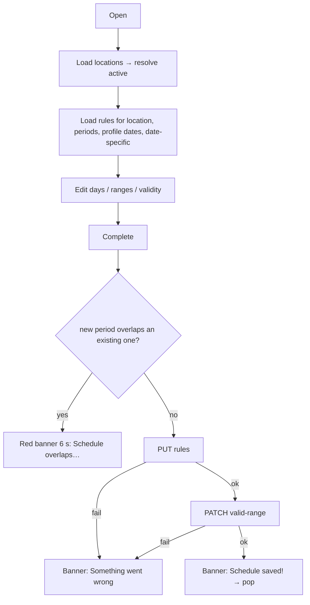

# Availability / working hours setup (weekly template + validity period)

| | |
|---|---|
| Area | 04 Calendar & schedule |
| Who sees it | Doctor only. Clinic staff: no access (schedules are per doctor profile). No tier gate. |
| Reached from | [04-calendar-empty-no-availability](04-calendar-empty-no-availability.md) "Go To Schedule"; (target) Profile → "Working hours"; first-run after registration (today registration goes straight to login — no onboarding step) |
| Screen type | Full screen pushed inside the Calendar tab (tab bar hidden), with a sticky bottom button |
| Current Flutter source | `lib/features/schedule/presentation/setup_schedule_screen.dart` (`ScheduleScreen`, `_LocationSelector`, `_NoLocationsHint`, `_DayCard`, `_SlotEditorInline`), `lib/state/schedule/schedule_controller.dart`, `lib/state/schedule/schedule_actions.dart` |
| Spec | `docs/kmp-spec/03-calendar-schedule.md` §2, §6 (GET/PUT `/api/schedule/rules`, PATCH `/api/schedule/valid-range`, GET `/api/schedule/validity-periods`); tickets SCHED-1, SCHED-2 |

## 1. Purpose
Define when patients can book: which weekdays, which hours, in what slot size, at which location, and for how long this template is valid. Once at setup, then every one or two months when the validity period runs out, and whenever hours change.

## 2. Entry points
- Calendar "Go To Schedule" card → pushed; on return the calendar reloads.
- Route `/create/schedule` (registered twice: root and shell). Nothing else navigates here today; the registration flow no longer ends here. Target: Profile → Working hours, and the first-run card.
- Opens on top of the calendar; back pops.

## 3. Layout, top to bottom (phone portrait)
1. **App bar:** back · title "Setup your Schedule" · action icon (pin) "Manage locations" → [13-locations-management](13-locations-management.md).
2. Intro line (centred, grey): "Select working days and define bookable time slots for your patients."
3. **Location selector** (grey box with pin icon): dropdown of location labels ("Main Clinic · ★" for the primary) + text button "Manage". Shown with one location too; with zero locations an amber hint "Add at least one practice location to organize your schedule." + "Add location". Switching location **reloads the whole screen** for that location's rules.
4. **Existing calendar periods** (only when any exist): chips "2026-09-01 – 2026-10-31"; note "A new period must not overlap any existing period."
5. **Validity:** label "Schedule valid from:" (or "New period from" when periods exist) → button with the start date or "Select Date"; label "Schedule valid until:" → button with the end date (default today + 60 days). Each opens the system date picker (start: today … end date; end: start … today + 365).
6. **"Expand schedule for specific dates"** collapsible section → [11-date-specific-hours](11-date-specific-hours.md).
7. **Seven day cards** Monday…Sunday (1 column on phone): checkbox + day name; when checked: overflow menu (Copy from previous day · Copy from another day) and an expand chevron. Expanded card shows the **inline range editor**: header "Monday slots"; per range a card with "Time Period" (`08:00 - 17:00`, edit icon), "Slot timeframe" (`30 minutes`, edit icon), "Remove"; "No slots yet" when empty; full-width secondary **Add**.
8. **Sticky bottom bar:** primary **Complete** (full width, spinner while saving).

Target structure (same data, fewer taps): location chips at the top; week overview (7 rows: "Mon 09:00–13:00, 14:00–18:00 · 30 min", "Sun Off") each opening a day editor sheet; validity as one "Valid until 23 Dec 2026" row; date-specific hours and days off as separate rows; sticky "Save".

## 4. Data and formats
| Field | Source | Format rule |
|---|---|---|
| Locations | GET `/api/doctors/me/locations` | active = last used (stored per doctor on the phone) → primary → first; the choice is stored back on the phone and also drives the shell's "active location" label |
| Rules | GET `/api/schedule/rules?locationId=` → `[{weekday 1..7, startTime "HH:mm", endTime "HH:mm", slotMinutes, locationId?}]` | a day is "enabled" when it has ≥ 1 range **or was ticked**; an enabled day with zero ranges is sent as nothing (silently off) |
| Weekday names | localised `monday…sunday`; Monday first | |
| Time display | `HH:mm` 24 h (the picker is forced to 24 h) | |
| Slot size | 10 · 15 · 20 · 30 · 45 · 60 min (bottom sheet) | per range |
| Validity | `scheduleValidFrom/Until` from `GET /api/doctors/me`; periods list from GET `/api/schedule/validity-periods` | shown `yyyy-MM-dd` (unlocalised) — target: localised long date |
| Save | PUT `/api/schedule/rules?locationId=` with the full array, then PATCH `/api/schedule/valid-range {validUntil, validFrom?}` | two calls, not atomic; any failure → generic error (the backend message is only logged) |
| Horizon | end date ≤ today + 365; default +60 days | this is the booking horizon patients and the doctor get |

### Time rules
- "Today" for the pickers is the practice-timezone date. Default end date uses the phone clock (bug 9) — target: practice TZ.
- Ranges are wall-clock in the practice timezone; they never cross midnight (end must be after start, same day). A night shift 22:00–02:00 needs two ranges on two days.
- Slot generation (backend): each range is cut into `slotMinutes` pieces from the start; a 09:00–10:15 range with 30-min slots yields 09:00, 09:30 and (UNVERIFIED) drops the 15-min remainder. There are **no buffers between slots** and no per-rule breaks — a gap is made by using two ranges.
- The weekly template applies to every date inside the validity period; dates outside have no slots (calendar shows the "Update schedule" card).
- DST: wall-clock rules → the backend generates slot instants per date; a 09:00 slot is 09:00 local all year.

## 5. Primary flow (happy path — first setup)
1. Open → full-screen spinner (target: skeleton of the header, location row, 7 day rows) → data arrives (locations, rules, periods, profile dates, date-specific rules: five requests).
2. Tick Monday → card expands → **Add** → time picker 08:00 → time picker 17:00 → duration sheet 30 min → range card appears.
3. Monday ⋮ → "Copy from previous day" (no-op on Monday) / Tuesday ⋮ → "Copy from previous day" → Tuesday gets Monday's ranges. Repeat or use "Copy from another day".
4. Set "Schedule valid until" (defaults to +60 days).
5. Tap **Complete** → client checks period overlap → spinner → PUT rules → PATCH range → banner "Schedule saved!" → screen pops → calendar reloads (within the 60 s throttle — bug).

## 6. Screen states
- **First load:** centred spinner today → target skeleton.
- **Empty (no rules):** all seven cards unticked; validity defaults; location row visible. Target: first-run hint "Tick the days you work, then add hours".
- **Empty (no locations):** amber hint + "Add location"; rules load without a location filter (global rules) — the doctor can still save; the backend treats them as the primary location (UNVERIFIED).
- **Error on load:** banner "Something went wrong" (or "Unauthorized…" / "Failed to load rules"); the form shows whatever loaded (possibly an empty template that would *overwrite* the real one on Complete — dangerous). Target: block Complete until rules loaded; show Retry.
- **Offline:** load fails as above; Complete fails with the generic banner.
- **Refreshing:** switching location or returning from Manage locations reloads everything (spinner replaces the form).
- **Partial data:** validity periods endpoint failing is swallowed (chips just absent); profile dates failing leaves defaults.
- **Permission needed:** n/a.
- **Locked by tier:** n/a.
- **Role difference:** doctors only.

## 7. Interactions and secondary flows
- **Tick a day** → enabled + expanded; untick → ranges removed from the state immediately (no confirm) — target: confirm when the day had ranges.
- **Expand chevron** → toggle editor (only when ticked).
- **Add** → start picker (default 08:00; cancel keeps 08:00!) → end picker (default 17:00; cancel keeps 17:00) → validation → duration sheet (default 30; cancel keeps 30) → range added. Cancelling any picker still adds a range with defaults — bug; target: cancel aborts.
- **Tap Time Period / Slot timeframe** → same three pickers prefilled → validation → range updated.
- **Remove** → range removed immediately.
- **⋮ Copy from previous day** → replaces this day's ranges with the previous weekday's; "Previous day has no schedule to copy." when empty; Monday has no previous (target: wrap to Sunday or hide).
- **⋮ Copy from another day** → simple dialog listing days that have ranges → replaces; "No other days have schedule to copy from." when none.
- **Location dropdown** → persist choice → full reload for that location (unsaved edits are lost without warning — target: dirty check).
- **Manage / pin icon** → locations screen; on return full reload.
- **Validity buttons** → date pickers with bounds in §3.
- **Complete** → save (see §5). Back → pops without saving and without a dirty check (target: ask).
- **System back** → same as back.

## 8. Edge cases
- **Overlapping ranges within a day** (09:00–12:00 and 11:00–15:00): rejected on add/edit: "This time overlaps an existing slot."
- **Touching ranges** (09:00–12:00 and 12:00–15:00): allowed (half-open check).
- **End before start:** "End time must be after start time."
- **Range shorter than the slot size** (09:00–09:20 with 30 min): accepted client-side; backend result UNVERIFIED (probably zero slots). Target: warn "No slot fits in this range".
- **Same hours every day:** copy menus; still 6 copies. Target: "Apply to Mon–Fri".
- **Day ticked but no ranges on Complete:** sent as off; after reload the tick disappears. Target: warn "Monday has no hours".
- **Seven days × 3 ranges = 21 cards:** the page is long; sticky Complete keeps save reachable.
- **Validity overlap with an existing period** (e.g. existing 1 Sep–31 Oct, new 15 Oct–15 Dec): blocked client-side with a long red banner naming the allowed dates. "Fully inside" an existing period is allowed (used for a second location).
- **End date before start date:** impossible via picker bounds; start picker max = end.
- **Start date cleared:** impossible (cannot clear once set — `copyWith(null)` bug); target: "No start (from today)" option.
- **Validity ending today:** allowed; tomorrow the calendar is empty.
- **Second location with different hours:** select it in the dropdown → its own rules; validity is **global** (one range for all locations) — the UI shows the same dates for both.
- **Deleting a location that has rules:** blocked by backend ("Schedule rules and appointments at this location must be removed first." — text in the locations screen).
- **Leaving mid-edit** (back, tab switch, deep link): all unsaved edits lost silently; the editor state is a global provider, so coming back may show stale edits mixed with reloaded data (bug 7).
- **Double tap Complete:** `_saving` guard.
- **PUT ok, PATCH fails:** rules saved, validity not; banner says "Something went wrong"; reopening shows the new rules with the old dates — confusing. Target: one backend call or explicit partial-success message.
- **401:** logout. **403 (staff):** cannot reach.
- **Rotation:** 2-column day grid above 720 dp content width (tablet); phones stay 1 column.
- **200 % font:** day card header row (checkbox, name, ⋮, chevron) stays on one line; range cards grow; validity Wrap breaks onto several lines; sticky button grows.
- **Language switch:** day names and labels re-render; the internal keys stay English.
- **Screen reader:** app bar → intro → location dropdown (value) → Manage → periods → validity buttons (values) → expand section → day cards (checkbox state, name, menu, expand) → ranges → Add → Complete.

## 9. Validation and messages
| Field/action | Rule | When checked | Message (English) | Where shown |
|---|---|---|---|---|
| Range | end > start | after both pickers | "End time must be after start time." | banner → target inline in the day editor |
| Range | no overlap with other ranges of the day | after both pickers | "This time overlaps an existing slot." | banner → inline |
| Validity | new period entirely before / after / inside each existing period | on Complete | "Schedule overlaps with existing schedule Existing schedule: {a} - {b}. New schedule must be entirely before (end by) or entirely after (start from) before {a}, or after {b+1}." | red banner 6 s → target inline under the dates |
| Start date | today … end date | picker bounds | — | picker |
| End date | start … today + 365 | picker bounds | — | picker |
| Location | at least one (soft) | on build | "Add at least one practice location to organize your schedule." | inline amber |
| Save | PUT + PATCH 2xx | on response | "Schedule saved!" / "Something went wrong" (target: backend message) | banner |
| Load | 200 | on open | "Unauthorized: please login again." / "Failed to load rules" / "Something went wrong" | banner |
| Copy | source has ranges | on tap | "Previous day has no schedule to copy." / "No other days have schedule to copy from." / "Schedule copied from previous day." / "Schedule copied from {day}." / "Failed to copy schedule from selected day." | banner |

## 10. Navigation out
- **Complete success →** pops to the calendar; calendar must force-refresh the selected day and the month (today throttled).
- **Back →** pops; unsaved edits discarded without asking (target: dirty dialog).
- **Manage locations →** [13](13-locations-management.md); on return reload (edits lost — target: keep).
- **Expand section →** stays on screen ([11](11-date-specific-hours.md) writes immediately).

## 11. Copy
- `setupYourSchedule` "Setup your Schedule"; `selectWorkingDaysAndDefineSlots`; `manageLocations` "Manage locations"; `selectLocation` "Select location"; `manage` "Manage"; `addFirstLocationHint`; `addLocation` "Add location"; `existingCalendarPeriods` "Existing calendar periods"; `newPeriodMustNotOverlap`; `scheduleValidFrom` "Schedule valid from:"; `scheduleValidFromNew` "New period from"; `scheduleValidUntil` "Schedule valid until:"; `selectDate` "Select Date"; `selectScheduleStartDate`; `selectScheduleEndDate`; `monday…sunday`; `daySlots` "slots"; `noSlotsYet` "No slots yet"; `timePeriod` "Time Period"; `slotTimeframe` "Slot timeframe"; `minutes` "minutes"; `remove` "Remove"; `add` "Add"; `copyFromPreviousDay`; `copyFromAnotherDay`; `copyScheduleFromDay` "Copy schedule from which day?"; `complete` "Complete"; `scheduleSaved` "Schedule saved!"; `somethingWentWrong`; `failedToLoadRules`; `unauthorizedPleaseLoginAgain`; `endTimeMustBeAfterStartTime`; `thisTimeOverlapsExistingSlot`; `scheduleOverlapsExisting`; `existingSchedule`; `newScheduleMustBeBeforeOrAfter`; `before`; `orAfter`.
- **NEW:** "Working hours" (title) · "Save" (instead of "Complete") · "Off" · "Apply to Mon–Fri" · "Valid until {date}" · "No start (from today)" · "Discard changes?" · "Monday has no hours yet" · "No slot fits in this range".

## 12. Known problems in the current app (do not carry over)
- Cancelling a time/duration picker still adds or edits the range with default values.
- No dirty check on back, location switch or Manage; editor state is global and can leak between locations.
- Two non-atomic save calls; backend error text discarded ("Something went wrong").
- A failed load leaves an empty template that Complete would push to the server.
- Validity dates shown as ISO; default end computed with the phone clock; start date cannot be cleared.
- Validity is global while rules are per location — the UI implies per-location periods.
- Title "Setup your Schedule" / button "Complete" read like onboarding although this is the everyday editor.
- Location row shown even with one location; "★" as the primary marker.
- 21-card page for a full week; copy functions buried in an overflow menu.

## 13. Open questions for design
- Week overview + per-day sheet vs seven expandable cards?
- Should lunch/breaks be an explicit "break" inside a day rather than two ranges?
- Validity: keep an explicit end date (forces doctors to renew every 60 days) or default to "no end" with the backend generating rolling slots? (Backend change — UNVERIFIED feasibility.)
- Where do "Days off / vacation" live — here or only in the calendar block dialog?
- Should slot size be per day/range (today) or one setting for the whole schedule with per-range override?
