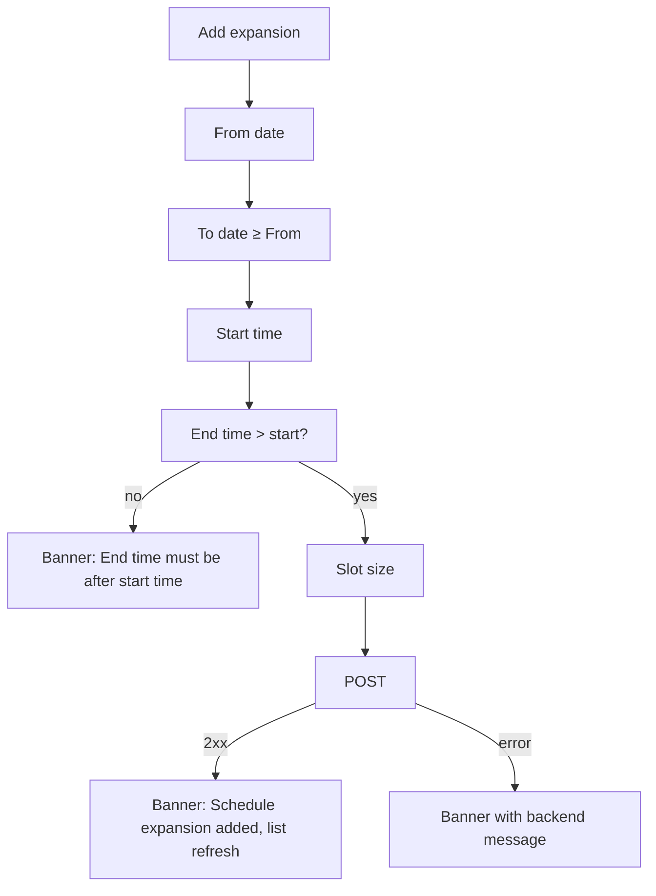

# Date-specific hours (per-date overrides: "expand schedule for specific dates")

| | |
|---|---|
| Area | 04 Calendar & schedule |
| Who sees it | Doctor only. No tier gate. |
| Reached from | [10-availability-setup](10-availability-setup.md) → collapsible section "Expand schedule for specific dates" |
| Screen type | Inline collapsible section + a chain of four system pickers (date, date, time, time) + duration sheet |
| Current Flutter source | `lib/features/schedule/presentation/setup_schedule_screen.dart` (`_ExpandScheduleSection`, `_addExpansion`, `_deleteDateSpecificRule`), `lib/state/schedule/schedule_actions.dart` (`fetchDateSpecificRules`, `createDateSpecificRule`, `deleteDateSpecificRule`) |
| Spec | `docs/kmp-spec/03-calendar-schedule.md` §2.2 "Expand schedule", §6 (GET/POST/DELETE `/api/schedule/date-specific`); ticket SCHED-2 |

## 1. Purpose
Add extra bookable hours on particular dates without touching the weekly template: a Saturday clinic next week, evening hours during a campaign, covering for a colleague. **Only additions** — these rules cannot shrink or override the weekly hours (the backend rejects overlaps; copy says so). Occasional use.

## 2. Entry points
- Schedule setup screen → tap the "Expand schedule for specific dates" header → section expands.
- Target: also from the calendar "Day off" empty state ("Add hours for this date") with the date prefilled ([04](04-calendar-empty-no-availability.md)).

## 3. Layout, top to bottom (phone portrait)
1. **Section header** (grey-100 container with teal border): date-range icon · "Expand schedule for specific dates" · chevron.
2. Expanded body:
   1. Hint: "Add extra hours after your existing schedule (e.g. 5PM–11PM). You cannot override already defined slots."
   2. Full-width secondary button **Add expansion** (+).
   3. Heading "Time Period" and a list of existing rules as cards: "2026-11-03 – 2026-11-03 · 17:00–21:00 (30 minutes)" with a red trash icon. Empty: "No date-specific expansions yet."

**Add flow (today)** = five modal pickers in a row, no summary screen: From date → To date → Start time (default 17:00) → End time (default start + 1 h) → Duration sheet (default 30) → saved immediately → banner "Schedule expansion added." → list refreshed.

Target: a small bottom sheet "Extra hours" with Date (or date range toggle), From/To time chips, slot size chips, location (inherits the selector), and **Add**. The list shows localised dates and groups past rules under "Past".

## 4. Data and formats
| Field | Source | Format rule |
|---|---|---|
| Rules | GET `/api/schedule/date-specific?locationId=` → `[{id, startDate, endDate "YYYY-MM-DD", startTime, endTime "HH:mm", slotMinutes, locationId?}]` | displayed raw ISO today; target localised "Mon 3 Nov · 17:00–21:00 · 30 min" |
| From/To date | pickers: today (practice TZ) … today + 365; To ≥ From, ≤ From + 365 | date-only, no timezone |
| Start/End time | 24 h pickers; end default = start + 1 h (23:59 cap) | `HH:mm` wall clock, practice TZ |
| Slot size | 10/15/20/30/45/60 | per rule |
| Location | current selector value | sent as `locationId` (nullable) |
| Create | POST immediately on the last picker | non-2xx → banner with the backend `message` (this endpoint *does* surface it) |
| Delete | DELETE `/api/schedule/date-specific/{id}` immediately on trash tap, no confirmation | errors → "Something went wrong" |

Time rules: dates and times are wall clock in the practice timezone; a rule spanning many dates repeats the same hours each date; it cannot cross midnight (end > start same day). Rules outside the validity period: accepted by the client; whether the backend generates slots there is UNVERIFIED. Overlap with weekly hours is rejected by the backend (message shown).

## 5. Primary flow (happy path)
1. Expand the section → list (maybe empty).
2. Add expansion → From = next Saturday → To = same → Start 09:00 → End 13:00 → 30 min.
3. POST → banner "Schedule expansion added." → card appears.
4. (Later) tap trash → gone immediately → list refreshed.

## 6. Screen states
- **First load:** loads with the whole setup screen (one of five requests). Collapsed by default.
- **Empty:** "No date-specific expansions yet."
- **Error on load:** load failure of this list is swallowed (empty list shown) — target: inline "Couldn't load" + Retry inside the section.
- **Offline:** list from the last load; Add fails with a banner; Delete fails with "Something went wrong".
- **Refreshing:** after add/delete the list is re-fetched (brief flash).
- **Partial data:** rule without `id` → trash disabled.
- **Permission needed:** n/a.
- **Locked by tier:** n/a.
- **Role difference:** n/a.

## 7. Interactions and secondary flows
- **Header tap** → expand/collapse (state local, not persisted).
- **Add expansion** → picker chain; cancelling any picker aborts (correct here, unlike the weekly editor).
- **Trash** → immediate delete; target: confirmation "Remove extra hours on {date}?".
- **Location selector change** (on the parent screen) → the list reloads for that location.

## 8. Edge cases
- **Overlaps the weekly template** (Monday 09:00–17:00 exists, add Monday 16:00–20:00): backend rejects; banner shows its message (text UNVERIFIED). Target: pre-check locally against the loaded weekly ranges and show "Starts inside your regular hours — start at 17:00 or later".
- **Overlaps another date-specific rule:** backend decides (UNVERIFIED).
- **Range of 365 days:** allowed; the list shows one card; the calendar shows the slots every day.
- **To before From:** picker bounds prevent; a second check shows an unlocalised banner ("To date must be on or after From date" built by concatenation).
- **Start 23:30:** end default 23:59; a 30-min slot does not fit → backend result UNVERIFIED.
- **Past rules:** stay in the list forever; target: group/hide.
- **Deleting while the calendar is open on that day:** calendar day is not invalidated (cache throttle) → target: invalidate affected days on save/delete.
- **Dates shown as ISO:** unreadable for Uzbek/Russian users; target localised.
- **Double tap Add:** two picker chains cannot run at once (modal); fine.
- **Network drop on POST:** banner; nothing added; retry by repeating the chain (annoying) → target: sheet keeps the values.
- **401:** logout.
- **Rotation:** pickers persist.
- **200 % font:** rule card text wraps to 3 lines; trash stays right.
- **Language switch:** labels re-render; dates stay ISO today.
- **Screen reader:** header (expanded/collapsed), hint, Add button, list rows ("3 November, 17:00 to 21:00, 30 minutes, delete button").

## 9. Validation and messages
| Field/action | Rule | When checked | Message (English) | Where shown |
|---|---|---|---|---|
| To date | ≥ From | picker bounds + after pick | "To date must be on or after From date" (concatenated, **NEW proper key**) | banner → inline |
| End time | > start | after pick | "End time must be after start time." | banner → inline |
| Create | 200/201 | on response | "Schedule expansion added." / backend message | banner |
| Delete | 200/204 | on response | — / "Something went wrong" | banner |
| (target) Overlap | not inside weekly hours | before POST | "Starts inside your regular hours" | inline |

## 10. Navigation out
- Stays on the setup screen. Changes are already saved (no relation to the Complete button — a doctor may add hours and then press back without "saving"; that is fine but not obvious). Calendar days touched must be invalidated.

## 11. Copy
- `expandScheduleForDates` "Expand schedule for specific dates"; `expandScheduleHint`; `addExpansion` "Add expansion"; `timePeriod` "Time Period"; `noDateSpecificRules` "No date-specific expansions yet."; `fromDate` "From date"; `toDate` "To date"; `minutes` "minutes"; `expansionAdded` "Schedule expansion added."; `endTimeMustBeAfterStartTime`; `somethingWentWrong`.
- **NEW:** "Extra hours" · "Add extra hours" · "Remove extra hours on {date}?" · "To date must be on or after the from date" · "Past" · "Starts inside your regular hours — start at {time} or later".

## 12. Known problems in the current app (do not carry over)
- Five consecutive modal pickers with no overview; a mistake at step 4 means starting over.
- Dates rendered as ISO strings; "5PM–11PM" in the hint while the app is 24 h.
- Delete without confirmation; list load errors hidden.
- Saved immediately while the surrounding screen has a big "Complete" button — mixed mental model.
- Calendar cache not invalidated after adding/removing hours.

## 13. Open questions for design
- Should this live inside the weekly editor at all, or be "Extra hours" under the calendar's day view (pick a date first)?
- Do we need multi-date ranges, or is "one date, repeat weekly until" enough?
