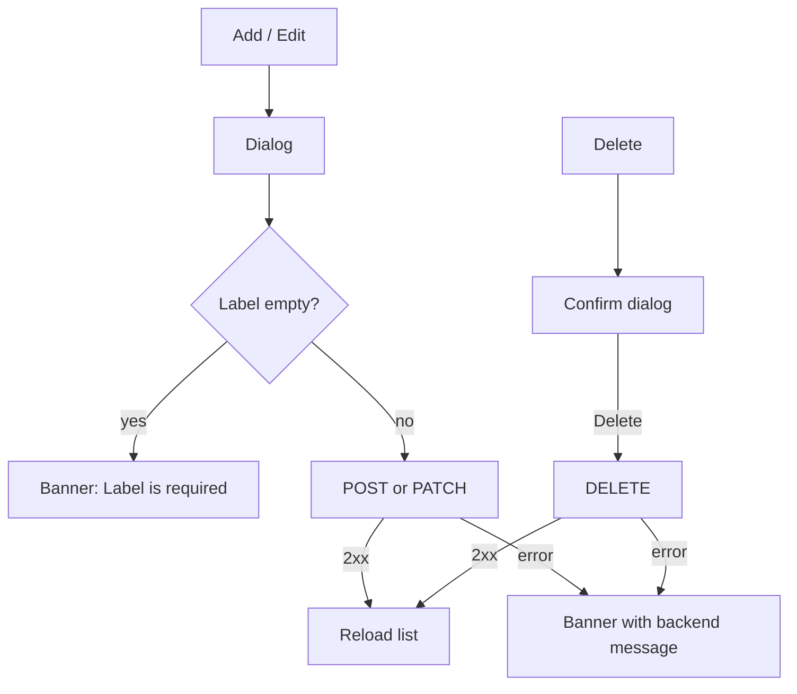

# Locations management (add / edit / delete / primary; video is not a location)

| | |
|---|---|
| Area | 04 Calendar & schedule (shared with 08 Profile for the map picker) |
| Who sees it | Doctor only. Clinic staff: no. No tier gate. |
| Reached from | [10-availability-setup](10-availability-setup.md) app-bar pin icon / "Manage" / "Add location"; (target) Profile → Locations |
| Screen type | Full screen (pushed with a plain page route, outside the shell's nested navigator — tab bar hidden) + editor dialog |
| Current Flutter source | `lib/features/schedule/presentation/doctor_locations_screen.dart` (`DoctorLocationsScreen`, `_LocationCard`, `_LocationEditorDialog`), `lib/state/locations/doctor_location_actions.dart`, `lib/state/locations/doctor_location_models.dart`; map: `lib/features/profile/presentation/location_picker_widget.dart` |
| Spec | `docs/kmp-spec/03-calendar-schedule.md` §3, §6 (GET/POST `/api/doctors/me/locations`, PATCH/DELETE `/api/doctors/me/locations/{id}`); tickets LOC-1, LOC-2 |

## 1. Purpose
Keep the list of places where the doctor sees patients. Each location can have its own weekly hours; the primary one is the default venue and the one patients see; the "active" location is what the shell header shows. Set up once; edited rarely. **Video is not a location** — it is a flag on the booking ("Video Call") and has no address or separate hours.

## 2. Entry points
- Schedule setup → pin icon in the app bar, "Manage" next to the selector, or "Add location" in the no-locations hint. Pushed full screen; on return the setup screen reloads.
- Shell header "active location" label reads the same list (no navigation from it).
- Target: Profile → "Locations" row (area 08) → same screen.

## 3. Layout, top to bottom (phone portrait)
1. **App bar:** back · "Manage locations".
2. **List** (16 dp padding, 12 dp gaps, pull-to-refresh): one card per location — label (16 pt semibold, ellipsis) + amber "Primary" badge; edit (pencil) and delete (red trash) icons on the right; under it up to three grey lines: clinic name · street address · "City, Region, Country".
3. **Empty:** centred grey "No locations yet. Tap "Add location" to create your first one."
4. **FAB extended:** "+ Add location" (bottom right).

**Editor dialog** (alert dialog, max width 420, scrollable):
1. Title "Add location" / "Edit location".
2. Text field **Label** (hint "e.g. Main Clinic").
3. Text field **Clinic**.
4. **Location picker section** (map with a pin, address search, structured address fields from reverse geocoding: country, region, district, city, postal code, street) — owned by area 08.
5. Switch **Set as primary**.
6. Actions: text **Cancel** · primary **Save**.

Target: a pushed form screen instead of a dialog (the map needs height), with Label, Clinic (optional), Address block (search field + map), "Primary location" switch, and a "Working hours at this location" link to the setup screen filtered by this location. Delete in the overflow menu with confirmation.

## 4. Data and formats
| Field | Source | Format rule |
|---|---|---|
| Location | `{id, label, clinic?, address?, latitude?, longitude?, locationCountry?, locationRegion?, locationDistrict?, locationCity?, locationPostalCode?, locationStreetAddress?, isPrimary}` | `address` is set to the street address on save; nulls omitted |
| Label | required, trimmed | card title; "★" marker in the setup dropdown — target: badge |
| Primary | boolean | one primary (backend enforces? UNVERIFIED — the client allows toggling on several) |
| Active | phone-stored `active_location_id:<doctorId>` | not shown on this screen; derived in the setup screen and shell |
| Errors | `{message|error}` from the body, else status text | shown raw in a bottom SnackBar (target: banner) |

Time rules: none directly; a location's timezone is **not** a field — all locations share the doctor's practice timezone. A doctor practising in two timezones is not supported (open question).

## 5. Primary flow (happy path — add a second clinic)
1. Open → spinner (target skeleton of 2 cards) → list with "Main Clinic · Primary".
2. FAB → dialog → Label "Evening Clinic", Clinic "Shifa Med", pick the pin on the map → address fields fill → Save.
3. POST → list reloads → two cards.
4. Back → setup screen reloads; the selector now lists both; pick "Evening Clinic" → define its own hours ([10](10-availability-setup.md)).

## 6. Screen states
- **First load:** spinner → target skeleton.
- **Empty:** text + FAB (no illustration). Target: illustration + "Add your first location" primary button in the body.
- **Error on load:** SnackBar with the message; body stays on the spinner's replacement (empty state) — misleading. Target: error state + Retry.
- **Offline:** load error; Save/Delete errors.
- **Refreshing:** pull-to-refresh (exists); list replaced.
- **Partial data:** location without address → card shows only the label; map opens on a default position.
- **Permission needed:** **Location permission** when the map picker uses "my position" (area 08 decides); denied permanently → address search still works.
- **Locked by tier:** n/a.
- **Role difference:** n/a.

## 7. Interactions and secondary flows
- **FAB** → add dialog. **Pencil** → edit dialog prefilled. **Trash** → confirm dialog "Delete location" / "Delete "Evening Clinic"? Schedule rules and appointments at this location must be removed first." (Cancel · Delete red) → DELETE → reload.
- **Save** → label check → request → reload; dialog closed before the request (errors appear over the list).
- **Cancel / back on the dialog** → discards (no dirty check; the map input is the expensive part — target: ask).
- **Pull-to-refresh** → reload.
- **Map pin / search** → area 08 flows.

## 8. Edge cases
- **Deleting the primary / the active / a location with rules or appointments:** backend 4xx with a message (text UNVERIFIED) shown raw. After deleting the active location the setup screen falls back to primary/first silently.
- **Two primaries:** the client lets you switch "Set as primary" on a second location; the backend may demote the first or reject — UNVERIFIED; the list may show two badges until reload.
- **Label duplicates:** allowed.
- **Very long label / address:** label 1 line ellipsis; address lines wrap.
- **No coordinates (search failed):** saved with address text only; map pin absent next time (spec bug 11: pin lost when reverse geocoding fails).
- **20 locations:** plain list; fine.
- **Slow network on Save:** dialog already closed; no progress indicator until the list reloads → target: keep the form open with a spinner.
- **Double tap Save:** dialog closes on the first tap; second tap impossible.
- **Network drop:** banner; list unchanged.
- **401:** logout.
- **Deep link while open:** screen is outside the shell navigator; a push deep link re-pushes the shell and this screen is lost (unsaved dialog input lost).
- **Rotation:** dialog persists; the map resizes.
- **200 % font:** dialog scrolls; card icons stay right; FAB label may wrap → use icon-only FAB at large text.
- **Language switch:** labels re-render; address text stays as geocoded.
- **Screen reader:** app bar → list cards (label, primary, clinic, address, edit button, delete button) → FAB.

## 9. Validation and messages
| Field/action | Rule | When checked | Message (English) | Where shown |
|---|---|---|---|---|
| Label | non-empty after trim | on Save | "Label is required" | top banner (today SnackBar) → target inline under the field |
| Delete | confirm | dialog | "Delete "{label}"? Schedule rules and appointments at this location must be removed first." | dialog |
| Request | 2xx | on response | backend `message`/`error` or "Request failed: {status}" | banner |
| (target) Address | street or coordinates present | on Save | "Add an address so patients can find you" (soft) | inline |

## 10. Navigation out
- **Back →** setup screen, which reloads locations and rules (and loses unsaved weekly edits — see [10](10-availability-setup.md) §12).
- Dialog Save/Cancel → stays on the list.

## 11. Copy
- `manageLocations` "Manage locations"; `addLocation` "Add location"; `editLocation` "Edit location"; `noLocationsYet`; `primary` "Primary"; `label` "Label"; `exampleMainClinic` "e.g. Main Clinic"; `clinic` "Clinic"; `setAsPrimary` "Set as primary"; `labelRequired` "Label is required"; `deleteLocation` "Delete location"; `deleteLocationConfirm`; `delete` "Delete"; `cancel` "Cancel"; `save` "Save".
- **NEW:** "Locations" (profile row) · "Add your first location" · "Working hours at this location" · "Primary location" · "Address" · "Add an address so patients can find you".

## 12. Known problems in the current app (do not carry over)
- The editor is an alert dialog hosting a full map — cramped, no dirty check, closes before the request so errors float over the list.
- "★" marker in the schedule dropdown; raw backend errors in SnackBars.
- Two local copies of the list (this screen and the setup screen) plus a third fetch in the shell for the header label — three sources that drift.
- Delete allowed on the primary/active location with only a backend message to explain.
- No link between a location and its hours from this screen.

## 13. Open questions for design
- Pushed form vs dialog; map inline vs "Pick on map" sub-screen?
- Should the primary location be set from the list (overflow "Make primary") rather than a switch inside the editor?
- Do we need a timezone per location (doctor with clinics in two zones)? Today: no.
- Should "Video consultations" appear in this list as a pseudo-location (toggle on/off, price) so doctors understand where video "lives"?
