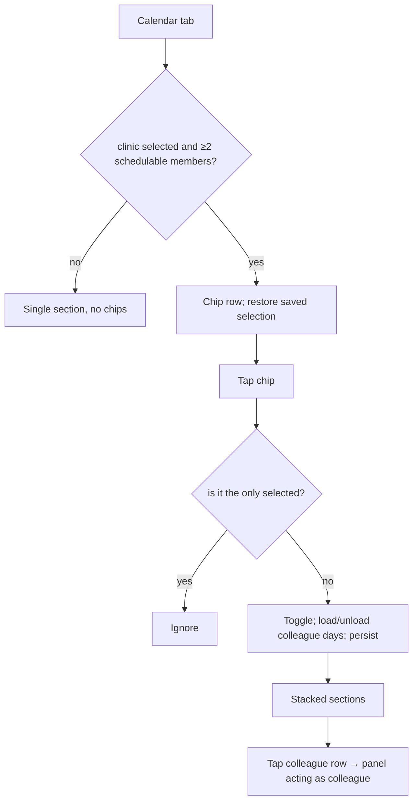

# Staff calendars (multi-doctor view) and the clinic doctor schedule screen (book on behalf)

| | |
|---|---|
| Area | 04 Calendar & schedule (entry points owned by 09 Clinic workspace) |
| Who sees it | **A.** Doctor who is a clinic member with ≥ 2 schedulable colleagues (roles DOCTOR / OWNER): chip row inside the Calendar tab. **B.** Clinic staff (receptionist, clinic admin, owner) and doctors: full-screen "clinic doctor schedule" for one colleague, opened from the Clinic workspace members list. No tier gate. |
| Reached from | A: automatic in [01-calendar-tab](01-calendar-tab.md). B: Clinic workspace → Doctors tab → member row → schedule; Patients screen "back to Dr X's schedule" return path |
| Screen type | A: chip row + stacked sections in the tab. B: full-screen modal route |
| Current Flutter source | `lib/features/calendar/presentation/calendar_screen.dart` (`_buildStaffDoctorBar`, `_toggleStaffDoctor`, `_loadStaffDoctorDay`, `_slotPanelClinicContext`), `lib/features/calendar/domain/calendar_staff_colors.dart`, `lib/features/clinic/presentation/clinic_doctor_schedule_page.dart`, `clinic_schedule_return_info.dart`, `clinic_workspace_screen.dart` (`pushClinicDoctorScheduleForMember`) |
| Spec | `docs/kmp-spec/03-calendar-schedule.md` §1.12, §4.1; ticket CAL-10 (and CLINIC-09 in doc 09) |

## 1. Purpose
A. Let a clinic doctor glance at colleagues' days next to their own (who is free to take a walk-in, when the shared room is busy) and book/unblock on their behalf.
B. Let the front desk run a doctor's calendar: see the day, book patients, move and cancel appointments, remove blocks — in the **clinic's** timezone. Daily for receptionists.

## 2. Entry points
- **A.** Calendar tab, when `selectedClinic` is set and its member list (fetched once per clinic) has ≥ 2 members with role DOCTOR or OWNER. The selection (which colleagues are visible) is restored from the phone per doctor + clinic.
- **B.** Clinic workspace → member → "schedule" → full-screen modal (slides up) with an **isolated calendar cache** for that doctor, clinic TZ, clinic street as venue label. Also re-opened automatically when the user comes back from a patient profile that was opened from it ("return info").
- B is not reachable from the Calendar tab; entering the Calendar tab resets any "acting as" state.

## 3. Layout, top to bottom (phone portrait)
**A. Staff chip row** (above the agenda, after the month card):
1. Caption "Staff calendars" (12 pt grey).
2. Wrap of filter chips, one per schedulable member, sorted by display name: 16 dp coloured dot avatar (check mark inside when selected) + name ("My schedule" for self). Selected = tinted background in the member's colour + coloured border; unselected = grey border.
3. Below: **one section per visible doctor**, stacked vertically: header row (10 dp colour dot + name in that colour, bold 14) then that doctor's agenda list (same rows as [02](02-day-agenda-item.md); the "+" icon and selection use the doctor's colour). Own section first, then by id.

**B. Clinic doctor schedule screen:**
1. App bar: back · doctor's display name.
2. Doctor hint block: name (grey, semibold) + "Book and manage this doctor's appointments. Times use this clinic timezone."
3. Header row: "Calendar" + date label; spinner; Filter icon (2 options: Show Appointments / Show Free Slots — no blocked toggle). No Block button.
4. Compact month picker (occupancy shading from the isolated cache; "Update schedule" card disabled).
5. Agenda list (fills the rest; not embedded in a page scroll — the month does not scroll away).
6. Tapping a row replaces the body with the slot/appointment panel (same as the doctor's), in colleague context.

## 4. Data and formats
| Field | Source | Format rule |
|---|---|---|
| Roster | `clinicMembersProvider(clinicId)` filtered to `DOCTOR`/`OWNER`, sorted by name (case-insensitive) | receptionists/nurses/admins are not calendars |
| Colour | index of the doctor's profile id in the sorted roster → 8-colour palette; fallback id mod 8 | only applied when roster ≥ 2 |
| Visibility | `Set<doctorProfileId>`; own id always present; cannot deselect the last one | persisted key `calendar_visible_staff_v1:<doctorId>:<clinicId>` |
| Colleague days | GET `/api/calendar?day=&doctorId=` per visible colleague per visible day — **read-only preview, not cached in the provider** (kept in widget memory, lost on tab switch) | failures are logged, section stays empty |
| Timezone | own section: practice TZ; colleague sections and screen B: `selectedClinic.timeZone` (fallback practice TZ / UTC) | two sections on the same screen may use **different timezones** when the doctor's practice TZ ≠ clinic TZ |
| Booking for a colleague | POST `/api/schedule/book` + `resourceDoctorId` | venue label = clinic address |
| Blocks for a colleague | POST blocks + `resourceDoctorId`; DELETE + `?doctorId=`; count + `doctorId` | only Remove is reachable in B; create is own-calendar only |
| Cancel / change for a colleague | DELETE / PUT without a doctor id | backend infers from the appointment (UNVERIFIED authorisation for staff) |
| Screen B cache | separate controller instance with `resourceDoctorId`; always force-refreshes on day change | 60 s throttle bypassed |

### Time rules
- Colleague times are shown in the **clinic** timezone; "today" for screen B is the clinic date. The timezone-mismatch banner is **not** shown in B (only the static hint). Target: show the mismatch banner in B comparing phone TZ vs clinic TZ.
- In A, when practice TZ ≠ clinic TZ, the own section (practice TZ) and colleague sections (clinic TZ) disagree about what "09:00" means — a real risk for doctors who set a wrong practice TZ. Target: one timezone for the whole screen (clinic TZ when a clinic is selected, with the banner naming it).
- Past-day guard, video window etc. use the section's timezone.

## 5. Primary flow (happy path — receptionist books for Dr Aliyev)
1. Clinic workspace → Doctors → Dr Aliyev → schedule → modal opens on today (clinic TZ), spinner → agenda.
2. Tap a free slot → booking panel ([06](06-book-appointment.md)) with "Dr Aliyev" context; assign patient; Save → POST with `resourceDoctorId` → day force-refreshed → panel closes → banner.
3. Back → clinic workspace.

A: doctor opens Calendar → chips "My schedule ✓", "Dr Aliyev", "Dr Karimova" → taps Dr Aliyev → his section loads under hers → she taps his free slot and books on his behalf.

## 6. Screen states
- **First load (A):** chips appear once the member list arrives (may pop in after the agenda); colleague sections show the shared spinner. Target: skeleton per section; chips skeleton.
- **First load (B):** app bar + hint immediately; month + agenda skeleton; forced fetch.
- **Empty:** colleague has no entries → "No items for this day" in their section; B: same (never the "Update schedule" card).
- **Error on load:** colleague day failure is silent (empty section) → target: inline "Couldn't load Dr X's day · Retry". B: SnackBar with the raw error → target banner + Retry.
- **Offline:** own cached day shows; colleague sections empty (not cached across tab switches); B: nothing (always force-refresh) → target: show last data with a stale banner.
- **Refreshing:** one spinner in the header for all sections; sections update independently as responses land.
- **Partial data:** member list failed → chips hidden, own calendar only (silent reset of the selection).
- **Permission needed:** n/a.
- **Locked by tier:** n/a (clinic features are role-gated server-side).
- **Role difference:** A exists only for doctors (members with a doctor profile). B is the only calendar clinic staff ever see; staff cannot create blocks, cannot open the doctor's schedule setup, cannot change "whose" calendar from inside B (one doctor per screen).

## 7. Interactions and secondary flows
- **Tap chip** → toggle; if deselecting the colleague whose entry is open, the panel closes; all visible days reload; selection persisted.
- **Tap own chip when it is the only one** → nothing (no feedback) → target: light haptic + tooltip "At least one calendar".
- **Tap colleague row** → panel in colleague context (name shown? — today the panel does **not** show whose calendar it is; target: subtitle "Dr Aliyev's calendar").
- **B: Filter** → two toggles, Apply refetches.
- **B: date label** (tablet only) → date picker 2020–2030.
- **B: patient name / Open Summary** → closes the modal, opens the patient in the shell; the patient screen's back re-opens B on the same doctor (return info).
- **B: back / swipe down** → closes; no dirty check beyond the panel's own.
- **Deep link (push) while B is open** → shell re-pushed over it; B is lost.

## 8. Edge cases
- **Roster of 8+ doctors:** chips wrap to several rows; 8 colours then repeat; sections stack into a very long page (each section up to 72 rows). Target: horizontal chip scroll + collapse sections to a summary ("Dr X · 3 free · 5 booked") with expand.
- **Colleague removed from the clinic while selected:** restore filters invalid ids; the current session keeps the stale section until reload.
- **Clinic switched (selected clinic changes):** selection restored for the new clinic; previous colleague data dropped.
- **Doctor belongs to two clinics:** only the selected clinic's roster is shown.
- **Same patient appears in two doctors' sections at the same time:** no cross-check.
- **Two doctors' sections, different timezones (see §4):** 09:00 in one is not 09:00 in the other; nothing flags it.
- **Booking for a colleague when his schedule has no slots:** his section says "No items for this day" with no action (the setup is his).
- **Colleague's slot taken meanwhile (409):** the booking error path force-refreshes the *own* cache day, not the colleague's widget cache → the stale slot stays visible until the panel's "saved" callback reloads the colleague's visible days (it does on success only). Target: refresh the colleague's day on error too.
- **B opened for a doctor with no rules yet:** empty every day; staff cannot fix it → copy must say "Dr X has not set up working hours".
- **B: receptionist cancels an appointment:** server authorisation UNVERIFIED; 403 shows a banner (staff are not logged out by 403).
- **B: today's date differs between phone and clinic:** the initial day is the clinic's today; no banner explains it.
- **Very long doctor name:** chip label single line (chip grows); app bar title ellipsis; hint 2 lines.
- **Slow network, 3 doctors × 1 day:** 1 + 2 requests; on tablet with 7 days: 21 requests per toggle.
- **401 mid-flow:** logout (modal and shell torn down).
- **Rotation:** A: tablet breakpoint may switch to grids side by side (not designed for phone). B: same.
- **200 % font:** chips wrap more; section headers wrap; B hint block 3–4 lines.
- **Language switch:** "My schedule", "Staff calendars", hint re-render; colleague names unchanged.
- **Screen reader:** chip row as a group ("Staff calendars, Dr Aliyev, selected"); section headers as headings; B: app bar title, hint, then calendar.

## 9. Validation and messages
| Field/action | Rule | When checked | Message (English) | Where shown |
|---|---|---|---|---|
| Deselect | at least one calendar stays visible | on tap | — (silent) → **NEW** "At least one calendar must stay visible" | tooltip/banner |
| Colleague day load | 200 | on response | — (silent) → **NEW** "Couldn't load Dr {name}'s day" + Retry | inline in section |
| B day load | 200 | on response | raw error → target "Couldn't load this day" + Retry | banner |
| Book on behalf | see [06](06-book-appointment.md) §9 | | | |
| Remove block on behalf | confirm | dialog | "Remove this block? Free slots will become available again." | dialog |

## 10. Navigation out
- **A:** colleague row → panel; "saved" callback reloads that colleague's days and closes the panel. Tab switch keeps the selection but drops colleague data (reloaded on return).
- **B:** back → clinic workspace (nothing to refresh there except finance after a booking — handled by the invalidation hub). Patient navigation → shell Patients tab with a return path back to B.

## 11. Copy
- `calendarStaffCalendars` "Staff calendars"; `mySchedule` (**no English — add "My schedule"**); `clinicSchedulePreviewHint` "Book and manage this doctor's appointments. Times use this clinic timezone."; `calendar` (**no English — "Calendar"**); `filter`, `showAppointments`, `showFreeSlots`, `apply`, `cancel`; `noItemsForThisDay`.
- **NEW:** "Dr {name}'s calendar" (panel subtitle) · "At least one calendar must stay visible" · "Couldn't load Dr {name}'s day" · "{name} has not set up working hours" · "Show all / Hide" (section collapse) · "{n} free · {m} booked" (collapsed summary).

## 12. Known problems in the current app (do not carry over)
- Colleague data lives in widget memory: lost on every tab switch, refetched on return; one spinner and one selection shared by all sections.
- Own and colleague sections can use different timezones on the same screen.
- The booking/preview panel never says whose calendar it acts on.
- Block button in the doctor's calendar always blocks the **own** calendar even while looking at a colleague; staff cannot block at all.
- B always force-refreshes (no cache, no offline), shows raw errors, and has a filter that refetches.
- Deselect-last is silently ignored; colleague load failures are silent.
- Tablet stacks full grids (max height 420 each) — not a phone concern but not designed.

## 13. Open questions for design
- Chips + stacked sections (today) vs a doctor **switcher** (segmented / dropdown showing one calendar at a time) on phone? Stacked sections do not scale beyond 2–3 doctors.
- Should A and B be the same screen (Calendar tab with a "Viewing: Dr X" switcher) instead of two implementations?
- Should staff be allowed to create blocks for a doctor (needs the "whose calendar" step)?
- Colour per doctor: 8-colour palette by roster order (changes when a member joins) vs a colour stored on the member?
