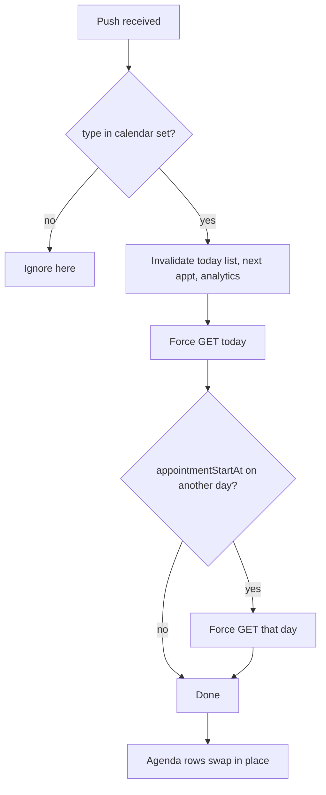

# Pull-to-refresh and live updates behaviour (calendar data freshness)

| | |
|---|---|
| Area | 04 Calendar & schedule |
| Who sees it | Doctor (Calendar tab, Home today list) and Clinic staff (clinic doctor schedule). No tier gate. |
| Reached from | Behaviour layered on [01-calendar-tab](01-calendar-tab.md), [14-staff-calendar-switcher](14-staff-calendar-switcher.md) and every mutation sheet in this folder |
| Screen type | Cross-cutting behaviour (no own screen) |
| Current Flutter source | `lib/state/calendar/calendar_controller.dart` (throttle, `loadDay`, `loadMonth`), `lib/state/appointments/appointment_invalidation.dart` (`invalidateAppointmentRelatedProviders`, `refreshCalendarFromPushPayload`, `appointmentCalendarPushTypes`), `calendar_screen.dart` (`didChangeAppLifecycleState`, shell/profile listeners), `lib/features/appointments/application/today_appointments_provider.dart` |
| Spec | `docs/kmp-spec/03-calendar-schedule.md` §1.2 "Reload triggers", §5 invalidation graph, §9 item 4; tickets CAL-2, CAL-9; 00-README "Real time: REST polling, same intervals, pause in background" |

## 1. Purpose
Make sure the calendar the doctor looks at is the calendar patients are booking into — without hammering the backend (429 rate limits were the reason for the throttle). Defines when data refreshes by itself, when the doctor must pull, and what the screen does while it happens.

## 2. Entry points (refresh triggers today)
| Trigger | What refreshes | Throttle |
|---|---|---|
| Profile loaded / Calendar tab opened | selected day (+ visible colleagues) + month prefetch | per-day 60 s cache |
| Shell tab switched **to** Calendar | same | 60 s |
| App resumed from background while on Calendar | selected day | ≥ 5 s since last refresh **and** 60 s cache |
| Day tapped | that day | 60 s (cached days render instantly, no refetch) |
| Month swiped | uncached days of that month, batches of 4 | only uncached |
| Filter Apply | selected day | forced (unnecessary) |
| Staff chip toggled / day-count changed (tablet) | visible days for all visible doctors | 60 s |
| Any mutation (book, cancel, change, adjust, block, unblock) | affected day(s) forced by the controller **+** today forced by the invalidation hub **+** the panel's "saved" callback → 2–3 identical GETs | forced |
| Push notification received (foreground) with type in `APPOINTMENT_BOOKED_BY_PATIENT`, `APPOINTMENT_CANCELLED_BY_PATIENT`, `APPOINTMENT_CANCELLED`, `APPOINTMENT_CHANGED`, `APPOINTMENT_RESCHEDULED_BY_PATIENT`, `APPOINTMENT_ASSIGNED`, `APPOINTMENT_PAID_BY_PATIENT` | today (practice TZ) forced + the day of `appointmentStartAt` if different; Home today/next, analytics invalidated | forced |
| Push tapped (go-to) | target day forced; appointment selected | forced |
| Visit ended elsewhere (area 05) | today forced via the hub | forced |
| Login / logout / account switch | whole cache cleared | — |
| Pull-to-refresh | **does not exist** on the calendar (exists on the locations list) | — |
| Periodic polling | **none** for the calendar (chat polls 5 s, unread 10 s; not calendar) | — |

Push only arrives on web builds today (Firebase is web-only in Flutter); on the KMP app it will work on Android/iOS, so push-driven refresh becomes the main live-update path.

## 3. Layout, top to bottom (phone portrait)
No own layout. Visible artefacts:
1. **Header spinner** (18 dp, next to the Block/Filter buttons) while any day is loading.
2. **Agenda spinner** replaces the list while loading (even when cached data exists for that day — the list shows the spinner whenever `_loadingDay` is true). Target: keep content, show a thin progress line under the header; skeleton only when the day has never been loaded.
3. **Month cells** gain shading progressively as the prefetch lands (no spinner).
4. Target: **pull-to-refresh indicator** at the top of the page scroll (standard platform indicator), active on the tab root and in the clinic doctor schedule.
5. Target: **"Updated" banner** when a push changes the day being looked at: "Schedule updated — Anna Karimova booked 10:30" with the row highlighted for 2 s.

## 4. Data and formats
| Item | Value | Note |
|---|---|---|
| Per-day cache throttle | 60 s | same day not refetched unless forced |
| Resume gate | 5 s | plus the 60 s cache → in practice resume refreshes only if the last fetch is > 60 s old |
| Month prefetch | all uncached days of the month, 4 parallel requests per batch, sequential batches | 31 requests for a fresh month |
| Mutation refresh | forced | 2–3× duplicated today → target exactly 1 GET per affected day (CAL-2) |
| Push refresh | today + appointment day | target: also the day currently selected if different, and colleague caches when `doctorId` matches |
| Next-appointment lookahead (Home) | up to 14 sequential day fetches on a cold cache | target: lazy, stop at first hit |
| Quick-book scan | up to 30 sequential day fetches | target: same lazy scan with one spinner |
| Scribe/notes polling in the preview | 4 s × 30 ticks | area 05 |
| Background | lifecycle: no refresh while backgrounded; on resume see above | target: pause all timers in background |

Time rules: "today" for all automatic refreshes is the practice-timezone date (clinic staff: `/api/me/profile` timezone; clinic TZ for the clinic schedule screen). A push received at 23:58 practice time for an appointment tomorrow refreshes today and tomorrow. The resume gate uses the practice clock too (harmless).

## 5. Primary flow (happy path — patient books while the doctor is looking)
1. Doctor is on today's agenda.
2. Patient books 10:30 from the patient app → backend pushes `APPOINTMENT_BOOKED_BY_PATIENT` with `appointmentStartAt`.
3. App (foreground) receives it → forced GET for today (and the start day if different) → the 10:30 free-slot row becomes an appointment row in place; Home today list and analytics invalidated.
4. Target: banner "Schedule updated" + 2 s highlight on the new row; no scroll jump.

## 6. Screen states
- **First load:** skeleton (target) / spinner (today).
- **Empty:** n/a.
- **Error on refresh (background/push):** silent today (logged). Target: silent for background refresh when cached data exists; banner with Retry for a user-initiated pull.
- **Offline:** cached days render; automatic refresh attempts fail silently; pull-to-refresh shows "No connection" banner; the age of the data is not shown (target: "Updated 12 min ago" caption under the header when > 5 min).
- **Refreshing:** header spinner; **content must not disappear** (today it does: the agenda shows a spinner during every reload, including the 2–3 post-mutation refetches → visible flicker after each booking).
- **Partial data:** one of several parallel day requests failing → that day keeps old data or becomes an error row; others update.
- **Permission needed:** notifications permission affects push-driven refresh only; when denied the calendar still refreshes on resume/tab/pull. Target: no prompt from the calendar itself.
- **Locked by tier:** n/a.
- **Role difference:** clinic staff: the clinic schedule screen force-refreshes on every day change (no cache); push types are the same but the payload's doctor may not be the one on screen — today the staff screen ignores push entirely (isolated cache). Target: refresh when `doctorId` matches.

## 7. Interactions and secondary flows
- **Pull down on the tab root** (target) → force-refresh the selected day for all visible doctors + re-prefetch the visible month's uncached days; indicator until the selected day returns.
- **Tap a day already cached** → instant; a background refresh happens only if the cache is older than 60 s (target: show stale content immediately, refresh silently, swap in place).
- **Return from a sheet after a mutation** → one forced GET per affected day; the agenda updates in place; the mutated row is highlighted (target).
- **Resume app** → silent refresh of the selected day if stale.
- **Receive push while a sheet is open** → data under the sheet updates; the sheet reads the live entry (preview) or recomputes options (booking). If the item the sheet is about disappears: banner "This appointment was moved or cancelled" and the sheet closes (target).

## 8. Edge cases
- **Two mutations in quick succession (book, then cancel):** each triggers forced refreshes; responses may land out of order; last response wins → could show stale state for one cycle. Target: sequence/ignore stale responses per day.
- **Push for today arriving at 00:00 practice time** (day rollover while the app is open): "today" is recomputed per call; the selected day stays yesterday until the user acts. Target: when the practice date changes while the tab is visible, move the "today" marker and offer "Jump to today".
- **Rate limit (429):** today's reason for the throttle; a burst of pushes (patient books 5 slots) → 5 forced refreshes of the same day. Target: coalesce refreshes within 1 s.
- **Phone clock wrong:** throttle timestamps use the phone clock (fine); practice "today" uses the server-side TZ with the phone's instant — a wrong phone clock shifts "today". Nothing to design; note for support.
- **Month prefetch while the user swipes three months quickly:** up to ~90 requests queued in batches; the swipe stays responsive; shading of earlier months arrives late. Target: cancel prefetch for months no longer visible.
- **Day currently loading when the user taps another day:** both finish; the agenda shows whichever is selected when data arrives; spinner may linger. Target: per-day loading state.
- **Mutation succeeded but the refresh failed (network drop right after POST):** the sheet closes (success path) but the agenda still shows the old state → confusing. Target: keep an optimistic local update until the next successful refresh, plus a banner "Saved · couldn't refresh the view".
- **Quick-book scanning 30 days on a slow network:** up to 30 × latency with the agenda flickering per day. Target: one scanning state "Looking for the next free slot…" with cancel.
- **Colleague sections:** push does not refresh them; pull-to-refresh must.
- **Deep link while refreshing:** the go-to flow forces its own day load; fine.
- **401 during a background refresh:** global logout even though the user did nothing — acceptable per app rules; avoid refreshing from the background state itself.
- **Rotation / language switch:** no refresh triggered (good).
- **200 % font / screen reader:** the thin progress line must have an accessible label "Refreshing"; pull-to-refresh needs an alternative (a "Refresh" action in the overflow / header) for switch-control users.

## 9. Validation and messages
| Field/action | Rule | When checked | Message (English) | Where shown |
|---|---|---|---|---|
| Pull-to-refresh | network ok | on response | **NEW** "Couldn't refresh. Check your connection." + Retry | top banner |
| Background refresh failure | — | — | silent | — |
| Push-driven change on the visible day | — | on refresh | **NEW** "Schedule updated" (optionally "· {patient} booked {time}") | top banner, auto-dismiss 3 s |
| Stale data | last successful fetch > 5 min | on build | **NEW** "Updated {n} min ago" | caption under header |
| Open item disappeared | id missing after refresh | on refresh | **NEW** "This appointment was moved or cancelled" | banner; sheet closes |

## 10. Navigation out
n/a (behaviour). Every mutation sheet in this folder ends with: one forced day refresh, Home today/next invalidated, analytics invalidated, clinic finance refreshed when a clinic is selected.

## 11. Copy
- No existing keys beyond `failedToLoad` "Failed to load" and `retry` "Retry".
- **NEW:** "Couldn't refresh. Check your connection." · "Schedule updated" · "{patient} booked {time}" · "Updated {n} min ago" · "This appointment was moved or cancelled" · "Looking for the next free slot…" · "Jump to today" · "Saved · couldn't refresh the view" · "Refreshing" (a11y label).

## 12. Known problems in the current app (do not carry over)
- No pull-to-refresh and no periodic refresh; freshness depends on tab switches, resume and (web-only) push.
- Every reload replaces the agenda with a spinner, and each mutation triggers 2–3 duplicate fetches → visible flicker after booking.
- Resume gate (5 s) is effectively overridden by the 60 s cache; filter Apply forces a pointless fetch.
- Month prefetch fires 31 requests per new month with no cancellation; quick-book and next-appointment scans are sequential loops with spinner flicker.
- Push refresh never reaches colleague sections or the staff schedule screen; failures are silent everywhere.
- No "last updated" information when offline.

## 13. Open questions for design
- Periodic polling for the calendar (e.g. 30 s while the tab is visible) in addition to push, or push + pull only?
- How loud should a push-driven change be: silent swap, brief highlight, or banner with the patient name (HIPAA: the banner may appear on a lock-screen-adjacent surface — keep names out of system notifications, fine inside the app)?
- Show "Updated n min ago" always or only when stale/offline?
