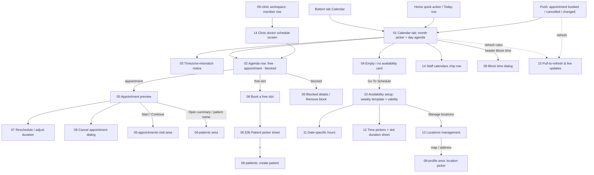

# 04 · Calendar & schedule — flow map and area rules

Spec: [`docs/kmp-spec/03-calendar-schedule.md`](../../kmp-spec/03-calendar-schedule.md). Conventions: [`../00-README.md`](../00-README.md).
Every file below follows [`../_TEMPLATE.md`](../_TEMPLATE.md). Numbers are the current app's values; "target" marks what the rewrite must do differently.

## 1. Flow map

## 2. Files

| File | Screen | Role | Tier | Purpose |
|---|---|---|---|---|
| [01-calendar-tab.md](01-calendar-tab.md) | Calendar tab root (month picker + day agenda, header, filter) | Doctor | all | See the day, move between days, open any item; entry for quick-book and push go-to |
| [02-day-agenda-item.md](02-day-agenda-item.md) | Agenda row anatomy (free · appointment · blocked) + status / payment chips | Doctor, Clinic staff | all | One consistent row and chip vocabulary for every calendar list |
| [03-timezone-mismatch-notice.md](03-timezone-mismatch-notice.md) | Timezone-mismatch banner | Doctor (target also staff) | all | Warn that times are practice-TZ when the phone is elsewhere |
| [04-calendar-empty-no-availability.md](04-calendar-empty-no-availability.md) | Empty / first-time state ("Update schedule" card) | Doctor | all | Explain why a day is empty and route to setup / extend / day-off |
| [05-appointment-preview-sheet.md](05-appointment-preview-sheet.md) | Appointment preview / quick-view with actions | Doctor, Clinic staff | all | Start / continue / open summary / reschedule / cancel / remind to pay from the calendar |
| [06-book-appointment.md](06-book-appointment.md) | Book a free slot (patient picker, place, start/end chain, reason) | Doctor, Clinic staff | all | Create an appointment (phone booking, walk-in, on behalf of a colleague) |
| [07-reschedule-sheet.md](07-reschedule-sheet.md) | Change slot dialog + adjust duration | Doctor, Clinic staff | all | Move an appointment to another free slot or change its length |
| [08-cancel-appointment-dialog.md](08-cancel-appointment-dialog.md) | Cancel appointment confirmation | Doctor, Clinic staff | all | Free the slot; patient notified server-side |
| [09-block-time.md](09-block-time.md) | Block time dialog (day / hours / several days) + blocked details / remove | Doctor (create), Doctor + staff (remove) | all | Breaks, days off, vacations, emergencies; optional cancel of overlapping visits |
| [10-availability-setup.md](10-availability-setup.md) | Availability / working hours (weekly template, validity period, location selector) | Doctor | all | Define bookable days, hours, slot size and how far ahead the schedule is valid |
| [11-date-specific-hours.md](11-date-specific-hours.md) | Date-specific extra hours (per-date additions) | Doctor | all | Add hours on particular dates without changing the weekly template |
| [12-slot-duration-and-time-pickers.md](12-slot-duration-and-time-pickers.md) | Time-range pickers + slot duration sheet (+ buffers decision) | Doctor | all | The grain of the calendar: 10–60 min slots; no buffers exist today |
| [13-locations-management.md](13-locations-management.md) | Locations list + editor (label, clinic, address/map, primary) | Doctor | all | Places the doctor practises; drives per-location hours and the venue label |
| [14-staff-calendar-switcher.md](14-staff-calendar-switcher.md) | Staff calendars chip row (doctor) + clinic doctor schedule screen (staff) | Doctor (clinic member), Clinic staff | all | View colleagues' days; book / move / cancel / unblock on a doctor's behalf |
| [15-refresh-live-updates.md](15-refresh-live-updates.md) | Pull-to-refresh, cache throttle, push-driven refresh | Doctor, Clinic staff | all | When the calendar refreshes itself and what the user sees while it does |

No screen in this area is tier-gated.

## 3. Not designed (and why)

| Item | Reason |
|---|---|
| Tablet / desktop two-pane layout (agenda left, month/details right, `AnimatedSwitcher`) | Phone-first rewrite; tablets get wider gutters, not split panes (00-README). |
| N-day **time grid** (`CalendarWeekGridView`: 1–7 day columns, hour gutter 56 dp, 07–20 h, overlap columns, free-slot tap layer, now-line) and the 1–7 day segmented selector | Only rendered when content width ≥ 720 dp; never on phones. Keep the overlap algorithm (spec §1.9) for a later tablet pass. |
| "Select dates to see your schedule" placeholder (160 dp circle illustration) | Tablet-only pane state before a day is selected; a day is always selected on phone. |
| Desktop date pill → date picker in the clinic doctor schedule header | Wide layout only. |
| Appointment Documentation tile (AI notes / Summary PDF tabs, 4 s polling) inside the preview | Owned by area 05; the preview reserves the slot. |
| Map picker, geocoding, structured address fields in the location editor | Owned by area 08 (LOC-2). |
| Timezone debug screen (`features/debug/timezone_debug_screen.dart`) | Dead code, not routed. |
| Dead helpers in `calendar_screen.dart` (`_pickDuration`, `_editText`, `_timeRangesOverlap`, `_latinUzbekForDisplay`), the 214-line commented controller, duplicate `TimeSlot` model, unused block helpers in `schedule_actions.dart` | Dead code (spec §9 item 1). |
| Registration → schedule onboarding step | Registration now ends at login; a first-run card ([04](04-calendar-empty-no-availability.md)) replaces it. |
| Recurring breaks, buffers between patients, minimum notice, max bookings/day, per-location timezone, cancellation reason, "notify patient" toggle | Do not exist in the backend contract today; each file lists them as open questions / NEW backend needs (UNVERIFIED). |

## 4. Area rules

### 4.1 Entry types and status vocabulary
| Thing | Values | Colour meaning (current → keep unless design decides otherwise) |
|---|---|---|
| Calendar entry type | `FREE_SLOT`, `APPOINTMENT`, `BLOCKED` (unknown → treated as free) | Free: white card, teal "+" · Appointment: white card, patient avatar · Blocked: red-50 card, red block icon |
| Place | in-person (teal pill, pin icon, location label) · video (blue pill, camera icon, "Video Call") | Target: decided by an explicit `isVideo` flag, never by the word "video" in a label |
| Appointment status | `REQUESTED`, `CONFIRMED`, `IN_PROGRESS`, `COMPLETED`, `CANCELLED`, `NO_SHOW` (+ `UNKNOWN`) | Confirmed amber · In progress blue · Complete green · Cancelled red · Requested / No-show / Unknown grey (labels for these three are **NEW**). Completed rows get a red strike-through; cancelled rows are muted (target). |
| Payment status (video only) | `PAID`, `PENDING`, `FAILED`, `NOT_REQUIRED` (+ unknown) | Paid green · Pending orange · Failed red · Not required blue-grey · unknown grey. All payment strings lack English values today. |
| Staff colour | 8-colour palette by roster order | Used for chips, section headers, "+" icons and selection when ≥ 2 schedulable staff |

### 4.2 Time rule (applies to every file)
- **Every time and date is shown in the doctor's practice timezone** (IANA id from the profile; UTC fallback when empty — target: explicit "set your timezone" state). In a colleague's section and on the clinic doctor schedule screen the **clinic** timezone is used instead.
- **"Today"** = the calendar date in that timezone, not the phone's. The phone clock is read only to decide whether to show the mismatch banner ([03](03-timezone-mismatch-notice.md)).
- Backend exchanges UTC instants (`startAt`/`endAt` ISO with `Z`); date-only values (`day`, validity dates, date-specific rules) are plain `YYYY-MM-DD` in the practice timezone.
- **Past-slot booking:** days before today are never bookable; any slot on today is bookable, even if its time has passed (walk-ins). No minimum notice. Rescheduling and cancelling are blocked once the appointment has **ended** (UTC end < now), except that an in-person visit from earlier today can still be *started*. Video start window: 5 min before start until 1 h after end.
- **Horizon:** bookable days exist only inside the schedule validity period (default today + 60 days, max today + 365); the month picker runs 2020–2030 regardless.
- **Double booking** is refused by the backend (409); the client only offers free slots and chains consecutive free slots at the same location. Overlapping appointments created elsewhere are shown side by side (tablet) / as consecutive rows (phone).
- **Slot grain:** 10 / 15 / 20 / 30 / 45 / 60 min per schedule range; bookings may span n consecutive slots; "adjust duration" steps by the venue's grain (5–240 min); minimum 5 min.
- **DST:** conversions are instant → wall clock per day, so a 09:00 rule stays 09:00 all year; a chain across a DST switch yields ±60 min and is UNVERIFIED backend-side.
- **Midnight:** schedule ranges and blocks are intra-day (end must be after start on the same day; "entire day" must become 00:00–24:00); an entry is listed on the day of its start.

### 4.3 Who can do what
| Action | Doctor (own calendar) | Doctor on a colleague (staff calendars, roles DOCTOR/OWNER in the clinic) | Clinic staff (receptionist / admin / owner) via clinic doctor schedule |
|---|---|---|---|
| View day / month | yes | yes (clinic TZ) | yes (clinic TZ, one doctor per screen) |
| Book a free slot | yes | yes (`resourceDoctorId`) | yes (`resourceDoctorId`) |
| Reschedule / adjust duration | yes | yes (backend authorisation UNVERIFIED) | yes (UNVERIFIED) |
| Cancel appointment | yes | yes (UNVERIFIED) | yes (UNVERIFIED) |
| Start / continue a visit | yes | technically possible today — target: no | technically possible today — target: no |
| Create a block | yes | **no** (the Block button always targets the own calendar) — target: ask "whose calendar" | no |
| Remove a block | yes | yes | yes |
| Edit working hours / locations | yes | no | no |
| Payment reminder | yes | yes | yes (UNVERIFIED) |

### 4.4 Feedback conventions in this area
Skeleton rows matching the agenda row heights for first loads; a thin progress line (never a spinner replacing content) for refreshes; top banners for errors and confirmations (the current app uses bottom SnackBars everywhere here); destructive confirmations (cancel appointment, remove block, delete location, discard unsaved changes) with the red action on the right; exactly one day refresh per mutation.
