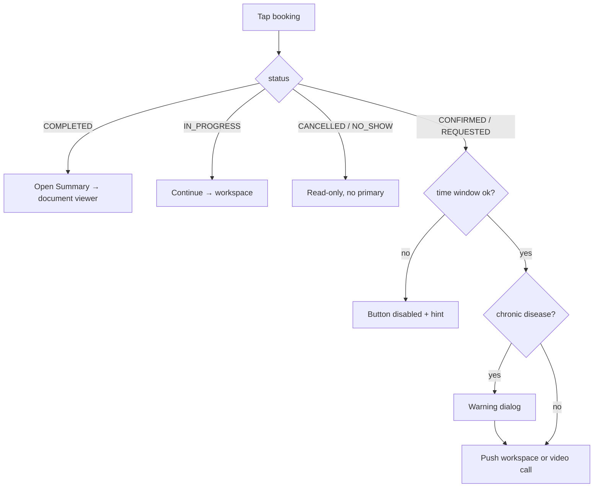

# Appointment details

| | |
|---|---|
| Area | Appointments & visit |
| Who sees it | Doctor; Clinic staff only through the clinic schedule (read + cancel; starting a visit is a doctor action — see §6) |
| Reached from | Calendar day/week tap on a booking, Home "Next patient" / today's timeline card, push notification deep link, Shifa Intelligence "open appointment" card, treatment-plan detail (see §2) |
| Screen type | Bottom sheet on phone (full-height, draggable); side panel on tablet |
| Current Flutter source | `lib/features/calendar/presentation/calendar_screen.dart` (`CalendarSlotDetailsPanel`, appointment branch), `lib/features/home/presentation/widgets/home_timeline_section.dart`, `home_clinical_workflow.dart` |
| Spec | `docs/kmp-spec/05-appointments-video-dental.md` §1, §7; `docs/kmp-spec/03-calendar-schedule.md` §3 (sheet internals: reason, place, duration, change slot belong to folder 04) |

## 1. Purpose
The doctor opens a booked visit to check who is coming, when, where (clinic or video), whether it is paid, and to take the one action that matters right now: start the visit, continue it, open the finished summary, or cancel. Used many times a day; it is the doorway to every visit screen in this folder.

## 2. Entry points
- **Calendar** (folder 04): tap a booking in month/day/week → sheet opens on top of the calendar with the full calendar entry (patient, times, status, payment status, reason, place).
- **Home → Next patient card / today's timeline** (folder 02): the card's *Start Appointment* button skips this sheet and goes straight to the visit workspace (after the chronic-disease warning, §7). Tapping the card body opens the patient, not this sheet. Target: card body opens this sheet so the doctor always has cancel/briefing at hand.
- **Push notification** (`APPOINTMENT_BOOKED_BY_PATIENT`, `APPOINTMENT_CHANGED`, `APPOINTMENT_PAID_BY_PATIENT`, …) → calendar on the appointment's day with this sheet open (folder 01 deep-link table).
- **Shifa Intelligence** "open appointment" card → goes straight to the workspace (no sheet). Target: same as Home.
- **Clinic treatment-plan detail / plans tab** → "Open visit" goes straight to the workspace.
- Arrives with: appointment id, patient id (may be missing for old bookings), practice-timezone day, start/end wall-clock, status, payment status (video only), reason, location text, photo URL, briefing status, attachment count.

## 3. Layout, top to bottom (phone portrait)
1. **Sheet handle + title** "Appointment Details". A language toggle overlays top-right in the current app (72 px reserved) — target: no toggle inside the sheet.
2. **Chips row**: status chip (see §4) and, for video visits only, a payment chip.
3. **When line**: `{date} - {start} - {end}` and `Duration: 45m` under it, both in practice timezone.
4. **Patient card**: avatar (photo or person icon), full name; whole row tappable → patient profile (folder 06) when a patient id exists; chevron only then.
5. **"AI documentation" expander** (collapsed by default): two tabs *Appointment Notes* (saved manual + AI notes, draft notes with copy buttons) and *Summary PDF* (card with the saved summary document + *Open Summary* button, or "No saved appointment documentation found."). Expanding starts a 4-second refresh loop (30 ticks = 2 minutes) so a scribe note that is still being produced appears without re-opening.
6. **Pre-visit briefing** (Home cards only today, see 02-pre-visit-briefing-sheet.md): a small "Visit briefing" button when the booking has attachments or a briefing status. Target: show it here too.
7. **Reason / complaint** field (editable, defaults to "Check Up" when empty — see §12).
8. **Adjust duration** card (confirmed visits in the future only): dropdown of end times + *Apply duration change*.
9. **Place** dropdown (clinic address or "Video Call") — folder 04 owns its behaviour.
10. **Encourage payment** outlined button: video visit, not past, not cancelled/completed, payment PENDING.
11. **Sticky action bar** (grey card at bottom): primary button whose label depends on status/time (§4), hint line under it when disabled, then a row *Cancel* (destructive, filled) · *Discard* (closes sheet, asks when the reason/place/duration were edited).

Scroll: regions 4–10 scroll; 1–3 and 11 stay fixed.

## 4. Data and formats
| Field | Source | Format rule |
|---|---|---|
| Status chip | appointment `status` | COMPLETED → green "Completed"; CANCELLED → red "Cancelled"; IN_PROGRESS → blue "In progress"; CONFIRMED → amber "Confirmed"; REQUESTED → orange "Requested"; NO_SHOW → grey "No-show"; unknown → grey raw text. Current app labels COMPLETED with the verb "Complete" and CANCELLED with "Cancel" (button words) — target uses the `appointmentStatus*` keys. |
| Payment chip (video only) | `paymentStatus` | PAID green, PENDING orange, FAILED red, NOT_REQUIRED blue-grey, else grey "Payment: {raw}". |
| Date / time | `day`, `start`, `end` | Practice timezone; date in app locale medium format; 24-hour time. Never the phone zone. |
| Duration | end − start | `45m`, `1h 15m`; clamp 0–24 h. |
| Patient name | `patientName` | First + last, fallback "Patient"; 1 line, ellipsis. |
| Reason | `reason` | 1–3 lines; empty → placeholder (not the literal "Check Up"). |
| Location | `location` | "Video Call" when the booking is a video consultation, otherwise clinic venue label. Today the type is sniffed from the word "video" in the location string — target: a real `kind` field. |
| Primary button label | status + time | COMPLETED → "Open Summary"; IN_PROGRESS → "Continue Appointment"; in-clinic earlier today → "Start Appointment"; past-due on another day → "Appointment Ended" (disabled); otherwise "Start Appointment". |

**Time windows (practice timezone):**
- In-clinic: *Start* enabled any time on the appointment day, including after the slot ended; blocked (label "Appointment Ended") once the day is over.
- Video: *Start* enabled from **5 minutes before start** until **1 hour after end** ("cold-join grace"); outside that the button is disabled with a hint. The backend's own token window is 5 min before → **15 min after end**, so between 15 and 60 min after end the button is enabled but the call screen shows the "join window closed" error (§12).
- Home "Next patient" card enables *Start* from **15 minutes before start** for both kinds (and always while the visit is "now"). Target: one rule — 15 min early for in-clinic, 5 min early for video, matching the backend.
- IN_PROGRESS / COMPLETED ignore all windows.

## 5. Primary flow (happy path)
1. Doctor taps a booking in the calendar → sheet slides up with real content (the entry is already cached; no skeleton needed). The "AI documentation" section lazily loads notes/PDF only when expanded.
2. Doctor reads chips and when-line, optionally expands briefing.
3. Taps **Start Appointment** → if the patient record carries a chronic disease other than "None", a warning dialog appears first ("Warning: This patient has a severe/chronic disease. Please take extra care." · OK).
4. The in-person workspace (04) or the video call (10/11) is pushed **on top of the calendar** with the tab bar hidden; the sheet stays underneath.
5. When the visit screen pops, the calendar day is force-refreshed and the sheet's AI-documentation refresh loop restarts, so the status chip flips to "Completed" and the *Summary PDF* tab fills in.

## 6. Screen states
- **First load:** content is from the calendar cache, so the sheet renders fully at once. If the entry must be fetched (deep link), show a skeleton of regions 2–4 and 11.
- **Empty:** n/a (a sheet is always about one booking).
- **Error on load:** deep link to an id that no longer exists → banner "Failed to load" with *Retry*, sheet otherwise empty; the "AI documentation" tabs show "Failed to load" inline.
- **Offline:** chips, when-line, patient card and reason show from cache; *Start* for in-clinic may still open the workspace (notes are typed locally) — today it does, and the first save fails silently. *Cancel*, *Apply duration change*, *Encourage payment*, *Open Summary* are disabled offline with a banner on tap.
- **Refreshing:** calendar day refresh after a visit swaps chip and button label in place; the 4-second notes/PDF poll updates the expander without scrolling.
- **Partial data:** patient id missing (old bookings): patient row not tappable, *Start* still works (workspace resolves the patient via today's calendar — breaks on other days, §12); notes load but documents fail → "Summary PDF" tab shows "Failed to load" only.
- **Permission needed:** n/a here (asked in the visit screens).
- **Locked by tier:** none. Video consultations are defined as PRO in the tier table but never checked; the backend decides. Target: BASIC doctors see video bookings with a disabled *Start* and "Video consultations need PRO" hint only if product confirms the gate.
- **Role difference:** Clinic staff reach the same sheet from the clinic schedule (doctor's name shown in the title area). Current code lets staff press *Start* and open the doctor's workspace; target: staff see *Cancel*, *Change slot*, *Open Summary* but no *Start*/*Continue* (UNVERIFIED whether the backend would accept staff completing a visit).

## 7. Interactions and secondary flows
- **Tap patient row** → patient profile pushed (sheet closes on phone) → back returns to calendar with sheet closed.
- **Tap Start / Continue** → chronic-disease warning if applicable → workspace or video call pushed; button shows a spinner while the warning/patient lookup runs (today the lookup is a cached read; no spinner).
- **Tap Open Summary (COMPLETED)** → documents list refetched → best-matching `APPOINTMENT_NOTE` document for that day/time opened in the document viewer under the Patients tab. If none: banner "No saved appointment documentation found." If no patient id: banner "Patient ID not available".
- **Expand AI documentation** → two tabs; long-press / copy icon on a note copies it ("Copied", 0.9 s).
- **Tap Visit briefing** → 02-pre-visit-briefing-sheet.md stacked over this sheet.
- **Encourage payment** → `POST` reminder → "Payment reminder sent" banner; failure banner with the error; button shows spinner and is disabled meanwhile.
- **Cancel** → 03-cancel-no-show-late.md confirmation dialog.
- **Discard** → closes the sheet; if reason/place/duration changed, "You have unsaved changes. Discard them?" (Cancel · Discard red).
- **Drag down / scrim tap / system back** → same as Discard (asks only when dirty).
- **Adjust duration → Apply** → saves and refreshes the day; button spinner; failure banner.

## 8. Edge cases
- Very long patient name or reason → name 1 line ellipsis; reason wraps to 3 lines in view mode, full when editing.
- Appointment crossing midnight in practice timezone (e.g. 23:30–00:15) → duration computed from wall-clock minutes clamps to 0; show "45m" from real instants (target), today shows "0m".
- Phone timezone differs from practice timezone → all times here are practice time; the calendar's small notice (folder 04) is the only hint. Window checks must use practice "now".
- Video visit opened 20 min after end → *Start* enabled (1 h grace) but the call screen errors ("join window closes 15 minutes after"). Target: align to 15 min or confirm with backend.
- Patient cancelled meanwhile (push arrives while the sheet is open) → day refresh flips chip to Cancelled, primary button disappears, *Cancel* disabled; show banner "Appointment cancelled by patient".
- Appointment deleted/rescheduled by staff (404/409 on any action) → banner "This appointment changed. Refreshing…" and reload the day; sheet closes if the entry is gone.
- Double tap on *Start* → second tap ignored while the push is in flight (today: two pushes possible on slow devices — guard it).
- Slow network on *Open Summary* (>3 s) → button spinner; keep the sheet.
- Session expired (401) when pressing Cancel → global logout (folder 01); sheet is dropped.
- Deep link while this sheet is open → close sheet, navigate, open the new one.
- Rotation → sheet stays open with the same scroll position; on tablet landscape it becomes the side panel.
- 200 % font → chips wrap to two rows; action bar buttons stack vertically; hint text wraps.
- Screen reader order: title → status chip → payment chip → when-line → patient row → sections → primary → Cancel → Discard. Disabled primary announces its hint as its description.
- 0 attachments and no briefing → no briefing button at all.
- Payment status missing on a video visit → grey chip "Payment: unknown" (today the raw key leaks, §12).

## 9. Validation and messages
| Field/action | Rule | When checked | Message (EN) | Where |
|---|---|---|---|---|
| Start (video, too early) | now < start − 5 min | on render | You can start 5 minutes before the appointment. | hint under disabled button |
| Start (video, too late) | now ≥ end + 1 h | on render | This video appointment ended more than an hour ago. Open it only if the consultation is already in progress. | hint under disabled button |
| Start (past day) | day < today, not in progress | on render | Past appointments cannot be changed or cancelled. | hint; button label "Appointment Ended" |
| Chronic disease | patient.chronicDisease set and ≠ None | on Start | Warning: This patient has a severe/chronic disease. Please take extra care. | dialog, OK |
| Open Summary | patient id present | on tap | Patient ID not available | banner |
| Open Summary | a summary document exists | on tap | No saved appointment documentation found. | banner |
| Encourage payment | success / failure | after request | Payment reminder sent / Could not send reminder: {error} | banner |
| Discard with edits | dirty | on tap/back | You have unsaved changes. Discard them? | dialog |

## 10. Navigation out
- → Visit workspace / video call: pushed on top; sheet kept; on return the day refreshes and the sheet re-polls notes/PDF.
- → Patient profile: sheet closes (phone); nothing to save.
- → Document viewer (Open Summary): switches to Patients tab; sheet closes; calendar state kept.
- → Briefing / Cancel: stacked sheet/dialog; return to this sheet.
- Close/Discard/back: unsaved reason/place/duration edits are asked about; nothing else to keep. Calendar needs no refresh unless an action succeeded.

## 11. Copy
Existing keys: `appointmentDetails` "Appointment Details", `startAppointment` "Start Appointment", `appointmentStatusRequested/Confirmed/Cancelled/Completed/InProgress/NoShow`, `durationLabelShort` "Duration", `videoCallAvailableFiveMinBefore`, `videoCallTooLateAfterOneHour`, `pastAppointmentNoChange`, `chronicDiseaseWarning`, `ok`, `cancel` "Cancel", `discard` "Discard", `unsavedChangesMessage`, `appointmentNotes` "Appointment Notes", `summaryPdf` "Summary PDF", `noSummaryYet`, `appointmentDocumentation`, `failedToLoad`, `patientIdNotAvailable`, `copied`, `adjustAppointmentDuration`, `applyAppointmentDuration`, `videoCall` "Video Call".
Keys referenced by the code but **without an English value** (render as raw keys today, must be filled): `continueAppointment` "Continue Appointment", `openSummary` "Open Summary", `aiDocumentation` "AI documentation", `encouragePayment` "Remind to pay", `paymentReminderSent`, `paymentReminderFailed` ("Could not send reminder: {{error}}"), `paymentLabel` "Payment: {{status}}", `paymentPaid` "Paid", `paymentPending` "Pending", `paymentFailed` "Failed", `paymentNotRequired` "Not required", `paymentUnknown` "Unknown", `unknownPatient` "Unknown patient".
**NEW:** `appointmentEndedShort` "Appointment Ended" (the existing `appointmentEnded` key means "ended successfully" and is misused as the disabled label), `appointmentChangedRefreshing` "This appointment changed. Refreshing…", `appointmentCancelledByPatient` "Appointment cancelled by patient".

## 12. Known problems in the current app (do not carry over)
- Video vs in-clinic is decided by the word "video" inside the location text; payment status is dropped from the appointment model once you leave the calendar.
- Status chip uses button words "Complete"/"Cancel" instead of status labels; unknown status shows raw backend text.
- "Appointment Ended" reuses the success toast key; "Continue Appointment", "Open Summary", "AI documentation" and all payment chip strings have no English value and render as keys.
- Empty reason is seeded as the literal English "Check Up" and sent to the backend.
- Video start window (1 h after end) disagrees with the backend token window (15 min after end).
- Home card uses a 15-minute early-start rule, the calendar uses 5 min for video and "any time today" for in-clinic — three different rules.
- Workspace needs a patient id; when it is missing it searches **today's** calendar, so old bookings opened on another day cannot be completed.
- Avatar loads with a raw network image (no cache/placeholder).
- Snackbars for every result; the sheet reserves 72 px for a language toggle overlay.
- Staff can press Start.

## 13. Open questions for design
- Should *Start* live in the sheet only, or stay on the Home card as a one-tap shortcut (current)? If both, the chronic-disease warning must look identical.
- Is a separate *Discard* button needed, or is drag-down/close enough?
- Where should "Visit briefing" sit: a chip in the header or a card in the body?
- Should the AI-documentation section be shown before the visit at all (it is empty until the visit happens)? Proposal: show only for IN_PROGRESS/COMPLETED.
