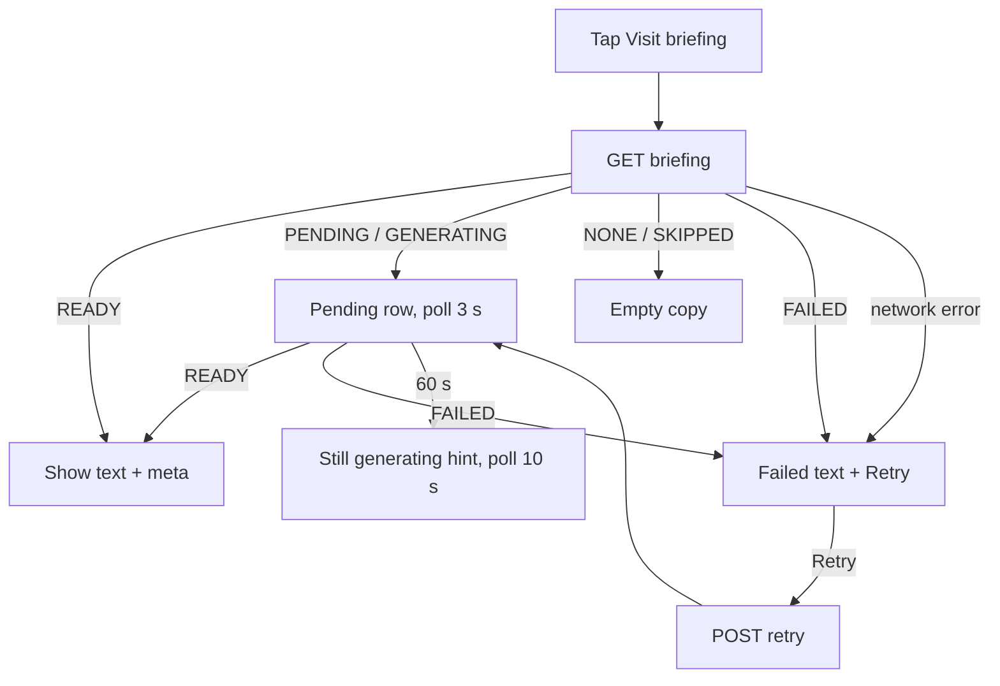

# Pre-visit briefing sheet

| | |
|---|---|
| Area | Appointments & visit |
| Who sees it | Doctor (PRO tier for AI briefings — the sheet itself is not gated today; see §6) |
| Reached from | Home next-patient card / today's timeline "Visit briefing" button; target: Appointment details (01) |
| Screen type | Bottom sheet (scrollable, ~60 % height, draggable to full) |
| Current Flutter source | `lib/features/appointments/presentation/widgets/appointment_briefing_sheet.dart`; trigger in `lib/features/home/presentation/widgets/home_timeline_section.dart` |
| Spec | `docs/kmp-spec/05-appointments-video-dental.md` §7 (`/briefing`), ticket APPT-06; `02-home-ai-intelligence.md` §6 for the *patient* briefing (a different, broader panel owned by folder 03) |

## 1. Purpose
Before the patient walks in, the doctor reads a short AI summary of the documents the patient attached when booking (lab results, discharge letters, photos). It answers "why are they here and what should I look at first" in 30 seconds. Used for a minority of visits — only bookings with attachments or a briefing status get the button.

## 2. Entry points
- Home next-patient hero and timeline rows: a "Visit briefing" icon button appears when the booking has `attachmentCount > 0` or a briefing status of READY / PENDING / GENERATING / FAILED. Sheet opens over Home.
- Target: the same button in Appointment details (01) region 6, opening over the details sheet.
- Arrives with: appointment id (and nothing else; the sheet fetches).

## 3. Layout, top to bottom (phone portrait)
1. Handle.
2. Title "Visit briefing"; subtitle "AI summary of documents the patient attached before this appointment."
3. Body (one of): briefing text rendered with the AI markdown-subset renderer (bold, bullets, headings) · pending row (spinner + "Generating briefing from attached documents…") · empty text · failed text.
4. Meta line (target): "{n} documents · generated {time}" from `documentCount` / `generatedAt` (practice timezone). Today these fields are parsed but not shown.
5. **Retry briefing** secondary button — shown for FAILED and PENDING (PENDING too, because a stuck job can be kicked).
6. Target: *Copy* text button (parity with the patient briefing panel).
7. Target: **Attached documents** list under the text (title, type icon, date) — the briefing is about them, and the doctor should be able to open the original with one tap (opens the document viewer, folder 06).
8. Target: footer hint "AI summary — verify against the originals." in small grey text; the briefing is decision support, not a record.

Sheet height: content-sized up to 60 %; drag to 92 %. On tablet: 480 px wide dialog centred over the details panel.

## 4. Data and formats
| Field | Source | Format rule |
|---|---|---|
| status | `GET /api/appointments/{id}/briefing` | NONE, SKIPPED, PENDING, GENERATING, READY, FAILED (string; unknown → treat as NONE) |
| briefingText | same | Markdown subset; may be long (several screens); selectable |
| documentCount | same | integer, "1 document / 3 documents" (plural) |
| generatedAt | same | ISO UTC → practice timezone, "Today 09:12" / medium date |
| error | same | shown instead of the failed text when present |

## 5. Primary flow (happy path)
1. Tap "Visit briefing" → sheet opens with a text skeleton (3 lines) → `GET …/briefing`.
2. READY → text appears; the doctor skims and dismisses.
3. PENDING/GENERATING → pending row; the sheet re-fetches every **3 s** until READY/FAILED or dismissed.

## 6. Screen states
- **First load:** skeleton of 3 text lines under the title.
- **Empty:** status NONE or SKIPPED → "No pre-appointment documents or briefing yet." (no button).
- **Error on load:** request failed → error text + *Retry briefing*.
- **Offline:** cannot load; error text + Retry; no cache.
- **Refreshing:** 3 s poll while PENDING/GENERATING; content swaps from spinner row to text without jumping (text starts at the same y).
- **Partial data:** READY with empty text → treat as empty state.
- **Permission needed:** n/a.
- **Locked by tier:** the code does not gate this sheet; the backend decides whether a briefing is produced (BASIC accounts presumably get SKIPPED — UNVERIFIED). Target: BASIC/unknown-tier sees the button only when attachments exist, and the body shows the document list instead of an AI text when the backend says SKIPPED.
- **Role difference:** staff never see Home; if the button is added to the details sheet, staff get the same read-only sheet.
- **Stale (target):** a document was attached after `generatedAt` → amber line "Updated documents since this briefing" + *Retry briefing* emphasised.
- **Read-only after the visit:** for COMPLETED visits the sheet still opens (useful for audits) but hides Retry.

## 7. Interactions and secondary flows
- **Retry briefing** → `POST …/briefing/retry` → button disabled with spinner → status PENDING → poll loop as above. Failure → error text replaced with the new error.
- **Drag down / scrim / back** → closes; the poll stops immediately (today the delayed callbacks continue firing after dismissal and are guarded only by a mounted check).
- **Long text** → scrolls inside the sheet; drag the handle to full height.
- Target **Copy** → clipboard → banner "Copied".

## 8. Edge cases
- Briefing stuck in PENDING for minutes → poll keeps going while the sheet is open; target: after 60 s show "Still generating — you can close this and check back." and keep polling at 10 s.
- Opened twice quickly (double tap) → one sheet only.
- Attachment count > 0 but status NONE → empty copy; consider listing the attached documents (they are visible in the workspace documents card anyway).
- Appointment cancelled meanwhile → backend 404 → error text "Could not generate the visit briefing." + Retry; Retry will 404 again — acceptable, the sheet is read-only.
- 401 mid-poll → global logout.
- Language switch while open → text stays in the language it was generated in; title re-localises.
- 200 % font → everything scrolls; Retry button full-width.
- Rotation → sheet persists.
- Screen reader: title, subtitle, body as one region, Retry.
- Patient attached a document **after** the briefing was generated → text is stale; the meta line's time makes this visible; *Retry briefing* regenerates (UNVERIFIED whether the backend re-reads attachments on retry).
- Documents the doctor cannot access (locked, needs request) → the backend presumably skips them; the sheet cannot tell the doctor which were skipped — target meta "based on {n} of {m} documents" if the API exposes it (UNVERIFIED).
- Very long briefing (>2 000 words) → sheet scrolls; keep the Retry button in a pinned footer so it is reachable without scrolling to the end.
- Opened from a push notification deep link straight into the calendar with the details sheet → the briefing button must be visible without expanding anything (target placement in 01 region 6).
- Two taps on *Retry* → second ignored while loading (button disabled with spinner today — keep).
- Briefing text in a different language than the UI (generated with the language at booking time) → show as is; no re-translation.
- Offline while polling → poll errors are swallowed and the sheet keeps the pending row; target: after two failed polls show "Connection lost — tap Retry when online".

## 9. Validation and messages
| Field/action | Rule | When checked | Message (EN) | Where |
|---|---|---|---|---|
| Load | HTTP error | after GET | Could not generate the visit briefing. | body text |
| Retry | HTTP error | after POST | Could not generate the visit briefing. | body text |
| Pending | status PENDING/GENERATING | on data | Generating briefing from attached documents… | body row |

## 10. Navigation out
- Close → back to Home / details sheet; nothing to refresh (the Home card's briefing icon state comes from the calendar entry).

## 11. Copy
`visitBriefingTitle` "Visit briefing", `visitBriefingSubtitle`, `visitBriefingEmpty`, `visitBriefingPending`, `visitBriefingFailed`, `retryBriefing` "Retry briefing", `copied` "Copied".
**NEW:** `visitBriefingMeta` "{count} documents · generated {time}" (with plurals), `visitBriefingStillGenerating` "Still generating — you can close this and check back.", `visitBriefingCopy` "Copy".

## 12. Known problems in the current app (do not carry over)
- Reachable only from Home cards; never from the appointment details sheet or the workspace.
- Poll implemented with chained delayed callbacks that outlive the sheet.
- `documentCount` / `generatedAt` fetched but never shown.
- Spinner instead of a skeleton; no copy action.

## 13. Open questions for design
- Should the briefing be a section inside Appointment details rather than a separate sheet?
- Should the workspace (04) show the briefing as a collapsible card at the top of the patient summary?
- Should the briefing be read aloud (TTS exists in the Intelligence voice session, folder 03) for doctors walking between rooms?
