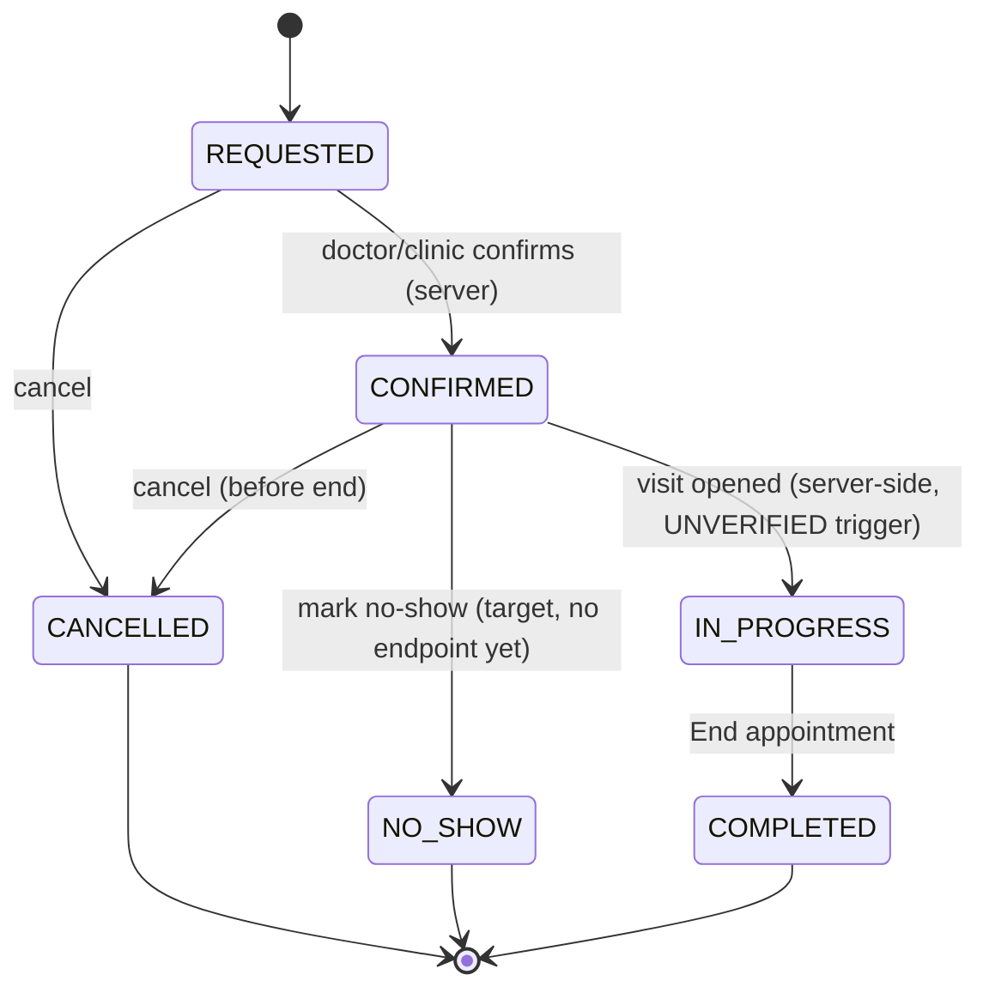

# Cancel, no-show and late states

| | |
|---|---|
| Area | Appointments & visit |
| Who sees it | Doctor and Clinic staff (cancel); doctor only for no-show/late decisions |
| Reached from | Appointment details (01) action bar; target: Home next-patient card overflow |
| Screen type | Confirmation dialog (cancel); inline states in Appointment details and Home card (late / not arrived); target bottom sheet for no-show |
| Current Flutter source | `lib/features/calendar/presentation/calendar_screen.dart` (cancel dialog + `_isPastAppointment`, `_canStartInClinicDespitePastDue`), `lib/state/calendar/calendar_controller.dart` (`cancelAppointment` → `DELETE /api/appointments/{id}`) |
| Spec | `docs/kmp-spec/03-calendar-schedule.md` §3 (cancel); `05-appointments-video-dental.md` §1 (status enum incl. NO_SHOW); backend request in doc 15 needed for a no-show endpoint |

## 1. Purpose
Handle the visits that do not happen as planned: the doctor cancels ahead of time, the patient is late, or the patient never shows up. Today the app can only **cancel** (hard delete) and otherwise lets an unattended booking sit as "Confirmed" forever. The rewrite needs a visible way to say "did not come" so the schedule, analytics and the patient's history are right. A few times a week.

## 2. Entry points
- **Appointment details → Cancel** (red button in the action bar): enabled for CONFIRMED/REQUESTED bookings whose end is still in the future. Disabled for past, completed, cancelled.
- **Late / not arrived**: no explicit entry today — the Home timeline shows the slot as "now" and the details sheet keeps "Start Appointment" enabled for the rest of the day for in-clinic visits.
- **No-show**: no entry today. Target: *Mark as no-show* in the details overflow and on the Home card once the slot's start is ≥ 15 min in the past and the visit is not IN_PROGRESS.

## 3. Layout, top to bottom (phone portrait)
**Cancel dialog (current):** title "Cancel Appointment" · body "Are you sure you want to cancel this appointment?" · actions *No* (text) · *Yes, Cancel* (text). Target per conventions: destructive red button on the right, optional reason field (see §13).

**Late state (target) in Appointment details and Home card:** a thin amber line under the when-line: "Started 12 min ago — patient not arrived" with two chips: *Start anyway* (opens the workspace) and *Mark as no-show*. Appears from start+0 for in-clinic, start+5 min for video, until the doctor acts or the day ends.

**No-show sheet (target):** title "Mark as no-show" · body "The visit will be recorded as missed. The patient is notified and the slot stays booked for your records." · optional toggle "Notify patient" (default on, UNVERIFIED backend support) · *Mark as no-show* (red) · *Cancel*.

## 4. Data and formats
| Field | Source | Format rule |
|---|---|---|
| Status after cancel | backend | today the row disappears from the day (DELETE); target: CANCELLED chip stays visible that day, slot freed |
| Status after no-show | backend | NO_SHOW chip grey; slot not freed for new booking (past anyway) |
| "Started X min ago" | practice-timezone now − start | minutes < 60 → "{n} min ago"; otherwise "{h} h {m} min ago" |
| Eligibility | status + time | Cancel: not past, not COMPLETED/CANCELLED/NO_SHOW. No-show: start ≤ now − 15 min, status CONFIRMED/REQUESTED, same practice day (older days: allowed from details only) |

## 5. Primary flow (happy path)
1. Doctor taps **Cancel** in details → dialog.
2. Confirms → button spinner (whole action bar disabled) → `DELETE /api/appointments/{id}`.
3. 200/204 → today's and the appointment's day are refreshed, Home lists invalidated, banner "Appointment cancelled successfully", details sheet closes (today: snackbar + sheet stays with stale buttons until refresh completes).
4. Failure → banner "Failed to cancel: {error}", sheet stays, buttons re-enabled.

## 6. Screen states
- **First load:** n/a (dialog over loaded sheet).
- **Empty:** n/a.
- **Error on load:** n/a.
- **Offline:** *Cancel* / *Mark as no-show* disabled with banner "You are offline" on tap; late line still computes locally.
- **Refreshing:** after success the details sheet closes; the calendar shows the day skeleton rows only for the changed entry (do not blank the day).
- **Partial data:** cancel succeeded but refresh failed → still close the sheet and show the success banner; calendar retries on next interaction (today the same).
- **Permission needed:** n/a.
- **Locked by tier:** none.
- **Role difference:** staff can cancel from the clinic schedule (same dialog). No-show: doctor and staff with OWNER/CLINIC_ADMIN/RECEPTIONIST clinic roles (target; server authoritative).

## 7. Interactions and secondary flows
- **Cancel → No / back / scrim** → dialog closes, nothing changes.
- **Cancel → Yes, Cancel** → §5.
- **Late line → Start anyway** → same as *Start Appointment* (chronic-disease warning, then workspace).
- **Late line → Mark as no-show** → no-show sheet → confirm → status NO_SHOW, banner "Marked as no-show", sheet closes; Home skips it as "next patient".
- **Video visit, patient never joins** (see 11-video-call-in-call.md) → *Leave* then this no-show flow from details; target: offer "Mark as no-show" directly in the leave dialog when no remote participant ever joined.
- **Undo** (target): the success banner carries *Undo* for 5 s for no-show (not for cancel — cancel notifies the patient immediately).

## 8. Edge cases
- Cancel pressed exactly as the slot ends → backend may reject (409/400) → banner with the backend message; sheet refreshes.
- Patient cancels at the same moment (409 or 404 on DELETE) → treat as success: refresh and banner "Appointment was already cancelled".
- Double tap on *Yes, Cancel* → one request (dialog closes on first tap; action bar disabled).
- Cancel while the notes/PDF poll is running in the details sheet → poll cancelled with the sheet.
- Slot in a series of consecutive bookings → only this one is cancelled; others untouched.
- No-show for a REQUESTED (never confirmed) booking → allowed; label still "No-show".
- No-show on a day in the past (doctor catching up) → allowed from details; late line not shown.
- Video patient joined late and the doctor already marked no-show → patient-app side gets "visit closed" (backend); doctor can no longer start — the details show NO_SHOW and no primary button. Target: allow "Reopen" for 24 h only if backend supports it (UNVERIFIED).
- Appointment crossing midnight → "late" is computed from instants, not wall-clock.
- Slow network (>3 s) → spinner in the destructive button, other controls disabled.
- 401 during cancel → logout.
- Rotation / language switch while the dialog is open → dialog persists, strings re-localise.
- 200 % font → dialog scrolls; buttons stack.
- Screen reader: dialog title announced; destructive button last.
- Cancel from the clinic schedule by staff while the doctor has the workspace open → the doctor's next save returns 404/409 → banner "This appointment was cancelled" and the workspace becomes read-only with *Close* (target; today the save fails silently).
- Recurring late patient → no history shown; target: a "late 3 of last 5 visits" hint belongs to the patient profile (folder 06), not here.
- No-show marked, then the patient arrives 30 min late → doctor must book a new slot (14) or ask the clinic to reopen (backend decision); make the no-show banner's Undo window 5 s and the "Reopen" question explicit in §13.

## 9. Validation and messages
| Field/action | Rule | When checked | Message (EN) | Where |
|---|---|---|---|---|
| Cancel | confirmation | on tap | Are you sure you want to cancel this appointment? | dialog |
| Cancel success | 200/204 | after request | Appointment cancelled successfully | top banner |
| Cancel failure | other status / network | after request | Failed to cancel: {error} | top banner |
| Cancel eligibility | past / completed / cancelled | on render | Past appointments cannot be changed or cancelled. | hint under buttons |
| No-show confirm (NEW) | start ≤ now − 15 min | on tap | The visit will be recorded as missed. | sheet body |
| No-show success (NEW) | 2xx | after request | Marked as no-show | banner with Undo |

## 10. Navigation out
- Cancel success → details sheet closes → calendar (or clinic schedule) refreshed for that day; Home lists invalidated.
- No-show success → details sheet stays open showing the grey chip (so the doctor can still open the patient) — or closes if launched from the Home card.
- Dialog dismissed → back to details, unchanged.

## 11. Copy
`cancelAppointment` "Cancel Appointment", `cancelConfirm`, `no` "No", `yesCancel` "Yes, Cancel", `appointmentCancelled`, `failedToCancel` "Failed to cancel", `pastAppointmentNoChange`, `appointmentStatusNoShow` "No-show", `appointmentStatusCancelled` "Cancelled".
**NEW:** `markNoShow` "Mark as no-show", `noShowConfirmBody` "The visit will be recorded as missed. The patient is notified and the slot stays booked for your records.", `noShowMarked` "Marked as no-show", `undo` "Undo", `patientNotArrived` "Started {minutes} min ago — patient not arrived", `startAnyway` "Start anyway", `appointmentAlreadyCancelled` "Appointment was already cancelled", `notifyPatient` "Notify patient", `offlineActionUnavailable` "You are offline. Try again when connected."

## 12. Known problems in the current app (do not carry over)
- Cancel is a hard DELETE: the booking vanishes from the calendar instead of showing as cancelled for the day.
- No no-show action at all although the status exists in the enum and the backend returns it; missed visits stay "Confirmed" and still count as "next patient" until midnight.
- No late-state feedback; the doctor cannot tell "running late" from "not coming".
- Confirmation uses two text buttons (no destructive emphasis); results are snackbars.
- `IN_PROGRESS` is never set by the client; the app relies on an unverified server-side trigger, so a visit opened and abandoned may still read "Confirmed".

## 13. Open questions for design
- Does cancel need a reason (free text / presets: doctor unavailable, patient asked, duplicate)? The backend DELETE takes none today — would be a backend request.
- Should "Mark as no-show" require a confirmation at all, given Undo?
- Where does the late line live on the Home card without crowding the Start button?
