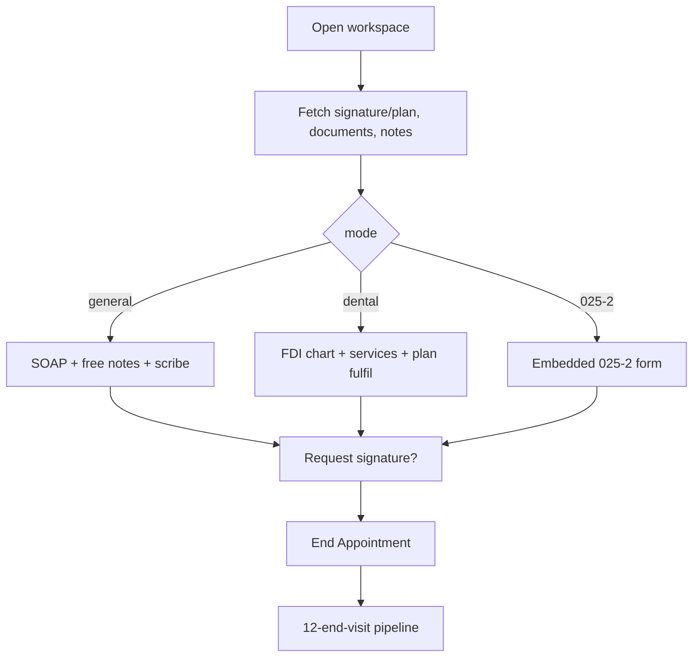

# In-person visit workspace

| | |
|---|---|
| Area | Appointments & visit |
| Who sees it | Doctor. Dental mode only for dental professions. AI scribe button and mic icons PRO+. Clinic staff: never (target; today reachable from the clinic schedule) |
| Reached from | Appointment details *Start / Continue* (01), Home next-patient *Start Appointment*, Shifa Intelligence "open appointment" card, treatment-plan detail "Open visit" |
| Screen type | Full screen, pushed inside the current tab (tab bar hidden) |
| Current Flutter source | `lib/features/appointments/presentation/in_person_appointment_screen.dart` (3 176 lines) + `presentation/widgets/consultation_documentation_widgets.dart` (header, documents list, upload strip, sticky footer) |
| Spec | `docs/kmp-spec/05-appointments-video-dental.md` §2, §5, §7; tickets APPT-02…05, APPT-08 |

## 1. Purpose
The screen the doctor keeps open for the whole consultation: see who the patient is, look at their documents, write or dictate the notes (free text, SOAP, dental chart or the official 025-2 form), let the AI scribe listen, tick off treatment-plan items, take a payment, request the patient's signature and finally end the visit. Daily, 10–40 times. The video call (11) embeds the same documentation half; design it once.

## 2. Entry points
- Appointment details → *Start Appointment* / *Continue Appointment* (01). Pushed on top of the calendar; details sheet stays beneath.
- Home card → *Start Appointment* (after chronic-disease warning). Pushed inside the Home tab.
- Intelligence "open appointment" card, clinic plan detail → pushed inside their tab.
- Arrives with the appointment object: id, patient id (maybe missing), name, location text, start/end, day, status, photo, reason. Everything else (signature state, linked plan, notes, documents, patient record) is fetched on open.
- Opening does **not** call any "start" endpoint; the client never sets IN_PROGRESS (server-side trigger UNVERIFIED — assumed on first notes save or on the video token).

## 3. Layout, top to bottom (phone portrait)
Single scroll column; on tablet two panes (documents | notes).

1. **Header** (not sticky today; target sticky, collapsing): back arrow (saves drafts first), avatar (photo/initials), patient name, status pill (Confirmed teal / In progress blue / Completed green / Cancelled red / Requested orange), meta line "{age} years · ID #{id}", schedule line "{start} - {end} - Consultation", location line (clinic name). Target adds a visit **timer** "12:40" counting from the scheduled start in practice time (none today).
2. **Chronic-disease warning dialog** fires once after the first frame when the patient record says so (same as 01).
3. **Patient summary** (target, missing today): one row of chips — allergies, chronic disease, last visit date, open tasks — tap → patient profile. Today only the chronic warning dialog exists.
4. **Documents card** "Documents" (collapsible to a 52 px rail on tablet): patient documents grouped in clinical buckets — Laboratory, Imaging, Clinical, Forms, Private, Other, Uncategorized — each tile: icon by file type, title, date; locked tiles show *Request access*. Under the list the **upload strip**: "Drop files here or tap to upload (saved as a medical document)" → file picker (multi-select) → uploads as category OTHER_MEDICAL → "Uploaded {count} file(s)." Hint row: "Final notes and PDFs are saved when you end the appointment. New uploads appear here immediately."
5. **Notes card** — title changes with the mode: "Notes" (general) / "Dental visit record" / "Form 025-2". Title trailing icons: focus mode (general; full-screen notes editor), fullscreen (dental; 025-2 on phone), and the **⋮ menu**: *From Shifa AI*, *From last 025-2 form*, *Before Treatment* (camera icon), *After Treatment*, divider, *General Form*, *Dental visit record* (dental professions only), *Form 025-2*.
   1. **Treatment plan panel** (clinic context + numeric patient id, hidden once completed): dropdown "Active comprehensive plan" (None / bill separately · plan titles), linked banner "Part of plan #{id} — {title}", progress "{done}/{total} planned items completed". See 08.
   2. **Helper region** (shown after *From Shifa AI* or *From last 025-2 form*): AI drafts (orange cards with *Discard* / *Save as note* and ICD suggestion rows with *Apply*), saved AI notes carousel "‹ 2/5 ›" with a *+* "Add to notes" button, or the last 025-2 card (Complaints / Diagnosis / Treatment, each with *+*).
   3. **Mode body**: General → SOAP expander + free notes + *Start AI Notes* (05, 06). Dental → FDI chart, services, totals, clinical notes (07) + plan finance card (09). 025-2 → the embedded official form (folder 06 owns the form; here it opens full-screen on phone).
   4. **Before/after photo chips** (general & dental): removable chips "Before Treatment · IMG_0012.jpg".
6. **Footer** (in-flow on phone; pinned on tablet — target pinned on phone too): signature line ("Patient Signed ✓" green / "Waiting for patient signature..." grey / nothing), *Request Signature* secondary (hidden once requested or signed), **End Appointment** destructive primary full-width.
7. **Full-screen overlays**: dental and 025-2 can take over the whole screen (scrim behind, title + "Collapse" icon top-right). General has *focus mode* pushed as a modal page titled with the notes editor.

## 4. Data and formats
| Field | Source | Format rule |
|---|---|---|
| Age | patient `birthDate` | whole years; hidden when unknown; today computed with device date |
| Schedule line | start/end wall-clock | 24 h in practice timezone, "09:00 - 09:45 - Consultation" |
| Status pill | appointment status | see 01 §4; label keys `appointmentStatus*` |
| Signature state | `GET /api/appointments/{id}` every 10 s while requested & unsigned | `patientSignedAt` ISO (may carry a `[Zone]` suffix — strip) |
| Linked plan | same response | `linkedPlanId`, `linkedPlanTitle`, `fulfilledLineIds` |
| Documents | `GET /api/patients/{pid}/documents` | bucket from category; date in practice tz; title 2 lines ellipsis |
| Manual notes | `GET …/consultation-notes` (source MANUAL) | fills the free-notes field once if it is empty |
| AI notes/drafts | same + `GET …/draft-notes` | AI notes strip a trailing "TRANSCRIPT:" block; drafts have label (default "Draft"), body, ICD list |
| Photos | camera/gallery, quality 85 % | kept in memory only until End; chip label = file name, 1 line ellipsis |
| Documentation mode | profession default, user choice wins | general ⇄ dental ⇄ 025-2 |

## 5. Primary flow (happy path, general mode)
1. Push → header with name/status immediately (from the appointment object); documents and notes show skeletons; signature/plan fetched.
2. Doctor types or dictates notes (05), optionally taps *Start AI Notes* and lets the recorder run (06).
3. Taps *Request Signature* when the notes are ready → "Signature request sent to patient" banner → footer switches to "Waiting for patient signature..." → 10 s poll → "Patient Signed ✓".
4. Taps **End Appointment** → 12-end-visit.md pipeline → success banner → screen pops back to where it came from.

## 6. Screen states
- **First load:** header real; documents card = 3 tile skeletons; notes card = title + 6-line skeleton; footer visible with *End Appointment* enabled (today a bare spinner sits in the documents card and notes are editable immediately — keep notes editable, skeleton only the lists).
- **Empty:** no documents → "No documents yet" inside the card (today the list is simply blank) + upload strip; no notes → placeholder "Enter appointment notes..."; no plans → dropdown shows "None / bill separately" only.
- **Error on load:** documents failed → inline "Failed to load" + *Retry* in the card; signature/plan fetch failed → footer shows no signature line and plan panel hidden; a banner "Some data could not be loaded" with *Retry* once.
- **Offline:** typing works; uploads, Request Signature, AI notes, End Appointment disabled with a banner "You are offline" on tap. Target: keep drafts locally and flush when back online (today nothing is saved until leave/switch/end — typed notes are lost if the app dies).
- **Refreshing:** 10 s signature poll only changes the footer line; no scroll jump. Pull-to-refresh: none (lists are small); target: none.
- **Partial data:** patient id missing → documents card shows "Patient record unavailable" and photos/plan hidden; End still works only when the calendar lookup finds the id (§12).
- **Permission needed:** microphone (speech/scribe) asked on first mic tap; camera on *Before/After Treatment*; files on upload. Denied permanently → banner "Microphone permission denied" / "Camera permission denied" with *Open settings*.
- **Locked by tier:** BASIC: mic icons and *Start AI Notes* are simply **hidden** today. Target: show the *Start AI Notes* button disabled with a lock and text "AI notes need PRO" and the mic icon hidden. Dental mode is profession-gated, not tier-gated. Unknown tier behaves as PREMIUM today (fail open) — target: hide until tier is known.
- **Role difference:** staff should never land here (target). If they do today, the screen works as for a doctor.

## 7. Interactions and secondary flows
- **Back arrow / system back / swipe back** → drafts saved (dental flush + general notes PUT) → pop. No dialog. Target: same, plus a banner "Draft saved" and a *PopScope* guard so the save completes.
- **⋮ → From Shifa AI** → helper region expands with AI drafts/notes; if none yet: banner "AI notes are not ready yet. Please try again in 30 seconds."
- **⋮ → From last 025-2 form** → loads the patient's latest 025-2 → card with Complaints/Diagnosis/Treatment; *+* appends to the active notes ("Added to notes").
- **⋮ → Before/After Treatment** → bottom sheet Camera / Gallery → chip added; chip ✕ removes. Marks unsaved.
- **⋮ → mode switch** → if unsaved: dialog "You have unsaved changes. Save before switching?" (*Cancel* · *Discard and switch* · *Save and switch*). Discard clears SOAP, free notes and photos.
- **Draft card → Save as note** → confirm draft → note moves to the AI notes carousel → "Draft saved as consultation note". **Discard** → "Draft discarded".
- **ICD suggestion → Apply** → switches to 025-2 and pre-fills the ICD search field with the code ("Applied: J06.9").
- **Document tile tap** → opens the file in the system viewer/browser (target: in-app viewer, folder 06). Locked tile → *Request access* → banner.
- **Upload strip tap** → multi-file picker → per-file progress → success/failure banners; list refreshes.
- **Treatment plan dropdown** → 08. **Plan finance card** → 09.
- **Request Signature** → §5 step 3; disabled while requesting; error banner "Error saving: {code}".
- **End Appointment** → 12. Button disabled with spinner during the pipeline.
- **Focus mode icon** (general) → full-screen notes editor (05). **Fullscreen icon** (dental/025-2) → overlay; *Collapse* returns.
- **Keyboard Done** on single-line fields moves focus; multi-line fields keep the newline.

## 8. Edge cases
- Visit opened on two devices → both edit; general notes are overwritten by whoever saves last (one text body), dental doc too. Target: banner "Notes were updated on another device" when a save returns a newer body (needs backend version/ETag — backend request).
- App killed mid-visit → general notes typed since the last leave/switch/end are **lost** today; dental autosaves every 1.2 s. Target: autosave general notes 2 s after typing stops.
- Status already COMPLETED (opened via Continue after completion race) → plan panel hidden, End still enabled → backend may reject; target: read-only mode with "Open Summary".
- Patient id missing on a visit from another day → End fails with "Patient ID not available. Cannot save notes." — the user cannot complete. Target: resolve the patient from the appointment detail endpoint.
- Two timers for the signature poll (fetch + request) → only one must run; stops on sign, leave, or after 30 min (target cap; today never stops if the patient never signs).
- Patient signs after the doctor already ended → signature not in the PDF (pipeline re-fetches once right before generation).
- Very long names/titles → header name 2 lines, document titles 2 lines, chip labels 1 line ellipsis.
- 100+ documents → grouped list is virtualised; buckets collapsible (target).
- Photos: 10+ chips wrap; each is ≤ quality 85 % JPEG; target cap 20 per visit with a banner.
- Mode switch with unsaved dental lines → dental panel save (PUT) happens first; failure keeps the old mode with banner "Could not save dental documentation".
- 025-2 on phone forces full-screen and collapses the documents card; returning restores.
- Timezone mismatch → schedule line is practice time; age uses the device date (fine).
- Appointment across midnight → schedule line "23:30 - 00:15"; timer keeps counting.
- Slow network (>3 s) on open → skeletons remain; typing allowed.
- Double tap End → second ignored (`_isSaving` guard exists).
- 401 mid-visit → logout; typed notes lost (target: keep local draft keyed by appointment id, restore after login).
- Deep link (push tap) while here → leaves the visit after saving drafts (same as back).
- Rotation → single column ↔ two panes; text and chips retained.
- Language switch mid-visit → labels re-localise; SOAP label text already embedded in a saved note body stays in the old language (notes are saved as one text with labels — §12).
- 200 % font → header meta wraps; menu items wrap; footer buttons stack; the FDI chart scrolls horizontally.
- Screen reader: header (name, status, times) → documents → notes title + menu → fields → footer buttons; the ⋮ menu must be labelled "More documentation options".

## 9. Validation and messages
| Field/action | Rule | When checked | Message (EN) | Where |
|---|---|---|---|---|
| Request signature | 200 | after PUT | Signature request sent to patient | banner (success) |
| Request signature | non-200 / error | after PUT | Error saving: {code or error} | banner (error) |
| Upload files | per file 2xx | after POST | Uploaded {count} file(s). / Upload failed: {name} | banner |
| From Shifa AI | any AI note or draft exists | on tap | AI notes are not ready yet. Please try again in 30 seconds. | banner |
| Mode switch | unsaved changes | on tap | You have unsaved changes. Save before switching? | dialog |
| Draft save/discard | 200 | after POST | Draft saved as consultation note / Draft discarded / Failed to save draft / Failed to discard draft | banner |
| End Appointment | see 12 | on tap | see 12 | — |
| Mic / camera | permission | on tap | Microphone permission denied / Camera permission denied | banner + Open settings |

## 10. Navigation out
- Back / swipe → drafts saved → previous screen (calendar with details sheet, Home, Intelligence, plan detail). Previous screen refreshes the day.
- End Appointment success → pop once (from Home/calendar) — the video variant pops to the tab root (§12 of 11).
- Patient profile (header tap, target) → pushed; drafts saved first.
- Document opened externally → returns here unchanged.
- 025-2 saved (Save & switch) → stays here; folder 06 form list refreshes.

## 11. Copy
`documents` "Documents", `notes` "Notes", `docModeGeneral` "General Form", `docModeDental` "Dental visit record", `docMode0252` "Form 025-2", `fromShifaAi` "From Shifa AI", `fromLast0252Form`, `beforeTreatment`, `afterTreatment`, `unsavedChangesSwitch`, `discardAndSwitch`, `saveAndSwitch`, `cancel`, `requestSignature` "Request Signature", `endAppointment` "End Appointment", `patientSigned` "Patient Signed ✓", `waitingForPatientSignature`, `signatureRequestSent`, `errorSaving`, `documentsFinalizeHint`, `consultationDocumentsDropHint`, `consultationDocumentsUploading` "Uploading…", `consultationUploadFailed`, `consultationUploadSuccess`, `requestAccess`, `consultationScheduleLine`, `patientAgeYears`, `patientIdLabel`, `appointmentStatus*`, `aiNotesNotReadyTryLater`, `draft` "Draft", `discard`, `close`, `collapse`, `complaints`, `diagnosis`, `treatment`, `chronicDiseaseWarning`, `microphonePermissionDenied`.
Hard-coded English today, needs keys (**NEW**): `aiSuggestedDiagnoses` "Suggested diagnoses (AI)", `recommended` "Recommended", `apply` "Apply", `appliedCode` "Applied: {code}", `saveAsNote` "Save as note", `draftSaved` "Draft saved as consultation note", `draftDiscarded` "Draft discarded", `draftSaveFailed` "Failed to save draft", `draftDiscardFailed` "Failed to discard draft", `addToNotes` "Add to notes", `addedToNotes` "Added to notes", `previous` "Previous", `next` "Next", `noDocumentsYet` "No documents yet", `patientRecordUnavailable` "Patient record unavailable", `someDataFailed` "Some data could not be loaded", `draftSavedBanner` "Draft saved", `aiNotesNeedPro` "AI notes need PRO", `cameraPermissionDenied` "Camera permission denied", `openSettings` "Open settings", `moreDocumentationOptions` "More documentation options", `visitTimer` (format only).

## 12. Known problems in the current app (do not carry over)
- General notes are saved **only** on back, mode switch or End — no autosave; a crash loses them. Dental autosaves (1.2 s).
- No system-back guard: Android back/iOS swipe pops before the save finishes.
- Patient id resolved from *today's* calendar; fails for other days.
- ~2 500 lines duplicated with the video screen; the video screen has a third copy of the ⋮ menu — one component in the rewrite.
- Hard-coded English in the AI helper region; avatar loaded without cache; snackbars everywhere; centred spinners.
- Signature poll never stops if the patient never signs.
- SOAP labels are baked into the saved note text, so the saved body is language-dependent.
- Four SOAP controllers leak on dispose (engineering).
- The "Visit facts" panel exists only on the video screen (see 11) — the in-person visit has no visit-facts review although the scribe runs here.
- Footer is in-flow on phones: End Appointment is at the very bottom of a long scroll.
- Tier fails open to PREMIUM while the profile loads.

## 13. Open questions for design
- Tabs (Summary · Notes · Documents · Plan) vs one long scroll with cards? The current long scroll hides End Appointment.
- Should the patient summary row exist (allergies/chronic/last visit) or is the warning dialog enough?
- Where does the mode switch live: segmented control at the top of Notes (visible) vs ⋮ menu (current, hidden)?
- Should "Request Signature" be a step inside End Appointment rather than a separate footer button?
- Photos: chips vs thumbnail grid?
