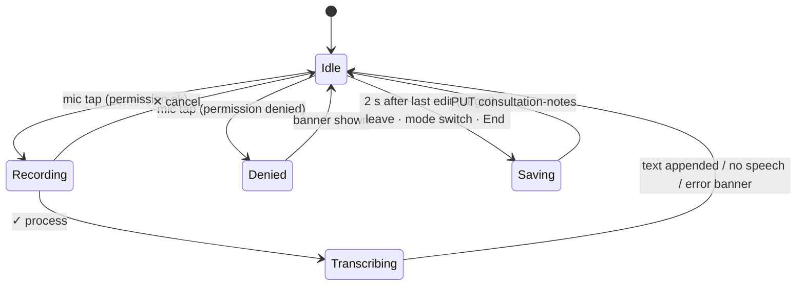

# SOAP note editor (general notes + speech-to-text + focus mode)

| | |
|---|---|
| Area | Appointments & visit |
| Who sees it | Doctor. Mic icons PRO+ (speech-to-text); hidden for BASIC |
| Reached from | Notes card in the in-person workspace (04) and video call (11) in *General Form* mode; focus-mode icon opens the full-screen variant |
| Screen type | Section inside the workspace; focus mode = full-screen modal page |
| Current Flutter source | `lib/features/appointments/presentation/widgets/consultation_soap_section.dart`, `lib/core/widgets/doctor_speech_text_field.dart`, `lib/core/api/doctor_transcription_api.dart`, focus mode in `in_person_appointment_screen.dart` (`_openConsultationFocusMode`) |
| Spec | `docs/kmp-spec/05-appointments-video-dental.md` §2.1–2.2; `02-home-ai-intelligence.md` §7.2–7.3; tickets APPT-03, AI-05, AI-06 |

## 1. Purpose
Where the doctor writes what happened: four optional structured fields (Subjective, Objective, Assessment, Plan) and one free-text area, each with a mic that turns speech into text. Every visit; most doctors use only the free area, dentists rarely use it (they use 07).

## 2. Entry points
- Workspace Notes card in General mode (default for non-dental professions) — the section is always rendered; no navigation.
- Focus-mode icon in the Notes card title → full-screen page "Consultation notes" with only the free-text area (SOAP fields not shown there).
- Helper actions (*From Shifa AI*, *From last 025-2 form*, AI note *+*) append text to the free area.
- Arrives with: existing manual notes (hydrated once from the server if the field is empty).

## 3. Layout, top to bottom (phone portrait)
1. **"Structured notes (SOAP)"** expander, subtitle "Optional sections — included in the saved consultation PDF." Collapsed by default; state kept while scrolling.
   - Four outlined fields, labels Subjective · Objective · Assessment · Plan; 1–3 lines each, grow with content; sentence capitalisation; mic icon at the trailing edge (PRO).
2. **Free notes** card: borderless multi-line field, placeholder "Enter appointment notes...", 17 pt text, 6 visible lines growing to 12 (then scrolls inside); mic icon top-right. In focus mode the field fills the page.
3. **Recording pill** (appears over the bottom of the active field while recording): dark rounded bar with a 40-bar live waveform, ✕ cancel on the left, ✓ confirm on the right (✓ becomes a spinner while transcribing). Adds 40–48 px bottom padding to the field so text is not hidden. No elapsed timer today (target: "0:42").
4. Below (in the workspace, not part of this section): *Start AI Notes* (06).

## 4. Data and formats
| Field | Source | Format rule |
|---|---|---|
| SOAP fields, free notes | local; saved as one text body | Saved body = "Subjective\n{text}\n\nObjective\n…\n\n{free}" — labels baked in, in the UI language at save time |
| Max length | none | no limit enforced; target: soft limit 20 000 chars with counter after 18 000 |
| Transcript language | UI locale uz / ru / en (else uz) | sent as `languageHint`; server may auto-detect |
| Transcript insertion | append at end with a space/newline separator | cursor moves to end; never replaces selection (target: insert at cursor) |
| Audio | AAC-LC 32 kbps 16 kHz mono `.m4a` | temp file deleted after upload (target) |
| Transcribe timeout | 90 s send + 90 s read | then "error: timeout" today |

## 5. Primary flow (happy path, dictation)
1. Doctor taps the mic in the free notes field → mic permission (first time) → recording pill slides up, waveform moves.
2. Speaks; taps ✓ → pill shows spinner, banner "Transcribing…".
3. Text appended to the field; banner "Transcription added" (10 s with a *Report* action when the backend QA flag is on, else 4 s).
4. Doctor edits by hand; nothing is saved yet — saving happens on leave, mode switch or End (today) / 2 s autosave (target).

## 6. Screen states
- **First load:** fields render empty immediately; when server notes arrive and the free field is still empty, it is filled once (no flicker: hydrate before first paint when cached).
- **Empty:** placeholders only; SOAP collapsed.
- **Error on load:** notes fetch failure is silent (treated as no notes); target: small inline "Could not load earlier notes · Retry" under the field.
- **Offline:** typing works; mic tap → banner "You are offline — dictation needs a connection"; drafts kept locally (target).
- **Refreshing:** n/a (no polling here).
- **Partial data:** an AI note exists but no manual note → free field stays empty; AI text is reachable via *From Shifa AI*.
- **Permission needed:** mic denied once → banner "Microphone permission denied"; denied permanently → same banner with *Open settings*; the pill never opens.
- **Locked by tier:** BASIC → mic icons hidden entirely (today). Target: hidden, with one line under the free field "Dictation needs PRO · Learn more" shown once per visit. Backend 403 on transcribe → "Speech-to-text requires a Pro subscription."
- **Role difference:** n/a (doctor only).

## 7. Interactions and secondary flows
- **Mic tap** → start recording (pill). Second tap on the same mic while recording → ignored; other mics disabled while one records.
- **✕** → discard recording, pill closes, nothing inserted.
- **✓** → stop, upload, transcribe, append; spinner until done; on "(No speech detected)" → banner "No speech detected", nothing inserted.
- **Report** action on the success banner → sends transcript (+ audio when available) for QA → banner "Thank you — saved for QA."; 404 → action silently unavailable.
- **Expander header tap** → opens/closes SOAP; state remembered during the visit (target: remember per doctor).
- **Focus mode icon** → modal page; back saves nothing extra (same controller) and returns.
- **Helper *+* (From Shifa AI / last 025-2)** → appends with a blank line; banner "Added to notes".
- **Keyboard**: multi-line fields use newline; "Done" dismisses; the pill stays above the keyboard.
- **Long press** in the field → system select/copy/paste.

## 8. Edge cases
- Notes typed offline → kept in the field; first save on reconnect (target autosave queue). Today lost if the app dies.
- Recording longer than a few minutes → no client limit; upload grows (~240 KB/min). Target: cap dictation at 5 min with a warning at 4:30 (scribe has its own flow, 06).
- Phone call interrupts recording → recorder stops (OS); target: treat as ✓ if ≥ 2 s were captured, else cancel with banner "Recording interrupted".
- App backgrounded while recording → same as above.
- Transcription takes > 10 s → keep spinner; > 90 s → banner "Transcription timed out. Try again." (today "error: TimeoutException…").
- Rate limit (429) → "You've reached your daily AI usage limit. Try again tomorrow."
- Transcript arrives after the doctor switched mode → appended to the field that requested it (controller survives) — but if the mode switch discarded notes, the text lands in a cleared field; acceptable.
- Language switch mid-visit → new dictations use the new language hint; labels in the final saved body are the ones at save time.
- 200 % font → fields grow; the pill overlays more of the field — keep the 48 px padding dynamic.
- Rotation → text preserved; pill re-laid out.
- Very long text (10k+ chars) → field scrolls internally (12 lines max in the workspace, full page in focus mode).
- Pasting rich text → plain text only.
- Screen reader: field label, then mic button "Speak to type", pill buttons "Cancel recording" / "Process recording"; announce "Transcription added".
- Two devices → last save wins (see 04 §8).
- 401 during transcribe → logout; recording discarded.
- Dictating into a SOAP field that is collapsed (expander closed after starting) → the pill stays attached to the field; expander must not collapse while a recording is active (disable the header tap).
- Doctor switches to 025-2 mode while a transcription is in flight → the transcript lands in the (now hidden) free notes field and is saved with the general notes; acceptable, but the success banner should say "Transcription added to general notes".
- Auto-capitalisation and Uzbek apostrophes (oʻ, gʻ) → the field must accept the typographic apostrophe; the transcript uses whatever the server returns.
- Hydration race: server manual notes arrive after the doctor already typed → the field is **not** overwritten (only filled when empty) — keep this rule; show a small "Earlier notes available · Insert" link instead (target).

## 9. Validation and messages
| Field/action | Rule | When checked | Message (EN) | Where |
|---|---|---|---|---|
| Mic | permission granted | on tap | Microphone permission denied | banner (+ Open settings when permanent) |
| Mic | recorder started | on tap | Error recording voice | banner |
| ✓ | upload/transcribe in progress | after tap | Transcribing… | banner |
| ✓ | transcript empty | after response | No speech detected | banner |
| ✓ | 200 | after response | Transcription added (+ "If the text looks wrong, tap Report to send it for QA (optional audio)." with *Report*) | banner |
| ✓ | 403 | after response | Speech-to-text requires a Pro subscription. | banner |
| ✓ | 429 | after response | You've reached your daily AI usage limit. Try again tomorrow. | banner |
| ✓ | timeout / other | after response | Transcription timed out. Try again. / error text | banner |
| Report | 2xx | after POST | Thank you — saved for QA. | banner |
| Free notes | soft limit (NEW) | while typing | {n} / 20 000 | counter under field |

## 10. Navigation out
- Leaving the workspace saves the combined body (04 §10). Focus mode back → returns to the workspace, same text.
- Mode switch → asks (04 §7); *Discard and switch* clears all five fields.

## 11. Copy
`soapNotesSectionTitle` "Structured notes (SOAP)", `soapNotesSectionSubtitle`, `soapSubjective` "Subjective", `soapObjective` "Objective", `soapAssessment` "Assessment", `soapPlan` "Plan", `enterNotes` "Enter appointment notes...", `speakToType` "Speak to type", `processRecording` "Process", `cancel`, `microphonePermissionDenied`, `errorRecordingVoice`, `transcribing` "Transcribing…", `noSpeechDetected`, `transcriptionAdded`, `transcriptionReportHint`, `transcriptionReportAction` "Report", `transcriptionReportThanks`, `speechToTextRequiresPro`, `consultationFocusModeTitle` "Consultation notes".
**NEW:** `transcriptionTimedOut` "Transcription timed out. Try again.", `aiDailyLimitReached` "You've reached your daily AI usage limit. Try again tomorrow." (hard-coded in code today), `dictationNeedsPro` "Dictation needs PRO", `dictationOffline` "You are offline — dictation needs a connection", `recordingInterrupted` "Recording interrupted", `cancelRecording` "Cancel recording", `couldNotLoadEarlierNotes` "Could not load earlier notes", `noteCharCounter` "{n} / {max}".

## 12. Known problems in the current app (do not carry over)
- No autosave; drafts live only in memory until leave/switch/end.
- Labels are embedded into the saved text, so one note body mixes languages if the doctor switches language between saves; the backend has `subjective/assessment/plan` fields that the client never uses.
- The recording pill has no timer and no maximum duration.
- Error text is raw ("error: TimeoutException after 0:01:30…"); rate-limit copy is hard-coded English.
- Mic hidden for BASIC with no explanation.
- Transcript always appended at the end, never at the cursor.
- Focus mode drops the SOAP fields.

## 13. Open questions for design
- Should SOAP be four fields or a segmented "S / O / A / P" switcher over one text area (saves vertical space)?
- Is the free notes area needed when SOAP is used, or should "Plan" absorb it?
- Where does the dictation language live — follow UI language (current) or a per-field chip (uz/ru/en) for bilingual consultations?
