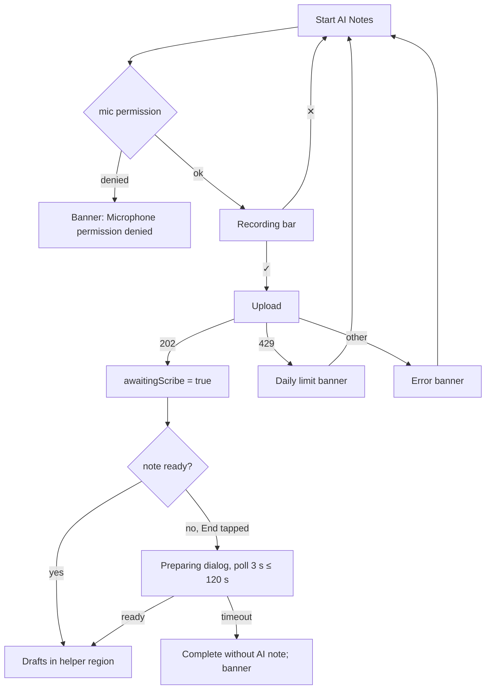

# AI scribe (ambient recording) flow

| | |
|---|---|
| Area | Appointments & visit |
| Who sees it | Doctor, PRO+ (`aiNotes` feature). BASIC: button hidden |
| Reached from | *Start AI Notes* button under the free notes in the in-person workspace (04); target also in the video call (11) |
| Screen type | Inline recorder bar inside the Notes card → modal "preparing" dialog at End → results in the AI helper region |
| Current Flutter source | `in_person_appointment_screen.dart` (`_startAiNotes`, `_uploadScribeRecording`, `_waitForScribeUi`), `lib/core/widgets/inline_voice_recorder_bar.dart`, `lib/core/widgets/doctor_voice_recorder_session.dart`, `lib/core/api/consultation_notes_api.dart` (`waitForScribeReady`) |
| Spec | `docs/kmp-spec/05-appointments-video-dental.md` §2.2 (upload, wait), §2.3 step 7; `02-home-ai-intelligence.md` §7.1; tickets SCRIBE-01, SCRIBE-02 |

## 1. Purpose
The doctor lets the phone listen to the consultation; the server turns the audio into a structured note and ICD suggestions that appear as drafts to review. It replaces typing for doctors who talk through the visit. Optional; a few times a day for PRO users.

## 2. Entry points
- Workspace Notes card, General or Dental mode: *Start AI Notes* (secondary button, mic icon, full width).
- Target: the same button in the video call notes panel (today the video visit has no recorder; scribe only arrives if the server records the call).
- Arrives with: appointment id, UI language (uz/ru/en → sent as `language`; anything else → uz).

## 3. Layout, top to bottom (phone portrait)
1. **Idle:** *Start AI Notes* button.
2. **Recording bar** (replaces the button): title "Recording for AI Notes", dark pill with 40 live waveform bars, ✕ on the left, ✓ "Process" on the right, hint under it "Stop when you are done — pauses and filler words are fine." No timer today — target: elapsed "12:03" and a subtle red dot. Recording starts the instant the bar mounts.
3. **Uploading:** banner "Uploading file..." (today a persistent snackbar) → then "Recording uploaded. Notes will be ready in a few minutes." The bar disappears and the button returns.
4. **At End Appointment** (12): if the note is not ready yet, a blocking dialog: spinner + "Preparing AI scribe documentation from the recording…" (up to 120 s, polling every 3 s). Target: add *Continue without waiting*.
5. **Result:** AI note(s) appear in the helper region (*From Shifa AI*): saved AI notes carousel and orange draft cards with *Save as note* / *Discard* and ICD rows with *Apply* (04 §3.5.2). The appointment details sheet (01) also polls every 4 s for 2 min so the note shows there after the visit.

## 4. Data and formats
| Field | Source | Format rule |
|---|---|---|
| Audio | AAC-LC 32 kbps, 16 kHz mono, `.m4a` named `ai_notes_{epochMs}.m4a` | ~240 KB per minute; 30 min ≈ 7 MB |
| Max duration | none in code | target: 90 min hard cap, warning banner at 60 min (UNVERIFIED backend limit) |
| Upload | `POST /api/consultations/upload-recording` multipart (`audio`, `appointmentId`, `language`) | 202 = accepted; 429 = daily limit; other = error body |
| Status | `GET /api/appointments/{id}/scribe-status` → `{status, hasDocumentation, hasScribeNote}` | polled every 3 s, give up after 120 s |
| Result | consultation notes with source AI_DRAFT + draft notes with ICD suggestions | AI note text strips a trailing "TRANSCRIPT:" block |

## 5. Primary flow (happy path)
1. Tap *Start AI Notes* → mic permission (first time) → bar appears, recording.
2. Consultation happens; doctor may type in parallel.
3. Tap ✓ → bar closes → "Uploading file..." → 202 → "Recording uploaded. Notes will be ready in a few minutes."; screen flag "awaiting scribe" set.
4. Doctor continues; when curious taps ⋮ → *From Shifa AI*: drafts shown if ready, else banner "AI notes are not ready yet. Please try again in 30 seconds."
5. Tap *End Appointment* → pipeline (12) sends `awaitingScribe=true`; if the server reports the note is still pending, the "Preparing…" dialog polls up to 120 s; then the PDF includes the AI block first, the doctor's notes second.

## 6. Screen states
- **First load:** n/a (button).
- **Empty:** no recording yet → button only.
- **Error on load:** n/a.
- **Offline:** button disabled with banner on tap "You are offline"; if offline at ✓ → keep the file and retry upload when online (target; today the upload fails and the audio is lost).
- **Refreshing:** poll only inside the End dialog; the helper region does not auto-refresh (target: refresh when the doctor opens *From Shifa AI*).
- **Partial data:** upload accepted but the server never produces a note → End completes after 120 s with "Appointment ended. AI documentation will appear shortly." and the note may never come; details sheet keeps polling 2 min.
- **Permission needed:** mic denied → banner "Microphone permission denied" (+ *Open settings* when permanent); bar closes.
- **Locked by tier:** BASIC → button hidden today. Target: button visible, disabled, lock icon, caption "AI notes need PRO".
- **Role difference:** n/a.

## 7. Interactions and secondary flows
- **✕ (cancel)** → stop and delete the file; button returns; nothing uploaded.
- **✓ (Process)** → §5. Button disabled during upload.
- **Start again after a successful upload** → allowed; a second recording creates a second note on the server (UNVERIFIED merge behaviour). Target: show "A recording is already processing" and allow a second one only after the first note arrived.
- **Pause** → not available. Target: none (pauses in speech are fine; keep it one button).
- **Leaving the screen while recording** → recorder keeps running until disposed; file discarded. Target: ask "Stop recording and leave? The recording will be processed." (*Keep recording* · *Process and leave* · *Discard*).
- **Preparing dialog → Continue without waiting** (target) → completes the visit; the note arrives later as a document update.
- **Draft card → Save as note / Discard / Apply ICD** → see 04 §7.

## 8. Edge cases
- Scribe times out (120 s) → visit still completes; PDF has only doctor notes; banner says AI docs will appear shortly — but the PDF never gets regenerated. Target: backend-rendered summary that updates when the note lands (PDF-01), or a "Summary pending AI note" state in details.
- Server returns 202 but the file was silent → note arrives empty or not at all; End shows "No items to save" if nothing else was typed.
- Phone call interrupts → OS stops the recorder; on return the bar is still shown; ✓ uploads what was captured. Target: banner "Recording stopped by a call — tap Process to send what was recorded."
- App killed while recording → file lost. Target: write to a temp file continuously and offer "Send previous recording?" on reopen (keyed by appointment id).
- Mic in use by the video call (11) → on the same screen the SDK owns the mic; a second recorder may fail → "Error recording voice". Target: in video visits the scribe uses the call audio (backend) — out of scope for the client.
- Very long consultation (60+ min) → large upload on mobile data; show size estimate in the leave/process confirmation.
- 429 → "You've reached your daily AI usage limit. Try again tomorrow."; the recording is discarded today — target: keep the file for a retry tomorrow? Decide (§13).
- Upload fails (network) → error banner with body text; audio lost today.
- Language switch mid-recording → upload uses the language at ✓ time.
- Rotation → bar stays; waveform continues.
- 200 % font → title and hint wrap; pill stays 1 row.
- Double tap ✓ → one upload (bar unmounts on first tap).
- 401 at upload → logout; recording lost.
- Two devices → each may record; two notes.
- Screen reader: "Recording for AI Notes, recording", buttons "Cancel recording", "Process recording"; announce upload result.

## 9. Validation and messages
| Field/action | Rule | When checked | Message (EN) | Where |
|---|---|---|---|---|
| Start | mic permission | on tap | Microphone permission denied | banner |
| Start | recorder error | on tap | Error recording voice | banner |
| ✓ | uploading | immediately | Uploading file... | banner (persistent until response) |
| ✓ | 202 | after response | Recording uploaded. Notes will be ready in a few minutes. | banner (success) |
| ✓ | 429 | after response | You've reached your daily AI usage limit. Try again tomorrow. | banner (error) |
| ✓ | other | after response | Error uploading file: {body} | banner (error) |
| From Shifa AI | no AI content yet | on tap | AI notes are not ready yet. Please try again in 30 seconds. | banner |
| End | note pending | during End | Preparing AI scribe documentation from the recording… | blocking dialog |
| End | timeout, nothing else to save | after 120 s | Appointment ended. AI documentation will appear shortly. | banner |
| Leave while recording (NEW) | recording active | on back | Stop recording and leave? The recording will be processed. | dialog |

## 10. Navigation out
- None of its own; lives inside 04/11. Leaving the workspace while recording → see §7 (target dialog).

## 11. Copy
`startAiNotes` "Start AI Notes", `recordingForAiNotes` "Recording for AI Notes", `processRecording` "Process", `voiceRecordingFinishHint`, `uploadingFile` "Uploading file...", `aiNotesUploaded`, `errorUploadingFile`, `preparingAiDocumentation`, `aiNotesNotReadyTryLater`, `aiDocumentationWillAppearShortly`, `microphonePermissionDenied`, `errorRecordingVoice`, `cancel`.
**NEW:** `aiNotesNeedPro` "AI notes need PRO", `continueWithoutWaiting` "Continue without waiting", `leaveWhileRecordingTitle` "Stop recording and leave?", `leaveWhileRecordingBody` "The recording will be processed.", `keepRecording` "Keep recording", `processAndLeave` "Process and leave", `recordingStoppedByCall` "Recording stopped by a call — tap Process to send what was recorded.", `recordingAlreadyProcessing` "A recording is already processing", `aiDailyLimitReached` (see 05), `scribeElapsed` (format "mm:ss").

## 12. Known problems in the current app (do not carry over)
- No timer, no maximum duration, no pause; recording starts silently the moment the bar appears.
- "Preparing…" dialog cannot be cancelled for up to 120 s.
- Recorder exists only on the in-person screen; video visits cannot start a scribe.
- Audio is lost on any upload error, 429, back navigation or crash.
- Uploading/success messages are snackbars, one of them persistent.
- The visit-facts review (what was said → tasks/timeline) is only wired on the video screen, not here where the recording actually happens.

## 13. Open questions for design
- Should the recorder be a floating pill at the bottom of the workspace (visible while scrolling and in dental mode) instead of inline under the notes?
- Keep audio after 429 for a retry the next day, or discard with a clear message?
- Should drafts arrive as a bottom sheet "AI note ready — review" instead of hiding behind ⋮ → From Shifa AI?
