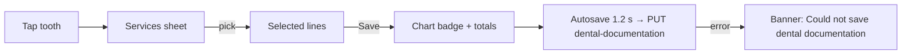

# Dental FDI chart entry (dental visit record)

| | |
|---|---|
| Area | Appointments & visit |
| Who sees it | Doctor whose profession matches the dental list (dentist, orthodontist, stomatolog, tish shifokori, …). Not tier-gated |
| Reached from | Notes card in the workspace (04) / video call (11) in *Dental visit record* mode (default for dental professions; also via ⋮ menu); fullscreen icon opens the overlay variant |
| Screen type | Section inside the Notes card; full-screen overlay on demand; services picker and fulfil picker are bottom sheets |
| Current Flutter source | `lib/features/appointments/dental/dental_visit_documentation_panel.dart`, `dental_fdi_chart.dart`, `dental_chart_codec.dart`, `dental_documentation_professions.dart` |
| Spec | `docs/kmp-spec/05-appointments-video-dental.md` §4.1–4.3, §4.5; tickets DENTAL-01, DENTAL-02 |

## 1. Purpose
Dentists document a visit by tooth: tap a tooth on the FDI chart, pick the services done from their price list, add non-tooth services, apply a discount and write clinical notes; the panel keeps a running total that goes into the visit summary. When a treatment plan is linked, the same chart is used to tick planned items as done (08). Every dental visit.

## 2. Entry points
- Automatic: profession is dental → the Notes card opens in dental mode (unless the doctor already switched modes in this visit).
- ⋮ → *Dental visit record* for dental professions.
- Fullscreen icon → overlay with the same panel, title "Dental visit record", *Collapse* icon.
- Arrives with: appointment id, optional active plan id + plan detail + fulfilment candidates (08), fulfilled line ids, clinic id.

## 3. Layout, top to bottom (phone portrait)
**Free mode (no plan linked):**
1. Intro text: "Tap a tooth (FDI-style quadrants), add your catalog services, then set discount if needed. Totals use the first currency found on priced lines."
2. **Tooth map** header "TOOTH MAP"; two horizontally scrollable rows: upper (18→11 | 21→28) with quadrant labels I / II above, lower (48→41 | 31→38) with IV / III below; anatomy captions under groups (incisors, Canine, pre-molars, molars, wisdom — English only today). Each tooth is a 45×60 tile with a drawn shape (incisor/canine/premolar/molar + roots), FDI number, and a count badge when it has services. **Dentition toggle is hidden in the visit panel** — always permanent (32 teeth); primary/mixed only via a linked plan's dentition.
3. **General / non-tooth services** button with count "(2)"; hint "Procedures not tied to a specific tooth (e.g. lip frenectomy, consultation)."
4. **Discount** field (percent, numeric keyboard with decimal).
5. **Clinical notes** multi-line field with mic (05 rules apply).
6. **Totals card**: "Subtotal: 1 250 000.00 UZS · 4 line items", "Discount: 10.0%", "Total due: 1 125 000.00 UZS".

**Plan mode (plan linked):** intro "Tap a tooth to mark planned procedures as completed."; chart coloured by plan state (planned light teal, completed teal, partial orange) with counts from the plan; general-services button; clinical notes; banners (see 08). No discount/total card (plan finance card 09 instead).

**Services picker sheet** (tap tooth / general): title "Services for tooth 16" or "General / non-tooth services"; left column: service groups; right: services with price line "120 000.00 UZS"; "Selected services" list with per-line delete; *Save*. Empty catalogue → "Define services under Services & Pricing first." + "Add service".

## 4. Data and formats
| Field | Source | Format rule |
|---|---|---|
| Tooth key | FDI two-digit (11–48 permanent, 51–85 primary); legacy "UR1" keys normalised | number shown on tile |
| Service line | `{serviceId, title, amountMinor, currency}` from `GET /api/doctors/me/services` (active services, first positive price) | price = minor/100 with 2 decimals + currency code (target: `Money.format`, no decimals for UZS) |
| Count badge | lines per tooth | integer, hidden at 0 |
| Discount | text → number, comma accepted | clamp 0–100; invalid → 0 |
| Subtotal | sum of priced lines **in the first currency found** | lines in another currency are silently skipped today — target: block mixed currencies with a banner |
| Total due | subtotal × (100 − discount)/100, rounded | same currency |
| Saved document | `PUT /api/appointments/{id}/dental-documentation` `{version:2, dentition, teeth{fdi:[lines], __general__:[…]}, discountPercent, notes}` | autosave 1 200 ms after last change; flush on leave/mode switch/End |
| Existing doc | `GET …/dental-documentation` on open | hydrates chart; if notes empty, prefilled from manual consultation notes |

## 5. Primary flow (happy path, free mode)
1. Mode opens → services catalogue + saved dental doc load (skeleton chart) → chart renders.
2. Tap tooth 16 → sheet → pick group → tap service → appears under "Selected services" → *Save* → tile 16 gets badge "1"; totals update; autosave fires after 1.2 s (no visible feedback today — target: tiny "Saved" tick near the title).
3. Repeat; tap *General / non-tooth services* for consultation fees.
4. Enter discount 10 → totals recalc live.
5. Dictate or type clinical notes.
6. *End Appointment* (12): panel flushes, builds the "DENTAL VISIT — Procedures by tooth" billing table for the summary.

## 6. Screen states
- **First load:** chart skeleton (two grey rows) + disabled picker buttons until catalogue and saved doc arrive (today: thin linear progress).
- **Empty:** no services on any tooth → chart without badges, totals "Subtotal: 0.00 UZS · 0 line items". Empty catalogue → picker shows "Define services under Services & Pricing first." with *Add service* (→ Profile › Services & pricing, folder 08).
- **Error on load:** catalogue or saved doc failed → inline "Could not load dental record" + *Retry*; chart stays disabled (today: silent, chart usable with empty catalogue).
- **Offline:** chart taps work; autosave fails silently and retries on next change (today) — target: offline badge in the title, flush when online.
- **Refreshing:** autosave is invisible; plan mode refetches candidates after a fulfil (08).
- **Partial data:** saved doc has teeth keys not in the current dentition (e.g. primary 55 while chart is permanent) → lines kept in data but not visible — target: show a "Hidden: 2 primary-teeth lines" chip that switches the view.
- **Permission needed:** mic for notes (05).
- **Locked by tier:** none. Non-dental professions never see the mode.
- **Role difference:** n/a.

## 7. Interactions and secondary flows
- **Tap tooth** → services sheet; **tap again** → same sheet showing existing lines (edit/delete).
- **Services sheet → group tap** → filters right column; **service tap** → adds a line (duplicates allowed, counted twice); **line ✕** → removes; **Save** → closes (changes apply immediately; there is no cancel — target: add *Cancel* that reverts).
- **General services button** → same sheet for the `__general__` bucket.
- **Discount field** → live recalculation; blur normalises "10,5" → "10.5".
- **Clinical notes mic** → dictation (05).
- **Fullscreen icon** → overlay; *Collapse* → back inline. Switching to fullscreen flushes the save first.
- **Horizontal scroll** on each row; target: pinch-zoom not needed, rows fit at 360 px with 45 px tiles ×16 = 720 px → scrolls; consider 2 rows of 8 per jaw on phones (§13).
- **Mode switch away** with unsaved lines → *Save and switch* calls the panel's save (banner "Dental visit documentation saved") / failure "Could not save dental documentation".
- **Request save** (Save & switch) shows a banner; autosave does not.

## 8. Edge cases
- Mixed dentition / child patient → cannot be charted today (toggle hidden, 32 permanent teeth only). Target: dentition segmented control (Adult teeth / Primary (child) teeth) in free mode; mixed = allow both rows stacked with a "Show primary" toggle; persisted in `dentition`.
- Teeth already treated in earlier visits → no history shown on the chart (each visit's doc is separate; history lives in the 025-2 form chart). Target: faint "previous work" dot from the patient's last dental doc (needs endpoint — UNVERIFIED).
- Missing tooth / extraction → no condition codes exist; document as a service line ("Extraction") on that tooth.
- Services priced in two currencies (UZS and USD) → USD lines excluded from subtotal silently; PDF total wrong. Target: refuse adding a line in a second currency: "This service is priced in USD; the visit total is in UZS."
- Price changed in the catalogue mid-visit → existing lines keep their captured amount (good).
- Free consultation services (price 0) → counted as a line, amount 0.
- 50+ lines on one tooth → sheet list scrolls; badge shows "50".
- Discount typed as "150" → clamped to 100; "abc" → 0 — target: inline error "0–100".
- Autosave races End (typing within 1.2 s of tapping End) → End calls flush first (OK).
- Autosave error → today a snackbar only on manual save; silent otherwise. Target: title shows "Not saved" with *Retry*.
- Plan linked after lines were added in free mode → panel switches to plan mode and free lines are hidden (data stays on the server) — confusing; target: confirm "Switch to plan mode? Your 3 free lines stay saved but are not billed." 
- Video visit on phone → chart below the video pane; fullscreen overlay recommended.
- Rotation → row scroll positions reset; acceptable.
- 200 % font → tooth numbers may overflow the 45 px tile — tiles must scale with font or keep numbers at a fixed small size with an a11y label.
- Language switch → captions re-localise (once localised); "Canine" etc. are English today.
- Screen reader: each tooth "Tooth 16, 2 services"; rows labelled "Upper right", "Upper left", "Lower left", "Lower right".
- 401 during autosave → logout; unsaved lines (≤ 1.2 s) lost.
- Two devices → last autosave wins; no merge.

## 9. Validation and messages
| Field/action | Rule | When checked | Message (EN) | Where |
|---|---|---|---|---|
| Discount | 0–100 numeric | on change (clamp) | 0–100 (NEW inline) | under field |
| Services picker | catalogue non-empty | on open | Define services under Services & Pricing first. | sheet body |
| Add line | same currency as the first priced line (NEW) | on tap | This service is priced in {ccy}; the visit total is in {ccy2}. | banner |
| Manual save | 200 | after PUT | Dental visit documentation saved / Could not save dental documentation | banner |
| Autosave (NEW) | failure | after PUT | Not saved · Retry | title chip |
| Load | failure (NEW) | after GET | Could not load dental record · Retry | inline |

## 10. Navigation out
- Mode switch / back / End → `flushSave` first (04 §10). Fullscreen collapse → inline, nothing lost.
- *Add service* → Profile › Services & pricing (folder 08); on return the catalogue reloads (target; today only on reopen).

## 11. Copy
`docModeDental` "Dental visit record", `toothMap` "Tooth map", `dentalDocIntro`, `dentalToothServices` "Services for tooth", `dentalGeneralServices`, `dentalGeneralServicesHint`, `dentalGeneralServicesShort` "General", `dentalDiscountPercent` "Discount", `dentalClinicalNotes` "Clinical notes", `dentalSubtotal` "Subtotal", `dentalLineItems` "line items", `dentalDiscount` "Discount", `dentalTotal` "Total due", `dentalNoServices`, `dentalAddService` "Add service", `dentalSelectedServices`, `dentalDocSaved`, `dentalDocSaveFailed`, `dentalDentitionPermanent` "Adult teeth", `dentalDentitionPrimary` "Primary (child) teeth", `dentalUpperJaw`, `dentalLowerJaw`, `dentalPdfHeader`, `collapse`, `save`.
**NEW:** `toothIncisors` "Incisors", `toothCanine` "Canine", `toothPremolars` "Premolars", `toothMolars` "Molars", `toothWisdom` "Wisdom", `dentalMixedCurrency` "This service is priced in {ccy}; the visit total is in {ccy2}.", `dentalNotSaved` "Not saved", `dentalLoadFailed` "Could not load dental record", `dentalHiddenLines` "Hidden: {n} primary-teeth lines", `dentalSwitchToPlanConfirm` "Switch to plan mode? Your {n} free lines stay saved but are not billed.", `discountRange` "0–100", `quadrantUpperRight` … (4 a11y labels), `toothA11y` "Tooth {fdi}, {n} services".

## 12. Known problems in the current app (do not carry over)
- No dentition switch during a visit: children cannot be charted; only a linked plan can set "primary".
- No per-surface or condition data (caries, filling, missing…) — only service lines; the legend key `dentalLegend` ("K=caries, P=filling…") belongs to the 025-2 chart, not this one.
- Mixed-currency lines silently dropped from totals.
- Anatomy captions hard-coded English; money shown with ".00" and the currency code.
- Services sheet has no cancel; every tap is immediate.
- Autosave gives no feedback; an unsupervised save fires after the widget is destroyed.
- Rows need horizontal scrolling on every phone.

## 13. Open questions for design
- Chart geometry on phones: scrolling 16-wide rows (current) vs two stacked rows of 8 per jaw vs an arch layout?
- Should conditions (caries, missing, crown) be chartable per tooth, or stay a services-only chart until the backend supports surfaces? (Backend payload has no field for it today.)
- Where does the dentition toggle sit — above the chart or in the ⋮ menu?
- Should the totals card be sticky above the footer so the doctor sees the bill while tapping teeth?
