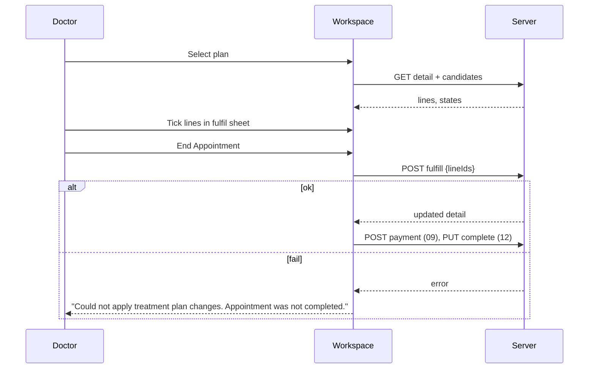

# Treatment plan in the visit (plan picker + fulfil sheet)

| | |
|---|---|
| Area | Appointments & visit (plans themselves: folder 09) |
| Who sees it | Doctor with an active clinic workspace and a numeric patient id; dental chart part only in dental mode |
| Reached from | Top of the Notes card in the workspace (04) / video call (11); the dental chart in plan mode (07); tooth tap opens the fulfil sheet |
| Screen type | Panel inside the Notes card + bottom sheet (fulfil picker) |
| Current Flutter source | `lib/features/appointments/presentation/appointment_treatment_plan_panel.dart`, `dental/dental_visit_documentation_panel.dart` (plan mode, `_openPlanFulfillSheet`, `applyPendingIfNeeded`) |
| Spec | `docs/kmp-spec/05-appointments-video-dental.md` §4.3 plan mode, §5; ticket DENTAL-03; `09-clinic-workspace-finance-treatment-plans.md` for plan creation |

## 1. Purpose
When the patient has an active comprehensive treatment plan, the doctor links this visit to it and ticks the planned procedures performed today; the plan's progress and finances update when the visit ends. Common in dental clinics; rare elsewhere.

## 2. Entry points
- Panel renders automatically when: a clinic is selected in the Clinic workspace, the patient id is numeric and the appointment is not completed. It loads the patient's ACTIVE COMPREHENSIVE plans.
- Auto-selection: the plan already linked to the appointment (`linkedPlanId`), otherwise the only plan if exactly one exists, otherwise "None / bill separately".
- Fulfil sheet: tap a tooth / *General services* on the plan-mode chart (dental mode only). Non-dental doctors can link a plan but have **no UI to tick lines** today (§12).
- Arrives with: clinic id, patient id, appointment id, linked plan id/title, fulfilled line ids.

## 3. Layout, top to bottom (phone portrait)
1. **Linked banner** (when the appointment is already part of a plan): "Part of plan #{id} — {title}".
2. Title "Treatment plan for this visit", hint "Tick planned items on the teeth chart below." (shown even outside dental mode — §12).
3. **Dropdown** "Active comprehensive plan": "None / bill separately", then each plan's title or "(untitled plan) #{id}".
4. **Progress** line: "{done}/{total} planned items completed".
5. (Dental mode) **Plan-mode chart** (07) coloured by state; **banners** above it: "All planned items on this plan are completed." · "Could not load open plan lines. Try again." + *Retry* · "No open planned lines on this plan."; thin progress while loading.
6. **Fulfil sheet** (tooth tap): title "Services for tooth 16" / "General / non-tooth services"; hint "Select the planned lines completed during this visit."; checkbox rows: line title, subtitle "{qty} × {unit price} · {status}"; already-fulfilled rows checked and disabled; *Save* in the footer.
7. Below the chart: **Plan finances** card (09).

## 4. Data and formats
| Field | Source | Format rule |
|---|---|---|
| Plans | `GET /api/treatment-plans?clinicId&patientId&status=ACTIVE&planKind=COMPREHENSIVE` | title 1 line ellipsis; "(untitled plan) #12" fallback |
| Progress | plan summary `linesCompletedCount/linesTotalCount` | "3/8 planned items completed" |
| Candidates | `GET /api/treatment-plans/{planId}/fulfillment-candidates?appointmentId=` | per line: id, title, FDI tooth, dentition, qty, unit price, status, `toothMatch` |
| Tooth state | from plan lines' `specialtyMetadata.fdi` + status | COMPLETED → completed (teal), CANCELLED → partial (orange, questionable), else planned (light teal) |
| Pending ticks | local set minus already fulfilled | posted only at End: `POST /api/treatment-plans/{planId}/appointments/{apptId}/fulfill {lineIds}` |
| Dentition | plan's `dentalPlanDocumentation.dentition` | chart follows the plan |

## 5. Primary flow (happy path)
1. Workspace opens → panel shows a skeleton line → plans arrive → the single plan is auto-selected → banner + progress; dental chart switches to plan mode and candidates load.
2. Doctor taps tooth 24 → fulfil sheet lists "Composite filling · 1 × 350 000 UZS · PLANNED" → checks it → *Save* → tooth 24 turns orange? No — today the tile state only changes after the server confirms; locally the badge count stays. Target: tick shown as a check mark overlay on the tile immediately.
3. Doctor enters a payment in Plan finances (09).
4. *End Appointment* → pipeline step 1 posts the ticked line ids → on success the visit continues; on failure the visit is **not** completed and a banner says so.

## 6. Screen states
- **First load:** one skeleton line in place of the dropdown; chart greyed with thin progress.
- **Empty:** no active plans → dropdown with only "None / bill separately"; target: hide the panel entirely and show a one-line "No active treatment plan" under the header.
- **Error on load:** plans fetch failed → today panel silently shows "None"; target: "Could not load treatment plans · Retry". Candidates failed → banner "Could not load open plan lines. Try again." + *Retry* (exists).
- **Offline:** dropdown disabled; ticks allowed locally? No — candidates cannot load; show the offline banner.
- **Refreshing:** after a fulfil at End the detail is refetched for the PDF; during the visit, changing the dropdown reloads detail + candidates (chart flickers today — keep the old chart until new data arrives).
- **Partial data:** detail loaded but candidates empty while progress < total → "Could not load open plan lines" banner with Retry.
- **Permission needed:** n/a.
- **Locked by tier:** none (clinic feature; folder 09 may gate plan creation).
- **Role difference:** n/a in the visit.

## 7. Interactions and secondary flows
- **Dropdown change** → local selection only (no link call) → detail + candidates load → chart recolours. "None" → chart back to free mode (free lines reappear).
- **Tooth tap (plan mode)** → fulfil sheet; no candidates for that tooth → banner "No open planned lines for this tooth."
- **Checkbox** → toggles pending set; disabled when already fulfilled.
- **Save** in the sheet → closes; nothing sent yet.
- **Retry** banner button → reload candidates.
- **Linked banner tap** (target) → plan detail (folder 09) pushed; drafts flushed first.
- **End Appointment** → fulfil posted first; failure stops the pipeline (12).

## 8. Edge cases
- Two active plans → nothing auto-selected; doctor must pick; if they forget, items are never ticked — target: highlight the dropdown with "Choose the plan for this visit" when candidates exist.
- Plan completed meanwhile (another doctor fulfilled the last line) → "All planned items on this plan are completed." banner; ticks impossible.
- Line cancelled on the plan while ticked here → fulfil returns an error → visit not completed; banner; the doctor must untick. Target: error names the line.
- Non-dental visit with a plan → progress shown but no way to tick: target a simple checklist of candidate lines instead of the tooth chart.
- Plan in a different currency than the clinic default → finance card shows the plan currency; dental free lines hidden anyway.
- Primary dentition plan on a chart → chart follows the plan (20 teeth); candidates for permanent teeth would not be tappable — show them under *General*.
- Ticks made, then the plan dropdown switched to another plan → pending ticks cleared silently today; target: confirm.
- Ticks made, then back/leave → pending ticks are **lost** (only posted at End); target: persist locally per appointment and restore on reopen, or post immediately with an undo.
- Visit opened on two devices → both can tick; the second fulfil of the same line is rejected or idempotent (UNVERIFIED).
- 401 at fulfil → logout; visit stays in progress.
- Slow network (>3 s) at End → End button spinner; pipeline step label (12) "Applying treatment plan…".
- Rotation/language/200 % → sheet scrolls; subtitle lines wrap; status word localised via the clinic status map (folder 09).
- Screen reader: checkbox rows "Composite filling, tooth 24, planned, not checked".

## 9. Validation and messages
| Field/action | Rule | When checked | Message (EN) | Where |
|---|---|---|---|---|
| Tooth tap | candidates for tooth exist | on tap | No open planned lines for this tooth. | banner |
| Candidates | load failed | after GET | Could not load open plan lines. Try again. | inline banner + Retry |
| Plan | all lines done | on data | All planned items on this plan are completed. | inline banner |
| Plan | no open lines | on data | No open planned lines on this plan. | inline banner |
| End → fulfil | 2xx | during End | Could not apply treatment plan changes. Appointment was not completed. | top banner, pipeline stops |
| Plans (NEW) | load failed | after GET | Could not load treatment plans · Retry | inline |
| Switch plan with ticks (NEW) | pending ticks | on change | Discard {n} ticked items? | dialog |

## 10. Navigation out
- None of its own. Pending ticks survive mode switch (same panel state) but not leaving the screen (§8). Plan detail (target) → folder 09, back returns with the chart refreshed.

## 11. Copy
`appointmentTreatmentPlanTitle` "Treatment plan for this visit", `appointmentTreatmentPlanChartHint`, `appointmentTreatmentPlanPick` "Active comprehensive plan", `appointmentTreatmentPlanNone` "None / bill separately", `appointmentLinkedPlanBanner` "Part of plan #{{id}} — {{title}}", `clinicTreatmentPlansUntitled` "(untitled plan)", `dentalPlanProgress` "{{done}}/{{total}} planned items completed", `appointmentPlanChartIntro`, `appointmentPlanFulfillSheetHint`, `appointmentPlanNoLinesOnTooth`, `appointmentPlanAllDone`, `appointmentPlanLoadFailed`, `appointmentPlanNoOpenLines`, `appointmentPlanApplyFailed`, `dentalPlanLegendPlanned/Partial/Completed`, `retry`, `save`.
Unused but present (from an earlier design): `appointmentPlanModeFulfill` "Fulfill planned items", `appointmentPlanModeExtra` "Add extra (not in plan)", `appointmentPlanExtraIncrease`, `appointmentPlanApply` "Apply to plan", `appointmentPlanApplied` — reuse if the "extra line" mode is designed (§13).
**NEW:** `noActivePlan` "No active treatment plan", `choosePlanForVisit` "Choose the plan for this visit", `plansLoadFailed` "Could not load treatment plans", `discardTicks` "Discard {n} ticked items?", `fulfilLineError` "{line} could not be marked as completed".

## 12. Known problems in the current app (do not carry over)
- Ticks are held in memory and posted only at End; leaving the screen loses them; no immediate feedback on the tile.
- Selecting a plan never links it to the appointment client-side; linking seems to happen server-side on fulfil (UNVERIFIED) — so a visit with a selected plan and zero ticks is not linked.
- The panel and its "tick on the chart" hint appear for non-dental doctors who have no chart.
- CANCELLED lines colour the tooth "partial" (orange).
- Strings for an "extra, not in plan" mode exist but no UI — adding an unplanned procedure during a plan visit is impossible; the doctor must switch to "None" and lose plan tracking.
- The same plan-section builder for the PDF exists three times.

## 13. Open questions for design
- Should ticking happen immediately (optimistic, with undo) instead of at End?
- Non-dental plan visits: a checklist card of plan lines — yes/no?
- "Add extra (not in plan)": design the mixed case (planned ticks + extra billed lines in one visit)?
