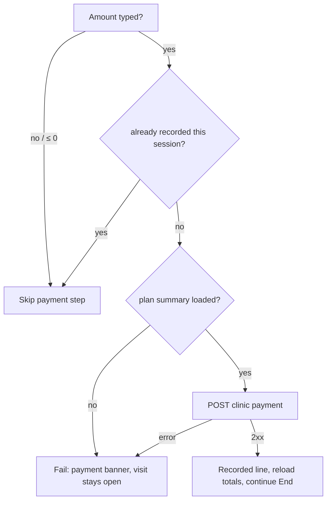

# Payment during the visit (plan finances card)

| | |
|---|---|
| Area | Appointments & visit (finance ledger: folder 09) |
| Who sees it | Doctor, only when a clinic workspace is selected **and** a treatment plan is linked **and** the Notes card is in dental mode |
| Reached from | Below the plan-mode dental chart (07/08) in the workspace (04) / video call (11) |
| Screen type | Card inside the Notes card |
| Current Flutter source | `lib/features/appointments/presentation/appointment_plan_finance_card.dart` (`recordSessionPaymentIfNeeded`), `lib/state/clinic/` payment action |
| Spec | `docs/kmp-spec/05-appointments-video-dental.md` §5 (finance card), §2.3 step 5; ticket DENTAL-03; `09-clinic-workspace-finance-treatment-plans.md` finance rules |

## 1. Purpose
Let the doctor record what the patient paid at the chair today against the treatment plan (cash, card terminal, transfer) without leaving the visit, and see the plan's total / paid / outstanding. There is **no payment capture for visits without a plan** and no video-visit payment (that is the patient app + "Encourage payment" reminder in 01). Dental clinics; several times a day.

## 2. Entry points
- Rendered automatically under the plan-mode chart when `activePlanId` and clinic id exist (dental mode only).
- Arrives with: clinic id, plan id, appointment id.
- Payment is **sent only when the doctor taps End Appointment** (pipeline step 2) — the card itself has no button.

## 3. Layout, top to bottom (phone portrait)
1. Title "Plan finances".
2. Three lines: "Plan total: 4 500 000.00 UZS", "Paid: 1 000 000.00 UZS", "Outstanding: 3 500 000.00 UZS".
3. Subtitle "Payment this visit".
4. Row: **Amount** field (decimal keyboard, major units) · **Method** dropdown (Cash / Card (terminal) / Transfer).
5. After End has recorded it: green line "Recorded: 500 000.00 UZS" and the fields lock.
6. Load failure: "Could not load plan finances." (no retry today).

## 4. Data and formats
| Field | Source | Format rule |
|---|---|---|
| Totals | `GET /api/treatment-plans/{id}/detail` summary `totalMinor/paidMinor/owedMinor/currency` | minor/100 with 2 decimals + code today; target `Money.format` (UZS without decimals, thousands separators) |
| Amount | text, comma or dot | > 0 required to record; empty = no payment; converted to minor units ×100 |
| Method | `CASH`, `CARD_EXTERNAL`, `TRANSFER` | labels from the clinic payment-method map |
| Request | `POST /api/clinics/{clinicId}/finance/payments {treatmentPlanId, amountMinor, currency, method, linkedAppointmentId}` | once per visit; a second End attempt does not re-post |
| Recorded line | local after success | "Recorded: {amount}" |
| PDF | summary "Treatment plan" section | total/paid/outstanding + "payment this visit (method)" |

## 5. Primary flow (happy path)
1. Card loads totals (thin progress → values).
2. Doctor types 500000, picks Cash.
3. Taps *End Appointment* → pipeline: plan fulfil → **payment POST** → complete… On success the totals refresh (Paid/Outstanding move) and "Recorded: 500 000.00 UZS" appears for the instant before the screen pops; the payment shows in the clinic ledger (folder 09) and in the PDF.
4. Failure → banner "Could not record payment. Appointment was not completed."; the visit stays open; doctor can fix the amount and End again.

## 6. Screen states
- **First load:** thin progress line where the three totals go (target: three text skeletons).
- **Empty:** plan with zero total → "Plan total: 0", fields still usable.
- **Error on load:** "Could not load plan finances." — target: add *Retry*; End still works but `recordSessionPaymentIfNeeded` returns false when an amount is typed and the summary is missing → End blocked with the payment-failed banner (confusing; the message should say finances could not load).
- **Offline:** fields editable; End blocked anyway.
- **Refreshing:** after a successful record the detail reloads; numbers change in place.
- **Partial data:** currency missing on the summary → payment cannot be posted; show "Plan currency unknown" (NEW).
- **Permission needed:** n/a.
- **Locked by tier:** none. Clinic role: finance actions are for OWNER / CLINIC_ADMIN / RECEPTIONIST / DOCTOR per folder 09 — the card does not check roles today; the server is authoritative. Target: hide the fields for roles without finance rights and show totals only.
- **Role difference:** staff do not run visits.

## 7. Interactions and secondary flows
- **Amount typing** → no live validation today; target: red helper "Enter an amount greater than 0" only when non-empty and ≤ 0; warn (not block) when amount > outstanding: "More than the outstanding balance".
- **Method dropdown** → selection only.
- **End Appointment** → posts; disabled fields during the pipeline.
- **Clear the amount** → no payment is recorded (allowed).
- Target **Record now** button inside the card (post immediately with a receipt banner) instead of hiding the action inside End — §13.

## 8. Edge cases
- Amount with thousands separators "500 000" → parse fails → treated as empty (no payment, no warning!) — target: strip spaces/separators and validate.
- Amount > outstanding (overpayment / deposit) → accepted by the client; backend behaviour UNVERIFIED — show a warning.
- Payment recorded but a later step fails (complete/PDF) → the payment stays recorded; a second End does not double-post (flag). But if the app is killed in between, reopening the visit shows an empty card and the doctor may post again → duplicate payment. Target: the card loads payments already linked to this appointment and shows them as "Recorded".
- Plan currency ≠ clinic default → amount is in the plan currency; label the field with the currency code.
- Two devices → both can post; duplicates possible server-side (UNVERIFIED idempotency).
- Rounding: 1 234.567 → ×100 rounded = 123 457 minor; show the normalised value on blur.
- Method "Card (terminal)" implies an external terminal; no card-entry UI exists (by design).
- 401 at POST → logout; payment not recorded (confirm on reopen).
- Slow network → End spinner; pipeline step "Recording payment…" (12).
- Rotation / 200 % font → amount and method stack vertically.
- Language switch → method labels re-localise; recorded line keeps the number format of the app locale.
- Screen reader: totals as one group; amount field labelled with currency.
- Clinic workspace switched during the visit (another clinic selected in the More sheet) → the card's clinic id is captured at open; the payment posts to the original clinic — correct, but the selected-clinic chip elsewhere may disagree; keep the clinic name in the card title ("Plan finances · {clinic}").
- Plan has an instalment schedule (folder 09) → the card shows only total/paid/outstanding; which instalment the payment settles is decided server-side; target: show "Next instalment due {date}: {amount}" as a hint under the amount.
- Patient pays part now, part by transfer later → one payment per visit today; a second amount would need a second visit or the clinic ledger. Target: allow adding a second line before End ("+ Add payment").
- Amount typed, then the plan dropdown switched to "None" → card disappears and the amount is dropped silently; target: confirm "Discard the {amount} payment?".
- Discount on free dental lines does not affect plan payments (separate systems) — label the card clearly as plan finances, not visit total.
- Typing while the totals are still loading → allowed; End waits for the summary (currency) before posting; if the load fails → "Plan currency unknown".
- Receipt: nothing is printed or shared today; the summary PDF's plan section is the only trace. Target: *Share receipt* on the "Recorded" line reusing the finance receipt (folder 09, if it exists — UNVERIFIED).

## 9. Validation and messages
| Field/action | Rule | When checked | Message (EN) | Where |
|---|---|---|---|---|
| Amount | numeric > 0 (else ignored) | on End | — (silently no payment today); NEW inline: Enter an amount greater than 0 | under field |
| Amount (NEW) | ≤ outstanding | on blur | More than the outstanding balance | helper (warning) |
| Record | 2xx | during End | Recorded: {amount} | card line |
| Record | failure | during End | Could not record payment. Appointment was not completed. | top banner |
| Load | failure | after GET | Could not load plan finances. (+ Retry NEW) | card body |
| Currency (NEW) | present | on load | Plan currency unknown | card body |

## 10. Navigation out
- None. The amount typed is lost if the doctor leaves the screen before End (no draft) — acceptable if "Record now" is adopted.

## 11. Copy
`appointmentPlanFinanceTitle` "Plan finances", `appointmentPlanFinanceTotal` "Plan total", `appointmentPlanFinancePaid` "Paid", `appointmentPlanFinanceOutstanding` "Outstanding", `appointmentPlanFinanceSessionPayment` "Payment this visit", `appointmentPlanFinanceAmount` "Amount", `appointmentPlanFinanceMethod` "Method", `appointmentPlanFinanceRecorded` "Recorded: {{amount}}", `appointmentPlanFinanceLoadFailed`, `appointmentPlanPaymentFailed`, `clinicPaymentMethodCash` "Cash", `clinicPaymentMethodTransfer` "Transfer", `clinicPaymentMethodCardExternal` (no English value today — "Card (terminal)").
**NEW:** `amountGreaterThanZero` "Enter an amount greater than 0", `amountExceedsOutstanding` "More than the outstanding balance", `planCurrencyUnknown` "Plan currency unknown", `recordNow` "Record now", `paymentAlreadyRecorded` "Already recorded for this visit".

## 12. Known problems in the current app (do not carry over)
- Payment is a hidden side effect of End Appointment; there is no button, no receipt, no confirmation.
- Amount parsing ignores thousands separators and silently records nothing.
- A killed app between payment and completion allows a duplicate on retry.
- Money shown as "500000.00 UZS".
- No payment path for visits without a treatment plan (cash consultation fee) — the clinic ledger (folder 09) must be used afterwards.

## 13. Open questions for design
- Record immediately with a receipt banner, or keep "everything happens at End"? (Immediate is safer against duplicates and matches reception workflows.)
- Should a visit without a plan get a simple "Consultation fee" payment row (needs a payments endpoint without `treatmentPlanId` — backend request)?
