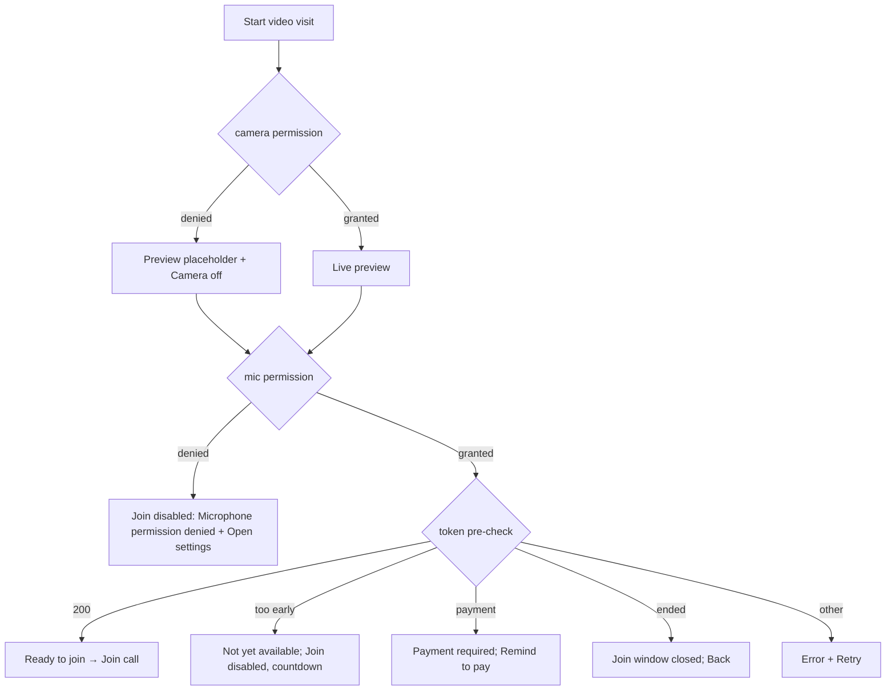

# Video call — pre-join (permissions and device check)

| | |
|---|---|
| Area | Appointments & visit |
| Who sees it | Doctor (video consultations are PRO in the tier table, but the app never checks it; backend decides) |
| Reached from | Appointment details *Start Appointment* on a video booking (01), Home card, Intelligence card |
| Screen type | Full screen (target). **Does not exist today**: the app jumps straight into the call and auto-joins with camera and mic on |
| Current Flutter source | n/a — join happens in `video_call_screen.dart` `_initializeVideoCall` (token → `CallClient.join`, camera + mic enabled & publishing); dead `waiting_room_screen.dart` is the only "before the call" page and nothing navigates to it |
| Spec | `docs/kmp-spec/05-appointments-video-dental.md` §3.1, §3.3, tickets VIDEO-01…03 |

## 1. Purpose
Give the doctor two seconds to check that camera and microphone work and that they are presentable before the patient sees them, request the OS permissions in a controlled way, and surface the join-window and payment errors **before** opening a full call UI. Every video visit (a few per day for PRO doctors).

## 2. Entry points
- Any *Start Appointment* on a video booking inside the allowed window (5 min before start → 1 h after end per the client, 15 min after end per the backend).
- Push "video call ready" (type `APPOINTMENT_*`, UNVERIFIED specific type) deep link → details → Start.
- Arrives with: appointment (id, patient name, photo, start/end, status, payment status).
- Target rule: *Continue* for an IN_PROGRESS video visit skips the pre-join only if the device already has both permissions.

## 3. Layout, top to bottom (phone portrait, target)
1. App bar: back, title "Video Call", patient name as subtitle.
2. **Self-preview** card (4:3, rounded): live camera; placeholder avatar with "Camera off" when disabled; small camera-flip button.
3. **Device row**: toggle *Camera* (on) · toggle *Microphone* (on) · mic level indicator (tiny bars) to prove the mic works · speaker/earpiece switch (optional, §13).
4. **Status line** from the token pre-check: "Ready to join" · "You can join 5 minutes before the appointment." · "Payment is required before joining this video consultation." · "Video call has ended. The join window closes 15 minutes after the appointment end."
5. **Patient line**: avatar, name, "Scheduled 10:00 – 10:30" (practice timezone), payment chip for video.
6. **Join call** primary (full width); *Cancel* text button.

Today: none of this — region 3's toggles are the only user-controllable bits and they live inside the call (11).

## 4. Data and formats
| Field | Source | Format rule |
|---|---|---|
| Token pre-check | `POST /api/video/token {appointmentId}` (no auto-logout on 403) | 200 → ready; error message mapped to the three known sentences, else raw text |
| Camera/mic state | OS permission + local toggles | persisted for the session only |
| Join window | client: start − 5 min … end + 1 h; backend: start − 5 min … end + 15 min | show the backend sentence when the backend refuses |
| Times | practice timezone | "10:00 – 10:30" |

## 5. Primary flow (happy path, target)
1. Tap Start → pre-join page with a dark preview skeleton → OS camera prompt → OS mic prompt (sequential, one at a time).
2. Preview appears; mic bars move when speaking; token pre-check runs in the background → "Ready to join".
3. Tap **Join call** → the in-call screen (11) is pushed replacing the pre-join; join uses the already-fetched token.

## 6. Screen states
- **First load:** preview skeleton (dark rounded block), toggles disabled until permissions resolve; status line "Checking…".
- **Empty:** n/a.
- **Error on load:** token error → status line with the mapped sentence; *Join* disabled except for "other" errors which show *Retry*.
- **Offline:** status "You are offline"; Join disabled; preview still works.
- **Refreshing:** "too early" state re-checks the token every 30 s and shows "Available in 3 min".
- **Partial data:** camera denied but mic granted → join allowed with camera off (audio-only call); mic denied → join blocked (the patient cannot hear the doctor).
- **Permission needed:** first time → OS dialogs. Denied once → inline explanation with *Allow* retrying the request. Denied permanently → "Microphone permission denied" + *Open settings*; returning from settings re-checks automatically.
- **Locked by tier:** if product confirms the PRO gate: page shows the preview blurred and "Video consultations need PRO" with *Upgrade*; otherwise none.
- **Role difference:** n/a.

## 7. Interactions and secondary flows
- **Camera toggle** → preview on/off; carried into the call as the initial state.
- **Mic toggle** → mute carried into the call.
- **Flip camera** → front/back.
- **Join call** → push 11; disabled while checking or when blocked.
- **Remind to pay** (payment-required state) → same request as 01 "Encourage payment" → banner "Payment reminder sent".
- **Cancel / back** → pop to details; camera released.
- **System back during OS permission dialog** → dialog dismissed = denied once.

## 8. Edge cases
- Both permissions permanently denied → page is fully blocked; copy explains both; one *Open settings*.
- Camera in use by another app → preview black with "Camera unavailable"; join allowed audio-only.
- Bluetooth headset connects while on the page → audio route switches automatically; show route name (optional).
- Token expires between pre-check and join (long stay on the page) → the call screen re-requests the token on join failure (one silent retry).
- Payment pending but the clinic allows unpaid calls (NOT_REQUIRED) → backend decides; the client only reacts to the error sentence.
- Patient already in the room → no presence API today; the page cannot show "Patient is waiting" (the dead waiting room claimed it). Keep the design slot "Patient status: —" out until the backend offers presence (UNVERIFIED).
- Doctor opens 2 min early → "Available in 2 min" with a live countdown; Join enables automatically.
- Doctor opens 40 min after end → the calendar allowed it (1 h) but the backend refuses (15 min) → "join window closed" and *Back*. Align the windows (01 §12).
- Low battery / power saving → OS may throttle camera; nothing to do.
- Rotation → preview re-sizes; landscape puts preview left, controls right.
- Language switch → status sentences re-localise (they are keyed).
- 200 % font → status wraps; Join stays visible above the home indicator.
- Phone call arrives on the page → preview pauses; resume on return.
- Double tap Join → one push.
- 401 → logout.
- Screen reader: preview "Your camera preview", toggles with state, status line live region, Join.

## 9. Validation and messages
| Field/action | Rule | When checked | Message (EN) | Where |
|---|---|---|---|---|
| Mic | permission | on load / toggle | Microphone permission denied | status line + Open settings |
| Camera | permission | on load / toggle | Camera permission denied (NEW) | preview placeholder |
| Token | too early | pre-check | Video call is not yet available. You can join 5 minutes before the appointment start. | status line |
| Token | payment | pre-check | Payment is required before joining this video consultation. | status line + Remind to pay |
| Token | ended | pre-check | Video call has ended. The join window closes 15 minutes after the appointment end. | status line |
| Token | other | pre-check | Failed to start video call: {error} | status line + Retry |
| Ready | 200 | pre-check | Video call ready | status line |

## 10. Navigation out
- Join → in-call (11) replaces this page (back from the call must not return here).
- Back/Cancel → details sheet; nothing to save; camera released.

## 11. Copy
`videoCall` "Video Call", `videoCallReady` "Video call ready" (exists, unused today), `videoCallNotYetAvailableMessage`, `videoCallPaymentRequiredMessage`, `videoCallJoinWindowClosedMessage`, `failedToStartVideoCall`, `microphonePermissionDenied`, `retry`, `cancel`, `back`.
**NEW:** `joinCall` "Join call", `cameraPermissionDenied` "Camera permission denied", `cameraUnavailable` "Camera unavailable", `cameraOff` "Camera off", `yourCameraPreview` "Your camera preview", `availableInMinutes` "Available in {n} min", `checkingCall` "Checking…", `openSettings` "Open settings", `remindToPay` "Remind to pay", `videoNeedsPro` "Video consultations need PRO", `flipCamera` "Flip camera", `microphoneLabel` "Microphone", `cameraLabel` "Camera".

## 12. Known problems in the current app (do not carry over)
- No pre-join at all: the call auto-joins with camera and mic publishing; the first thing the patient sees is an unprepared doctor.
- OS permission prompts appear only when the SDK starts, mid-join, with no explanation; a denial becomes a generic "Failed to start video call".
- Join-window and payment errors are discovered only after the full call UI is on screen.
- The waiting-room page is dead code and promised presence that does not exist.
- The video start window in the calendar (1 h after end) is wider than the backend's (15 min).

## 13. Open questions for design
- Is a pre-join page worth a tap for every call, or should it appear only on first use / when a permission is missing / when the pre-check fails?
- Should the pre-join show the patient's attached documents / briefing while waiting for the window to open?
- Speaker vs earpiece control here or only in-call?
