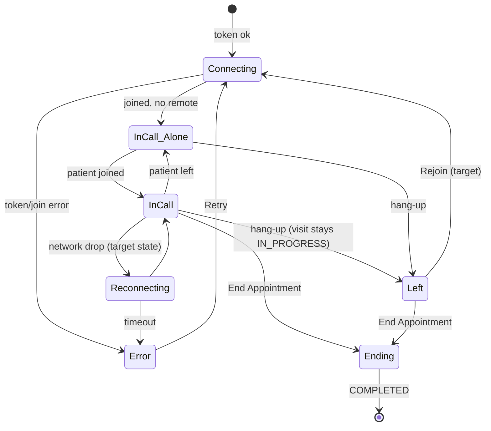

# Video call — in-call

| | |
|---|---|
| Area | Appointments & visit |
| Who sees it | Doctor (PRO in the tier table; not enforced client-side) |
| Reached from | Pre-join *Join call* (10, target); today directly from any *Start Appointment* on a video booking |
| Screen type | Full screen, pushed inside the tab (tab bar hidden); phone: video pane on top, notes panel below; tablet: side by side |
| Current Flutter source | `lib/features/appointments/presentation/video_call_screen.dart` (3 481 lines), `lib/core/services/daily_video_service.dart`, `daily_video_embed_web.dart` (web only, not ported), `lib/features/home/presentation/widgets/visit_facts_panel.dart` |
| Spec | `docs/kmp-spec/05-appointments-video-dental.md` §3.1–3.2, §10 items 4–6, 16; tickets VIDEO-01, VIDEO-02, AI-10 |

## 1. Purpose
Run the remote consultation: see and hear the patient, control camera/mic, and document the visit in the same screen (the documentation half is the in-person workspace, 04). Leaving the call and ending the visit are two different things and must read that way.

## 2. Entry points
- Pre-join → Join (target) or Start Appointment (today). Arrives with the appointment object; the token is fetched here today (`POST /api/video/token`, 403 does not log out).
- *Continue Appointment* on an IN_PROGRESS video visit → rejoins the same room.
- On open the screen also runs: chronic-disease warning, signature-status fetch (10 s poll if pending), visit-facts fetch.

## 3. Layout, top to bottom (phone portrait)
1. **Video pane** (flex 3 of the height; black rounded canvas inside a white card): remote participant full-bleed; local self-view PiP 120×160 bottom-right with white border; when alone: own camera full (or a person icon when no track). Overlays: *connecting* (spinner + "Connecting to video call..."), *error* (icon, "Video call error", mapped message, **Retry**), *not available* ("Video call not available").
2. **Call controls** (floating pill at the bottom of the pane): camera toggle, mic toggle, screen-share (a no-op on native), red hang-up. No timer, no participant count, no chat. Target: elapsed timer, network quality dot, flip camera, speaker route, remove screen-share.
3. **Notes panel** (flex 2; scrolls): **Visit facts panel** at the top ("Visit facts from the call" — kept/dropped facts, patterns, *Document everything*), then the same Notes card as 04 (mode menu, plan panel, SOAP/free notes, dental, 025-2, photo chips). Documents card is hidden on phones (tablet only). A fullscreen-notes icon opens the whole notes panel over the video.
4. **Footer** (same as 04): signature line, *Request Signature*, **End Appointment**.
5. Header is the standard consultation header (name, status pill, times) above the video pane.

Target phone layout: video full-screen with controls; a draggable bottom sheet (peek 96 px: "Notes · Visit facts · Documents" chips) that expands to ¾ height; the video shrinks to a PiP when the sheet is expanded. Keep *End Appointment* in the sheet footer, hang-up in the video controls.

## 4. Data and formats
| Field | Source | Format rule |
|---|---|---|
| Token | `POST /api/video/token {appointmentId:int}` → `{token, roomUrl, roomName}` | all required; missing key crashes today |
| Participants | SDK events (joined/updated/left, inputs updated, call state) | only the **first** remote participant is rendered |
| Mute/camera | SDK `inputsUpdated` | icons red when off |
| Error mapping | backend sentences → keys | ended / not yet / payment / "Call error occurred"; anything else shown raw |
| Visit facts | `GET /api/ai/visit-facts/appointment/{id}`; commit `POST /api/ai/visit-facts/commit {appointmentId, acceptFactIds, rejectFactIds}` | rows "{type} · {text}", optional "Schedule: {hint}"; patterns top 3 |
| Timer (target) | from join time | "12:34" |

## 5. Primary flow (happy path)
1. Join → "Connecting…" overlay → remote video appears when the patient is there; otherwise own camera and (target) "Waiting for {name} to join…" caption.
2. Consultation; doctor mutes/unmutes, writes notes in the panel (05/07), scribe (06, target — not available here today).
3. Visit facts arrive during/after the call; the doctor keeps/rejects rows and taps *Document everything* → "Documented N facts and drafted M medication tasks. They are on the patient timeline."
4. Tap **End Appointment** → the call is left first, then the 12 pipeline runs → success banner → pops to the **tab root** today (`popUntil first`; target: pop once like in-person).

## 6. Screen states
- **First load:** header real; video pane "Connecting to video call..." (spinner on black — acceptable here, it is a live medium, not a list); notes panel skeleton as in 04.
- **Empty (alone):** own camera full; target caption "Waiting for {patient} to join…" + elapsed waiting time; after 10 min offer *Mark as no-show* (03).
- **Error on load:** mapped sentence + *Retry* in the pane; a 6 s banner too today (drop the banner; the pane is enough).
- **Offline:** video drops; SDK reconnects (target: "Reconnecting…" overlay with a 30 s timeout → Error with Retry); notes typing continues.
- **Refreshing:** signature poll 10 s; visit facts refresh on *Refresh* icon and after commit.
- **Partial data:** token fine but no remote video track (patient camera off) → person icon with "Camera off" caption; audio continues.
- **Permission needed:** camera/mic — handled in 10; if the OS revokes mid-call → pane shows "Microphone permission denied" + Open settings.
- **Locked by tier:** none enforced; backend may return a payment/plan error sentence.
- **Role difference:** n/a.

## 7. Interactions and secondary flows
- **Mic / camera toggles** → SDK update → icon state; failure logged silently today (target: banner "Could not change microphone").
- **Hang-up** → leaves the room immediately, no confirmation; the visit stays IN_PROGRESS; pane shows "Video call ended" (snackbar today) and the controls disappear; End Appointment still available. Target: confirm sheet "Leave the call?" with *Leave call* · *Leave and end visit* · *Cancel*; after leaving show *Rejoin*.
- **Retry** on error → re-fetch token and join.
- **Fullscreen notes icon** → notes panel over the video (video audio continues; target: PiP video stays visible).
- **Visit facts: Keep/Reject** per row → local; **Document everything** → commit → success banner → rows become read-only ("These visit facts are already in the patient timeline.").
- **Request Signature / End Appointment** → as 04 / 12. End leaves the call first.
- **Back arrow / system back** → saves drafts and pops **while still in the call** today (the SDK is torn down in dispose, fire-and-forget). Target: back = same confirm sheet as hang-up.
- **Rotation** → vertical ↔ horizontal split; target: landscape = video full with notes as a side sheet.

## 8. Edge cases
- Patient never joins → doctor waits alone; no indication of elapsed time; target caption + no-show shortcut after 10 min; token keeps the room open until the backend window closes.
- Patient leaves and rejoins → first remote participant swaps; PiP/remote controllers must be recycled (today controllers are disposed on leave — fine).
- Two remote participants (patient + relative on a second device) → only the first is shown; the second is heard but invisible. Target: 2-up grid or a "+1" badge.
- Phone call interrupts → OS takes the mic/camera; SDK pauses; on return resume automatically; show "Call paused" overlay meanwhile.
- App backgrounded → audio continues (needs background audio mode, iOS) — UNVERIFIED in current app; target: keep audio, camera off while in background, banner on return.
- Daily token expired (long call or reopened after the window) → join fails with the "ended" sentence → *Retry* re-fetches a fresh token; if the backend window is closed, only *End Appointment* remains.
- Network drop during the call → SDK reconnect; after 30 s show Error + Retry; notes unaffected.
- Doctor opens the same visit on a second device → second join kicks nothing; both publish; the patient sees two doctors. Target: backend single-session or a client warning "You are already in this call on another device" (UNVERIFIED support).
- Hang-up then End → works (End skips the leave).
- End while the call is connecting → leave is called on a half-initialised client; must be safe.
- Mic/camera denied permanently mid-call (settings changed) → pane error; End still works.
- Timer across midnight → counts up; the scheduled times in the header remain the booking's.
- Screen-share button → remove (not supported in the SDK used today).
- Low bandwidth → remote video freezes; show "Poor connection" dot (target).
- Speaker: default route is the earpiece on some Android phones → target default to speaker for video.
- Notes typed offline → kept in memory as in 04.
- 200 % font → controls pill wraps to two rows or scales icons only; caption text wraps.
- Language switch → control tooltips re-localise; mapped error sentences re-localise.
- 401 from a non-video endpoint mid-call → global logout tears the call down; unavoidable, but drafts should be flushed first.
- Double tap hang-up → second ignored.
- Screen reader: video pane "Video of {patient}", controls with state ("Mute microphone, currently on"), live region for connection status.

## 9. Validation and messages
| Field/action | Rule | When checked | Message (EN) | Where |
|---|---|---|---|---|
| Join | token 403 window | on join | Video call has ended. The join window closes 15 minutes after the appointment end. | pane + Retry |
| Join | too early | on join | Video call is not yet available. You can join 5 minutes before the appointment start. | pane |
| Join | payment | on join | Payment is required before joining this video consultation. | pane |
| Join | SDK error | on join | Call error occurred / Failed to start video call: {error} | pane |
| Leave | call left | on event | Video call ended | pane caption |
| Document everything | 2xx | after commit | Documented {n} facts and drafted {m} medication tasks. They are on the patient timeline. | banner |
| Document everything | already committed | on render | These visit facts are already in the patient timeline. | panel text |
| Leave confirm (NEW) | in call | on hang-up/back | Leave the call? The visit stays open until you end it. | sheet |
| Waiting (NEW) | no remote | on render | Waiting for {name} to join… | pane caption |
| Reconnecting (NEW) | network | on event | Reconnecting… | pane overlay |

## 10. Navigation out
- End Appointment success → today pops to the first route of the tab (surprising); target: pop once to where the visit was started, which refreshes its day.
- Hang-up → stays on the screen (controls gone).
- Back → drafts saved, call torn down; target confirm first.
- Patient profile / document opens → allowed; the call continues in the background (audio) — target PiP.

## 11. Copy
`videoCall` "Video Call", `videoCallConnecting`, `videoCallErrorTitle` "Video call error", `videoCallJoinWindowClosedMessage`, `videoCallNotYetAvailableMessage`, `videoCallPaymentRequiredMessage`, `callErrorOccurred`, `failedToStartVideoCall`, `videoCallEnded`, `videoCallNotAvailableShort`, `retry`, `endAppointment`, `requestSignature`, `visitFactCards` "Visit facts from the call", `droppedFacts`, `documentEverything`, `documenting` "Documenting…", `factsAlreadyDocumented`, `intelKeep` "Keep", `intelReject` "Reject", `intelScheduleHint`, `clinicalTimeline`; `intelCardPatterns` and `refresh` have no English value (needed: "Patterns in your clinic", "Refresh"). The visit-facts hint "Only what was spoken. Review, then document everything." and the commit message are hard-coded fallbacks today.
**NEW:** `leaveCallTitle` "Leave the call?", `leaveCallBody` "The visit stays open until you end it.", `leaveCall` "Leave call", `leaveAndEndVisit` "Leave and end visit", `rejoinCall` "Rejoin", `waitingForPatient` "Waiting for {name} to join…", `reconnecting` "Reconnecting…", `callPaused` "Call paused", `poorConnection` "Poor connection", `patientCameraOff` "Camera off", `muteMic` "Mute microphone", `unmuteMic` "Unmute microphone", `cameraOn`/`cameraOff` toggles, `couldNotChangeMic` "Could not change microphone", `alreadyInCallElsewhere` "You are already in this call on another device", `visitFactsHint` "Only what was spoken. Review, then document everything.", `visitFactsCommitted` "Documented {n} facts and drafted {m} medication tasks. They are on the patient timeline."

## 12. Known problems in the current app (do not carry over)
- Hang-up and End Appointment look alike; hang-up has no confirmation and leaves the visit IN_PROGRESS with no "Rejoin".
- Screen-share button does nothing on native; mute/camera toggles on web only flip icons.
- Only one remote participant rendered; no timer; no reconnect state; no waiting caption.
- No scribe recorder on video visits (asymmetric with in-person).
- End pops to the tab root instead of returning to the caller.
- Documentation half is a 2 500-line copy of the in-person screen with a third copy of the ⋮ menu in the fullscreen notes overlay.
- Visit-facts panel exists here but not on the in-person screen where the recording is made.
- Token response crashes on a missing field; error messages compared by English sentence.
- Camera/mic start publishing at join without a pre-join.

## 13. Open questions for design
- Phone layout: split pane (current) vs full-screen video + draggable notes sheet (proposed)?
- Should the visit-facts panel be the first tab of the notes sheet or a badge-triggered sheet ("3 facts to review")?
- Two-participant grid or always single remote + "+1"?
