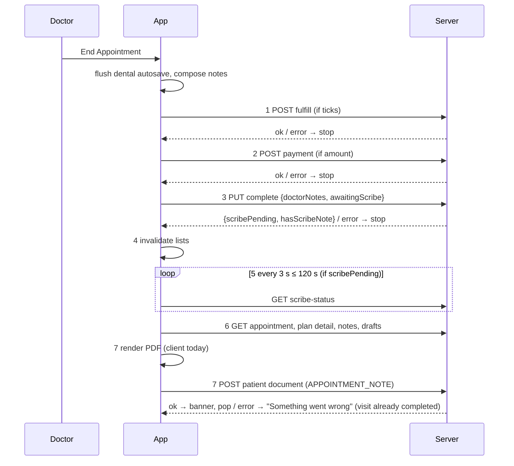

# End visit

| | |
|---|---|
| Area | Appointments & visit |
| Who sees it | Doctor |
| Reached from | *End Appointment* in the footer of the in-person workspace (04) and the video call (11) |
| Screen type | Target: confirmation/summary sheet + progress dialog. Today: no sheet — the button runs the pipeline directly with snackbars and one blocking "Preparing…" dialog |
| Current Flutter source | `in_person_appointment_screen.dart` `_endAppointment` (and its copy in `video_call_screen.dart`), `lib/core/api/consultation_notes_api.dart` (`completeAppointmentVisit`, `waitForScribeReady`), `lib/state/appointments/appointment_invalidation.dart` |
| Spec | `docs/kmp-spec/05-appointments-video-dental.md` §2.3, §10.5–10.6, §10.15; tickets APPT-07, SCRIBE-02, PDF-01; README "Verified bugs" #5 |

## 1. Purpose
Close the visit: push everything that was done (plan ticks, payment, notes) to the server, mark the appointment COMPLETED, produce the visit summary document for the patient's file, and return the doctor to their day. Once per visit; it must be fast, impossible to double-run, and never leave a completed visit without its document.

## 2. Entry points
- Footer *End Appointment* (destructive primary) on 04/11. In the video call the room is left first.
- Target: *Leave and end visit* from the video leave sheet (11).
- Arrives with the full screen state: mode, SOAP/free text, dental lines, pending plan ticks, typed payment, before/after photos, awaiting-scribe flag, linked plan, signature state.

## 3. Layout, top to bottom (phone portrait)
**Target — End visit sheet (new):**
1. Title "End appointment", patient name, scheduled time and the actual duration.
2. **Checklist** of what will be saved, each with a state icon: Notes ({n} characters / "none"), Dental services ({n} lines, total), Treatment plan ({n} items to mark completed), Payment ({amount} {method} / "none"), Photos ({n}), AI notes ("ready" / "still processing — up to 2 min" / "none"), Signature ("signed" / "requested, not signed" / "not requested").
3. Warning line when nothing will be saved: "Nothing to save. The visit will be marked as completed without a summary."
4. **End appointment** (red, full width) · *Back to notes* (text).

**Progress dialog** (replaces the sheet content while running; not dismissible): step list with spinners/checks — "Applying treatment plan…", "Recording payment…", "Completing visit…", "Waiting for AI notes… (0:42)", "Saving summary…". The AI step has *Continue without waiting*.

**Today:** button → spinner on the button → snackbars → `preparingAiDocumentation` dialog if needed → pop.

## 4. Data and formats
| Step | Request | Failure effect today | Target |
|---|---|---|---|
| 0 Resolve patient id | `GET /api/calendar?day=today` if missing | "Patient ID not available. Cannot save notes." → stop | from appointment detail; never stop here |
| 1 Plan ticks | `POST /api/treatment-plans/{plan}/appointments/{appt}/fulfill {lineIds}` | banner, **stop** (visit open) | same |
| 2 Payment | `POST /api/clinics/{clinic}/finance/payments` | banner, **stop** | same; once only |
| 3 Complete | `PUT /api/appointments/{id}/complete {clinicId?, doctorNotes?, awaitingScribe?}` → `{scribePending, hasDocumentation, hasScribeNote}` | "Something went wrong", **stop** | same, with the backend message |
| 4 Refresh lists | today/that day calendar, Home, analytics, clinic finance | ignored | ignored |
| 5 Wait for scribe | poll `GET …/scribe-status` every 3 s ≤ 120 s | undismissable dialog | cancellable |
| 6 Re-read | `GET /api/appointments/{id}` (signature, fulfilled ids), plan detail, notes, drafts | ignored | ignored |
| 7 Summary | client PDF → `POST /api/patients/{pid}/documents` (title "Appointment Documentation - {yyyy-MM-dd} {HH:mm}", category APPOINTMENT_NOTE) | "Something went wrong" 5 s, **visit already COMPLETED**, user stuck on screen | backend renders; or client retry with "completed, document pending" |
| 8 Done | banner + pop | snackbar | banner "Appointment ended. Documentation saved." |
| Nothing-to-save branch | after 3/5: no notes, no photos, no dental work | snackbar "No items to save. Appointment ended." / "…AI documentation will appear shortly." / "…Documentation saved." + pop, **no PDF** | same decision, surfaced in the sheet beforehand |

Times in the title and PDF: practice timezone "now" at the moment of ending.

## 5. Primary flow (happy path)
1. Tap *End Appointment* → (target) sheet with the checklist → confirm.
2. Progress dialog runs steps 1→7; each step turns into a check.
3. Banner "Appointment ended. Documentation saved." → screen pops to the caller; calendar day and Home refresh; details sheet (01) shows Completed and the *Summary PDF* tab fills.

## 6. Screen states
- **First load (sheet):** checklist values come from local state — instant; AI status may show "checking…" for one request.
- **Empty:** nothing to save → warning line; End still allowed (visit marked completed without a summary — today's behaviour too).
- **Error on load:** n/a.
- **Offline:** *End Appointment* disabled with banner "You are offline. End the visit when connected." (today: fails at step 1/3 with a generic error).
- **Refreshing:** progress dialog steps; the AI step shows elapsed seconds.
- **Partial data:** step 7 fails after completion → today: generic error, stuck. Target: dialog shows "Visit completed. Summary could not be saved." with *Retry summary* and *Close*; the details sheet shows "Summary pending" with Retry; a background retry on next app start (keyed by appointment id).
- **Permission needed:** n/a.
- **Locked by tier:** n/a (AI step simply absent for BASIC).
- **Role difference:** n/a.

## 7. Interactions and secondary flows
- **Back to notes** → sheet closes, nothing done.
- **End appointment (confirm)** → pipeline; all other controls disabled; system back ignored during the dialog.
- **Continue without waiting** (AI step) → completes without the AI block; the note arrives later; summary generated without it (target: backend regenerates when the note lands).
- **Retry summary** (step 7 failure) → re-run 6–7 only.
- **Signature "requested, not signed"** → sheet shows a hint "The patient has not signed yet. The summary will show an empty signature line." with *Wait for signature* (keeps the sheet open, poll continues) and *End anyway*.

## 8. Edge cases
- Double tap End → one run (flag); the sheet's confirm button disables on first tap.
- Slow network (>3 s) on complete → progress dialog stays; no timeout today — target 30 s per request then "Still working… / Cancel" (cancel only before step 3; after step 3 the visit is completed and only the summary can be retried).
- App killed between step 3 and 7 → visit COMPLETED, no document; on next open the details show "Summary pending". Target: persist a "summary job" locally and retry on launch.
- Scribe never finishes → after 120 s continue; summary lacks the AI block; later AI note is only visible in details "Appointment Notes" tab and never in the PDF (needs backend regeneration — PDF-01).
- Scribe still processing and nothing else typed → "Appointment ended. AI documentation will appear shortly." and no PDF at all.
- Plan tick fails because a line was cancelled → stop with the plan banner; the doctor unticks and ends again — payment not yet posted (good ordering).
- Payment posted, complete fails → payment recorded, visit open; second End skips payment (flag) — but only within the same screen session (09 §8).
- Patient signs during the pipeline → re-read at step 6 picks it up; signs after → not in the PDF.
- End pressed on a visit already COMPLETED by another device → backend 409/400 → stop with the backend message; target: offer *Open Summary*.
- End with mode 025-2 → the form is saved by its own Save (folder 06); End only completes; notes block empty unless something else was typed — make this clear in the checklist ("Form 025-2: saved at 10:12" / "not saved").
- Dental mode with a linked plan → dental billing table is replaced by the plan section in the PDF (so free lines added before linking vanish from the summary — 07 §8).
- Video visit: leave is called first; if leave throws, End continues.
- Language at End decides the PDF language (en/uz; ru falls back to en today).
- Practice-timezone midnight crossing → title date is the end moment's date.
- 401 at step 3 → logout; visit stays open; drafts flushed before? No — today lost. Target: flush drafts before step 1.
- Rotation during the dialog → dialog persists; state kept.
- 200 % font → checklist scrolls; buttons stack.
- Screen reader: progress steps announced as they complete; final banner announced.
- Very large photos (10 × 5 MB) → PDF generation on device is slow (several seconds) and memory heavy; target: upload photos as separate documents (PDF-01).

## 9. Validation and messages
| Field/action | Rule | When checked | Message (EN) | Where |
|---|---|---|---|---|
| Patient id | present | step 0 | Patient ID not available. Cannot save notes. | banner, stop |
| Plan ticks | 2xx | step 1 | Could not apply treatment plan changes. Appointment was not completed. | banner, stop |
| Payment | 2xx | step 2 | Could not record payment. Appointment was not completed. | banner, stop |
| Complete | 2xx | step 3 | Something went wrong (target: backend message) | banner, stop |
| Scribe | pending | step 5 | Preparing AI scribe documentation from the recording… | dialog |
| Nothing to save | no notes/photos/dental | after 3/5 | No items to save. Appointment ended. / Appointment ended. AI documentation will appear shortly. / Appointment ended. Documentation saved. | banner |
| Summary | 2xx | step 7 | Appointment ended. Documentation saved. | banner (success) |
| Summary | failure | step 7 | Something went wrong (target: Visit completed. Summary could not be saved. · Retry summary) | banner / dialog |
| Offline (NEW) | connectivity | on tap | You are offline. End the visit when connected. | banner |
| Signature (NEW) | requested & unsigned | in sheet | The patient has not signed yet. The summary will show an empty signature line. | sheet hint |

## 10. Navigation out
- Success → pop once to the caller (calendar + details sheet, Home, Intelligence, plan detail); that screen refreshes its day; details sheet re-polls notes/PDF. Video today pops to the tab root — do not keep.
- Failure before step 3 → stay on the workspace with everything intact.
- Failure after step 3 → stay with a "completed, summary pending" state; *Close* pops; summary retry available from details.

## 11. Copy
`endAppointment` "End Appointment", `appointmentEndedDocumentationSaved`, `aiDocumentationWillAppearShortly`, `noItemsToSave`, `somethingWentWrong`, `patientIdNotAvailable`, `cannotSaveNotes`, `appointmentPlanApplyFailed`, `appointmentPlanPaymentFailed`, `preparingAiDocumentation`, `appointmentDocumentation` "Appointment Documentation" (PDF title prefix), `fromShifaAi` and `doctorNotesSection` "Doctor notes" (headings inside the summary text), `cancel`.
**NEW:** `endVisitTitle` "End appointment", `endVisitChecklistNotes` "Notes", `endVisitChecklistDental` "Dental services", `endVisitChecklistPlan` "Treatment plan items", `endVisitChecklistPayment` "Payment", `endVisitChecklistPhotos` "Photos", `endVisitChecklistAi` "AI notes", `endVisitChecklistSignature` "Signature", `endVisitNothingToSave` "Nothing to save. The visit will be marked as completed without a summary.", `backToNotes` "Back to notes", `stepApplyingPlan` "Applying treatment plan…", `stepRecordingPayment` "Recording payment…", `stepCompleting` "Completing visit…", `stepWaitingAi` "Waiting for AI notes…", `stepSavingSummary` "Saving summary…", `continueWithoutWaiting` "Continue without waiting", `summarySaveFailed` "Visit completed. Summary could not be saved.", `retrySummary` "Retry summary", `summaryPending` "Summary pending", `endOffline` "You are offline. End the visit when connected.", `signatureNotYet` "The patient has not signed yet. The summary will show an empty signature line.", `waitForSignature` "Wait for signature", `endAnyway` "End anyway", `alreadyCompletedElsewhere` "This visit was already completed on another device."

## 12. Known problems in the current app (do not carry over)
- The visit is marked COMPLETED **before** the summary exists; a PDF/upload failure strands a completed visit without a document and shows only "Something went wrong" (verified bug #5).
- No confirmation, no preview of what will be saved; "No items to save" is discovered after completion.
- Undismissable 120 s dialog for the scribe.
- Patient id looked up in today's calendar; visits from other days cannot be ended.
- Generic error text for every failure after step 2; snackbars; video variant pops to the tab root.
- Client-side PDF (en/uz only, device-rendered, photos embedded) — target backend rendering (PDF-01).
- Drafts are not flushed before the pipeline when a 401 interrupts.

## 13. Open questions for design
- Is the checklist sheet one step too many for a 20-visit day? Alternative: inline summary strip above the End button + confirm only when something is unusual (unsigned, nothing to save, AI pending).
- Should "Continue without waiting" be the default (never block) with the AI note merged into the summary later by the backend?
- Where does the doctor see "Summary pending — retry": details sheet, Home attention centre, or both?
