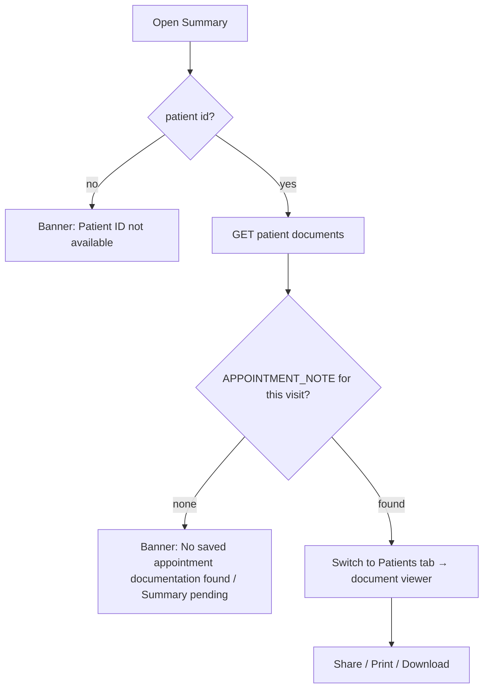

# Appointment summary (PDF) — preview and share

| | |
|---|---|
| Area | Appointments & visit (viewer itself: folder 06 document viewer) |
| Who sees it | Doctor; Clinic staff via the patient's documents |
| Reached from | Appointment details → *Open Summary* / *Summary PDF* tab (01); patient profile → Documents (folder 06); target: End-visit success banner *View summary* |
| Screen type | Document viewer (full screen) with share/print actions |
| Current Flutter source | generation: `lib/features/appointments/services/appointment_pdf_service.dart` (+ `_data.dart`, `_translations.dart`); opening: `calendar_screen.dart` `_openSavedSummaryPdf`; viewing: patients document viewer |
| Spec | `docs/kmp-spec/05-appointments-video-dental.md` §6, §10.3, §10.9; tickets PDF-01, PDF-02 |

## 1. Purpose
The one document that proves what happened in the visit: notes (AI + doctor), dental procedures and prices, treatment-plan progress and payment, the patient's e-signature, with the clinic/doctor header. The doctor opens it to check or to share with the patient; clinics print it. Opened for maybe one visit in five.

## 2. Entry points
- Appointment details (COMPLETED) → *Open Summary* → the app looks up the patient's documents, picks the `APPOINTMENT_NOTE` closest in time to the visit (same day preferred), switches to the Patients tab and opens the viewer.
- Patient documents list (folder 06) → the document titled "Appointment Documentation - {date} {time}".
- Target: success banner after End → *View summary*; push "AI note ready" → summary.
- Arrives with: patient id, document id, title.

## 3. Layout, top to bottom (phone portrait)
Viewer (folder 06) with this document's specifics:
1. App bar: title (document title), *Share*, *Print* (target), overflow *Download*.
2. Page 1 (A4): header — logo + "SHIFA", clinic name (in-person only), weekday + full date + time, appointment id; title band "Appointment Summary"; metadata card (patient name/ID | doctor, specialization, type "Face-to-face"/"Video consultation", duration "{n} min").
3. **Clinical Notes**: "From Shifa AI" block (AI notes + drafts) then "Doctor notes" block (manual notes; the SOAP labels are part of the text).
4. **Services provided** (dental free mode): table Tooth · Service · Amount; subtotal, discount %, total.
5. **Treatment plan** (dental + plan): plan # and title, total / paid / outstanding, "Fulfilled this visit" lines, "Payment this visit ({method})".
6. Diagnosis / Prescriptions / Recommendations / Follow-up headings — **never filled** today (dead sections; remove).
7. Dental sterilisation attestation (Uzbek, hard-coded) with the signature image when present.
8. Signatures: doctor line; patient signature image + "Signed electronically on {date} via SHIFA Patient App", or an empty line.
9. Footer: generated-by, "Page n / total", confidentiality note.
10. Extra pages: before/after photos, one per page.

## 4. Data and formats
| Field | Source | Format rule |
|---|---|---|
| Language | app language at End | en, uz tables; **ru falls back to en** today |
| Dates | practice timezone at End | weekday + long date; time 24 h |
| Money | minor/100 2 decimals + currency | target `Money.format` |
| Notes | combined text (12 §4 step 6) | chunked 35 lines per block |
| Signature | base64 PNG from the appointment | scaled to ~160 px wide |
| Title | "Appointment Documentation - yyyy-MM-dd HH:mm" | document list shows it; target: "Visit summary · {date}" |
| Category | `APPOINTMENT_NOTE` | used to find the summary later |
| Lookup | by category, else by title prefix in 3 languages; nearest to the visit start on the same day | ambiguous when two visits with the same patient happen the same day — target: match by `appointmentId` on the document |

## 5. Primary flow (happy path)
1. Details → *Open Summary* → button spinner → documents refetched → viewer opens with the PDF (skeleton page while loading).
2. Doctor scrolls, taps *Share* → OS share sheet (file) — today the viewer opens the URL externally; sharing exists only in the general document viewer (`share_plus`).
3. Back → returns to Patients tab (today) / to the details sheet (target).

## 6. Screen states
- **First load:** grey page skeleton with the app bar; title known immediately.
- **Empty:** no summary document → banner "No saved appointment documentation found." and no navigation (today); target: details show "Summary pending" with *Retry* when the visit is COMPLETED but no document exists (12).
- **Error on load:** file download failed → viewer error with *Retry*.
- **Offline:** cached file opens if previously downloaded; otherwise error state.
- **Refreshing:** n/a; AI note arriving later does **not** update the PDF today.
- **Partial data:** signature missing → empty line; no clinic name on video visits; no DOB/gender/licence (fields always null today — remove from layout).
- **Permission needed:** storage/share on old Android for *Download*.
- **Locked by tier:** none.
- **Role difference:** staff open it from the clinic patient's documents; no difference.

## 7. Interactions and secondary flows
- **Pinch zoom / page scroll** → viewer.
- **Share** → OS share sheet with the PDF file.
- **Print** (target) → OS print dialog (AirPrint / Android print).
- **Download** → saves to Files/Downloads; banner "Saved to Downloads".
- **Back** → previous screen.
- **Open from End success banner** (target) → viewer; back returns to the caller of the visit.

## 8. Edge cases
- Two completed visits with the same patient on one day → lookup may open the wrong summary; target: `appointmentId` link.
- Summary generated while the UI language was Russian → English PDF (no ru table); patient receives English.
- Long notes (10 pages) → chunking works; photos add pages; file size may exceed 10 MB with photos → slow share; target: photos as separate documents.
- Dental lines in two currencies → table shows the first currency only (07 §8).
- Signature image corrupt → decoding fails silently; empty line.
- Visit completed but PDF failed (12) → no document; "No saved appointment documentation found." misleads — target "Summary pending".
- AI note lands after the PDF → PDF outdated forever; backend regeneration needed (PDF-01) or a "Regenerate summary" action in details.
- Very long patient/doctor names → metadata card wraps; Cyrillic handled by DejaVu font.
- Rotation → viewer reflows.
- 200 % font → does not affect the PDF; viewer chrome scales.
- Screen reader → PDF content is not accessible; provide the notes text in the details "Appointment Notes" tab (exists).
- 401 on download → logout.
- Doctor changes clinic name or specialisation later → old PDFs keep the values at generation time (correct); no regeneration.
- Staff opens the summary of a visit run by another doctor → allowed via documents; the doctor's name in the header tells whose visit it was.
- Patient revoked document access (privacy, folder 06) → the summary is the doctor's own document and stays visible; UNVERIFIED whether the backend ever restricts APPOINTMENT_NOTE.
- Document deleted from the patient's file (folder 06 allows delete?) → details "Summary PDF" tab shows "No saved…"; target: *Regenerate summary*.
- Opening the summary while the AI scribe note is still pending (End chose "Continue without waiting") → PDF without the AI block; the details tab "Appointment Notes" will show the AI note when it lands — explain with a line "AI notes arrived after the summary was created" (target).
- Share sheet on iOS needs the file on disk → download first with a progress banner for large files (photos).

## 9. Validation and messages
| Field/action | Rule | When checked | Message (EN) | Where |
|---|---|---|---|---|
| Open Summary | patient id | on tap | Patient ID not available | banner |
| Open Summary | document exists | after fetch | No saved appointment documentation found. | banner |
| Download (NEW) | saved | after write | Saved to Downloads | banner |
| Load | failed | on open | Failed to load · Retry | viewer |

## 10. Navigation out
- Back → previous (details sheet should be restored, target). Share/print → OS sheets, return here.

## 11. Copy
`openSummary` (no English value today — "Open Summary"), `summaryPdf` "Summary PDF", `appointmentDocumentation` "Appointment Documentation", `noSummaryYet`, `patientIdNotAvailable`, `failedToLoad`, `retry`, `fromShifaAi`, `doctorNotesSection`, `dentalPdfHeader` "DENTAL VISIT — Procedures by tooth".
PDF-internal labels live in a Dart table (en/uz only): "Appointment Summary", "Clinical Notes", "Services provided", "Treatment plan", "Face-to-face", "Video consultation", "Signed electronically on", "via SHIFA Patient App", "Page", "Confidential" — must become keys with ru values (**NEW** `pdf*` set) and the hard-coded Uzbek sterilisation sentence needs en/ru.
**NEW:** `shareSummary` "Share", `printSummary` "Print", `downloadSummary` "Download", `savedToDownloads` "Saved to Downloads", `summaryPending` "Summary pending", `regenerateSummary` "Regenerate summary", `viewSummary` "View summary".

## 12. Known problems in the current app (do not carry over)
- Rendered on the device with a bundled font; Russian has no translation table; "{n} min" hard-coded.
- Found by title/category and nearest time, not by appointment id.
- Dead sections (Diagnosis, Prescriptions, Recommendations, Follow-up, DOB, gender, licence) always empty.
- No share/print from the summary path; the viewer opens the URL externally.
- Not regenerated when the AI note or the signature arrives later.
- Photos embedded as pages inflate the file.

## 13. Open questions for design
- Should the summary be previewed **before** completing (End sheet → "Preview summary") or only after?
- One document per visit, or separate "Visit summary" and "Photos" documents?
- Patient-facing version (no internal notes) vs the full clinical one — same file or two?
