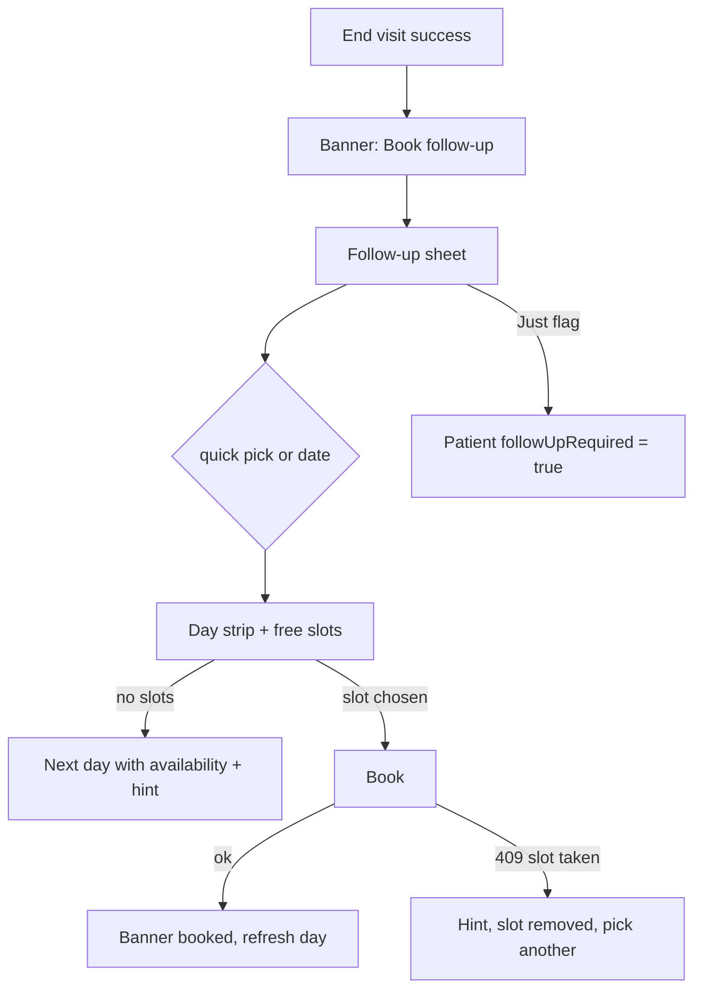

# Follow-up booking from the visit

| | |
|---|---|
| Area | Appointments & visit (booking sheet itself: folder 04) |
| Who sees it | Doctor |
| Reached from | Target: End-visit success banner / End sheet "Book follow-up"; Appointment details (COMPLETED) overflow; patient profile. **Does not exist today** |
| Screen type | Bottom sheet (reuses the calendar booking sheet with the patient pre-filled) |
| Current Flutter source | n/a — no follow-up action in `lib/features/appointments/`; the PDF `followUpDate` field is always null; `Patient.followUpRequired` and the Patients "Follow-ups" tab exist (folder 06); booking lives in `calendar_screen.dart` (`_AssignPatientSheet`, free-slot flow) |
| Spec | `docs/kmp-spec/05-appointments-video-dental.md` §10.3 (dead `followUpDate`); `03-calendar-schedule.md` booking; `06-patients-forms-documents-care.md` follow-up flag |

## 1. Purpose
Right after a visit the doctor usually knows when they want to see the patient again ("in two weeks"). Today they must leave the visit, open the calendar, find a slot and search the patient again. The follow-up sheet books the next visit in three taps while the context is fresh, or at least flags the patient as needing one. Several times a day.

## 2. Entry points
- End-visit success (12): banner "Appointment ended. Documentation saved." with action *Book follow-up* (5 s) — and a *Book follow-up* text button on the End sheet's last step (target).
- Appointment details (01) for COMPLETED visits: overflow → *Book follow-up*.
- Patient profile (folder 06) → *Book appointment* (same sheet, not follow-up specific).
- Arrives with: patient id + name, previous appointment id (to link as `followUpOf` — backend field UNVERIFIED), visit kind (in-person/video), clinic/location of the previous visit.

## 3. Layout, top to bottom (phone portrait, target)
1. Title "Book follow-up", subtitle "{patient name} · after today's visit".
2. **Quick picks** chips: "In 1 week", "In 2 weeks", "In 1 month", "In 3 months", "Pick a date".
3. **Day strip** for the chosen week (practice timezone) with availability dots; below it the free slots of the selected day as chips (from the calendar day load; consecutive-slot rules from folder 04).
4. **Kind** segmented: In clinic · Video (default = previous visit's kind).
5. **Reason** field prefilled "Follow-up" (localised; editable).
6. Optional **"Just flag for follow-up"** link → sets the patient's follow-up flag without booking.
7. **Book** primary (disabled until a slot is chosen) · *Not now* text.

## 4. Data and formats
| Field | Source | Format rule |
|---|---|---|
| Quick picks | today in practice tz + offset | lands on the same weekday; if no availability that day, jump to the next day with slots |
| Slots | calendar day load (`GET /api/calendar?day=`) free entries | "09:00", 15/20/30-min grid per schedule |
| Booking | existing assign-patient flow (folder 04): `POST` book with patient, start, slot minutes, place | success → entry CONFIRMED |
| Link | previous appointment id | if the backend has no field, store nothing (UNVERIFIED) |
| Reason | text | default "Follow-up" |

## 5. Primary flow (happy path)
1. End succeeds → banner with *Book follow-up* → sheet opens over the calendar/Home.
2. Tap "In 2 weeks" → day strip jumps; first free slot chips shown.
3. Tap "10:30" → *Book* enabled → tap → spinner → "Appointment booked for {date} {time}" banner → sheet closes; calendar day refreshed; patient's follow-up flag cleared if it was set.

## 6. Screen states
- **First load:** quick picks instantly; day strip and slots skeleton (7 dots + 4 chips) until the day loads.
- **Empty:** no free slots in the selected day → "No free slots on this day" + "Next available: Thu 14 Nov" link; no schedule set up at all → "Set up your availability first" → folder 04 schedule setup.
- **Error on load:** day load failed → inline "Failed to load" + Retry.
- **Offline:** quick picks disabled; "Just flag for follow-up" queued? No — disabled with the offline banner.
- **Refreshing:** switching days shows a skeleton for the slot chips only.
- **Partial data:** patient id missing (old booking) → sheet opens in "flag only" mode with the explanation.
- **Permission needed:** n/a.
- **Locked by tier:** video kind hidden/disabled when the PRO gate for video is confirmed.
- **Role difference:** staff book via the clinic schedule (folder 09), not from here.

## 7. Interactions and secondary flows
- **Quick pick chip** → selects day; **Pick a date** → date picker (practice tz, past disabled).
- **Day strip swipe** → previous/next week.
- **Slot chip** → selected; long slots need consecutive free slots (folder 04 rule) — unavailable combinations greyed.
- **Kind toggle** → changes place sent with the booking; video shows the payment note "Patient pays before joining" if applicable.
- **Book** → request; disabled during; success banner; close.
- **Just flag for follow-up** → patient flag → banner "Marked for follow-up"; close.
- **Not now / drag down** → close; nothing saved.

## 8. Edge cases
- Slot taken meanwhile (409) → banner "That slot was just booked. Pick another." and the chip disappears.
- Patient already has a future booking → show "Already booked: {date} {time}" at the top with *Open* instead of defaulting to a new slot (prevents duplicates).
- Clinic closed on the quick-pick day → jump to the next day with slots and say so.
- Doctor works at two locations → location picker appears (default = previous visit's location).
- Quick pick lands past the schedule horizon (no availability published for 3 months) → "No availability published yet for {month}" + flag option.
- Across midnight / DST change → slot times are generated in practice tz (folder 04 rule).
- Phone tz differs → day strip labelled in practice tz; no device dates.
- Double tap Book → one request.
- 401 → logout; nothing booked.
- Slow network (>3 s) → spinner in Book; sheet stays.
- Rotation → sheet persists; slot selection kept.
- Language switch → chips and default reason re-localise (reason only if untouched).
- 200 % font → chips wrap; day strip scrolls horizontally.
- Screen reader: chips as radio buttons; slot chips announce "10:30, 30 minutes, available".
- Follow-up for a cancelled/no-show visit → allowed (details overflow), subtitle "after the missed visit".

## 9. Validation and messages
| Field/action | Rule | When checked | Message (EN) | Where |
|---|---|---|---|---|
| Book | slot selected | on render | — (button disabled) | — |
| Book | 2xx | after request | Appointment booked for {date} {time} | banner |
| Book | 409 | after request | That slot was just booked. Pick another. | banner + chip removed |
| Book | other error | after request | Could not book: {error} | banner |
| Day | no slots | on data | No free slots on this day · Next available: {date} | inline |
| Flag | 2xx | after request | Marked for follow-up | banner |
| Duplicate | future booking exists | on open | Already booked: {date} {time} | inline card + Open |

## 10. Navigation out
- Booked → sheet closes; underlying calendar/Home refreshes the new day; if opened from the End banner the doctor stays where End left them.
- Open existing booking → details sheet (01) for that visit.
- Not now → nothing changes.

## 11. Copy
Reusable: `cancel`, `save`, `selectDate` "Select Date", `videoCall` "Video Call", `patientStatusFollowUp` "Follow-up" (patients), `failedToLoad`, `retry`.
**NEW:** `bookFollowUp` "Book follow-up", `followUpSubtitle` "{name} · after today's visit", `inOneWeek` "In 1 week", `inTwoWeeks` "In 2 weeks", `inOneMonth` "In 1 month", `inThreeMonths` "In 3 months", `pickADate` "Pick a date", `inClinic` "In clinic", `followUpReasonDefault` "Follow-up", `justFlagFollowUp` "Just flag for follow-up", `markedForFollowUp` "Marked for follow-up", `notNow` "Not now", `book` "Book", `appointmentBookedFor` "Appointment booked for {date} {time}", `slotJustBooked` "That slot was just booked. Pick another.", `noFreeSlotsThisDay` "No free slots on this day", `nextAvailable` "Next available: {date}", `alreadyBooked` "Already booked: {date} {time}", `noAvailabilityPublished` "No availability published yet for {month}", `setUpAvailabilityFirst` "Set up your availability first", `couldNotBook` "Could not book: {error}".

## 12. Known problems in the current app (do not carry over)
- No follow-up action anywhere in the visit flow; the PDF has a "Follow-up" heading that is never filled.
- Booking requires the calendar free-slot flow with a patient search even for the patient you just saw.
- The patient "follow-up required" flag exists but cannot be set from a visit.

## 13. Open questions for design
- Quick picks: fixed offsets (current proposal) or "same weekday/time as today" by default?
- Should the sheet appear automatically after every End (dismissible) or only via the banner action?
- Is "flag only" valuable enough to keep, or does it create a list nobody works?
