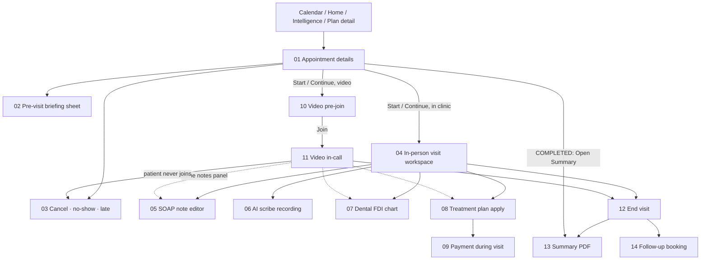

# 05 · Appointments & visit — flow map and rules

Everything between "the doctor taps a booking" and "the visit is completed with its summary in the patient's file": appointment details, the in-person workspace, the video call, notes (SOAP, speech, AI scribe), the dental chart, treatment-plan fulfilment and payment, end-visit, the summary PDF and the follow-up. Spec: `docs/kmp-spec/05-appointments-video-dental.md` (plus doc 02 §7 for the notes/scribe API and doc 03 §3 for the details sheet internals).

## 1. Flow map

Solid arrows are navigation; dotted ones mean "the same component is embedded".

## 2. Status machine

```mermaid
stateDiagram-v2
  [*] --> REQUESTED: patient books (server)
  REQUESTED --> CONFIRMED: confirmed (server / clinic)
  REQUESTED --> CANCELLED: Cancel (DELETE)
  CONFIRMED --> CANCELLED: Cancel (DELETE), only before end
  CONFIRMED --> IN_PROGRESS: visit opened — set by the server, trigger UNVERIFIED; the client never sets it
  CONFIRMED --> NO_SHOW: Mark no-show — target, no endpoint today
  IN_PROGRESS --> COMPLETED: End appointment (PUT complete)
  COMPLETED --> [*]
  CANCELLED --> [*]
  NO_SHOW --> [*]
```

End-visit sequence (fulfil → payment → complete → scribe wait → re-read → summary) is drawn in `12-end-visit.md` §5.

## 3. Files

| File | Screen | Role | Tier | Purpose |
|---|---|---|---|---|
| 01-appointment-details.md | Appointment details sheet | Doctor; staff read/cancel via clinic schedule | all | See one booking (status, payment, when, patient) and take the next action: start, continue, open summary, cancel |
| 02-pre-visit-briefing-sheet.md | Pre-visit briefing sheet | Doctor | PRO for AI text (not gated client-side) | Read the AI summary of documents the patient attached when booking; retry when it failed |
| 03-cancel-no-show-late.md | Cancel dialog · late state · no-show sheet | Doctor; staff cancel | all | Cancel ahead of time, see "patient not arrived", mark a missed visit as no-show (target) |
| 04-in-person-visit-workspace.md | In-person visit workspace | Doctor | all; scribe/mic PRO; dental by profession | Run the consultation: documents, notes in three modes, plan, signature, end |
| 05-soap-note-editor.md | SOAP + free notes + speech-to-text + focus mode | Doctor | mic PRO | Write or dictate the clinical note |
| 06-scribe-recording.md | AI scribe recording flow | Doctor | PRO | Record the consultation, upload, wait for the AI note, review drafts and ICD suggestions |
| 07-dental-chart-entry.md | Dental FDI chart entry | Dental professions | all | Document procedures per tooth with prices, discount, totals and notes |
| 08-treatment-plan-apply-sheet.md | Treatment plan picker + fulfil sheet | Doctor in a clinic workspace | all | Link the visit to an active plan and tick planned items done today |
| 09-payment-during-visit.md | Plan finances card | Doctor in a clinic workspace | all (clinic role, server-checked) | Record the patient's chair-side payment against the plan |
| 10-video-call-pre-join.md | Video pre-join (permissions, device check) | Doctor | PRO (defined, not enforced) | Check camera/mic and the join window before the patient sees you — new screen |
| 11-video-call-in-call.md | Video in-call | Doctor | PRO (defined, not enforced) | Run the remote consultation with the same notes panel plus visit facts |
| 12-end-visit.md | End visit sheet + progress | Doctor | all | Save everything, complete the visit, produce the summary, never strand a completed visit without its document |
| 13-appointment-summary-pdf.md | Appointment summary (PDF) viewer | Doctor; staff via documents | all | Open, share and print the visit summary |
| 14-follow-up-booking.md | Follow-up booking sheet | Doctor | all (video kind PRO if confirmed) | Book the next visit for the same patient right after this one — new screen |

## 4. Not designed (and why)

| Item | Why not |
|---|---|
| Waiting room screen | Dead code: routable, never navigated to, no presence API. Pre-join (10) replaces its one useful idea; "patient is waiting" needs a backend presence signal first (UNVERIFIED). |
| Web Daily Prebuilt iframe | Web-only; the KMP app uses native Daily SDKs. Nothing from the embed (controls hidden, iframe permissions) carries over. |
| Screen-share button | No-op on native in the current SDK; not requested by product. |
| Typing indicator / chat inside the call | Not present and not requested; chat lives in folder 07. |
| Prescriptions, Diagnosis, Recommendations, Follow-up sections of the PDF | Never populated by any screen; remove from the document (13). Prescriptions as a feature do not exist in the app. |
| Phone-OTP / admin flows touching appointments | Out of the mobile scope (doc 00). |
| Drag-and-drop document upload | Web-only; mobile uses the file picker (04). |
| Form 025-2 internals | Embedded in the workspace but owned by folder 06 (patients, forms). This folder only describes how it opens/collapses and the Save & switch handshake. |
| Shifa Intelligence chat and the visit-facts internals | Folder 03. Here only their placement inside the visit screens (04 §3, 11 §3). |
| Admin "legal contract" PDFs, finance ledger screens | Folders 08/09. |

## 5. Area rules

**Status vocabulary.** `REQUESTED`, `CONFIRMED`, `IN_PROGRESS`, `COMPLETED`, `CANCELLED`, `NO_SHOW` — UI labels from the `appointmentStatus*` keys (never the button words "Complete"/"Cancel"). The client sets only `COMPLETED` (End) and triggers `CANCELLED` (DELETE). `IN_PROGRESS` is server-side (trigger unverified); `NO_SHOW` has no client action today and needs a backend endpoint.

**Visit kind.** In-clinic vs video must be a real field on the appointment (today: the word "video" in the location text). Payment status (PAID / PENDING / FAILED / NOT_REQUIRED) is shown for video visits only.

**Who can do what.** Doctors start, continue, document and end visits; staff see details, cancel and change slots from the clinic schedule and never enter the workspace or the call. Clinic membership roles gate finance actions client-side as a courtesy; the server decides.

**Tier gates actually enforced today:** AI scribe (*Start AI Notes*) and speech-to-text mic icons → PRO (`aiNotes`, `speechToText`), hidden when locked. Patient briefing → PRO (the pre-visit *appointment* briefing sheet is not gated client-side). Video consultations are listed as PRO in the tier table but **never checked** in code. Dental mode is gated by **profession**, not tier. Unknown tier behaves as PREMIUM today; the rewrite hides gated entries until the tier is known (doc 00 open decision 2). Locked state in the rewrite: control visible but disabled with a lock and a one-line reason, never silently missing.

**Time windows (practice timezone, never the phone's).** Video: start −5 min … end +15 min on the backend (the client allows up to end +1 h — align). In-clinic: any time on the appointment day, including after the slot. Home card: 15 min early for both kinds — unify to "15 min early in clinic, 5 min early video". IN_PROGRESS and COMPLETED ignore windows.

**Polling and timers.** Signature status 10 s while requested and unsigned (cap at 30 min, stop on leave). Scribe status 3 s up to 120 s at End (cancellable). Details-sheet notes/PDF refresh 4 s × 30 after a visit. Briefing 3 s while pending. Dental autosave 1.2 s after the last change; general notes autosave 2 s (target; none today). Chronic-disease warning once per visit open.

**Completion ordering.** Plan ticks → payment → complete → (scribe wait) → summary. A failure before *complete* leaves the visit open with a specific message; a failure after *complete* must surface as "completed, summary pending" with a retry — never a generic error and never a lost document. Prefer a backend-rendered summary (PDF-01).

**Feedback.** Skeletons for lists/cards (the live video pane may show a spinner), top banners for results, confirmation dialogs/sheets for cancel, leave-call and end; destructive buttons red on the right. No snackbars.

**Copy.** Three languages; design for Russian length. Every string in this folder's §11 lists exists in `docs/kmp-spec/strings/en.json` unless marked **NEW**; several referenced keys have no English value today (listed per file) and must be filled.
