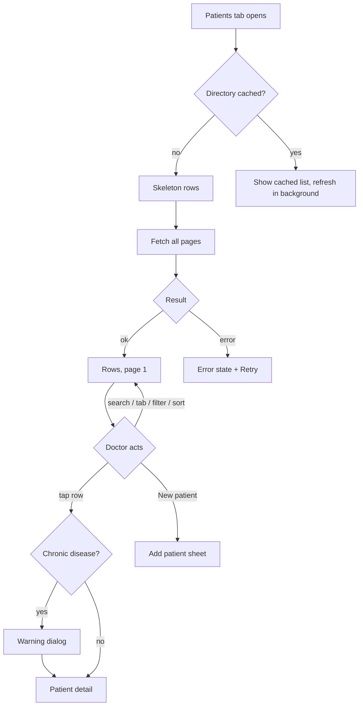

# Patients list (Patients tab root)

| | |
|---|---|
| Area | Patients, documents & forms |
| Who sees it | Doctor only (all tiers). Clinic staff never get this tab; they reach patients through the Clinic workspace (folder 09) |
| Reached from | Bottom tab "Patients"; deep links that select a patient (chat header, push notifications, clinic roster) open this screen with the patient already selected (see §2) |
| Screen type | Tab root |
| Current Flutter source | `lib/features/patients/presentation/patients_screen.dart`, `patients_directory_panel.dart`, `patient_detail_helpers.dart`, `lib/state/patients/patients_provider.dart` |
| Spec | `docs/kmp-spec/06-patients-forms-documents-care.md` §1.1–1.5, tickets PAT-02, PAT-03 |

## 1. Purpose
The doctor's directory of every patient they have created or been given access to. Used many times a day to find one person and jump into their record. On a phone this screen is only the list; tapping a row pushes the Patient detail screen (file 03). On tablets ≥ 720 dp the list sits in a left pane (7/20 of the width) and the detail in the right pane.

## 2. Entry points
- **Bottom tab "Patients"** — no context; the list is reloaded from the server every time the tab becomes active.
- **Chat thread header tap** (patient conversations only) — arrives with a patient id; the screen opens on top of the chat with that patient selected (phone: detail screen pushed immediately, back returns to the list, second back returns to chat).
- **Push notification "document access approved / rejected / requested"** — arrives with patient id, document id, document title and a flag "open viewer"; the detail opens on the Documents tab with that document highlighted and, for "approved", the viewer is pushed on top automatically (file 08).
- **Clinic roster** (folder 09) — arrives with patient id, clinic id and a "return to clinic schedule" payload; a back row above the list returns to the clinic schedule.
- **Home "New patient" quick action** and **Calendar → assign patient** open the Add patient sheet (file 02) directly, not this list.
- If the selected patient is not in the loaded directory (e.g. a clinic patient), the app fetches that one patient separately and shows it at the top of the list ("overlay" patient).

## 3. Layout, top to bottom (phone portrait)
1. **Optional back row** — only when the screen was pushed (deep link / clinic). Text button "← Patients" or system back. Not shown on the plain tab.
2. **Title block** — "Patients" (display size) with a pill badge under it: "N patients" / "1 patient" (count of the **whole** directory, not the filtered set).
3. **Search field** — hint "Name, phone, or ID", search icon prefix, no clear button, no debounce (filters on every keystroke; resets to page 1).
4. **Filter + primary button row** — square icon button with filter icon (tinted when a status filter is active) and a full-width primary button "New patient" with a person-add icon.
5. **Segment tabs** (horizontally scrollable, underline indicator 28 px): "All patients" · "Recent" · "Favorites" · "Follow-ups".
6. **Tools row** — refresh icon button (tooltip "Refresh") and a "Sort ▾" outlined chip opening a menu.
7. **List** — one card row per patient, 8 px gaps, **10 rows per page**. Row anatomy: initials avatar (44 px, photo if the patient has one) · name (1 line, ellipsis) · subtitle "34, Male · +998 90 123 45 67" (age and gender omitted when unknown; falls back to the phone alone, or "—") · status pill ("Active" / "At risk" / "Follow-up") · chevron. Selected row (tablet) gets a teal border + tint.
8. **Pagination footer** (sticky at list end, not screen bottom) — caption "Showing 1 to 10 of 47 patients", ‹ › arrows, up to 5 page numbers centred on the current page, "…" when there are more than 5 pages.
9. **Bottom clearance** for the tab bar. Whole screen scrolls as one (header is not sticky today).

No FAB; the primary action is the "New patient" button in the header.

## 4. Data and formats
| Field | Source | Format rule |
|---|---|---|
| Name | patient `name` (single string) | As stored; empty string possible → design must show "Patient" (NEW fallback) |
| Initials | first letter of first and last whitespace token, uppercased | "?" when empty; single word → one letter |
| Age | birth date vs today | Integer years; absent when no birth date. Today = practice-timezone date (Flutter uses device clock) |
| Gender | patient `gender` | Localised "Male / Female / Other"; raw value if unknown; omitted when empty |
| Phone | first of `phones[]` (or legacy `phone`) | Shown as stored (no E.164 formatting today); "—" when none |
| Status pill | `clinicalStatus` ∈ ACTIVE / AT_RISK / FOLLOW_UP (anything else → Active) | Localised labels; colours: teal / amber / violet |
| Display id (search only) | `P-` + id zero-padded to 5 | "P-00042"; non-numeric ids → `P-<raw>` |
| Count badge | directory length | Plural: "1 patient" / "N patients" (Russian needs 3 forms) |
| Pagination caption | visible (filtered) count | "Showing {start} to {end} of {total} patients"; "Showing 0 to 0 of 0" when empty |

Sorting is by name A–Z by default (case-insensitive on the server fetch, case-sensitive in the in-memory sort — inconsistent). "Recent activity" sort uses the newest **document** date per patient; patients with no documents go last.

## 5. Primary flow (happy path)
1. Tab opens → list region shows skeleton rows (target; today the list shows "No patients found" until data arrives).
2. Directory arrives (server pages of 100 are walked until exhausted, then sorted client-side) → rows render, page 1 of N, count badge updates.
3. Doctor types in Search → list filters live over name, raw id, display id and first phone; page resets to 1.
4. Doctor taps a row → phone: Patient detail (file 03) is pushed; tablet: right pane loads. If the patient has a chronic disease a blocking warning dialog appears first (file 04 §"Chronic disease warning").
5. Back returns to the list with search, tab, filter, sort and page preserved (they live in the list widget; they are lost only when the tab is rebuilt).

## 6. Screen states
- **First load** — skeleton: title + badge placeholder, search field real, 6 skeleton rows (avatar circle, 2 text bars, pill). Today: no loading state at all; the empty message is shown while loading.
- **Empty** — directory has 0 patients: illustration + "No patients found" + hint and the "New patient" button repeated as CTA (NEW copy, see §11). Empty after filtering (search/tab/status): "No patients found" only, with a "Clear filters" link (NEW).
- **Error on load** — full-list error block with "Failed to load patients. Please try again." + Retry. Today: initial load errors are swallowed silently; only manual refresh shows a red toast.
- **Offline** — last successfully loaded directory stays visible and searchable; "New patient" and refresh show the global offline banner on tap. Row tap still opens the cached detail.
- **Refreshing** — pull-to-refresh (target) or refresh icon: rows stay in place, a thin progress line under the header; on success a top banner "Patient list refreshed" (today a 2 s bottom toast). Content must not jump; selection and page are preserved.
- **Partial data** — n/a (single call). If the overlay patient fetch for a deep link fails, the list shows normally and the detail shows its own error.
- **Permission needed** — n/a.
- **Locked by tier** — none; all tiers.
- **Role difference** — clinic staff never see this screen. In the Clinic workspace the same detail panel is embedded with a clinic id, but the list there is the clinic roster (folder 09), not this directory.

## 7. Interactions and secondary flows
- **Tap row** → select → chronic warning if applicable → Patient detail. Phone pushes; tablet swaps the right pane and refreshes that patient's documents.
- **Tap "New patient"** → Add patient sheet (file 02) → on success the list reloads and the new patient is selected/opened.
- **Type in Search** → filters instantly; page → 1. Keyboard "Search" just closes the keyboard. Target: 300 ms debounce (UNVERIFIED value; today none) and a clear (×) button.
- **Tap segment tab** → "All patients" (everything) · "Recent" (today: last 20 patients **by name order reversed**, not recency — must become real recency or be dropped, PAT-03) · "Favorites" (starred patients; today not persisted, lost on restart) · "Follow-ups" (clinical status FOLLOW_UP). Page → 1.
- **Tap filter icon** → menu "All statuses / Active / At risk / Follow-up"; selection tints the icon; page → 1.
- **Tap "Sort"** → menu "Name (A–Z) / Name (Z–A) / Recent activity"; current item pre-checked; page is **not** reset today (should reset to 1).
- **Tap refresh icon** → reload directory + documents of the selected patient + banner.
- **Tap page number / ‹ / ›** → changes page; arrows disabled at the ends; list scrolls to top (today scroll position is kept — fix).
- **Pull-to-refresh** → not implemented today; target same as refresh icon.
- **Long-press row** → nothing today. Open question: star/unstar via long-press.
- **System back** on the tab root → leaves the app / goes to previous tab per shell rules (folder 01). On the pushed variant → pops; with the clinic return payload → re-opens the clinic schedule.

## 8. Edge cases
- **Patient without last name** → single initial, name shown as is. **Without phone and DOB** → subtitle shows "—" alone; design should hide the subtitle line instead.
- **Empty name** (possible from API) → "Patient" fallback + "?" avatar.
- **Very long name** (60+ chars, no spaces) → single line ellipsis; pill and chevron must never be pushed off-screen.
- **Phone stored unformatted** ("901234567", "+998 (90) 123-45-67") → shown verbatim; search matches on the stored string only, so searching "90 123" fails against "+998901234567". Target: normalise digits for search.
- **0 patients** → empty state with CTA. **1 patient** → "1 patient" badge, "Showing 1 to 1 of 1 patient", single page, arrows disabled. **500+ patients** → today 5+ server pages are downloaded on every tab switch (~0.5–1 MB); paging is purely visual. Target: server-side search/paging or a cached directory with TTL; design should not depend on knowing the total up-front.
- **Duplicate names** → no disambiguation besides phone/age; consider showing display id "P-00042" as a third subtitle token.
- **Search debounce / typing fast** → today each keystroke rebuilds the whole filtered list; with 500+ patients this stutters.
- **Filtered to zero** on page 3 → page resets to 1 automatically (any filter change resets); the sort menu does not reset the page, which can show an empty page with "Showing 21 to 20".
- **Favorites tab after restart** → empty (not persisted). Target: persist per doctor.
- **Slow network > 3 s** → skeleton stays; after 10 s show "Still loading…" text under the skeleton (NEW).
- **Double tap on a row** → must open the detail once (today the second tap re-selects and may show the chronic dialog twice in quick succession).
- **401 mid-load** → global logout (folder 01). The list is not retried.
- **Deep link while a sheet (Add patient) is open** → sheet is dismissed, selection applied; unsaved sheet input is lost (acceptable, but close the sheet explicitly).
- **Patient deleted by someone else** (404 on overlay fetch) → list shows normally; detail pane shows "Patient not found" with Back (NEW copy).
- **Rotation** → phone→landscape on a tablet-class width switches to the two-pane layout; the selected patient must remain selected.
- **Language switch** while open → labels re-render; the status pill and gender re-translate; stored language values like "uzbek" are capitalised English words, not translated (known problem).
- **Font scaling 200 %** → the header button row wraps ("New patient" under the filter icon); the pagination row must wrap the page numbers under the caption, not overflow.
- **Screen reader** → order: title, count, search, filter, New patient, tabs, sort, rows (name, subtitle, status as one label), pagination. Row must announce "Selected" on tablet.
- **Practice vs phone timezone** → age is computed from the device date; a patient whose birthday is "today" in practice TZ but "yesterday" on the device shows one year less. Use practice TZ.

## 9. Validation and messages
| Field/action | Rule | When checked | Message (EN) | Where shown |
|---|---|---|---|---|
| Search | none; trims whitespace; case-insensitive contains | on each change | — | — |
| Load directory | HTTP 200 required; 401 → logout | on load | "Failed to load patients. Please try again." | full-list error block + Retry |
| Refresh | same | on tap/pull | success "Patient list refreshed"; failure "Error: …" sanitised | top banner |
| Overlay patient fetch | 404 / network | on deep link | "Patient not found" (NEW) | detail pane |

## 10. Navigation out
- Row → Patient detail (file 03). List state kept. Returning does not refetch unless the detail changed data (create account, medical info edits trigger a directory reload today).
- "New patient" → Add patient sheet (file 02); on success reload + select; on cancel nothing changes.
- Back row (deep-link variant) → previous screen; with clinic payload → clinic doctor schedule reopened full-screen.
- Tab switch away → nothing saved; switching back reloads the directory (today) — target: cached, refresh on pull.

## 11. Copy
Existing keys (`docs/kmp-spec/strings/en.json`): `patients` "Patients" · `patientsCountLabel` "patients" / `patientsCountLabelOne` "patient" · `patientsPagination` "Showing {{start}} to {{end}} of {{total}} {{noun}}" · `searchPatientsDirectoryHint` "Name, phone, or ID" · `newPatient` "New patient" · `allPatients` "All patients" · `recent` "Recent" · `favorites` "Favorites" · `followUps` "Follow-ups" · `filterAllStatuses` "All statuses" · `patientStatusActive` "Active" · `patientStatusAtRisk` "At risk" · `patientStatusFollowUp` "Follow-up" · `sort` "Sort" · `sortNameAsc` "Name (A–Z)" · `sortNameDesc` "Name (Z–A)" · `sortRecent` "Recent activity" · `refresh` · `noPatientsFound` "No patients found" · `failedToLoadPatients` "Failed to load patients. Please try again." · `listRefreshed` "Patient list refreshed" · `retry` "Retry" · `genderMale/Female/Other` · `patientsPageSubtitle` "Manage your patient directory and clinical records" (unused today; could be the empty-state hint).

**NEW**: empty-directory title "No patients yet" + body "Add your first patient to start keeping records." · "Clear filters" · name fallback "Patient" · "Patient not found" · "Still loading…".

## 12. Known problems in the current app (do not carry over)
- No loading state: the empty message shows during the first load; initial load errors are swallowed.
- Whole directory downloaded (pages of 100) on every tab activation, then paged 10-per-page in memory; no server search.
- "Recent" tab is "last 20 by name order reversed"; "Recent activity" sort uses document dates only.
- Favourites live in widget memory only; they vanish on restart or tab rebuild.
- No search debounce, no clear button; sort change does not reset the page; page change keeps the scroll offset.
- Success/failure feedback is a bottom SnackBar; must be a top banner.
- Age uses the device date, not the practice timezone.
- Three private avatar widgets with slightly different initials rules; one component in the new design.
- Patient name is a single `name` string; the row cannot show "Last, First" ordering.

## 13. Open questions for design
- Keep the 10-per-page pager on phone, or switch to infinite scroll with a sticky "N of M" indicator? (Pager exists because the web version had it.)
- Do "Recent" and "Favorites" survive as segments, or do we replace them with a status filter chip row (All / At risk / Follow-up / Favorites)?
- Should the row show the display id (P-00042) to disambiguate duplicate names?
- Is "New patient" a header button, a FAB, or both (FAB hides behind the tab bar on small phones)?
- Where does the chronic-disease warning live on tablet where selection happens without navigation — dialog or an inline red banner on the detail header?
