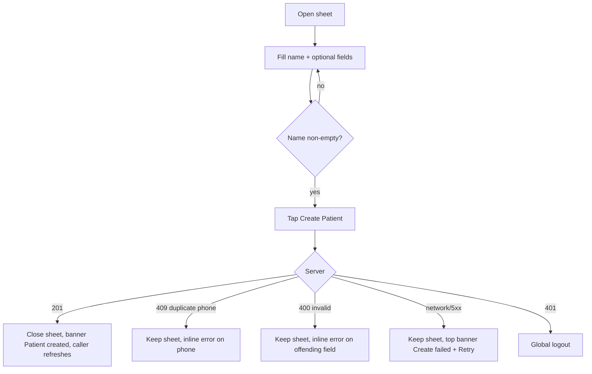

# Add patient (create patient sheet)

| | |
|---|---|
| Area | Patients, documents & forms |
| Who sees it | Doctor (all tiers). Clinic staff create patients through the Clinic workspace (folder 09), which must reuse this same sheet |
| Reached from | Patients list "New patient"; Home quick action "Add patient"; Calendar → book → "New patient" (assign flow) |
| Screen type | Bottom sheet (full-height scrollable form) |
| Current Flutter source | `lib/features/patients/presentation/patients_screen.dart` (`_openCreatePatientModal`), `create_patient_sheet.dart` (`showCreatePatientSheet`), `lib/core/widgets/multiple_phone_fields.dart`, `lib/state/patients/patient_actions.dart` (`createPatientWithClient`) |
| Spec | `docs/kmp-spec/06-patients-forms-documents-care.md` §1.6, ticket PAT-04 |

## 1. Purpose
Register a new person in the doctor's directory with the minimum the doctor knows at that moment — usually name and phone — so an appointment, a form or a document can be attached immediately. Happens several times a week; often while the patient is standing at the desk, so it must be fast and forgiving. Everything except the name can be completed later in Medical info (file 05).

## 2. Entry points
- **Patients list → "New patient"** — opens on top of the list; on success the list reloads and the new patient is selected / opened.
- **Home → quick action "Add patient"** — opens on top of Home; on success a banner, the sheet closes, Home stays (today it does not navigate to the new patient).
- **Calendar → booking → assign patient → "New patient"** — opens on top of the booking sheet; on success the created patient is returned to the booking flow and pre-selected there.
- **Clinic workspace** (folder 09) — target: same sheet with a clinic id so the patient lands on the clinic roster. Today the clinic has its own create dialog (out of scope here).

Today there are **two different implementations** with different field sets (directory variant has gender, blood group, allergies; the Home/Calendar variant does not). The rewrite ships one sheet with the superset below.

## 3. Layout, top to bottom (phone portrait)
1. **Sheet grab handle + title** "Create New Patient". Close (×) at the right (today: drag/scrim only).
2. **Full name \*** — single text field, autofocus, keyboard "next". Required.
3. **Phone number (Optional)** — repeating field group: one phone field, "−" remove icon on each row when more than one, and a "+ Phone number" text button under the group. Numeric/phone keyboard. Removing the last remaining field just clears it.
4. **Email** — email keyboard, optional.
5. **Address** — free text, optional (legacy single-line address; the structured location fields exist only on the backend).
6. **Language** — dropdown, default "Uzbek"; options English, Uzbek, Russian, German, Karakalpak, Kazakh, Kyrgyz, Tajik, Turkmen, Arabic (labels are capitalised English words today; must be localised).
7. **Gender** — dropdown: "—", Male, Female, Other.
8. **Blood group** — dropdown: "—", A+, A−, B+, B−, AB+, AB−, O+, O−.
9. **Allergies** — free text, optional.
10. **Birth date** — tap-to-pick field; placeholder "Select Date"; opens a date picker limited to 1900 … today, initial 1990. Shows "d.M.yyyy" after picking (unpadded today — use "dd.MM.yyyy").
11. **Primary button "Create Patient"** (full width) pinned under the form; disabled while the name is empty (today: enabled but silently does nothing).

Sheet scrolls; keyboard pushes the content up; the primary button stays reachable at the end of the form.

## 4. Data and formats
| Field | Sent as | Format rule |
|---|---|---|
| Full name | `name` (one string) | Trimmed; no split into first/last |
| Phones | `phones[]` (+ `phone` when exactly one) | Trimmed, empty rows dropped. Target: normalised to E.164 with +998 default (helper exists: strips non-digits, keeps "+", drops a leading 0, prefixes +998) |
| Email | `email` | Trimmed; empty string sent when blank (target: omit) |
| Address | `address` | Trimmed |
| Birth date | `birthDate` as `YYYY-MM-DD` or null | Picked date only, no time; never in the future |
| Language | `language` lowercase English word, e.g. `uzbek` | Stored value stays English; UI label localised |
| Gender | `gender` "Male" / "Female" / "Other" | Omitted when "—" |
| Blood group | `bloodGroup` | Omitted when "—" |
| Allergies | `allergies` | Omitted when blank |
| Chronic disease | `chronicDisease` "" | Always empty at creation; set later in Medical info |
| Photo | `photoUrl` null | No photo capture at creation |

## 5. Primary flow (happy path)
1. Sheet opens, Full name focused.
2. Doctor types name (+ phone). "Create Patient" becomes enabled when the trimmed name is non-empty.
3. Tap "Create Patient" → button shows progress, fields disabled (today the sheet closes **before** the request and the result arrives as a toast on the screen behind).
4. Server 201 → sheet closes → top banner "Patient created" → caller refreshes (directory reload + select; booking flow pre-selects; Home shows banner only).
5. Server 409 (duplicate phone) → sheet **stays open**, phone field highlighted, inline message (see §9).

## 6. Screen states
- **First load** — n/a (no fetch). Opens instantly with empty fields.
- **Empty** — the default state; "Create Patient" disabled.
- **Error on load** — n/a.
- **Offline** — sheet can be filled; tapping Create shows the offline banner and keeps input. No offline queue (decision: not needed; patient creation needs the server id).
- **Refreshing** — n/a.
- **Partial data** — n/a.
- **Permission needed** — n/a (no camera/contacts). Open question: pick from device contacts would need Contacts permission.
- **Locked by tier** — none.
- **Role difference** — clinic staff (via folder 09) see the same sheet; the created patient is attached to the clinic. Doctor variant has no clinic selector.
- **Saving** — button with spinner, fields disabled, sheet not dismissible by drag/scrim.

## 7. Interactions and secondary flows
- **Tap "+ Phone number"** → appends an empty phone row below the last; focus moves there.
- **Tap "−" on a phone row** → removes that row; when it is the only row, clears it instead.
- **Tap Birth date** → platform date picker (1900 … today, starts at 1990 or the already-picked date) → field shows the date; a small × to clear (NEW; today a picked date cannot be removed).
- **Keyboard "next"** moves Name → Phone → Email → Address; "done" on Address submits when the name is valid (today only in the Home/Calendar variant).
- **Drag down / tap scrim / ×** → closes and discards input **without confirmation** today. Target: if any field has content, ask "Discard new patient?" (Cancel / Discard).
- **Tap Create with empty name** → today nothing happens; target: button disabled + helper "Full name is required" under the field once the user tried.
- **Double tap Create** → must send once (today the sheet pops on first tap so the second tap lands elsewhere).

## 8. Edge cases
- **Name only** (no phone, no DOB) → allowed; the patient will have no subtitle in the list.
- **Duplicate phone** → server 409 with message "Patient with this phone number already exists."; the message is shown verbatim. The design should offer "Open existing patient" if the server returns the id (UNVERIFIED whether it does).
- **Phone typed with spaces / brackets / leading 0** → sent as typed today; target: E.164 normalisation preview under the field ("Will be saved as +998 90 123 45 67").
- **Same number entered twice** in two rows → both sent; target: dedupe client-side.
- **Very long name** (100+ chars) → accepted; no max length today. Target: 120 chars soft cap.
- **Emoji / Cyrillic / Latin mixed** names → accepted; initials logic takes first letters.
- **Birth date = today** → allowed (age 0); future dates impossible via picker.
- **Patient under 1 year** → age shows "0"; design may show months (open question).
- **Email invalid** ("abc") → sent as is today; server may 400 ("Invalid request. Please check the phone number." — misleading text). Target: client-side email format check on blur.
- **Slow network > 3 s** → button spinner; sheet locked; after 30 s request timeout → banner "Create failed" with input kept.
- **Leaving mid-save** (app backgrounded) → request continues; on return the sheet reflects the result; if the result was lost, the directory reload reveals whether the patient exists (risk of duplicate on retry — the 409 on phone protects only when a phone was given).
- **401 mid-save** → global logout; input lost (acceptable).
- **Language switch while open** → labels re-render; selected dropdown values stay.
- **Font scaling 200 %** → dropdowns and the date field must grow in height; the phone row's "−" icon must not overlap the field.
- **Rotation** → sheet re-lays out; input preserved.
- **Screen reader** → announce the sheet title, required marker on Name, "Add phone number" button, and the disabled reason of the Create button.
- **RTL** — n/a (no RTL locale shipped; Arabic is a patient language, not a UI language).

## 9. Validation and messages
| Field/action | Rule | When checked | Message (EN) | Where shown |
|---|---|---|---|---|
| Full name | required, trimmed length ≥ 1; target max 120 | on change (enables button); on submit | "Full name is required" (NEW) | inline under field |
| Phone (each row) | optional; digits, spaces, +, (), − allowed; after normalisation 9–15 digits (E.164) | on blur + on submit | "Enter a valid phone number" (NEW) | inline under the row |
| Phone duplicate (server) | 409 | on submit | "Patient with this phone number already exists." (server text today) | inline under phone + sheet stays open |
| Email | optional; must contain one @ and a dot after it | on blur | "Enter a valid email" (NEW) | inline |
| Birth date | 1900-01-01 … today | picker enforces | — | — |
| Address / Allergies | free text, trimmed | — | — | — |
| Create (400) | server rejects | on submit | "Invalid request. Please check the phone number." (server fallback today) | top banner |
| Create (network/5xx) | — | on submit | "Create failed: …" (sanitised) | top banner, input kept |
| Create (201) | — | — | "Patient created" | top banner on the caller screen |

## 10. Navigation out
- **Success** → sheet closes; caller refreshes: Patients list reloads and selects/opens the new patient; Calendar assign flow receives the patient and continues booking; Home shows the banner only (open question: navigate to the new patient?).
- **Cancel / drag / scrim / ×** → closes; input discarded (with the discard confirmation when dirty).
- **401** → login screen.

## 11. Copy
Existing keys: `createNewPatient` "Create New Patient" · `fullName` "Full Name" · `phoneNumber` "Phone Number" · `optional` "Optional" · `addPhoneNumber` "Add phone number" · `remove` "Remove" · `email` "Email" · `address` "Address" · `language` "Language" · `gender` "Gender" · `genderMale` / `genderFemale` / `genderOther` · `bloodGroup` "Blood group" · `allergies` "Allergies" · `birthDate` "Birth Date" · `selectDate` "Select Date" · `selectDateHint` "Select Date of Birth" · `createPatient` "Create Patient" · `patientCreated` "Patient created" · `createFailed` "Create failed" · `cancel` "Cancel" · `addPatient` "Add patient" (Home quick action label).

**NEW**: "Full name is required" · "Enter a valid phone number" · "Enter a valid email" · "Will be saved as {phone}" · "Discard new patient?" / "Discard" · language option labels (English, Uzbek, Russian, German, Karakalpak, Kazakh, Kyrgyz, Tajik, Turkmen, Arabic) as keys · "Open existing patient".

## 12. Known problems in the current app (do not carry over)
- Two implementations with different fields; Home/Calendar users cannot set gender, blood group or allergies.
- The sheet closes before the request is sent; errors arrive as a red toast on the screen behind and all input is lost.
- Only the name is validated; phone/email are sent raw; the E.164 helper exists but is unused here.
- Birth date display is unpadded "5.3.1990"; cannot be cleared once picked.
- Language values are English words capitalised at render time, never localised.
- Text controllers leak when the sheet is dismissed (engineering note).
- Feedback via SnackBar; must be a top banner.

## 13. Open questions for design
- Should phone be the first field (desk workflow: number is what receptionists ask first) or name?
- One sheet or a two-step "Quick add (name + phone) → optional details" to keep the first screen short?
- After creating from Home, navigate into the new patient or stay on Home?
- Offer "Pick from contacts"? (Adds a permission and a privacy question.)
- Show the normalised E.164 preview or format the field live with a mask?
