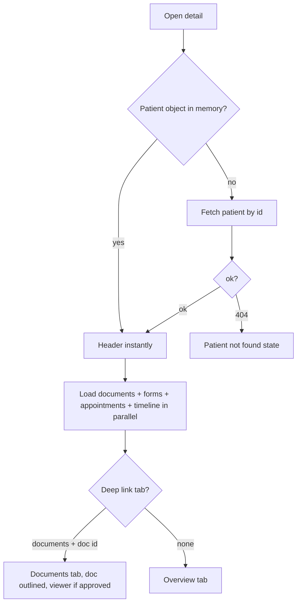

# Patient detail (profile)

| | |
|---|---|
| Area | Patients, documents & forms |
| Who sees it | Doctor (all tiers; the "AI summary" button and copilot card need PRO). Clinic staff see the same panel embedded in the Clinic workspace with a clinic id (adds Prophylaxis and Create treatment plan, removes nothing) |
| Reached from | Patients list row; chat header; push notifications (document access); clinic roster; Home "next patient" / search overlay (folder 02) |
| Screen type | Full screen (phone) / right pane (tablet ≥ 720 dp) |
| Current Flutter source | `lib/features/patients/presentation/patient_detail_panel.dart`, `patient_detail_overview.dart`, `patient_detail_helpers.dart`, `lib/features/home/presentation/widgets/visit_facts_panel.dart` (clinical timeline card) |
| Spec | `docs/kmp-spec/06-patients-forms-documents-care.md` §2.1–2.3, §2.5, §2.7, §2.8, tickets PAT-05, PAT-07, FORM-05 |

## 1. Purpose
The patient's record: who they are, what is known clinically, what happened with this doctor, and the entry point to every action on them (book, message, upload, form, partner). Opened many times a day, usually for 10–30 seconds before or during a visit.

## 2. Entry points
- **Patients list row** — phone: pushed on top of the list; tablet: right pane. Arrives with the patient object from the directory.
- **Chat header** — pushed with a patient id (no object); the patient is fetched if not in the directory.
- **Push "document access approved / rejected / requested"** — pushed with patient id + document id (+ title, + "open viewer"); opens on the **Documents** tab with that document outlined; "approved" pushes the viewer automatically.
- **Clinic roster** (folder 09) — embedded panel with clinic id; a "return to clinic schedule" payload may be present.
- **Home** — next-patient card, patient search overlay, activity feed (folder 02) → same route with a patient id.
- A **chronic-disease warning dialog** (file 04) blocks the screen on every selection when the patient has a chronic disease other than "None".

## 3. Layout, top to bottom (phone portrait)
1. **App bar** — back ("← Patients" text button today) + nothing else (title lives in the header below). Target: standard back, no title, so the hero header reads as the title.
2. **Hero header** — avatar 64 px (photo or initials) · name (22 px) · pill row: status ("Active patient" / "At risk" / "Follow-up") + optional amber "AI risk detected" pill with sparkle icon · caption "Last visit: 12 Mar 2026" or "No recent visit" (today derived from the **newest document date**; target: last completed appointment). Action row: star (favourite) · "AI summary" secondary button (PRO, generates a patient briefing — folder 03) · ⋮ more (file 04).
3. **Summary stats** — 6 tiles in a 2-column wrap (<720 dp): Age · Gender · Phone · Birth date (dd.MM.yyyy) · Patient ID (P-00042) · Language. "—" / "-" when unknown.
4. **AI copilot card** (PRO only) — "Ask about this patient" input with streaming answers, capped at 12 messages (folder 03 owns it; here it is a slot).
5. **Sticky tab bar** — 6 tabs, scrollable: Overview · Medical info · Appointments · Documents · Prescriptions (→ rename **Forms**) · History (→ rename **Activity**). Tabs are a manual switch on phone (no swipe), a pager on tablet.
6. **Tab body** (single scroll with the header; the tab bar pins under the app bar):
   - **Overview** — Clinical summary card (Chronic disease, Allergies, Blood group, Language) · Clinical timeline card (visit facts from Shifa Intelligence; hidden when empty or failed) · Recent activity card (max 6 items, "View full history" → History tab) · Quick actions card (New appointment · Send message · Create document · More actions) · SMS reminders card (only when the doctor's profile allows SMS) · Patient app access card · "AI follow-up suggestions" card (static heuristics, max 3 — target: drop or rename "Reminders").
   - **Medical info** — editable general info (file 05) + Prophylaxis card in clinic scope.
   - **Appointments** — primary button "New appointment" then cards: date (dd.MM.yyyy) · status pill · "09:00 - 09:30" · "Video Call" / "In Clinic" / location text · reason caption. Empty: "No appointments with you yet."
   - **Documents** — file 06.
   - **Prescriptions (Forms)** — list of forms (template "025-2" + date, chevron) → opens the form (file 10). Empty: pill icon + "No prescriptions yet" + "Create Form" button. Target: title "Forms", empty copy "No forms yet", signed badge per row (file 09).
   - **History (Activity)** — same 6 items as Recent activity (file 11).
7. No bottom action bar. Primary actions are in Quick actions and the ⋮ sheet.

Tablet: header + horizontal 6-tile stat row + tab bar + swipeable pager; Overview is two columns (3:2).

## 4. Data and formats
| Field | Source | Format rule |
|---|---|---|
| Name | `name` | As stored; fallback "Patient" |
| Status pill | `clinicalStatus` | Active → "Active patient"; AT_RISK → "At risk" (amber); FOLLOW_UP → "Follow-up" (violet) |
| AI risk pill | `atRisk` boolean | Only when true |
| Last visit | newest document date today → target: last COMPLETED appointment `startAt` in practice TZ | "Last visit: d MMM yyyy" localised month; "No recent visit" |
| Age | birth date vs practice-TZ today | integer; "-" when unknown |
| Gender | patient gender, else first form with a gender, else "—" | localised |
| Phone | first phone | as stored; "—" |
| Birth date | `birthDate` | dd.MM.yyyy; "—" |
| Patient ID | numeric id | "P-" + 5-digit zero pad |
| Language | `language` | capitalised stored word today → localised label |
| Appointment date/time | `startAt`/`endAt` UTC | **practice timezone**, dd.MM.yyyy and HH:mm–HH:mm (today uses device local time — bug) |
| Appointment status | REQUESTED / CONFIRMED / CANCELLED / COMPLETED / IN_PROGRESS (NO_SHOW exists elsewhere) | localised labels; unknown → raw |
| Location | `isVideo` → "Video Call"; else `location` text or "In Clinic" | — |
| Forms row | `templateId` + `date` | "025-2 · 12.03.2026"; target: localised template name "Form 025-2" |

## 5. Primary flow (happy path)
1. Row tapped → (chronic warning dialog if needed) → screen pushes with header skeleton (avatar circle, two bars, pill) and 6 stat skeleton tiles; the tab bar renders immediately.
2. Patient data is already in memory (from the list) so header fills instantly; documents and forms load in the background (used by Last visit/Recent activity/Documents/Forms).
3. Doctor reads Overview, taps a quick action or a tab.
4. Back returns to the list, which keeps its state.

## 6. Screen states
- **First load** — header skeleton + stat tiles skeleton + tab bar real + Overview card skeletons (clinical summary 4 rows, activity 3 rows, quick-actions 4 buttons real). Per-tab bodies have their own skeleton (appointments: 3 cards; forms: 3 rows).
- **Empty** — per section: Clinical summary shows "Not specified" / "No known allergies" / "None"; Recent activity "No recent activity"; Appointments "No appointments with you yet." + the New appointment button; Forms empty state with "Create Form"; Clinical timeline card simply absent.
- **Error on load** — patient fetch failed: full-screen error "Could not load patient" + Retry (NEW). Section failures: Appointments shows "Error: …" + Retry (today raw error text, no retry); Documents has its own error block (file 06); Forms error silently shows the empty state today — target: inline error + Retry.
- **Offline** — header and stats from cache; Overview cards from cache; action buttons that need the network (book, message, upload, create account, SMS) show the offline banner on tap.
- **Refreshing** — pull-to-refresh on any tab reloads patient + current tab data; header never jumps. Today: Documents tab refresh icon shows a 1 s "Refreshing..." toast.
- **Partial data** — documents failed but patient loaded: header shows "No recent visit", Recent activity shows its error; everything else works.
- **Permission needed** — n/a on this screen (camera lives in Upload, file 07).
- **Locked by tier** — BASIC: "AI summary" button and AI copilot card hidden (not dimmed); PRO/PREMIUM: shown. Unknown tier: today fails open; target: hidden until resolved.
- **Role difference** — clinic staff (embedded in Clinic workspace): Prophylaxis card in Medical info, "Create treatment plan" in ⋮; documents, uploads and request-access are clinic-scoped. SMS card and Patient app access card behave the same.

## 7. Interactions and secondary flows
- **Tap star** → toggles favourite immediately (optimistic); persists per doctor (today memory only).
- **Tap "AI summary"** (PRO) → starts the patient briefing (folder 03); button shows progress; result opens the briefing panel.
- **Tap ⋮** → More actions sheet (file 04).
- **Tap a stat tile** → nothing today. Open question: tap Phone → call/copy; tap Patient ID → copy.
- **Tap tab** → switches body; scroll position per tab is not kept today (reset on rebuild) — target: keep per-tab scroll.
- **Swipe between tabs** → tablet pager only today; target: phone too.
- **Overview → Quick actions**: "New appointment" → booking dialog (file 04 §Make appointment); "Send message" → switches to the Chat tab and opens/creates the conversation with this patient (folder 07); "Create document" → Upload options sheet (file 07); "More actions" → the ⋮ sheet.
- **Overview → "View full history"** → History/Activity tab.
- **Appointments → "New appointment"** → booking dialog; after booking the list refreshes.
- **Appointments → tap a card** → nothing today. Target: open Appointment details (folder 05).
- **Forms → tap row** → Form 025-2 editor with the existing form (file 10); on return forms + documents refresh.
- **Forms → "Create Form"** → template picker sheet (file 09).
- **Pull-to-refresh** → target: reload patient + active tab.
- **Back** (system or app bar) → list; on tablet there is no back, the pane stays.

## 8. Edge cases
- **Patient without last name / phone / DOB** → single-letter avatar; Phone "—"; Age "-" and Birth date "—". Stat tiles must keep their height with "—".
- **Name 60+ chars** → header wraps to 2 lines max then ellipsis; the pill row goes under.
- **No documents, no forms, no appointments** (freshly created) → every list tab shows its empty state; Last visit "No recent visit"; "AI follow-up suggestions" produces "Review recent documents" + "Invite patient to portal" (meaningless automation — drop).
- **100+ documents / appointments** → Appointments list is unpaged (server returns everything); design for 100 cards with lazy rendering. Activity is capped at 6 today.
- **Appointment spanning midnight** or **phone timezone ≠ practice timezone** → date and times must be in practice TZ; today's `toLocal()` shows the device's time (a Tashkent doctor travelling shows wrong hours).
- **Appointment in a status not in the known list** (e.g. NO_SHOW) → raw code shown today; add NO_SHOW label and "Unknown" fallback.
- **Gender from form but not on the patient** → shown from the newest form with a gender (legacy); the form never sets gender today, so this never fires — keep the fallback but do not design around it.
- **Patient deleted by someone else / 404** → "Patient not found" + Back; the list reloads on return.
- **Edited concurrently from the web** (medical info changed) → values refresh on pull or next open; no live sync. Document this for the designer as "data can be stale until refresh".
- **Chronic warning + deep link** → dialog appears before the deep-linked Documents tab is visible; the auto-open viewer waits for the documents to load, so it can push **over** the dialog. Target: dialog first, then tab, then viewer.
- **Session expired (401)** mid-tab-load → global logout.
- **Slow network > 3 s** → skeletons per section; header already present.
- **Rotation** (tablet class) → switches between stacked and two-pane; selected tab and scroll must survive.
- **Language switch** → all labels re-render; "Last visit" month must re-localise (hardcoded English months today); Form 025-2 titles re-localise.
- **Font 200 %** → stat tiles become single column; tab labels scroll horizontally; pill row wraps.
- **Screen reader** → order: back, name, status pills, last visit, favourite (state), AI summary, more, stats (label + value as one node), tabs (selected state), body.
- **Deep link while another patient is open** → replaces the current detail (phone pushes a second instance today — avoid duplicates by replacing).

## 9. Validation and messages
| Field/action | Rule | When | Message (EN) | Where |
|---|---|---|---|---|
| Load patient | 200 required | on open | "Could not load patient" (NEW) + Retry | full screen |
| Load appointments | any non-200 → error | on tab open | "Error: …" sanitised + Retry | inline in tab |
| Load forms | non-200 | on open | "Could not load forms" (NEW) + Retry | inline in Forms tab |
| Favourite toggle | none | — | — | — |
| AI summary | PRO tier | on tap | upgrade copy (folder 03) | — |

## 10. Navigation out
- Back → Patients list (state kept). If the detail was reached from Chat or a push, back returns there.
- ⋮ sheet items → file 04 (booking dialog, upload, form, treatment plan, briefing, find partner, care partnerships).
- Tabs → file 05 (Medical info), 06 (Documents), 09/10 (Forms), 11 (Activity).
- Send message → Chat tab (folder 07); the patient screen stays in the Patients tab stack.
- Nothing on this screen holds unsaved input except the AI copilot question (discarded on leave).

## 11. Copy
Existing keys: `patients` · `activePatient` "Active patient" · `patientStatusAtRisk` · `patientStatusFollowUp` · `aiRiskDetected` "AI risk detected" · `lastVisit` "Last visit" · `noRecentVisit` "No recent visit" · `favorites` (tooltip) · `aiSummary` "AI summary" · `moreActions` "More actions" · `age` · `gender` · `phoneNumber` · `birthDate` · `patientId` "Patient ID" · `language` · `overview` "Overview" · `medicalInfo` "Medical info" · `appointments` "Appointments" · `documents` "Documents" · `prescriptions` "Prescriptions" (→ use NEW "Forms") · `history` "History" (→ NEW "Activity") · `clinicalSummary` "Clinical summary" · `chronicDisease` · `allergies` · `bloodGroup` · `notSpecified` · `noKnownAllergies` · `clinicalTimeline` "Clinical timeline" · `clinicalTimelineHint` · `recentActivity` "Recent activity" · `viewFullHistory` "View full history" · `noRecentActivity` · `quickActions` "Quick Actions" · `newAppointment` "New appointment" · `sendMessage` "Send message" · `createDocument` "Create document" · `aiFollowUpSuggestions` · `noPatientAppointments` "No appointments with you yet." · `appointmentStatusRequested/Confirmed/Cancelled/Completed/InProgress/NoShow` · `videoCall` "Video Call" · `inClinic` "In Clinic" · `noPrescriptions` "No prescriptions yet" (→ NEW "No forms yet") · `createForm` "Create Form" · `selectPatientHint` is used but **missing from en.json** ("Select a patient to view details") · `patientAppointmentHistory` "Appointment history" (unused today; good section title).

**NEW**: "Forms" · "Activity" · "No forms yet" · "Could not load patient" · "Could not load forms" · "Patient not found" · "Unknown" (status fallback) · name fallback "Patient".

## 12. Known problems in the current app (do not carry over)
- "Last visit" is the newest document date, not a visit.
- Appointment times are shown in device time, not practice timezone.
- "Prescriptions" tab is the forms list; "History" duplicates "Recent activity" (both capped at 6).
- "AI follow-up suggestions" are hard-coded heuristics presented as AI.
- Favourite star not persisted.
- Chronic-disease dialog blocks on **every** selection; must be once per patient per session (file 04).
- Phone tab switching is a manual body swap with no swipe and no per-tab scroll memory; tab index resets whenever the widget rebuilds.
- Forms-tab load errors are swallowed into an empty state.
- The whole patient object is passed through navigation; the new app passes ids only.
- Header "Patients" back is a text button in the body, not an app bar.

## 13. Open questions for design
- Six tabs on a phone is a lot: merge Activity into Overview (full list) and Forms into Documents (filter chip) to get to four?
- Should Quick actions be a sticky bottom bar (Book · Message · Upload · More) instead of a card inside Overview?
- Is the AI copilot card worth its space on the Overview, or should it be a button that opens the Intelligence chat (folder 03) pre-scoped to the patient?
- Tap-to-call on the phone tile, or keep the number read-only?
- Tablet: keep the 7:13 split or go 2:3?
