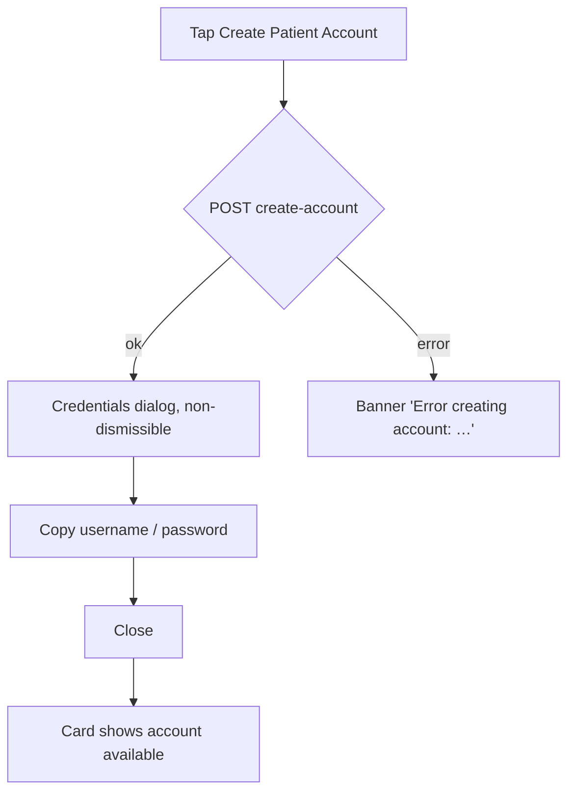

# Patient quick actions, More-actions sheet and patient dialogs

| | |
|---|---|
| Area | Patients, documents & forms |
| Who sees it | Doctor (all tiers; "Generate briefing" needs PRO). Clinic staff get the same sheet plus "Create treatment plan" |
| Reached from | Patient detail header ⋮; Overview "Quick Actions" card; chronic warning fires on selecting a patient; credentials dialog after "Create Patient Account" |
| Screen type | Bottom sheet (More actions), card (Quick actions, SMS reminders, Patient app access), dialogs (Chronic disease warning, Account created, Make appointment) |
| Current Flutter source | `patient_detail_panel.dart` (`_showHeroMoreActions`, `_showMakeAppointmentDialog`, `_PatientPortalCard`, `_SmsReminderCard`), `patient_detail_overview.dart` (`QuickActionsCard`), `patients_screen.dart` (`_createAccount`, `_showAccountCreatedModal`), `lib/core/utils/patient_warning_utils.dart` |
| Spec | `docs/kmp-spec/06-patients-forms-documents-care.md` §1.3, §1.7, §2.2, §2.3, §2.5, tickets PAT-05, PAT-07 |

## 1. Purpose
Everything the doctor can *do* to a patient from the record, gathered in one place: book, message, upload, start a form, create a treatment plan (clinic), generate an AI briefing, invite a partner doctor, open care partnerships, enable SMS reminders, and give the patient app access. Plus the two blocking dialogs the record can throw up: the chronic-disease warning and the one-time credentials.

## 2. Entry points
- **Quick Actions card** (Overview tab): four buttons — New appointment · Send message · Create document · More actions.
- **Header ⋮** → More-actions sheet.
- **Chronic-disease warning dialog** — automatically when a patient whose chronic disease is set (not "None") is selected in the list, and again when a form for them is opened.
- **Patient App Access card** (Overview) → "Create Patient Account" → Account created dialog.
- **SMS appointment reminders card** (Overview) — only when the doctor's own profile has SMS reminders allowed.
- **Make appointment dialog** — from Quick actions, the sheet, or the Appointments tab button.

## 3. Layout, top to bottom (phone portrait)
**More-actions sheet** (list tiles with leading icons):
1. Make appointment (calendar icon)
2. Upload Document (upload)
3. Create Form (description)
4. Create treatment plan (assignment) — **clinic scope only**
5. Generate briefing (summarize) — **PRO only**
6. Find therapy partner (handshake)
7. Care partnerships (groups)
No title, no destructive items. Target: add a grab handle and the patient's name as a small header.

**Quick Actions card**: 2×2 grid of tonal buttons with icons: "New appointment" · "Send message" · "Create document" · "More actions".

**Chronic disease warning dialog** (non-dismissible by scrim): red warning icon 48 px · red title "Patient with Chronic Disease" · body "You are dealing with a patient who has a chronic disease:" · red-tinted box with "Patient: {name}" and "Chronic Disease: {localised disease}" · footer "Please be careful and double-check all procedures, medications, and treatments you are planning for this patient." · single red filled button "I Understand".

**Patient App Access card**: title "Patient App Access"; if the patient has an account → green check + "Account already available (username)"; else → "No account yet" + primary "Create Patient Account".

**Account created dialog** (non-dismissible): green shield icon + title "Account Created" · body "Please share these credentials with the patient. They will be required to change their password on first login." · "Username" row (monospace value + copy icon) · "One-time Password" row (same) · red bold warning "⚠️ For security, this password is shown only once." · "Close" text button.

**SMS appointment reminders card**: title · description "Patient receives an SMS before each future appointment at the time you choose below." · amber note "Add a phone number to enable SMS reminders." when no phone · switch "Send SMS reminders" · dropdown "Reminder time": "24 hours before appointment" / "1 hour before appointment" · text button "Send test SMS now" (only with a phone) · 2 px progress line while saving.

**Make appointment dialog** (calendar-owned, folder 04 designs it; listed here because it is launched from the patient): date field "Select Date" (picker from practice-TZ today) → "Available Slots" grid of free slots for that day → optional "End time" dropdown (consecutive free slots) → "Appointment type" choice chips "Clinic" / "Video Call" → Cancel / Confirm.

## 4. Data and formats
| Item | Source | Rule |
|---|---|---|
| Sheet items visibility | clinic id present → treatment plan; PRO feature flag → briefing | hidden, not disabled |
| Chronic disease label | 22 English keys → localised | "None" / empty never triggers |
| Username / one-time password | server response, shown once | monospace; copy puts the raw value on the clipboard |
| Has account | `hasAccount`, `username` | — |
| SMS enabled / hours | `smsReminderEnabled`, `smsReminderHoursBefore` ∈ {24, 1} | other values → 24 |
| SMS allowed | doctor profile `smsRemindersAllowed` | card hidden when false |
| Booking | free slots of the doctor's calendar for the chosen day, practice TZ | location/reason strings must come from the booking dialog's own data, not hard-coded English ("Video Consultation" / "Clinic Address" / "Check Up" today) |

## 5. Primary flow (happy path) — create patient account
1. Overview → Patient App Access → "Create Patient Account" → button progress.
2. Server returns username + one-time password → dialog opens (cannot be dismissed by scrim/back).
3. Doctor taps copy on each row → banner "Username copied to clipboard" (1 s).
4. "Close" → card now shows "Account already available (username)"; list reloads so the flag persists.

Chronic warning flow: select patient → if chronic → dialog → "I Understand" → detail opens. Target: once per patient per app session, and also as a persistent red strip in the detail header so the information is not lost after dismissal.

## 6. Screen states
- **First load** — sheet/dialogs are instant. SMS card and Portal card render with the patient (no skeleton). Booking dialog: slot grid skeleton while slots load.
- **Empty** — SMS card without phone: controls disabled + amber note. Booking: "No slots available" for the day + hint to pick another date.
- **Error on load** — booking slots failed: "Error loading slots" + Retry inside the dialog.
- **Offline** — all actions in the sheet need the network except opening screens; tapping Create account / Send test SMS / Confirm booking shows the offline banner; sheet items that navigate still work (Find therapy partner opens and shows its own offline state).
- **Refreshing** — n/a for sheet/dialogs; SMS card shows the 2 px progress line.
- **Partial data** — profile not loaded yet → SMS card hidden until the profile resolves (acceptable), portal card always shown.
- **Permission needed** — n/a (clipboard needs none).
- **Locked by tier** — "Generate briefing" hidden below PRO (today also hidden). Unknown tier: hide until resolved.
- **Role difference** — clinic staff: "Create treatment plan" present; "Generate briefing" depends on the clinic doctor's tier (UNVERIFIED for staff — today staff fail open to PREMIUM).

## 7. Interactions and secondary flows
- **Make appointment** → dialog; Confirm → booking → banner "Patient assigned"/success → Appointments tab list + calendar refresh. Cancel → nothing.
- **Upload Document** → Upload options sheet (file 07).
- **Create Form** → Template picker (file 09).
- **Create treatment plan** (clinic) → Treatment plan wizard sheet with this patient preselected (folder 09).
- **Generate briefing** (PRO) → starts the patient briefing (folder 03); sheet closes; progress appears in the header's AI summary area.
- **Find therapy partner** → file 12 with patient id + name.
- **Care partnerships** → file 13 (list, not filtered by patient today — target: filter by this patient with a "Show all" link).
- **Send message** (Quick actions) → switches to Chat tab and opens/creates the conversation (folder 07). The Patients tab stack is kept.
- **Favourite** — see file 03.
- **SMS switch** → immediate save; failure reverts the switch with a banner. **Reminder time dropdown** → immediate save (disabled while the switch is off). **Send test SMS now** → progress on the button → banner "Test SMS sent. Check the patient phone."; 403 → "SMS reminders are not enabled for your account."; 503 → "SMS service is not configured on the server."
- **Create Patient Account** → see §5. Tap while already has account → button not shown.
- **Credentials copy** → clipboard + 1 s banner. **Close** → only exit.
- **Chronic dialog "I Understand"** → closes. Back gesture is blocked today (non-dismissible); keep it blocked but make "I Understand" the only button.
- **Sheet drag / scrim / back** → closes the sheet, nothing else.

## 8. Edge cases
- **Patient has no phone** → SMS controls disabled with the amber note; "Send test SMS" hidden; Make appointment still allowed (reminder simply cannot be sent).
- **Patient already has an account but `username` is empty** → "Account already available" without the bracket.
- **Create account pressed twice quickly** → second request may 409; disable the button after the first tap; on 409 show "Account already exists" (NEW) and reload the patient.
- **Credentials dialog dismissed accidentally** → impossible by design (non-dismissible); but if the app is killed while open, the password is gone forever — the body copy warns about it; consider a "Share…" (system share sheet) button to hand it over immediately (open question; HIPAA: credentials, not clinical data).
- **Chronic dialog on every tap** → annoying for repeat visits; target: once per patient per session + header strip. Also fires again when opening a form for the same patient — suppress when already acknowledged in the session.
- **Chronic value "Other"** → dialog shows "Other"; consider showing the allergies/notes line too (open question).
- **Briefing item when the tier is unknown** → hidden until resolved (not fail-open).
- **Find therapy partner for a patient with a non-numeric id** → today would crash on int parse; ids are numeric in practice, UNVERIFIED for clinic-imported patients.
- **Booking: date with no free slots** → "No slots available"; **end-time list** depends on consecutive free slots; **phone TZ ≠ practice TZ** → day boundaries and slot labels must be practice TZ (folder 04 owns the rule).
- **Booking confirm double-tap** → single booking; disable Confirm while in flight.
- **401** during any action → logout; sheet/dialog closed by the auth redirect.
- **Patient deleted (404)** on create account / SMS → banner "Patient not found" and pop to the list.
- **Rotation** with the sheet open → sheet survives; dialog survives.
- **Language switch** while a dialog is open → re-render labels; disease label re-localises.
- **Font 200 %** → the sheet becomes scrollable (7 tiles); the credentials rows wrap, copy icons stay at the right; the 2×2 quick-action grid becomes 1 column.
- **Screen reader** → sheet tiles are buttons; chronic dialog announces as an alert and focuses the title; credentials rows announce "Username, value, copy button"; the one-time password should be announced on demand, not automatically (privacy in a shared room — open question).

## 9. Validation and messages
| Action | Rule | When | Message (EN) | Where |
|---|---|---|---|---|
| Create account | 2xx | tap | dialog "Account Created" | dialog |
| Create account failed | non-2xx | — | "Error creating account: …" sanitised | top banner |
| Copy credential | — | tap | "{Username|One-time Password} copied to clipboard" | top banner 1 s |
| SMS toggle / time saved | 2xx | change | "SMS reminder settings saved" | top banner |
| SMS save failed | non-2xx | — | "Error: …" sanitised, control reverted | top banner |
| Send test SMS | 2xx | tap | "Test SMS sent. Check the patient phone." | top banner |
| Send test SMS 403 / 503 | — | — | "SMS reminders are not enabled for your account." / "SMS service is not configured on the server." | top banner |
| Booking confirm | date + slot chosen | tap Confirm | "Please select a date first" / slot required | inline in dialog |
| Booking failed | — | — | "Failed to assign: …" | banner |
| Chronic dialog | chronic ≠ None/empty | on select | title/body as §3 | dialog |

## 10. Navigation out
- Sheet items navigate as listed in §7; the sheet closes first, the destination opens after the close animation (today deferred by one frame to avoid a navigator race).
- Dialogs return to the detail; the credentials dialog triggers a patient reload.
- Booking success stays on the detail; Appointments tab and the calendar refresh.

## 11. Copy
Existing keys: `makeAppointment` "Make appointment" · `uploadDocument` · `createForm` · `createTreatmentPlan` "Create treatment plan" · `generateBriefing` "Generate briefing" · `findTherapyPartner` "Find therapy partner" · `carePartnerships` "Care partnerships" · `quickActions` "Quick Actions" · `newAppointment` · `sendMessage` · `createDocument` · `moreActions` · `patientWithChronicDisease` "Patient with Chronic Disease" · `dealingWithChronicDiseasePatient` "You are dealing with a patient who has a chronic disease:" · `patient` · `chronicDisease` · `takeExtraCareForChronicDiseasePatient` · `iUnderstand` "I Understand" · `chronicDiseaseWarning` (short variant, use for the header strip) · `patientAppAccess` "Patient App Access" · `accountAlreadyAvailable` "Account already available" · `noAccountYet` "No account yet" · `createPatientAccount` "Create Patient Account" · `accountCreated` "Account Created" · `shareCredentialsWithPatient` · `username` · `oneTimePassword` "One-time Password" · `forSecurityPasswordShownOnce` · `copy` · `copiedToClipboard` "copied to clipboard" · `close` · `errorCreatingAccount` "Error creating account" · `smsReminderTitle` "SMS appointment reminders" · `smsReminderDescription` · `smsReminderNoPhone` · `smsReminderEnabled` "Send SMS reminders" · `reminderTiming` "Reminder time" · `reminder24Hours` "24 hours before appointment" · `reminder1Hour` "1 hour before appointment" · `smsSendTest` "Send test SMS now" · `smsTestSent` · `smsReminderSaved` · `selectDate` · `availableSlots` "Available Slots" · `noSlotsAvailable` · `appointmentType` "Appointment type" · `clinicAddress` "Clinic" · `videoCall` · `confirm` · `cancel` · `pleaseSelectDateFirst` · `patientAssigned` "Patient assigned" · `failedToAssign` · `errorLoadingSlots`.

**NEW**: "Account already exists" · "Patient not found" · sheet header "{patient name}" · "Share credentials…" (if adopted).

## 12. Known problems in the current app (do not carry over)
- Chronic warning blocks on every selection and again on form open; nothing persists after dismissal.
- Booking sends hard-coded English `location` ("Video Consultation" / "Clinic Address") and `reason` ("Check Up") to the backend.
- Quick actions are a card in the Overview; on phone they are below the fold after the stats and copilot card.
- Credentials dialog cannot share, only copy; raw error strings in toasts.
- "Care partnerships" opens the unfiltered list, not this patient's partnerships.
- Briefing/treatment-plan visibility uses fail-open tier logic.
- Two deferred navigations after the sheet closes (frame hack) — the new app navigates after the sheet's close callback.

## 13. Open questions for design
- Sticky bottom action bar (Book · Message · Upload · More) on the detail instead of a card + ⋮?
- Chronic warning: dialog once per session + permanent header strip, or strip only?
- Credentials: add "Share…" via the system share sheet, or show a QR the patient scans?
- Should "Send test SMS" be hidden behind a long-press to avoid accidental SMS to patients?
- Is "Care partnerships" needed in the per-patient sheet at all, or only in More (folder 01) with a patient filter here?
