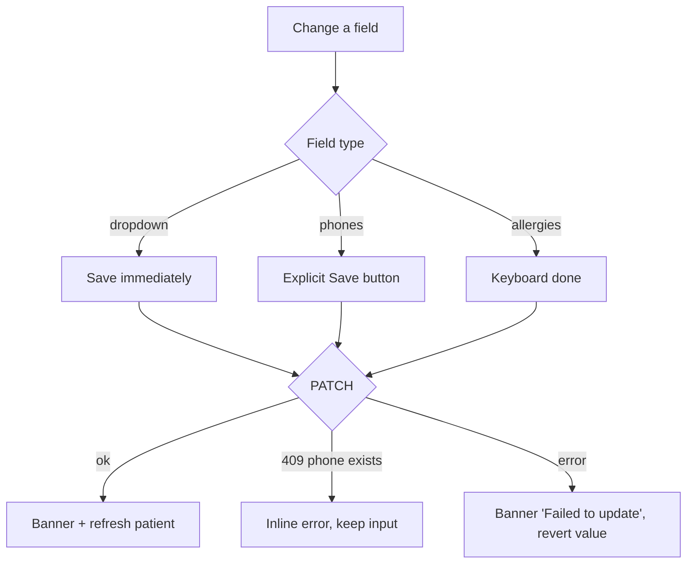

# Edit patient — Medical info tab

| | |
|---|---|
| Area | Patients, documents & forms |
| Who sees it | Doctor (all tiers); clinic staff via the Clinic workspace, where the Prophylaxis card is added |
| Reached from | Patient detail → tab "Medical info" |
| Screen type | Tab body inside Patient detail (inline editing, no separate screen) |
| Current Flutter source | `lib/features/patients/presentation/patient_detail_panel.dart` (`_GeneralInfo`, `_ClinicProphylaxisEditor`), `lib/state/patients/patient_actions.dart` (`updatePatientWithClient`, prophylaxis settings) |
| Spec | `docs/kmp-spec/06-patients-forms-documents-care.md` §2.4, §2.9, tickets PAT-06 |

## 1. Purpose
Correct or complete the patient's identity and clinical baseline after creation: phones, chronic disease, gender, blood group, allergies, and (clinic scope) prophylaxis reminder settings. Occasional — once when the record is completed, then rarely. There is **no full "Edit patient" form today**: name, email, address, birth date, language and photo cannot be edited from the app although the API accepts them. The target design adds an "Edit details" screen for those (see §13), reusing the Add patient field set.

## 2. Entry points
- Patient detail → "Medical info" tab (second tab). No deep link.
- Target: an "Edit details" pencil in the detail header opens the full-field editor (same layout as Add patient, pre-filled) — NEW screen, documented here as a variant.

## 3. Layout, top to bottom (phone portrait)
1. **Card "General Information"**
   1. Read-only rows (label left 110 px, value right): Patient ID (raw numeric id today → show P-00042) · Birth Date (dd.MM.yyyy) · Email · Address (structured "Street, City, District, Region" when present, else legacy address) · Language. Rows with no value are hidden.
   2. **Phone numbers** — N text fields (first labelled "Phone Number (Optional)"), "−" on each when more than one, "+ Add phone number" text button, then an explicit secondary button **"Save"** for phones (phones are the only field with an explicit save).
   3. **Chronic Disease** — dropdown of 22 fixed values: None, Diabetes (Type 1), Diabetes (Type 2), HIV/AIDS, Hypertension, Heart Disease, Chronic Kidney Disease, Chronic Liver Disease, Asthma, COPD, Cancer, Epilepsy, Multiple Sclerosis, Parkinson's Disease, Rheumatoid Arthritis, Lupus, Crohn's Disease, Ulcerative Colitis, Hemophilia, Sickle Cell Disease, Thalassemia, Other. Saves **immediately on change**; "None" clears the field on the server.
   4. **Gender** — dropdown "—", Male, Female, Other; saves immediately.
   5. **Blood Group** — dropdown "-", A+ … O−; saves immediately.
   6. **Allergies** — single-line text, hint "No known allergies"; saves only on keyboard "done" (no button, no blur save).
2. **Card "Prophylaxis reminders"** (clinic scope only): dropdown "Interval (months)" 1–60 (default 12) · switch "Send reminders" (default on) · caption "Last sent: {date}" when present · primary "Save".
3. While any save is in flight every input in the card is disabled and a thin progress line shows.

## 4. Data and formats
| Field | Sent as | Rule |
|---|---|---|
| Phones | `phones[]` (+ `phone` when one) | Trimmed, blanks dropped; target E.164 normalisation and inline validation as in file 02 |
| Chronic disease | `chronicDisease` English key or "" | 22 fixed English strings on the wire; labels localised via `chronicDisease_*` keys; "None" → "" |
| Gender | `gender` "Male"/"Female"/"Other"/"" | "" clears |
| Blood group | `bloodGroup` | "" clears |
| Allergies | `allergies` free text | Trimmed |
| Prophylaxis | `{patientId, clinicId, intervalMonths 1–60, enabled}` | Separate endpoint; "no row" on the server = defaults 12 / on |
| Last sent | `lastSentAt` raw string | Shown verbatim today; target: practice-TZ date |
| Read-only rows | — | Email / address / language / DOB are display-only here (editable in the NEW Edit details screen) |

## 5. Primary flow (happy path)
1. Tab opens → fields show current values immediately (patient already in memory); prophylaxis card shows a skeleton while its settings load.
2. Doctor changes Chronic disease → dropdown closes → card goes busy → PATCH → top banner "Chronic disease updated" → patient refreshed in list and header (status pill, warning on next open).
3. Doctor edits a phone and taps **Save** → busy → "Phone number updated".
4. Doctor types allergies and presses "done" → saved silently today (target: banner "Saved").
5. Clinic: change interval/switch → "Save" → "Prophylaxis settings saved".

## 6. Screen states
- **First load** — general info instant; prophylaxis card skeleton (2 rows) while loading.
- **Empty** — all optional; dropdowns show "—"; allergies hint "No known allergies"; no phones → one empty phone field.
- **Error on load** — prophylaxis settings failed: inline "Could not load prophylaxis settings" + Retry (NEW; today falls back to defaults silently, which risks overwriting server values on Save).
- **Offline** — fields visible; any save shows the offline banner and reverts the control to the previous value.
- **Refreshing** — after a successful save the whole directory is reloaded today (heavy); target: patch the cached patient only. Content must not flicker.
- **Partial data** — n/a.
- **Permission needed** — n/a.
- **Locked by tier** — none.
- **Role difference** — clinic scope adds the Prophylaxis card; otherwise identical. Clinic staff can edit the same fields (server authoritative).
- **Saving** — card busy: inputs disabled, progress line; no modal.

## 7. Interactions and secondary flows
- **Change dropdown** (chronic / gender / blood) → immediate save; on failure the dropdown reverts and a banner explains.
- **Edit phone text** → nothing until Save. **"+ Add phone number"** → new row. **"−"** → remove row (last row clears instead). **Save** → sends the whole phone list.
- **Allergies "done"** → save. Leaving the field without "done" → **change is lost silently** today. Target: save on blur with a 600 ms debounce, or an explicit Save like phones.
- **Prophylaxis Save** → PUT; success banner; "Last sent" unchanged.
- **Chronic disease set to something other than None** → the next time this patient is opened the warning dialog (file 04) fires. Design should preview this: a small red note under the dropdown "A warning will be shown when opening this patient" (NEW, optional).
- **Pull-to-refresh** → reload patient; discards unsaved phone/allergy edits (ask first if dirty — NEW).
- **Back / tab switch with unsaved phone or allergy text** → lost silently today. Target: "Discard changes?" dialog.
- **Target "Edit details" screen** (NEW): header pencil → full-screen form with Full name, Phones, Email, Address, Language, Gender, Blood group, Allergies, Birth date (same rules as file 02) and "Save" in the app bar; unsaved-changes guard on back.

## 8. Edge cases
- **Patient with no DOB / email / address / language** → the read-only rows are hidden, so the card can collapse to just the editable fields; keep a stable minimum height.
- **Address**: structured fields present but empty street → "City, District, Region"; neither → row hidden.
- **Phone duplicate on another patient** → 409 with server message; show inline under the phone list, keep the text.
- **Removing all phones** → sends an empty list; SMS reminder card becomes disabled (file 04) and the list subtitle loses the phone — allowed, but confirm "Remove the last phone number?" (NEW).
- **Chronic disease value not in the 22-list** (legacy data) → dropdown cannot display it today (would crash or show blank); target: show the raw value as a disabled extra option until changed.
- **Allergies text very long** (500+ chars) → single-line field scrolls horizontally; target: multi-line auto-grow, soft cap 1 000.
- **Rapid successive changes** (gender then blood group within a second) → second change is ignored while busy today; target: queue or allow independent saves per field.
- **Save fails midway for phones** → previous phones remain on the server; the text fields keep the edits so the doctor can retry.
- **Concurrent edit from web** → last write wins per field (PATCH only sends the changed field, so no clobbering of others); the screen shows the stale value until refresh.
- **401 during save** → logout; edit lost.
- **404 patient deleted** during save → banner "Patient not found"; back to list on OK.
- **Rotation** → unsaved phone text must survive.
- **Language switch while open** → dropdown labels re-localise; the selected chronic value (English key) keeps mapping correctly.
- **Font 200 %** → the 110 px label column must switch to stacked label-over-field.
- **Screen reader** → each row announces "label, value"; dropdowns announce current value; busy state announces "Saving".
- **Prophylaxis interval out of range from server** (0, 72) → clamped to 1–60 silently today; show the clamped value with a note (rare).

## 9. Validation and messages
| Field/action | Rule | When | Message (EN) | Where |
|---|---|---|---|---|
| Phone (each) | optional; valid E.164 after normalisation | on blur / on Save | "Enter a valid phone number" (NEW) | inline |
| Phone (server 409) | duplicate | on Save | server message ("Patient with this phone number already exists.") | inline + banner |
| Phones saved | — | — | "Phone number updated" | top banner |
| Chronic disease saved | — | — | "Chronic disease updated" | top banner |
| Gender / blood group / allergies saved | — | — | "Saved" (NEW; today silent) | top banner |
| Any save failed | non-2xx / network | — | "Failed to update: …" sanitised | top banner, value reverted |
| Prophylaxis saved | — | — | "Prophylaxis settings saved" | top banner |
| Prophylaxis interval | 1–60 integer | picker enforces | — | — |
| Discard guard | dirty phones/allergies | on back / tab switch | "Discard changes?" (NEW) | dialog |

## 10. Navigation out
- Tab switch / back → detail stays; dirty text fields trigger the discard dialog (NEW). Successful saves refresh the header (status pill, phone tile) and the list row.
- No navigation from this tab besides the NEW "Edit details" screen.

## 11. Copy
Existing keys: `generalInformation` "General Information" · `patientId` · `birthDate` · `email` · `address` · `language` · `phoneNumber` · `optional` · `addPhoneNumber` "Add phone number" · `remove` · `save` · `chronicDisease` "Chronic Disease" · `chronicDisease_none` … `chronicDisease_other` (22 labels) · `chronicDiseaseUpdated` "Chronic disease updated" · `gender` · `genderMale/Female/Other` · `bloodGroup` "Blood group" · `allergies` · `noKnownAllergies` "No known allergies" · `phoneUpdated` "Phone number updated" · `failedToUpdate` "Failed to update" · `patientDetailTabProphylaxis` "Prophylaxis" · `prophylaxisRemindersTitle` "Prophylaxis reminders" · `prophylaxisIntervalMonths` "Interval (months)" · `prophylaxisEnabled` "Send reminders" · `prophylaxisLastSent` "Last sent: {{date}}" · `prophylaxisSave` "Save" · `prophylaxisSaved` "Prophylaxis settings saved" · `error`.

**NEW**: "Saved" · "Enter a valid phone number" · "Discard changes?" · "Remove the last phone number?" · "Could not load prophylaxis settings" · "Edit details" (header action + screen title) · "A warning will be shown when opening this patient".

## 12. Known problems in the current app (do not carry over)
- No way to edit name, email, address, birth date, language or photo from the app.
- Mixed save models (immediate dropdowns, explicit Save for phones, keyboard-done for allergies); allergy edits are lost on blur.
- Every save reloads the entire directory.
- Prophylaxis load failure silently falls back to defaults (12 / on) which a Save would then write over the real values.
- Raw error text in toasts; must be sanitised banners.
- Patient ID row shows the raw numeric id while the header shows P-00042.
- Chronic disease list is 22 hard-coded English strings; a value outside the list cannot be displayed.

## 13. Open questions for design
- One consistent save model: all-immediate with undo banner, or a single "Save" for the whole card?
- Where does "Edit details" live — header pencil, ⋮ item, or the first row of Medical info?
- Chronic disease: keep a single-choice dropdown or allow multiple conditions (clinically more honest; needs backend)?
- Should allergies become a chip list (penicillin, latex…) instead of free text?
