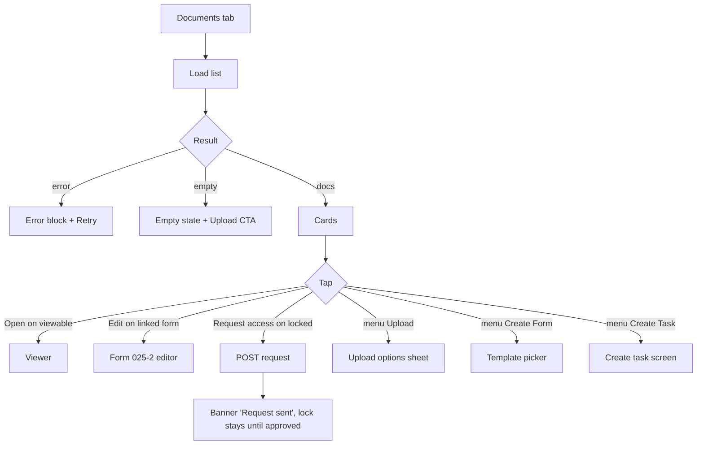

# Patient documents (Documents tab)

| | |
|---|---|
| Area | Patients, documents & forms |
| Who sees it | Doctor (all tiers); clinic staff via Clinic workspace (clinic-scoped list) |
| Reached from | Patient detail → tab "Documents"; push notifications about document access (opens this tab with a document outlined) |
| Screen type | Tab body inside Patient detail |
| Current Flutter source | `lib/features/patients/presentation/patient_detail_panel.dart` (`_buildDocumentsTab`, `_buildDocumentList`, `_openDocument`), `lib/features/patients/domain/document_category.dart`, `lib/state/patients/patient_documents_provider.dart`, `patient_actions.dart` (`fetchPatientDocumentsWithClient`, `requestDocumentAccessWithClient`) |
| Spec | `docs/kmp-spec/06-patients-forms-documents-care.md` §2.6, §4.1, §4.3–4.6, tickets DOCS-01, DOCS-04 |

## 1. Purpose
Everything filed on the patient: uploaded PDFs and scans, generated form 025-2 PDFs, appointment notes and task documents, including documents other doctors or the patient uploaded. The doctor opens it to read a result during a visit, to re-open a form, or to request access to a locked file. Daily.

## 2. Entry points
- Patient detail → "Documents" tab.
- Push "Document access approved" → tab opens with the document outlined and the viewer pushed automatically; "rejected" / "access requested" → tab opens with the document outlined only.
- After an upload (file 07) or a form save (file 10) the list refreshes and returns here.
- Clinic workspace embeds the same tab with a clinic id; the server then applies clinic-roster permissions.

## 3. Layout, top to bottom (phone portrait)
1. **Section header row** — title "Document History" · refresh icon · ⋮ menu (Upload Document · Create Form · Create Task).
2. **Search field** — hint "Search", magnifier, filters by title substring (case-insensitive), instant.
3. **List** — cards with 12 px gaps, newest first as returned by the server (no client sort). Card anatomy:
   - Line 1: optional form icon (linked form) · optional lock icon (no access) · **title** (bold 14, wraps). For a linked 025-2 form the title is replaced by the localised "Form 025-2 (dd.MM.yyyy)" (today the Uzbek phrase "025-2 raqamli tibbiy hujjat" is the English value too).
   - Line 2: date (dd.MM.yyyy) · **category chip** (icon + label; teal tint for medical results, grey for private; **absent** for `FORM_025_2` today — must be present) · small group icon with tooltip "Visible to all doctors of this patient" when shared with the team.
   - Line 3 (locked only): byline "Uploaded by Doctor / Patient / Another user".
   - Trailing: **Edit** tonal icon button (linked form, not locked) · ⋮ (locked only → "Request access") · **Open** tonal icon button (PDF icon; disabled when locked or no file).
   - A 2 px brand outline marks the deep-linked document.
4. Empty / loading / error blocks take the list area (see §6). No pagination (server returns all).

## 4. Data and formats
| Field | Source | Rule |
|---|---|---|
| Title | `title` | raw; form docs → localised "Form 025-2 ({date})"; detection = linked form with template 025-2, or title starting "Form 025-2" |
| Date | `date` ISO | dd.MM.yyyy in practice TZ; invalid/missing date → today (server bug; show "—" instead) |
| Category | `category` code | 22 medical-result codes (BLOOD_TEST, URINE_TEST, STOOL_TEST, LAB_RESULT, MRI, CT_SCAN, XRAY, ULTRASOUND, MAMMOGRAPHY, ECG, EEG, ENDOSCOPY, BIOPSY, PATHOLOGY, IMAGING_OTHER, PRESCRIPTION, VACCINATION_RECORD, DISCHARGE_SUMMARY, REFERRAL, HOSPITAL_REPORT, ALLERGY_REPORT, OTHER_MEDICAL) · 4 private codes (APPOINTMENT_NOTE, REMOTE_TASK_DOCUMENT, INTERNAL_NOTE, OTHER_PRIVATE) · FORM_025_2 · unknown → humanised code |
| Shared with team | `isSharedWithTeam` | group icon |
| Locked | `canView == false` (and `url` null) | lock icon, disabled Open, Request access in ⋮ |
| Creator | `creatorLabel` "Doctor" / "Patient" / "Unknown" | "Unknown" → "Another user"; shown only when locked today (target: always, small) |
| Linked form | `forms[].documentId == doc.id` | fallback heuristics by title and date exist today — drop |
| Selected | route arg `documentId` | outline |

## 5. Primary flow (happy path)
1. Tab opens → 3 skeleton cards while the list loads (today a centred spinner).
2. List renders; doctor scans titles / chips, optionally types in Search.
3. Tap **Open** → Document viewer (file 08) pushed with the raw title as app bar title.
4. Back from the viewer → list refreshes silently (access may have changed).

## 6. Screen states
- **First load** — 3 skeleton cards (title bar, meta bar, 2 round buttons).
- **Empty** — "No documents available" + hint "Uploaded files and scans will appear here…" + primary "Upload Document" (today text only, no CTA). Search with no match: "No documents match “{query}”" (NEW).
- **Error on load** — icon + "Error: {sanitised}" + "Retry" (exists today).
- **Offline** — last loaded list visible; Open works only if the viewer has that file cached (it does not today); Request access / Upload show the offline banner.
- **Refreshing** — refresh icon or pull: cards stay, progress line under the header; today a 1 s "Refreshing..." toast.
- **Partial data** — forms failed to load but documents loaded: form docs show without the Edit button and with their raw title "Form 025-2 (2026-03-12)"; acceptable, but show a quiet inline notice (NEW).
- **Permission needed** — n/a here (camera/files are in Upload).
- **Locked by tier** — none.
- **Role difference** — clinic scope: list filtered by the server to what the clinic roster allows; uploads and requests carry the clinic id.

## 7. Interactions and secondary flows
- **Tap Open** (viewable) → viewer (file 08). Disabled Open on a locked doc does nothing; target: tapping the card itself on a locked doc opens the Request access action.
- **Tap Edit** (linked 025-2, not locked) → form editor with the existing form; on return forms + documents refresh.
- **⋮ on locked → Request access** → request sent → banner "Request sent"; the card stays locked; approval arrives as a push that deep-links back here and auto-opens the viewer. Target: card shows a "Requested" chip until resolved (needs backend flag — UNVERIFIED).
- **Header ⋮ → Upload Document** → file 07. **→ Create Form** → file 09. **→ Create Task** → task creation (folder 07) with the patient preselected.
- **Refresh icon / pull** → reload.
- **Type in Search** → instant title filter; clear × (NEW).
- **Long-press a card** → nothing today. Open question: context menu (Open, Share, Rename, Delete) once those exist.
- **Tap card body** → nothing today; target: same as Open (whole card tappable), Request access when locked.

## 8. Edge cases
- **0 documents** → empty state with CTA. **1** → single card. **200+** → unpaged list; lazy list rendering; search becomes essential; consider category filter chips (NEW).
- **Very long title** (file names like "IMG_20260312_091533_scan_final_v2_(1).pdf", 80+ chars) → wrap to 2 lines max then ellipsis; the two trailing buttons must stay visible.
- **Title with no extension / extension-only** → shown as is.
- **Form document without a linked form** (link step failed on save) → appears as a plain "Form 025-2 (2026-03-12)" PDF with no Edit; the form itself is still listed under Forms. Today a title-regex fallback tries to pair them; the rewrite shows a small "Not linked" hint instead of guessing.
- **Two forms on the same day** → fallback pairing could pick the wrong form — another reason to match by id only.
- **Category unknown / new backend code** → humanised chip ("Genetic Test").
- **FORM_025_2 category** → chip "025-2 form" (missing today).
- **Locked document uploaded by the patient** → byline "Uploaded by Patient"; Request access goes to the patient app (UNVERIFIED who approves).
- **Request access twice** → second request may 409; show "Request already sent" (NEW) instead of an error.
- **Access revoked after opening** → next Open returns 403 → viewer error with "Request access" shortcut (NEW).
- **Date missing/invalid** → today shows today's date; show "—".
- **Deep link to a document not in the list** (deleted or no access) → tab opens without outline; banner "Document not found" (NEW).
- **Deep link while another patient's documents are open** → replace, not stack.
- **Session expired** on request-access → logout.
- **Rotation** → list keeps scroll; outline stays.
- **Language switch** → chips and 025-2 titles re-localise; byline re-localises (hard-coded Uzbek sentence today).
- **Font 200 %** → card trailing buttons move under the text block.
- **Screen reader** → card reads "title, date, category, shared with team, locked, uploaded by X"; buttons labelled "Open document", "Edit form", "More options".

## 9. Validation and messages
| Action | Rule | When | Message (EN) | Where |
|---|---|---|---|---|
| Load list | 200 | on open / refresh | "Error: …" + Retry | inline block |
| Request access | 2xx | on tap | "Request sent" | top banner |
| Request access failed | non-2xx | — | "Error: …" sanitised; 409 → "Request already sent" (NEW) | top banner |
| Open | `canView && url` | — | button disabled otherwise | — |
| Search | substring on title | on change | "No documents match “{query}”" (NEW) | list area |

## 10. Navigation out
- Open → Document viewer (file 08); on return the list refreshes.
- Edit → Form 025-2 editor (file 10); on return forms + documents refresh.
- Header ⋮ → Upload sheet (file 07), Template picker (file 09), Create task (folder 07).
- Back → Patient detail keeps the Documents tab selected.

## 11. Copy
Existing keys: `documentHistory` "Document History" · `refresh` · `refreshing` · `uploadDocument` "Upload Document" · `createForm` "Create Form" · `createTask` "Create Task" · `search` · `noDocuments` "No documents available" · `documentsEmptyHint` "Uploaded files and scans will appear here so you can open them during the visit." · `form0252MedicalDocument` (EN value is the Uzbek phrase — replace with `form0252` "Form 025-2") · `documentCategory_*` (27 labels incl. `documentCategory_FORM_025_2` "025-2 form") · `sharedWithTeamTooltip` "Visible to all doctors of this patient" · `uploadedBy` "Uploaded by" · `anotherUser` "Another user" · `documentLocked` "Locked" · `requestAccess` "Request access" · `requestAccessSent` "Request sent" · `openDocument` "Open Document" · `edit` · `error` · `retry` · `documentAccessApproved` / `documentAccessRejected` / `documentAccessRequest` (+ `…Detail`) for the notification texts.

**NEW**: "No documents match “{query}”" · "Request already sent" · "Requested" (chip) · "Not linked" · "Document not found" · "Some details could not be loaded".

## 12. Known problems in the current app (do not carry over)
- No delete, rename, re-categorise, share or save-to-device; the list is append-only.
- `FORM_025_2` is missing from the category table, so form PDFs show no chip.
- Form↔document pairing falls back to title-regex and same-date heuristics.
- English value of the 025-2 title key is Uzbek; Uzbek byline is hard-coded in code.
- Creator byline only shown for locked documents.
- Centred spinner and toasts; must be skeletons and banners.
- Form save invalidates the list without the clinic id, so the clinic workspace shows a stale list.
- Unknown/invalid dates render as today.

## 13. Open questions for design
- Category filter chips above the list (Medical results / Private / Forms) in addition to search?
- Group by month, or flat list with dates?
- Whole-card tap to open, with Edit/Request access in a long-press/⋮ menu, to free horizontal space?
- Should delete exist in the app (backend endpoint UNVERIFIED) — and if so, soft-delete with undo?
- Show the uploader on every card (small avatar) rather than only when locked?
