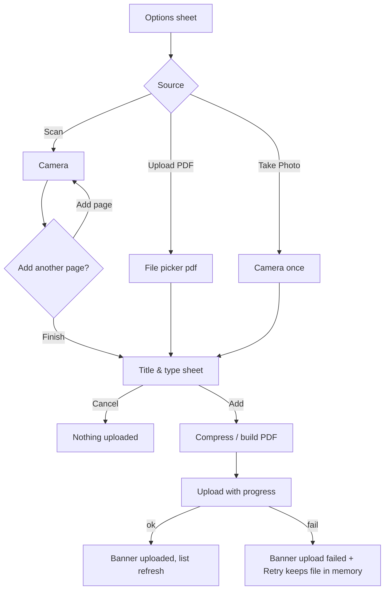

# Upload document (options sheet, scan loop, title & type sheet)

| | |
|---|---|
| Area | Patients, documents & forms |
| Who sees it | Doctor (all tiers); clinic staff via Clinic workspace (upload is clinic-scoped) |
| Reached from | Patient detail ⋮ "Upload Document"; Quick actions "Create document"; Documents tab ⋮ "Upload Document"; in-visit documents panel (folder 05) |
| Screen type | Bottom sheet (options) → system picker / camera → dialog loop (scan) → bottom sheet (title & type) |
| Current Flutter source | `lib/features/patients/presentation/patients_screen.dart` (`showPatientDocumentUploadOptions`, `patientAddDocumentPdf`, `patientScanMultiplePages`, `patientAskAddAnotherPage`, `patientUploadPagesAsPdf`, `askPatientDocumentTitleAndCategory`), `lib/state/patients/patient_actions.dart` (`uploadPatientDocumentWithClient`) |
| Spec | `docs/kmp-spec/06-patients-forms-documents-care.md` §4.2, §9, tickets DOCS-02, DOCS-03 |

## 1. Purpose
Get a paper result, a referral or an existing PDF into the patient's record in under a minute, during or right after a visit. Three sources: a PDF from the device, a single photo, or a multi-page camera scan that becomes one PDF. The doctor names it and picks a type; the type decides who else can see it.

## 2. Entry points
- Patient detail header ⋮ → "Upload Document".
- Overview → Quick actions → "Create document".
- Documents tab header ⋮ → "Upload Document".
- Empty Documents state CTA (target).
- In-visit documents panel (folder 05) — same sheet, additionally passes the appointment id so the document is attached to the visit.
- Clinic workspace — same sheet with clinic id.

## 3. Layout, top to bottom (phone portrait)
**Step 1 — Options sheet** (three list tiles): "Upload PDF" (PDF icon) · "Take Photo" (camera) · "Scan (multi-page)" (document scanner). Target: add "Choose from gallery" (image) and a grab handle.

**Step 2a — PDF**: system file picker filtered to `.pdf` only. Cancel → nothing happens.

**Step 2b — Photo / Scan**: system camera. After each capture (scan mode only) a dialog "Add another page?" with body "Pages scanned: {n}" and buttons "Finish" / "Add page" (primary). Photo mode captures once. Cancel in the camera with 0 pages → nothing; with ≥1 page → proceeds with the captured pages.

**Step 3 — Title & type sheet** (scrollable form): title "Upload Document" · text field "Document Title" (hint "Enter document title"; prefilled with the file name without `.pdf`, or "Scanned document (3 pages)") · label "Document type" + helper "Pick a medical-result type to share this document with all doctors of this patient. Internal/private types stay visible only to you." · dropdown "Select a type" with two disabled group headers: "Medical results (visible to all doctors)" (22 items, teal icons) and "Private (visible only to you)" (4 items, grey icons) · buttons "Cancel" (outlined) and "Add" (primary, **disabled until a type is chosen**).

**Step 4 — Upload**: today a transient "Uploading..." toast and nothing else. Target: a non-dismissible progress card at the top of the Documents tab (file name, progress bar, Cancel) or a sheet with a determinate bar.

## 4. Data and formats
| Item | Value | Rule |
|---|---|---|
| Allowed picker types | PDF only (`.pdf`) today | Target: also images (jpg, png, heic) and the camera; DOCX etc. stay excluded (viewer cannot render them) |
| Camera capture | JPEG quality 85, **no max side**, no further compression | Target: max side 2 048 px, JPEG 85 before PDF embedding (DOCS-02) |
| Scan output | one PDF, one page per photo, image fit-contain, file name `scanned_document.pdf` | Target: file name `scan_{yyyyMMdd_HHmm}.pdf` (practice TZ) |
| Photo (single) | same path as scan: a 1-page PDF | Target: upload the JPEG itself so the viewer shows an image |
| Size cap | **none** client-side; server limit UNVERIFIED | Target: 25 MB hard cap with message; warn above 10 MB |
| Multipart | part `file` with MIME by extension (pdf/png/jpeg/gif/webp else octet-stream), fields `title`, `category`, optional `appointmentId`, query `clinicId` | — |
| Title | trimmed; empty → file name | max length UNVERIFIED (target 120) |
| Category | required; code from the 26-code vocabulary | medical result ⇒ shared with every doctor of the patient; private ⇒ creator only |
| Progress | none today | determinate when the body length is known |

## 5. Primary flow (happy path) — 3-page scan
1. ⋮ → "Upload Document" → options sheet → "Scan (multi-page)".
2. Camera permission prompt (first time) → camera → capture page 1 → dialog "Add another page? Pages scanned: 1" → "Add page" → … → after page 3 "Finish".
3. Title & type sheet: title prefilled "Scanned document (3 pages)"; doctor picks "Blood test" → "Add" enabled → tap.
4. Progress card: "Scanned document (3 pages) · 2.1 MB" with bar → done → banner "Document “Scanned document (3 pages)” uploaded" → Documents tab list refreshes with the new card on top.

## 6. Screen states
- **First load** — n/a (sheets are instant). Building the PDF from 10 photos can take 1–3 s: show "Preparing document…" (NEW) before the upload bar.
- **Empty** — title & type sheet with no type chosen: "Add" disabled, helper text visible.
- **Error on load** — n/a.
- **Offline** — options sheet opens; picker/camera work; on "Add" show the offline banner and keep the sheet open with the file in memory so the doctor can retry when back online. Decision: **no persistent offline queue** (files are large, patient data must not sit on disk unencrypted) — state this on the Figma frame.
- **Refreshing** — after success the Documents list refreshes; the upload card disappears.
- **Partial data** — n/a.
- **Permission needed** — camera: system prompt on first use with a pre-prompt sheet explaining why (NEW); **denied permanently** → inline dialog "Camera access is off. Enable it in Settings to scan documents." with "Open Settings" / "Cancel". Photos/files: Android 13+ needs no permission for the picker; iOS photo library limited access → the picker handles it.
- **Locked by tier** — none.
- **Role difference** — clinic staff: identical; the upload carries the clinic id and the server decides visibility.

## 7. Interactions and secondary flows
- **Tap option** → closes the sheet → picker/camera.
- **Cancel picker / camera** with nothing captured → back to the detail, no message.
- **"Add page"** → camera again; **"Finish"** → title sheet. Back gesture on the dialog = "Finish" (keep pages) — today back dismisses the dialog with `false` which also finishes; fine.
- **Edit title** → free text; clear ×.
- **Pick type** → enables "Add"; group headers are not selectable.
- **Tap "Add"** → upload starts; the sheet closes; progress card appears. Double tap must not double-upload (disable on first tap).
- **Tap "Cancel"** on the title sheet → discards captured pages (ask "Discard 3 scanned pages?" when ≥ 1 page — NEW).
- **Cancel upload** (progress card) → aborts the request; banner "Upload cancelled" (NEW).
- **Retry** after failure → re-sends the same bytes without re-capturing.
- **Review pages before upload** (NEW, open question): thumbnail strip with delete/reorder in the title sheet.

## 8. Edge cases
- **20 MB PDF** → today accepted and sent with no feedback for a long time; target: warn above 10 MB, block above 25 MB with "This file is too large (max 25 MB)".
- **Unsupported type picked** (user changes the picker filter, or a share-sheet intent delivers a DOCX) → block with "Only PDF and image files can be uploaded" (NEW).
- **HEIC image from iOS gallery** → must be converted to JPEG before upload (viewer and backend expect jpeg/png); camera captures are already JPEG.
- **Very long file name** (120+ chars) → title field prefilled fully; the list wraps/ellipsises later; cap at 120.
- **Empty title** → falls back to the file name silently; show the placeholder as the effective title.
- **Upload fails midway** (network drop) → banner with Retry; nothing is created server-side (UNVERIFIED for partial multipart). Pages stay in memory until the sheet is dismissed.
- **App backgrounded during upload** → iOS may suspend; target: keep the request alive with a background task; on failure show Retry on return.
- **401 mid-upload** → logout; captured pages discarded.
- **404 patient deleted** → banner "Patient not found".
- **Camera returns a 0-byte / corrupt image** → skip the page with a banner "Could not read the photo" (NEW).
- **10+ pages** → the "Pages scanned: n" counter keeps growing; memory: 10 × 2 MB raw photos — compress each page as captured, not at the end.
- **Permission denied once** → system prompt again next time; **denied permanently** → Settings dialog (above).
- **Rotation during the camera** → system-handled; during the title sheet → input preserved.
- **Language switch** mid-flow → labels re-render; category labels re-localise; the prefilled "Scanned document (3 pages)" keeps the language it was generated in (acceptable).
- **Font 200 %** → dropdown items wrap; group headers stay readable; the two buttons stack vertically.
- **Screen reader** → group headers announced as headings, not options; "Add" announces its disabled reason ("Select a document type").
- **Concurrent uploads** (doctor starts a second one) → allowed; progress cards stack (max 3 — NEW rule).
- **Same file uploaded twice** → two documents; no dedupe (acceptable; mention in §13).

## 9. Validation and messages
| Field/action | Rule | When | Message (EN) | Where |
|---|---|---|---|---|
| Document type | required | on change (enables Add) | helper text; "Select a document type" (NEW) as disabled reason | under dropdown |
| Title | optional; trimmed; ≤ 120 | on change | — | — |
| File type | pdf / jpeg / png (heic converted) | on pick | "Only PDF and image files can be uploaded" (NEW) | top banner |
| File size | ≤ 25 MB; warn > 10 MB | on pick | "This file is too large (max 25 MB)" / "Large file — upload may take a while" (NEW) | banner / inline |
| No file data | picker returned nothing | on pick | "No file data to upload" | top banner |
| Upload success | 2xx | — | "Document “{title}” uploaded" (today assembled from `document` + `uploaded`; make one key) | top banner |
| Upload failed | non-2xx / network | — | "Upload failed" + Retry; details sanitised | banner + progress card |
| Scan failed | PDF build error | — | "Scan failed" | banner |
| Camera denied permanently | — | on tap | "Camera access is off. Enable it in Settings to scan documents." (NEW) | dialog |
| Discard pages | ≥ 1 page captured and Cancel | on tap | "Discard {n} scanned pages?" (NEW) | dialog |

## 10. Navigation out
- Success → back on the screen that launched the sheet; the Documents list refreshes (and the in-visit panel, when launched from there).
- Cancel at any step → launcher screen unchanged.
- Permission dialog "Open Settings" → system settings; returning re-opens nothing (doctor taps again).

## 11. Copy
Existing keys: `uploadDocument` "Upload Document" · `uploadPdf` "Upload PDF" · `takePhoto` "Take Photo" · `scanMultiPage` "Scan (multi-page)" · `addAnotherPage` "Add another page?" · `pagesScanned` "Pages scanned" · `finish` "Finish" · `addPage` "Add page" · `scannedDocument` "Scanned document" · `pages` "pages" · `documentTitle` "Document Title" · `enterDocumentTitle` "Enter document title" · `documentCategoryLabel` "Document type" · `documentCategoryHint` · `documentCategorySelect` "Select a type" · `documentCategoryGroupMedical` "Medical results (visible to all doctors)" · `documentCategoryGroupPrivate` "Private (visible only to you)" · `documentCategory_*` (26) · `cancel` · `add` "Add" · `uploading` "Uploading..." · `uploadingFile` "Uploading file..." · `document` + `uploaded` (assembled) · `documentUploaded` "Document uploaded successfully" (unused today, better) · `uploadFailed` "Upload failed" · `uploadError` "Upload error" · `scanFailed` "Scan failed" · `noFileData` "No file data to upload" · `pageDocument` "page document" · `uploadPhoto` "Upload Photo" (exists; use for "Choose from gallery") · `errorPickingImage` "Error picking image".

**NEW**: "Choose from gallery" · "Preparing document…" · "Only PDF and image files can be uploaded" · "This file is too large (max 25 MB)" · "Large file — upload may take a while" · "Select a document type" · "Discard {n} scanned pages?" · "Upload cancelled" · "Could not read the photo" · "Camera access is off. Enable it in Settings to scan documents." · "Open Settings" · "Document “{title}” uploaded" as a single key with placeholder.

## 12. Known problems in the current app (do not carry over)
- No upload progress, no cancel, no retry; a 1-second "Uploading..." toast is the only feedback.
- No size cap, no type check beyond the picker filter; camera photos are not resized (only JPEG quality 85).
- A single photo is wrapped into a 1-page PDF instead of uploaded as an image.
- No gallery source; iOS HEIC never handled.
- Scanned pages cannot be reviewed, reordered or deleted before upload.
- Camera permission is left to the plugin; no "permanently denied" path.
- Success copy is concatenated from two keys ("Document" + title + "uploaded").
- Title controller leaks (engineering).

## 13. Open questions for design
- Merge "Take Photo" and "Scan (multi-page)" into one camera flow with an "Add page" button in the camera UI?
- Page review step (thumbnails, reorder, retake, auto-crop) — worth it for v1?
- Type picker as a grouped dropdown vs a two-section chip grid with search?
- Should a medical-result type require a confirmation ("This will be visible to all doctors of this patient") the first time?
- Dedupe hint when the same file name already exists for the patient?
