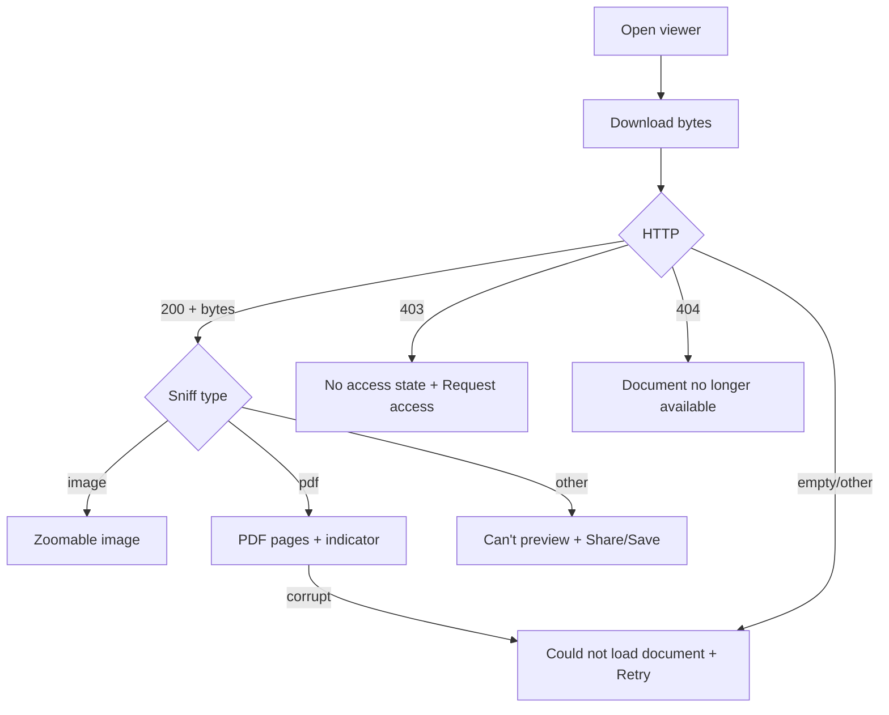

# Document viewer

| | |
|---|---|
| Area | Patients, documents & forms |
| Who sees it | Doctor (all tiers); clinic staff via Clinic workspace (clinic-scoped download) |
| Reached from | Documents tab "Open"; push "Document access approved" (auto-open); in-visit documents panel (folder 05); chat document messages use their own viewer (folder 07) |
| Screen type | Full screen, pushed on top (tab bar hidden) |
| Current Flutter source | `lib/features/patients/presentation/document_viewer_screen.dart`, `pdf_viewer_web.dart` / `pdf_viewer_stub.dart`, `lib/state/patients/patient_actions.dart` (`fetchDocumentDownloadWithClient`, `detectMimeFromBytes`) |
| Spec | `docs/kmp-spec/06-patients-forms-documents-care.md` §2.10, §4.4, tickets DOCS-05 |

## 1. Purpose
Read a document in the app without leaving the record: a lab PDF, a scanned referral, a 025-2 form PDF, a photo. Used during visits; must open fast and zoom well. Nothing leaves the app today (no share, no save, no print) — the target adds Share/Save behind a confirmation because documents are patient data.

## 2. Entry points
- Documents tab → "Open" on a viewable card → pushed with patient id, document id, **raw title**, optional clinic id.
- Push "Document access approved" → Patient detail opens on Documents and pushes the viewer once automatically; title comes from the notification payload or falls back to "Document".
- In-visit documents list (folder 05) → same screen.
- Target: Activity items that are documents (file 11) → same screen.

## 3. Layout, top to bottom (phone portrait)
1. **App bar** — back · title = document title (1 line, ellipsis; the 025-2 localised title is **not** used here today — raw "Form 025-2 (2026-03-12)" — fix) · target actions: Share (system share sheet), overflow ⋮ (Save to device, Print, Request access when 403, Document info).
2. **Content**
   - **Image** (JPEG/PNG/GIF/WebP by magic bytes, then content-type, then extension): pinch-zoom 0.5×–4×, pan, fit-contain on open, black or neutral background.
   - **PDF**: continuous vertical pages with pinch zoom (native renderer); page indicator "2 / 5" (NEW); first page fit-width.
   - **Anything else** (DOCX, unknown bytes): today fed to the PDF renderer and fails silently; target: "This file type can’t be previewed" with Share/Save (NEW).
3. **Loading** — centred spinner today; target: skeleton page (grey A4 rectangle with shimmer) under the app bar.
4. **Error** — icon + "Could not load document" + "Retry" text button.
No bottom bar.

## 4. Data and formats
| Item | Source | Rule |
|---|---|---|
| Bytes | authenticated download endpoint (not the list `url`) | whole file in memory; no streaming, no disk cache |
| File name | `Content-Disposition` (plain, bare or RFC 5987) | used for type detection and as the Save/Share name; fall back to title + extension |
| Type | magic bytes (JPEG, PNG, GIF, WebP, PDF) → `Content-Type` → extension | unknown → "can't preview" |
| Title | route arg | 025-2 form docs: localised "Form 025-2 ({date})" (NEW consistency) |
| Zoom | image 0.5–4×; PDF native pinch | double-tap to toggle 1×/2× (NEW) |
| Page indicator | PDF page count | "n / N" |
| Size | unknown until loaded | show "Downloading… {MB}" when Content-Length present (NEW) |

## 5. Primary flow (happy path)
1. Tap Open → screen pushes with title + skeleton page.
2. Download completes (typ. 0.3–2 s) → type sniffed → image or PDF renders fit-to-width.
3. Doctor pinches/scrolls; back returns to the Documents tab which refreshes silently.

## 6. Screen states
- **First load** — app bar with title + skeleton page; "Downloading…" caption after 1 s.
- **Empty** — server returned 200 with 0 bytes → treated as error ("Could not load document").
- **Error on load** — generic: "Could not load document" + Retry. Target distinct states: **403** "You don’t have access to this document" + "Request access" button; **404** "This document is no longer available" + Back; **network** generic + Retry.
- **Offline** — no cache today → error state immediately. Target: keep the last 20 opened documents in an encrypted cache for 24 h (open question, privacy).
- **Refreshing** — n/a (Retry re-downloads).
- **Partial data** — n/a.
- **Permission needed** — only when saving to device on older Android (storage); the system picker avoids it. Share needs none.
- **Locked by tier** — none.
- **Role difference** — none in the UI; the server may 403 clinic staff.

## 7. Interactions and secondary flows
- **Pinch / drag** → zoom and pan; **double-tap** → toggle zoom (NEW).
- **Scroll** (PDF) → pages; indicator updates.
- **Back / swipe back** → pop; Documents list refreshes.
- **Retry** → shows the skeleton again and re-downloads.
- **Share** (NEW) → confirmation "Share this patient document outside Shifa?" → system share sheet with the file (name from Content-Disposition). **Save** (NEW) → system file saver. **Print** (NEW, PDFs) → system print dialog. These are the only ways a document leaves the app; log nothing about the content.
- **Request access** (403 state, NEW) → same POST as the Documents tab → banner "Request sent" → pop.
- **Rotation** → re-layout fit-to-width; keep the current page and zoom (today zoom resets).
- **Tap the image** → toggles the app bar (immersive), optional.

## 8. Edge cases
- **Corrupt PDF** (truncated upload) → renderer throws → show the generic error with Retry and a "Share anyway" fallback so the doctor can open it elsewhere (NEW).
- **Password-protected PDF** → renderer fails → "This PDF is password-protected and can’t be previewed" (NEW).
- **50-page PDF / 30 MB** → load fully in memory today; show the download caption and render pages lazily; consider a size warning above 20 MB.
- **Huge image (8000×6000)** → downsample for display; keep the original for Share.
- **HEIC stored on the server** (uploaded from another client) → not sniffed → "can't preview"; backend should convert on upload (raise).
- **DOCX / XLSX** → "can't preview" + Share/Save.
- **File name missing** → Share name = sanitised title + sniffed extension.
- **Very long title** → app bar ellipsis; full title in the Document info sheet (NEW).
- **Access revoked while open** → nothing changes until Retry/back; next Open → 403 state.
- **Document deleted meanwhile** → 404 state.
- **401 mid-download** → logout.
- **Deep link while the viewer is open** (second approval push) → replace the viewer, do not stack two.
- **Slow network > 3 s** → caption "Still downloading…"; the screen stays cancellable via back (today back works; the download continues and is discarded).
- **Rotation** → keep page/zoom; **language switch** → only the error strings change; **font 200 %** → app bar title ellipsis, error copy wraps; **screen reader** → image gets the title as its label; PDF pages announce "Page n of N"; zoom gestures need the standard accessibility actions.
- **Memory pressure** on old devices with a 30 MB PDF → the screen may be killed; on return the list is shown — acceptable but the Documents list must restore.

## 9. Validation and messages
| Action | Rule | When | Message (EN) | Where |
|---|---|---|---|---|
| Download | 200 + non-empty | on open / Retry | "Could not load document" | centre |
| 403 | — | — | "You don’t have access to this document" (NEW) + "Request access" | centre |
| 404 | — | — | "This document is no longer available" (NEW) | centre |
| Unsupported type | sniff failed | after download | "This file type can’t be previewed" (NEW) | centre |
| Corrupt / protected PDF | renderer error | after download | "Could not open this PDF" / "This PDF is password-protected and can’t be previewed" (NEW) | centre |
| Share confirm | — | on Share | "Share this patient document outside Shifa?" (NEW) · Cancel / Share | dialog |
| Request access | 2xx | tap | "Request sent" | top banner |

## 10. Navigation out
- Back → Documents tab (or the launcher: in-visit panel, Activity). The list refreshes so a newly granted access shows.
- Request access (403) → banner then pop.
- Share / Save / Print → system sheets; return to the viewer.

## 11. Copy
Existing keys: `couldNotLoadDocument` "Could not load document" · `retry` "Retry" · `document` "Document" (fallback title) · `errorOpeningDocument` "Error opening document" · `requestAccess` · `requestAccessSent` "Request sent" · `form0252` "Form 025-2" (for the localised form title) · `cancel`.

**NEW**: "You don’t have access to this document" · "This document is no longer available" · "This file type can’t be previewed" · "Could not open this PDF" · "This PDF is password-protected and can’t be previewed" · "Share" · "Save to device" · "Print" · "Document info" · "Share this patient document outside Shifa?" · "Downloading…" / "Still downloading…" · "Page {n} of {total}".

## 12. Known problems in the current app (do not carry over)
- Any non-image bytes go to the PDF renderer; unsupported files fail silently.
- One generic error for 403 / 404 / network / corrupt; no "request access" shortcut from the viewer.
- No share, save or print; no page indicator; zoom resets on rotation.
- Centred spinner; the app bar shows the raw stored title even for 025-2 forms.
- No cache: reopening the same document re-downloads it.
- Web used a base64 data-URL iframe; irrelevant for mobile.

## 13. Open questions for design
- Should Share/Save exist at all for medical-result documents, or only for documents the doctor created (forms, notes)?
- Immersive mode (tap to hide the app bar) for images?
- Encrypted on-device cache for recently opened documents — acceptable for the privacy policy?
- Document info sheet: show uploader, category, date, size, visibility — and allow editing title/category from here once the backend supports it?
