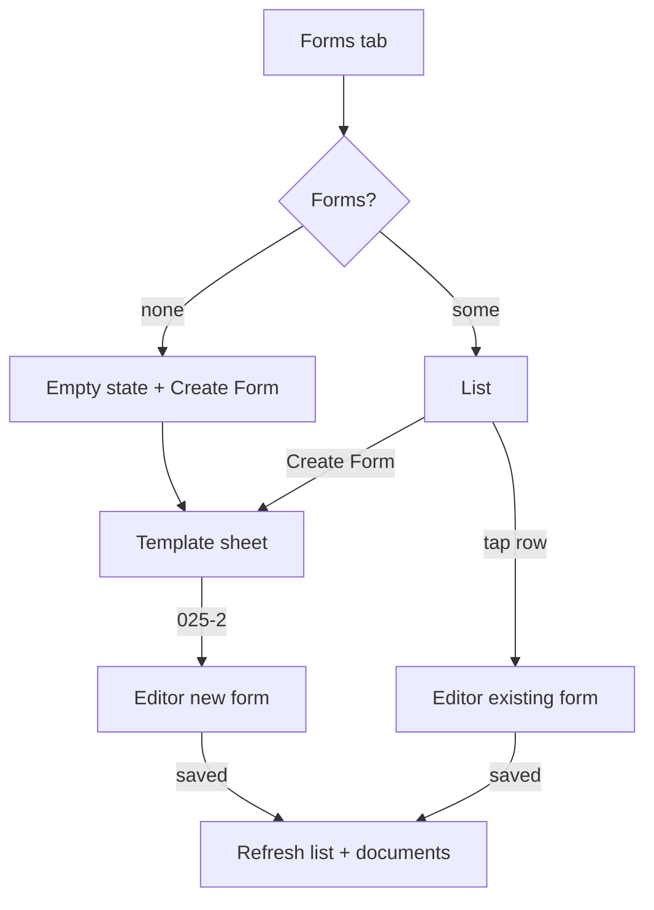

# Forms tab ("Prescriptions" today) and form template picker

| | |
|---|---|
| Area | Patients, documents & forms |
| Who sees it | Doctor (all tiers); clinic staff via Clinic workspace |
| Reached from | Patient detail → tab "Prescriptions" (→ "Forms"); "Create Form" from the header ⋮, the Documents tab ⋮, the empty Forms state |
| Screen type | Tab body inside Patient detail + bottom sheet (template picker) |
| Current Flutter source | `lib/features/patients/presentation/patient_detail_panel.dart` (`_buildPrescriptionsTab`), `patients_screen.dart` (`showPatientFormTemplateSheet`), `lib/features/patients/domain/patient_form_models.dart` (`formTemplates`), `lib/state/patients/patient_forms_provider.dart` |
| Spec | `docs/kmp-spec/06-patients-forms-documents-care.md` §2.7, §3.1, tickets FORM-02, FORM-05 |

## 1. Purpose
List the medical forms filled for this patient and start a new one. Today the only template is the Uzbek dental outpatient card **025-2**; the picker exists so other templates can be added. Opened a few times a week by dentists; rarely by other specialities.

## 2. Entry points
- Patient detail → fifth tab (today labelled "Prescriptions" — rename "Forms").
- "Create Form" from: header ⋮ sheet (file 04), Documents tab ⋮ (file 06), the empty Forms state. All open the **template picker sheet**.
- After saving a form (file 10) the app pops back to wherever the form was opened from and this list refreshes.
- In-visit screens (folder 05) embed the 025-2 editor directly and never show this tab.

## 3. Layout, top to bottom (phone portrait)
**Forms tab**
1. Target header row: title "Forms" · count caption "3 forms" · primary "Create Form" (today the button exists only in the empty state).
2. List of cards (10 px gaps), newest first (today server order): leading form icon · title = template id "025-2" (target "Form 025-2") · subtitle date dd.MM.yyyy · target badges: "Signed ✓" (green) when the patient signature is present, "Signature requested" (amber) when pending, "No PDF" (grey) when the form has no linked document · chevron.
3. Empty state: pill icon 48 px · "No prescriptions yet" (→ "No forms yet") · secondary button "Create Form".

**Template picker sheet**
1. Title "Select Form Template".
2. One list tile per template: description icon · name "025-2" (target "Form 025-2 — Dental outpatient card" with a one-line description) → tap opens the editor for a **new** form.
3. Target: grab handle; with a single template, skip the sheet and open the editor directly (open question).

## 4. Data and formats
| Field | Source | Rule |
|---|---|---|
| Template | `templateId` ("025-2") | localised display name; unknown ids → "Form {id}" |
| Date | `date` (date-only) | dd.MM.yyyy; forms are dated by the day they were created in the doctor's practice TZ |
| Signed | `patientSignatureImageBase64` non-empty | badge "Signed ✓"; `patientSignedAt` raw string shown in the editor |
| Signature requested | `signatureRequested` true and not signed | badge |
| Linked PDF | `documentId` present | missing → "No PDF" badge; opening the form and saving again regenerates it |
| Doctor | `doctorName`, `doctorClinic` set by the server on save | optional second subtitle "Dr. Karimova" when the form was created by another doctor of the clinic (UNVERIFIED visibility) |
| Sort | by date desc, then id desc | the "latest 025-2" rule used by the appointment screens |

## 5. Primary flow (happy path)
1. Tab opens → 3 skeleton rows → list.
2. Tap "Create Form" → template sheet → "025-2" → editor (file 10) pushed with the patient and no existing form.
3. Save in the editor → pop → list refreshes; the new form is first; Documents tab gains the generated PDF.
4. Tap an existing row → editor with the form loaded → Save → pop → refresh.

## 6. Screen states
- **First load** — 3 skeleton rows (icon circle, title bar, date bar).
- **Empty** — icon + "No forms yet" + "Create Form".
- **Error on load** — today the error is swallowed and the empty state is shown (dangerous: the doctor may create a duplicate). Target: "Could not load forms" + Retry (NEW), no Create button until loaded.
- **Offline** — cached list visible; rows open the editor read-only? No — the editor needs the network only to save; opening works. "Create Form" allowed; save will fail with the offline banner (file 10).
- **Refreshing** — pull-to-refresh; rows stay.
- **Partial data** — n/a.
- **Permission needed** — n/a.
- **Locked by tier** — none.
- **Role difference** — clinic staff: same list (server decides which forms a staff member sees — UNVERIFIED).

## 7. Interactions and secondary flows
- **Tap row** → editor (file 10) with existing form. On return: forms + documents refresh.
- **Tap "Create Form"** → template sheet.
- **Pick template** → sheet closes → editor pushes. Back from the editor without saving → nothing created.
- **Long-press row** → nothing today. Target: context menu "Open PDF" (jumps to the viewer with the linked document), "Request signature" (if not signed), later "Delete" (no endpoint today).
- **Swipe row** → nothing; do not add delete without an endpoint.
- **Pull-to-refresh** → reload forms.

## 8. Edge cases
- **0 forms** → empty state. **1 form** → single card. **50+ forms** (long-running dental patients) → unpaged list; lazy render; consider year dividers.
- **Two forms on the same date** → identical rows; show creation time (NEW: needs server `createdAt`, UNVERIFIED) or form number `formNumber` when present.
- **Form without linked PDF** (save pipeline failed after the form was created) → "No PDF" badge; opening and saving regenerates and links; the Documents tab lacks the card until then.
- **Form linked to a document the doctor cannot view** → row shows normally; "Open PDF" would 403 → viewer 403 state.
- **Template id unknown** (future backend template) → "Form {id}"; opening it shows the generic editor layout (file 10 handles non-025-2 templates with the basic field set).
- **Signed form edited and saved again** → the signature image is preserved by the server; the PDF is regenerated with it (today the editor says "save again to refresh the PDF").
- **Deep link** to a form → none today; target route `patients/{id}/forms/{formId}` for notifications about signatures (UNVERIFIED whether a push type exists).
- **401 / 404** → standard; 404 patient → "Patient not found".
- **Rotation / language switch / font 200 %** → list re-flows; template names re-localise; badges wrap under the title.
- **Screen reader** → row reads "Form 025-2, 12 March 2026, signed".

## 9. Validation and messages
| Action | Rule | When | Message (EN) | Where |
|---|---|---|---|---|
| Load forms | 200 | on open | "Could not load forms" (NEW) + Retry | inline |
| Create Form (offline) | network | on tap | offline banner | top banner |
| Open row | — | — | — | — |

## 10. Navigation out
- Row / template → Form 025-2 editor (file 10). The editor owns the unsaved-changes guard.
- Back → Patient detail keeps the Forms tab selected.
- "Open PDF" (target) → Document viewer (file 08).

## 11. Copy
Existing keys: `prescriptions` "Prescriptions" (replace) · `noPrescriptions` "No prescriptions yet" (replace) · `createForm` "Create Form" · `selectFormTemplate` "Select Form Template" · `form0252` "Form 025-2" · `form0252MedicalDocument` (Uzbek value; do not use as English) · `patientSigned` "Patient Signed ✓" · `patientSignaturePending` (long sentence; use a short badge instead) · `retry`.

**NEW**: "Forms" · "No forms yet" · "{n} forms" / "1 form" · "Signed ✓" (short) · "Signature requested" · "No PDF" · "Could not load forms" · template description "Dental outpatient card (Uzbekistan form 025-2)" · "Open PDF" · "Request signature".

## 12. Known problems in the current app (do not carry over)
- Tab is named "Prescriptions" but lists forms; the empty-state icon is a pill.
- Load errors are hidden behind the empty state.
- Rows show the bare template id and no signature/PDF status.
- The whole patient object and the form object are passed through navigation; the new app passes ids.
- "Create Form" is absent when the list is non-empty (only in ⋮ menus).
- Template sheet always appears even with one template.

## 13. Open questions for design
- Skip the template sheet while there is one template, or keep it for discoverability?
- Merge Forms into the Documents tab as a filter chip ("Forms") since every saved form is also a PDF document?
- Show forms created by other clinic doctors with an author line, or hide them?
- Year dividers vs flat list for long histories?
