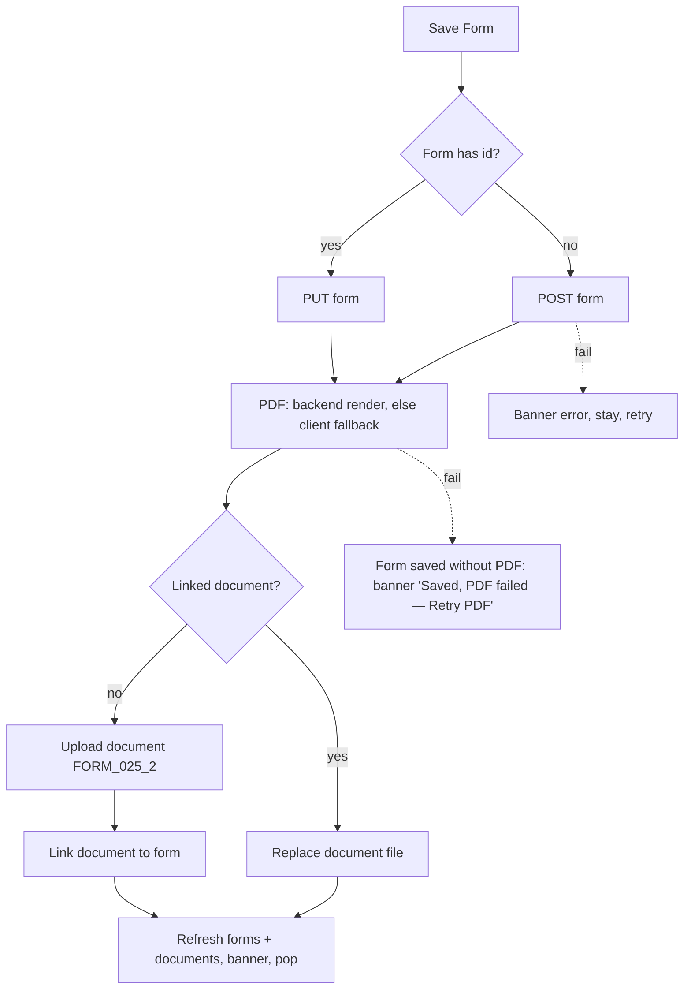

# Medical form 025-2 editor

| | |
|---|---|
| Area | Patients, documents & forms |
| Who sees it | Doctor (all tiers; the clinical-engine panel and speech fields depend on PRO features owned by folder 03). Clinic staff: UNVERIFIED (editor is reachable from the embedded panel today) |
| Reached from | Forms tab row (existing form); template picker (new form); Documents tab "Edit" on a linked form PDF; embedded inside the in-person/video visit screens (folder 05) |
| Screen type | Full screen (standalone) or embedded panel (visit screens; no app bar, parent owns Save) |
| Current Flutter source | `lib/features/patients/presentation/patient_form_screen.dart` (`PatientFormScreen`, `_DentalChartGrid`, `_FollowupsTable`, `_generatePdf`), `lib/features/patients/domain/patient_form_models.dart`, `lib/features/appointments/dental/dental_chart_codec.dart`, `lib/state/patients/patient_actions.dart` (forms endpoints) |
| Spec | `docs/kmp-spec/06-patients-forms-documents-care.md` §3.1–3.8, tickets FORM-01…FORM-04 |

## 1. Purpose
The dentist's legal outpatient record (Uzbekistan form 025-2) for one visit series: complaints, diagnosis with ICD-10, dental chart, treatment, recommendations, return visits and the patient's signature. Filled during or right after the visit; edited on return visits. Saving produces a PDF filed under the patient's documents. This is the only template today; the layout below marks which sections are 025-2-specific so a second template can reuse the shell.

## 2. Entry points
- Template picker → new form (date = today in practice TZ, dental chart prefilled with the patient's latest 025-2 as read-only history rows).
- Forms tab row / Documents tab "Edit" → existing form, all fields loaded.
- Visit screens (folder 05) embed the editor without an app bar; the visit's Save/End buttons call the editor's save; the visit can also push an ICD code into it.
- A chronic-disease warning dialog (file 04) fires once when the editor opens for a patient with a chronic disease.

## 3. Layout, top to bottom (phone portrait)
1. **App bar** (standalone only) — back · title "Form 025-2" (today the Uzbek phrase) · print icon (existing forms only; today a stub) → target: ⋮ with "Open PDF", "Request patient signature".
2. **Read-only header block** (grey boxes): Patient ID · Date · Full Name · Gender (today never shown — must come from the patient) · Age (computed from DOB; hidden when unknown).
3. **General** — Address (2 lines, prefilled from the patient) · Job · Diagnosis (3 lines, free text).
4. **ICD-10 picker** — selected code chip "K02.1 — Caries of dentine" with × · search field "ICD-10" (hint "Search ICD-10 code or title", magnifier, clear ×, spinner while searching) · results panel (≤ 240 px tall, dense rows "code — title" + subtitle) that appears under the field after a **250 ms** debounce, max 20 results, in the UI language.
5. **Clinical engine panel** (025-2 only; folder 03 designs it) — picks a disease from a catalogue and fills complaints/visual checkup/treatment etc. plus the ICD code.
6. **Anamnesis** — Complaints (3 lines) · Other illnesses and complications (3) · More details on above (4) · Visual checkup (3).
7. **Dental Chart** (025-2 only) — section title · segmented toggle "Adult teeth" / "Primary (child) teeth" · grid: read-only **history rows** above the upper jaw and below the lower jaw (caption date + doctor per row, from previous forms) · **editable rows** (dropdown cell per tooth, codes: blank, O, R, C, P, Pt, П, A, I, II, III, K, И) with "Add row" / "Remove row" per jaw · tooth tiles drawn per FDI number (11–18/21–28 upper, 41–48/31–38 lower; primary 51–55/61–65, 81–85/71–75) with anatomy captions (incisors, canine, pre-molars, molars, wisdom — hard-coded English today) · legend caption "Legend: K=caries, P=filling, pulpitis, periodontitis, crown, post, missing, prosthetic."
8. **Oral status** (025-2) — Occlusion / Bite type (1 line) · Condition of the oral cavity, gums, alveoli, palate, and oral mucosa (3) · X-ray and laboratory examination data (3).
9. **Treatment** (025-2) — Treatment (3) · Treatment result (progress/dynamics) (3) · Recommendations / Instructions (3) · read-only Doctor ("Will be set automatically on save" or the saved name).
10. **Return visits** (025-2) — table header Date · Clinical findings & conclusion · Doctor's surname · rows with edit (pencil) and delete (bin) icons · "No return visits added yet" · secondary "Add return visit" (adds today's date, empty findings; tap pencil to edit in a dialog with a date picker 2000–2100 and a 4-line text).
11. **Patient signature (form 025-2)** — caption "Unsaved changes are saved automatically when you send the request." · state A received: green "Patient signature received." + "Signed at: {timestamp}" + "Save the form again to refresh the PDF so it includes the patient signature." · state B pending: amber "A signature request was sent. The patient is notified in the mobile app." + secondary button "Request patient signature" · state C none: the button only.
12. **Primary button "Save Form"** (full width, progress while saving). Target: sticky bottom bar with Save and a dirty indicator.

Every free-text field is a speech-enabled text field (mic suffix appends dictation; folder 03). The whole screen is one scroll; no section navigation today — target: collapsible section headers or a sticky chip bar (General · ICD · Chart · Treatment · Return visits · Signature).

## 4. Data and formats
| Field | Rule |
|---|---|
| Patient ID / Full name / Age | from the patient; age in whole years at the form date (practice TZ) |
| Date | date-only `YYYY-MM-DD`; new form = today in practice TZ; not editable today (open question) |
| Diagnosis | free text, primary; ICD is optional metadata |
| ICD-10 | `code`, `display`, `system` "ICD10" (the clinical engine writes "ICD-10" — unify) |
| Dental codes | blank, O, R, C, P, Pt, П, A, I, II, III, K, И (Cyrillic П and И are part of the Uzbek legend) |
| Dental chart storage | per-tooth FDI keys + editable jaw rows + history rows with date/doctor + dentition flag; legacy UR1…LL8 keys migrated on load |
| Return visit | date (2000–2100), findings text, doctor name set by server ("(auto)" placeholder today) |
| Signature | server-owned: requested flag, signed-at string, PNG base64; never sent back by the client |
| Doctor / clinic | server sets on save |
| PDF | **target: rendered by the backend** on save; client fallback renders landscape A4 with Uzbek labels, Cyrillic font, metadata box, sections, dental grid with history captions, return-visits table, signature image + date |
| Document | category `FORM_025_2`, title "Form 025-2 ({date})" localised at display time, file `form_025-2_{date}.pdf`; on re-save the same document is replaced |
| Form title (UI) | "Form 025-2" |

## 5. Primary flow (happy path) — new form during a visit
1. Template picker → editor opens; chronic dialog if needed; header filled; dental chart shows last visit's rows as history.
2. Doctor dictates complaints, types diagnosis, searches ICD "K02" → picks "K02.1" → chip.
3. Marks teeth in the editable rows; adds a return visit.
4. Taps "Save Form" → button progress; one logical action: save form → PDF → document → link (today 3–4 sequential requests; the target makes the server own PDF + link so the client does at most 2).
5. Success → pop to the Forms tab → banner "Form saved successfully"; Forms and Documents refresh.
6. Later: "Request patient signature" → (silent save if never saved) → request → banner "The patient has been notified to review and sign the form." → section shows pending; when the patient signs (patient app), reopening shows "received"; saving again refreshes the PDF.

## 6. Screen states
- **First load** — existing form: header instantly (patient in memory), fields filled from the passed form; the latest-025-2 prefill for new forms waits for the forms list (skeleton over the dental chart only). Target: never block the text fields on the chart prefill.
- **Empty** — new form: all editable fields blank, dental rows empty (one editable row per jaw), "No return visits added yet", signature state C.
- **Error on load** — prefill of history rows failed: chart shows without history + inline note "Previous chart unavailable" (NEW). ICD search error: results panel shows "Search failed — Retry" (today silently empty).
- **Offline** — everything editable; ICD search shows "You’re offline" in the panel; Save shows the offline banner and keeps the form; the signature request is disabled. **No autosave/draft today** — target: local draft per form (encrypted) restored with a "Restore unsaved form?" prompt.
- **Refreshing** — n/a.
- **Partial data** — form saved but PDF/document step failed: today the form exists without a PDF and the next save creates a **second** document; target: remember the created document id, show "Saved, PDF failed" with "Retry PDF" and never duplicate.
- **Permission needed** — microphone for dictation (folder 03 flow); none for the form itself.
- **Locked by tier** — clinical engine and speech are PRO (folder 03); the form itself is open to all tiers.
- **Role difference** — embedded in visit screens: no app bar, no Save button (parent saves), unsaved-changes reported to the parent, ICD can be injected by the parent.
- **Saving** — Save button progress, all fields disabled, back blocked (today back is possible mid-save).

## 7. Interactions and secondary flows
- **Type in ICD field** → 250 ms debounce → search (limit 20, UI language) → panel; **tap result** → chip set, panel closed, field cleared; **× on chip** → clears code/display/system.
- **Clinical engine "Apply"** → fills several text fields (appends or replaces — folder 03 defines) and sets the ICD chip.
- **Dentition toggle** → switches tooth numbering and cell count (16 vs 10 per row); editable rows reset; history rows remain for their own dentition (UNVERIFIED mixing).
- **Dental cell tap** → dropdown of codes; selection paints the tooth tile.
- **Add row / Remove row** (per jaw) → adds/removes an editable row above/below the chart; removal needs no confirmation (cells are visible).
- **Add return visit** → new row dated today; **pencil** → edit dialog (date picker + findings; Cancel/Save); **bin** → removes the row immediately (target: undo banner).
- **Request patient signature** → if never saved: silent save first (no pop, no banner) → request → banner. Disabled while saving or already signed.
- **Print icon** → today generates a PDF and shows "PDF generated. Printing not yet implemented." Target: open the linked PDF in the viewer (file 08) where Print/Share live.
- **Save Form** → §5. Double tap guarded by the button's loading state.
- **Back / swipe back** → today pops instantly, **losing all edits** (standalone). Target: "Discard changes?" when dirty; "Keep editing" / "Discard".
- **Keyboard "done"** → closes the keyboard; does not save.
- **Scroll** → one long scroll; target: section chip bar that scrolls to a section.

## 8. Edge cases
- **Patient without DOB** → Age row hidden; without gender → Gender row hidden; without address → Address empty.
- **New form when the patient has no previous 025-2** → no history rows; chart shows only the editable rows.
- **Previous 025-2 from another doctor** → history rows carry that doctor's name and date (visible to this doctor — intended).
- **Primary dentition patient (child)** → toggle "Primary (child) teeth"; FDI 51–85; age shown; the PDF must honour the dentition.
- **Legacy chart keys** (UR1…) → migrated on load; saving writes the FDI grammar.
- **ICD search with 1 character** → still searches (no min length); target: min 2 chars. **No results** → "No matches" (NEW). **Slow search** → spinner in the field; results from an outdated query must be ignored (today a late response can overwrite newer results).
- **Very long free text** (2 000+ chars in Treatment) → field grows; PDF must wrap/paginate (client fallback truncates onto one page UNVERIFIED).
- **Many return visits** (20+) → table grows; PDF table paginates.
- **Form half-filled then app killed** → everything lost today. Target: local draft restored on next open of the same patient/template.
- **Concurrent edit from the web** → last PUT wins, the PDF regenerates from the last writer's data; no conflict detection (409 not used) — acceptable, flag in §13.
- **Signature arrives while the editor is open** → nothing updates until reopen; target: poll the form every 10 s while the signature is pending (the app already polls signatures at 10 s in the visit screens).
- **Request signature for a patient without the app account** → the request succeeds server-side but nobody is notified; show the Patient App Access hint ("Patient has no app account yet — create one first") (NEW, UNVERIFIED backend behaviour).
- **Save with nothing filled** → allowed today (no validation). Target minimum: at least one of Diagnosis / Complaints / a dental code / a return visit; otherwise "Add at least a diagnosis or complaints before saving" (confirm with product).
- **401 during the save chain** → logout; partially created form may remain (acceptable).
- **404 patient** → banner "Patient not found", pop.
- **Rotation** → all input preserved; the dental grid re-flows (horizontal scroll on narrow widths).
- **Language switch while open** → labels re-render; stored values unchanged; ICD display text stays in the language it was picked in.
- **Font 200 %** → the dental grid must scroll horizontally rather than shrink cells below 40 px; the return-visits table switches to stacked cards.
- **Screen reader** → each tooth cell announces "Tooth 11, code O"; history rows read "History, 12 March 2026, Dr. X"; the signature state is announced as status.
- **Embedded mode** — parent's End-visit must not complete while a save is in flight (folder 05 bug list).

## 9. Validation and messages
| Field/action | Rule | When | Message (EN) | Where |
|---|---|---|---|---|
| Minimum content | diagnosis or complaints or any tooth code or a return visit (proposal) | on Save | "Add at least a diagnosis or complaints before saving" (NEW) | top banner + scroll to first empty |
| ICD search | ≥ 2 chars (NEW) | on type | — | — |
| Return visit date | 2000-01-01 … 2100-12-31 | picker | — | — |
| Return visit findings | optional | — | placeholder "(tap to edit)" today → NEW "Tap to add findings" | row |
| Save success | — | — | "Form saved successfully" | top banner |
| Save failed | — | — | "Error saving form: …" sanitised | top banner, stay |
| PDF step failed | form saved, PDF not | — | "Form saved, but the PDF could not be created" + "Retry PDF" (NEW) | banner |
| Signature request sent | — | — | "The patient has been notified to review and sign the form." | top banner |
| Signature request failed | — | — | "Error: …" sanitised | top banner |
| Discard guard | dirty | on back | "Discard changes?" (NEW) | dialog |

## 10. Navigation out
- Save → pop to the launcher (Forms tab / Documents tab / template flow); both lists refresh (documents with the right clinic scope).
- Back → discard guard → launcher unchanged.
- "Open PDF" (target) → viewer; "Request patient signature" stays on the screen.
- Embedded: never pops; parent handles.

## 11. Copy
Existing keys: `form0252` "Form 025-2" · `patientId` · `date` · `fullName` · `gender` · `age` · `address` · `job` · `diagnosis` · `icd10SearchHint` "Search ICD-10 code or title" · `complaints` · `otherIllnessesAndComplications` · `moreDetailsOnAbove` · `visualCheckup` · `dentalChart` "Dental Chart" · `toothMap` "Tooth map" · `dentalDentitionPermanent` "Adult teeth" · `dentalDentitionPrimary` "Primary (child) teeth" · `addRow` · `removeRow` · `dentalLegend` · `occlusionBiteType` · `oralCavityCondition` · `xrayLabExaminationData` · `treatment` · `treatmentResultProgress` · `recommendationsInstructions` · `doctor` · `willBeSetAutomaticallyOnSave` · `returnVisits` "Return visits" · `clinicalFindingsConclusion` · `doctorsSurname` · `noReturnVisitsAddedYet` · `addReturnVisit` · `editRow` · `removeRow` · `patientFormSignatureSectionTitle` · `patientFormSignatureRequestRequiresSaveHint` · `patientFormSignatureReceived` · `patientFormSignedAtPrefix` "Signed at" · `patientFormSaveAgainToRefreshPdf` · `patientSignaturePending` · `requestPatientFormSignature` · `patientSignatureRequestSent` · `saveForm` "Save Form" · `formSavedSuccessfully` · `errorSavingForm` · `pdfGeneratedPrintingNotImplemented` (drop) · `save` · `cancel` · `error`.

**NEW**: "Discard changes?" / "Keep editing" / "Discard" · "Add at least a diagnosis or complaints before saving" · "No matches" · "Search failed — Retry" · "Previous chart unavailable" · "Form saved, but the PDF could not be created" · "Retry PDF" · "Tap to add findings" · "Set on save" (replaces "(auto)") · anatomy captions as keys (incisors, canine, premolars, molars, wisdom) · "Restore unsaved form?" · "Patient has no app account yet".

## 12. Known problems in the current app (do not carry over)
- Validation is a no-op; a completely empty form can be saved and produces a PDF.
- No autosave/draft and no unsaved-changes guard; back loses everything.
- Save is 3–4 sequential requests with a client-rendered PDF; a failure after step 1 leaves a form without PDF and the next save duplicates the document.
- PDF generated on the client in landscape A4 with hard-coded Uzbek labels, English anatomy captions and "(auto)" / "(tap to edit)" placeholders in the UI.
- Gender is never shown or saved from the form; the ICD system string is inconsistent ("ICD10" vs "ICD-10").
- Print button is a stub; the English title key holds an Uzbek phrase.
- Chronic warning dialog repeats on form open after already being shown on selection.
- Document cache is invalidated without the clinic scope.
- Late ICD search responses can overwrite newer results.

## 13. Open questions for design
- Section navigation: collapsible cards, a sticky chip bar, or a multi-step wizard (General → Chart → Treatment → Return visits → Signature)?
- Dental chart on a phone: horizontal scroll of the full arch, or quadrant-by-quadrant view with a mini-map?
- Should the form date be editable (back-dating a visit)?
- Minimum required content for Save — which fields?
- Where does "Request patient signature" belong: inline section (today) or the ⋮/bottom bar as a secondary action after Save?
- Show the server-rendered PDF preview inline after save?
