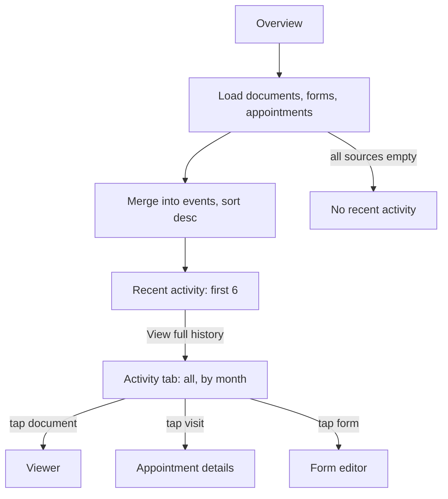

# Patient activity / history and clinical timeline

| | |
|---|---|
| Area | Patients, documents & forms |
| Who sees it | Doctor (all tiers); the clinical timeline card needs the Shifa Intelligence visit-facts feature (PRO, folder 03). Clinic staff via Clinic workspace |
| Reached from | Patient detail → Overview "Recent activity" card and "View full history"; tab "History" (→ "Activity"); Overview "Clinical timeline" card |
| Screen type | Cards inside the Overview tab + tab body |
| Current Flutter source | `lib/features/patients/presentation/patient_detail_helpers.dart` (`buildPatientActivities`), `patient_detail_panel.dart` (`_buildHistoryTab`), `patient_detail_overview.dart` (`RecentActivityCard`), `lib/features/home/presentation/widgets/visit_facts_panel.dart` (`PatientVisitTimelineCard`) |
| Spec | `docs/kmp-spec/06-patients-forms-documents-care.md` §2.3, §2.8, §10.15, tickets PAT-07; clinical timeline in doc 02 |

## 1. Purpose
Answer "what happened with this patient, in order" at a glance before a visit. Two different things wear this name today and must be designed as two components:
1. **Activity** — a dated feed of record events. Today it is derived **only from documents** (max 6), so "History" is just the Documents list in disguise. Target: a merged feed of appointments, documents, forms, tasks and partnership events.
2. **Clinical timeline** — accepted visit facts captured by Shifa Intelligence during visits ("step by step, sourced from what was spoken"); a clinical narrative, not an audit log.

## 2. Entry points
- Overview tab → "Recent activity" card (first 6 items) → "View full history" → History tab.
- Patient detail → "History" tab directly.
- Overview → "Clinical timeline" card (only rendered when the patient has at least one accepted fact or pattern; hidden on error).
- Target: Home activity feed (folder 02) → tap an item → this patient's Activity tab with the item highlighted.

## 3. Layout, top to bottom (phone portrait)
**Recent activity card (Overview)**: title "Recent activity" · up to 6 rows · text button "View full history". Empty: "No recent activity".

**Activity row anatomy** (card per item today; target: timeline list with a vertical rail):
- Leading 36 px rounded square with a type icon and tint:
  - lab/blood result → flask, blue
  - document → file, brand teal
  - form / prescription → pill, amber
  - target additions: appointment → calendar (teal; red tint for cancelled/no-show), task → check-circle, partnership → handshake, account created → person, access request → lock
- Title (bold 14): event type ("Lab result uploaded", "Document uploaded", "Prescription issued" → target "Form 025-2 saved").
- Subtitle (12, grey): document title / appointment reason / task name.
- Trailing: date dd.MM.yyyy (target: relative "Today", "Yesterday", then dd MMM yyyy in practice TZ; time for same-day items).
- Target: whole row tappable → opens the related object.

**History / Activity tab**: same rows, full list (today still capped at 6 — the cap is in the shared builder), newest first. Target: grouped by month with sticky month headers, infinite list, filter chips "All · Visits · Documents · Forms · Tasks".

**Clinical timeline card (Overview)**: timeline icon + title "Clinical timeline" · caption "Accepted visit facts, step by step. Sourced from what was spoken." · facts list: each fact a row with a dot on a vertical rail, fact text, and a small date/visit label; patterns (recurring findings) listed after facts as chips or a short list (folder 03 owns the fact/pattern anatomy). Hidden entirely when empty or failed.

## 4. Data and formats
| Item | Source today | Target source | Format |
|---|---|---|---|
| Document events | patient documents list | same + `createdBy` | title from category; subtitle = document title (025-2 → localised title) |
| Type detection | title substring "blood"/"mri"/starts with "form" or category BLOOD_TEST/MRI | category only (never title sniffing) | — |
| Appointment events | — (not included) | appointments with this doctor (status COMPLETED, CANCELLED, NO_SHOW, upcoming CONFIRMED shown separately) | "Visit completed · 09:00–09:30 · In clinic" |
| Form events | documents of category FORM_025_2 | forms list (`date`, signed flag) | "Form 025-2 saved" / "Form 025-2 signed by patient" |
| Task events | — | remote-care tasks assigned/completed (folder 07) | "Task assigned: Blood pressure log" |
| Partnership events | — | care partnership created/accepted/completed (file 14) | "Dr. X accepted the care partnership" |
| Date | document `date` | event instant | practice TZ; relative labels; month headers "March 2026" |
| Cap | 6 (both card and tab) | card 6, tab unlimited (paged 50) | — |
| Sort | date desc | instant desc | ties: documents before forms |
| Clinical facts | visit-facts bundle (facts + patterns) | same | fact text verbatim as accepted; source visit date |

## 5. Primary flow (happy path)
1. Overview loads → Recent activity shows a 3-row skeleton → fills with the 6 latest events.
2. Doctor taps "View full history" → Activity tab → full list grouped by month.
3. Taps a document event → viewer; taps a visit event → appointment details (folder 05); taps a form event → editor (file 10).

## 6. Screen states
- **First load** — card: 3 skeleton rows; tab: 8 skeleton rows under a month header placeholder.
- **Empty** — card: "No recent activity" + hint "Visits, documents and forms will appear here" (NEW); tab: illustration + same copy + "Upload Document" and "New appointment" buttons (NEW).
- **Error on load** — card: "Couldn’t load activity" + Retry (NEW; today the card silently shows whatever source succeeded); tab: full error block + Retry.
- **Offline** — cached events shown; row taps that need the network show the offline banner.
- **Refreshing** — pull on the tab; the list keeps position; new items slide in at the top.
- **Partial data** — one source failed (e.g. appointments): show the other sources and a dismissible inline notice "Some activity couldn’t be loaded" with Retry (NEW).
- **Permission needed** — n/a.
- **Locked by tier** — Clinical timeline card hidden below PRO (no upsell inside the patient record; the upsell lives in folder 03). Activity is open to all tiers.
- **Role difference** — clinic staff: events limited to what the clinic scope returns; partnership and AI facts hidden (UNVERIFIED for staff).

## 7. Interactions and secondary flows
- **Tap "View full history"** → switches to the Activity tab (same screen).
- **Tap row** → opens the object (target); today rows are inert.
- **Filter chips** (target) → narrows the list; selection persists while the detail is open.
- **Pull-to-refresh** (tab) → reload all sources.
- **Long-press row** → nothing. Open question: "Copy summary".
- **Clinical timeline fact tap** → folder 03 (opens the visit facts panel / source visit).

## 8. Edge cases
- **Patient with no activity** (just created) → empty states; no "AI follow-up" filler.
- **Only documents, no visits** → feed is all document events; fine.
- **100+ documents** → tab must page (50) and the card must not compute over everything on every rebuild (today it re-derives on each build).
- **Document with title "Blood pressure plan.pdf" and category INTERNAL_NOTE** → today labelled "Lab result uploaded" because of the substring "blood" — never sniff titles.
- **Document with no category and generic title** → "Document uploaded".
- **Form PDF whose title does not start with "Form"** (localised uploads) → today missed as a form; use category FORM_025_2 / forms list.
- **Events on the same day across midnight in practice TZ** → grouped by practice-TZ day, not device day.
- **Phone TZ ≠ practice TZ** → "Today" label must use the practice date.
- **Future-dated items** (upcoming appointment) → show under an "Upcoming" header above the history, or exclude — decide (§13).
- **Document deleted elsewhere** → event disappears on refresh (no tombstone; backend has no event log — UNVERIFIED).
- **Very long document titles** → 1 line ellipsis in the row.
- **Rotation / font 200 %** → rows wrap the date under the title; month headers stay sticky.
- **Language switch** → event titles re-localise; relative dates re-localise; month names localised (hard-coded English months in the header "Last visit" today).
- **Screen reader** → row reads "Lab result uploaded, Blood test March 2026, 12 March 2026"; month headers are headings.
- **Clinical timeline with 50+ facts** → card shows the latest 5 with "Show all" (NEW); error → card hidden (today) — target: hidden is acceptable, but log for support.

## 9. Validation and messages
| Action | Rule | When | Message (EN) | Where |
|---|---|---|---|---|
| Load activity | all sources 200 | on open | "Couldn’t load activity" (NEW) + Retry | card / tab |
| Partial failure | ≥ 1 source failed | — | "Some activity couldn’t be loaded" (NEW) + Retry | inline notice |
| Tap row (offline) | network | on tap | offline banner | top banner |

## 10. Navigation out
- "View full history" → Activity tab (same screen, tab index 5 today).
- Row taps (target) → Document viewer (file 08), Appointment details (folder 05), Form editor (file 10), Task details (folder 07), Partnership detail (file 14).
- Back → Patient detail Overview.

## 11. Copy
Existing keys: `recentActivity` "Recent activity" · `viewFullHistory` "View full history" · `noRecentActivity` "No recent activity" · `history` "History" (→ NEW "Activity") · `activityDocumentUploaded` "Document uploaded" · `activityLabResult` "Lab result uploaded" · `activityPrescription` "Prescription issued" (→ NEW "Form 025-2 saved") · `clinicalTimeline` "Clinical timeline" · `clinicalTimelineHint` "Accepted visit facts, step by step. Sourced from what was spoken." · `patientActivity` "Patient activity" · `documents` · `appointments` · `form0252`.

**NEW**: "Activity" · "Visits, documents and forms will appear here" · "Couldn’t load activity" · "Some activity couldn’t be loaded" · "Visit completed" · "Visit cancelled" · "No-show" · "Form 025-2 saved" · "Form 025-2 signed by patient" · "Task assigned: {name}" · "Task completed: {name}" · "{doctor} accepted the care partnership" · "Account created" · "Access requested for “{title}”" · "Today" / "Yesterday" · "Upcoming" · "Show all" · filter labels "All · Visits · Documents · Forms · Tasks".

## 12. Known problems in the current app (do not carry over)
- "History" tab shows exactly the same 6 items as the Overview card; "View full history" shows nothing extra.
- Events are derived from documents only; type is guessed from title substrings ("blood", "mri", "form").
- "Prescription issued" is the label for any document whose title starts with "Form".
- Rows are not tappable; dates use device time and hard-coded English months elsewhere in the header.
- The "AI follow-up suggestions" card next to it is static heuristics presented as AI; drop it.
- Clinical timeline silently hides on error.

## 13. Open questions for design
- Merge Activity into the Overview as the main body (feed-first record) and drop the separate tab?
- Include upcoming appointments in the feed under "Upcoming", or keep the feed strictly historical?
- Timeline rail with dots vs plain list cards?
- Should the clinical timeline live in the Overview or inside the Intelligence briefing (folder 03) only?
