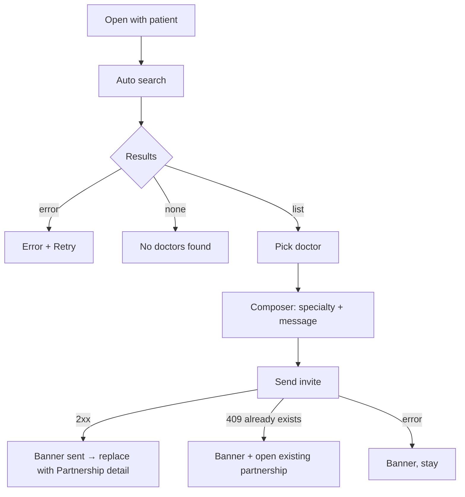

# Find therapy partner (invite a partner doctor)

| | |
|---|---|
| Area | Patients, documents & forms — care partnerships |
| Who sees it | Doctor (all tiers). Clinic staff: not reachable (the entry is in the patient ⋮ sheet; UNVERIFIED whether staff should invite) |
| Reached from | Patient detail ⋮ → "Find therapy partner" (arrives with patient id + name) |
| Screen type | Full screen, pushed inside the Patients tab |
| Current Flutter source | `lib/features/care_partnerships/presentation/find_therapy_partner_screen.dart`, `lib/features/care_partnerships/data/care_partnership_repository.dart` |
| Spec | `docs/kmp-spec/06-patients-forms-documents-care.md` §5.1–5.4, tickets CARE-01, CARE-02 |

## 1. Purpose
Invite another Shifa doctor to co-manage one specific patient — typically a referral to another speciality (dentist → orthodontist, GP → cardiologist). The doctor searches the directory of doctors on the platform, picks one, adds a message, sends. Rare: a few times a month.

## 2. Entry points
- Patient detail header ⋮ → "Find therapy partner" → pushed with the patient id and display name. There is no other entry; a partner cannot be invited without a patient context.
- Target: from the appointment details (folder 05) "Refer…" with the appointment id attached (the API already accepts `originatingAppointmentId`).

## 3. Layout, top to bottom (phone portrait)
1. **App bar** — back · title "Find therapy partner".
2. **Context line** — "Find a partner doctor in Uzbekistan for {patient name}" (country is hard-coded today; target: the doctor's own practice country with a change affordance).
3. **Search field** — label "Search" (name), magnifier; submits on keyboard search.
4. **Specialty field** — label "Specialty" (free text filter; target: picker from the 138-profession catalogue, folder 08).
5. **"Search" filled button** right-aligned (target: remove; search as you type with 300 ms debounce).
6. **Thin progress bar** while searching; red error text on failure.
7. **Results list** — tiles: name (first + last) · subtitle "profession · clinic · city (or country)" joined with " · " · trailing chevron, or a check icon when selected; selected tile highlighted. Target: avatar (photo/initials) leading, "Already a partner for this patient" tag when applicable (UNVERIFIED data).
8. **Invite composer** (appears under the list once a doctor is selected): text field "Message to partner (optional)" (2 lines, keyboard "send") · filled button "Send invite". Target: a bottom sheet/sticky bar with the chosen doctor's name, specialty requested (prefilled from the filter or the doctor's profession, editable) and the message.

## 4. Data and formats
| Field | Source | Rule |
|---|---|---|
| Search query | `q` | trimmed; empty → all doctors in the country |
| Specialty filter | `profession` | trimmed free text today; also sent as `specialtyRequested` on invite when non-empty (else the chosen doctor's profession) |
| Country | hard-coded "Uzbekistan" | target: doctor profile country (fallback Uzbekistan) |
| Result | id, first/last name, profession?, clinic?, city?, country?, avatar? | display name = "First Last"; subtitle drops empty parts |
| Message | optional text | target max 500 chars |
| Invite payload | patient id, partner doctor id, specialty requested?, message?, originating appointment id? | one POST; 200 expected (201 is treated as failure today — fix: any 2xx) |
| Result | new partnership (status PENDING) | navigate to its detail |

## 5. Primary flow (happy path)
1. Screen opens → auto-search with empty filters → skeleton tiles → list of doctors.
2. Doctor types "ortho" in Specialty → results narrow (today: must tap Search).
3. Taps "Dr. Karimova" → tile checked → composer appears.
4. Types "Patient needs braces assessment, see attached 025-2" → "Send invite".
5. Button progress → success → banner "Partner invite sent" → screen is **replaced** by Partnership detail (file 14) showing PENDING with "Invite sent. Waiting for Dr. Karimova to accept."

## 6. Screen states
- **First load** — search fields real; 6 skeleton tiles (avatar, 2 bars).
- **Empty** — "No doctors found" + hint "Try another name or specialty" (NEW; today an empty list with no text).
- **Error on load** — inline error + Retry (today raw error text in red, no retry button; "Search" works as retry).
- **Offline** — fields editable; search shows the offline state in the list area; Send invite disabled with the offline banner.
- **Refreshing** — new search replaces results; selection is cleared if the selected doctor is no longer in the results (today the selection persists invisibly — fix).
- **Partial data** — n/a.
- **Permission needed** — n/a.
- **Locked by tier** — none today. Open question: PRO feature?
- **Role difference** — n/a (doctor only).
- **Sending** — Send button progress; fields disabled; back blocked.

## 7. Interactions and secondary flows
- **Type name / specialty** → target debounced search; keyboard "search" also triggers.
- **Tap "Search"** → explicit search (keep as a fallback on the keyboard).
- **Tap tile** → select (single); tap again → keep selected (target: tap again to deselect).
- **Tap "Send invite"** → POST → navigate. Keyboard "send" in the message field does the same.
- **Back** → pops to Patient detail; a typed message is discarded (ask when non-empty — NEW).
- **Tap a result's avatar/name** → target: doctor profile preview sheet (specialty, clinic, city) before inviting.

## 8. Edge cases
- **No doctors in the country** → empty state; still allow searching other countries (target country picker).
- **Doctor searches themselves** → they appear in the results (UNVERIFIED); inviting yourself must be blocked client-side ("You can’t invite yourself") if the server does not.
- **Already have an active/pending partnership with this doctor for this patient** → server may 409; show "You already have a partnership with {name} for this patient" + "Open" (NEW; UNVERIFIED status code).
- **Partner has no profession/clinic/city** → subtitle shows only what exists; may be empty → show "Shifa doctor".
- **Very long clinic names** → subtitle 1 line ellipsis.
- **500+ results** (empty query) → unpaged list today; target: page 50 and require ≥ 2 characters or a specialty before listing.
- **Slow search > 3 s** → progress bar; late responses from older queries must be ignored.
- **Double tap Send** → one invite (button disabled on first tap).
- **401** → logout. **404 patient** → banner "Patient not found", pop.
- **Rotation** → selection and message kept.
- **Language switch** → labels re-render; the specialty filter text stays (free text).
- **Font 200 %** → tiles grow; the composer button goes full width.
- **Screen reader** → tiles announce "Selected" state; the composer appears with focus moved to the message field.
- **Message contains patient details** → fine (shared with the partner), but the push/notification preview on the partner's phone should not include patient names (folder 07 rule).

## 9. Validation and messages
| Field/action | Rule | When | Message (EN) | Where |
|---|---|---|---|---|
| Search | none; target ≥ 2 chars when no specialty | on type | — | — |
| Selection | one doctor required | enables Send | — | — |
| Message | optional; ≤ 500 (NEW) | on type | counter "123/500" | under field |
| Self-invite | partner id ≠ my id | on Send | "You can’t invite yourself" (NEW) | top banner |
| Send success | 2xx | — | "Partner invite sent" | top banner |
| Send failed | non-2xx | — | "Could not send the invite" (NEW; today raw error) | top banner |
| Duplicate | 409 | — | "You already have a partnership with {name} for this patient" (NEW) + Open | top banner with action |
| Search failed | — | — | "Search failed" + Retry (NEW) | list area |

## 10. Navigation out
- Send success → **replace** this screen with Partnership detail (file 14) so back goes to the Patient detail.
- Back → Patient detail (discard guard when a message is typed).
- Duplicate → open the existing Partnership detail.

## 11. Copy
Existing keys: `findTherapyPartner` "Find therapy partner" · `findPartnerForPatient` "Find a partner doctor in Uzbekistan for {name}" (country must become a placeholder) · `search` "Search" · `specialtyFilter` "Specialty" · `partnerInviteMessage` "Message to partner (optional)" · `sendPartnerInvite` "Send invite" · `partnerInviteSent` "Partner invite sent" · `searchProfession` "Search profession..." (for the specialty picker).

**NEW**: "No doctors found" · "Try another name or specialty" · "Search failed" · "Could not send the invite" · "You can’t invite yourself" · "You already have a partnership with {name} for this patient" · "Open" · "Shifa doctor" · "Discard message?" · "Find a partner doctor in {country} for {name}".

## 12. Known problems in the current app (do not carry over)
- Country hard-coded to Uzbekistan; specialty is free text, not the profession catalogue.
- No debounce; an explicit Search button; auto-search with empty filters lists every doctor.
- Only HTTP 200 counts as success (a 201 would show an error after the invite was actually created); response decoded without UTF-8 (Cyrillic names may garble).
- Errors shown as raw exception text.
- Selection can point to a doctor no longer in the results.
- No avatars, no empty state, no self-invite guard.

## 13. Open questions for design
- Composer inline under the list (today) or a bottom sheet after tapping a doctor?
- Should the invite carry the latest 025-2 / selected documents as context (needs backend)?
- Is "specialty requested" a separate field or just the chosen doctor's profession?
- Gate behind PRO?
