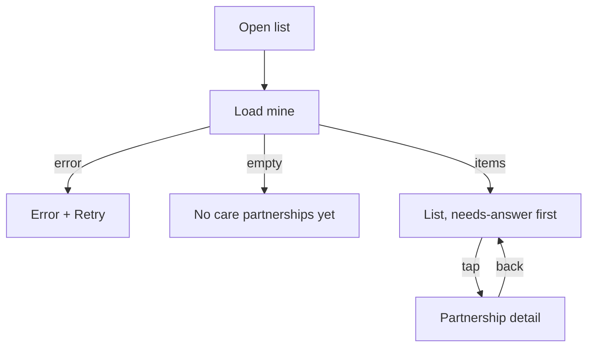

# Care partnerships list

| | |
|---|---|
| Area | Patients, documents & forms — care partnerships |
| Who sees it | Doctor (all tiers). Clinic staff: not reachable today (UNVERIFIED whether staff participate) |
| Reached from | Patient detail ⋮ → "Care partnerships"; target: More sheet (folder 01) and notification "partnership invite" (push type UNVERIFIED) |
| Screen type | Full screen, pushed inside the current tab |
| Current Flutter source | `lib/features/care_partnerships/presentation/care_partnership_screens.dart` (`CarePartnershipsListScreen`), `lib/features/care_partnerships/data/care_partnership_repository.dart` |
| Spec | `docs/kmp-spec/06-patients-forms-documents-care.md` §5.1–5.4, tickets CARE-01, CARE-03 |

## 1. Purpose
See every co-treatment the doctor is part of — invites waiting for their answer, invites they sent, active partnerships and finished ones — and open one to act. Weekly at most; the pending invites are the part that matters.

## 2. Entry points
- Patient detail ⋮ → "Care partnerships" — today opens the **unfiltered** list of all the doctor's partnerships. Target: filter to this patient with a "Show all" link.
- Target: More sheet → "Care partnerships" (global list), and the notification centre when an invite arrives (opens the detail directly, file 14).
- After sending an invite (file 12) the app lands on the detail, not here.

## 3. Layout, top to bottom (phone portrait)
1. **App bar** — back · title "Care partnerships". Target: filter chips row under it: "All · Needs my answer · Active · Sent · Finished".
2. **List** (pull-to-refresh) — one tile per partnership, dividers:
   - Title: patient name (fallback "Patient #{id}" today → target "Patient").
   - Subtitle today: "{STATUS} · {role label} · {initiating doctor} ↔ {partner doctor}" — raw status code shown.
   - Target anatomy: leading avatar of the **other** doctor · title patient name · line 2 "with Dr. {other}" + specialty requested · line 3 status chip (Pending — needs your answer / Pending — waiting / Active / Declined / Cancelled / Completed) + relative date of last update · chevron. Items needing the doctor's answer sorted first with a dot indicator.
3. Empty state centred: "No care partnerships yet" (target + hint and a "Find therapy partner" shortcut when opened from a patient).

## 4. Data and formats
| Field | Source | Rule |
|---|---|---|
| Patient name | `patientName` | fallback "Patient" (never expose raw ids) |
| Role | `viewerRole` INITIATOR / PARTNER; fallback compares my doctor id with the two ids | "Invite for you" / "You sent" labels today |
| Status | `status` string: PENDING, ACTIVE handled; DECLINED / CANCELLED / COMPLETED UNVERIFIED names | enum + localised chips; unknown → "Unknown" grey |
| Other doctor | partner name when I initiated, initiating doctor when I am the partner | "Dr." prefix only if names lack titles (open question) |
| Dates | `createdAt`, `updatedAt` raw ISO strings | practice TZ, relative ("2 d ago") then dd MMM |
| Sort | server order today | needs-answer first, then updatedAt desc |
| Scope | all my partnerships | optional patient filter from the entry point |

## 5. Primary flow (happy path)
1. Open → 5 skeleton tiles → list.
2. Doctor sees "Pending — needs your answer" at the top → taps → Partnership detail (file 14) → Accept.
3. Back → list refreshes (today re-fetches on every open; target: refresh on return with the updated item moved to "Active").

## 6. Screen states
- **First load** — 5 skeleton tiles.
- **Empty** — "No care partnerships yet" + hint "Invite a partner doctor from a patient’s record to co-treat together." (NEW) + button "Find therapy partner" when a patient context exists.
- **Error on load** — today raw error text centred, no retry (pull works). Target: error block + Retry.
- **Offline** — cached list visible; tiles open the cached detail; actions disabled there.
- **Refreshing** — pull-to-refresh indicator; list stays.
- **Partial data** — n/a.
- **Permission needed** — n/a.
- **Locked by tier** — none.
- **Role difference** — n/a.
- **Filtered empty** (target) — "No {filter} partnerships".

## 7. Interactions and secondary flows
- **Tap tile** → Partnership detail (file 14).
- **Pull-to-refresh** → reload.
- **Filter chips** (target) → client-side filter.
- **"Show all"** (target, when patient-filtered) → removes the patient filter.
- **Swipe tile** → nothing; do not add destructive swipes (decline/cancel need confirmation in the detail).
- **Back** → previous screen.

## 8. Edge cases
- **0 / 1 / 50+ partnerships** → empty / single / unpaged list (fine at this volume; lazy render).
- **Partnership whose patient was deleted** → `patientName` null → "Patient"; detail still opens (UNVERIFIED backend).
- **Both doctors have the same name** → the "with Dr. X" line is ambiguous; add specialty/clinic.
- **`viewerRole` missing and profile not loaded** → role unknown → show without the role label rather than guessing wrong; today it would default to "You sent".
- **Unknown status string** → grey "Unknown" chip, still tappable.
- **Very long names** (patient or doctor) → 1 line each with ellipsis.
- **Status changed by the other side while the list is open** → shown after pull; target: refresh on resume.
- **Deep link** to a partnership that is not in the list (already finished) → open the detail by id anyway.
- **401** → logout. **Network timeout** → error block.
- **Rotation / language / font 200 %** → tiles re-flow; status chips re-localise; chips row scrolls horizontally.
- **Screen reader** → tile reads "{patient}, with Dr. {other}, {status}, updated {date}"; "needs your answer" announced first.
- **Timezone** → relative dates computed from the practice TZ day boundaries.

## 9. Validation and messages
| Action | Rule | When | Message (EN) | Where |
|---|---|---|---|---|
| Load list | 2xx | on open / pull | "Couldn’t load partnerships" (NEW) + Retry | block |
| Empty | — | — | "No care partnerships yet" | centre |

## 10. Navigation out
- Tile → Partnership detail (file 14); on return the list refreshes.
- "Find therapy partner" (empty state, patient context) → file 12.
- Back → Patient detail or More sheet origin.

## 11. Copy
Existing keys: `carePartnerships` "Care partnerships" · `noCarePartnerships` "No care partnerships yet" · `partnershipRoleInvitee` "Invite for you" · `partnershipRoleSender` "You sent" · `status` "Status" · `findTherapyPartner` · `retry`.

**NEW**: status chips "Pending — needs your answer" · "Pending — waiting for {name}" · "Active" · "Declined" · "Cancelled" · "Completed" · "Unknown" · filter chips "All · Needs my answer · Active · Sent · Finished" · "with Dr. {name}" · "Invite a partner doctor from a patient’s record to co-treat together." · "Couldn’t load partnerships" · "Show all" · "Patient" fallback.

## 12. Known problems in the current app (do not carry over)
- Raw status codes ("PENDING") and "Patient #123" shown to users.
- Subtitle crams status, role and both doctor names into one line with "↔".
- No filters, no sorting (pending invites can be buried), no avatars.
- Opened from a patient but not filtered to that patient.
- Load error shows the exception text with no Retry; list refetched on every open with no cache.
- Role fallback silently assumes "You sent" when the profile id is unavailable.

## 13. Open questions for design
- Where does the global list live: More sheet item, Notifications, or only via patients?
- Tabs (Needs answer / Active / History) vs chips?
- Should finished (declined/cancelled/completed) partnerships be hidden by default?
