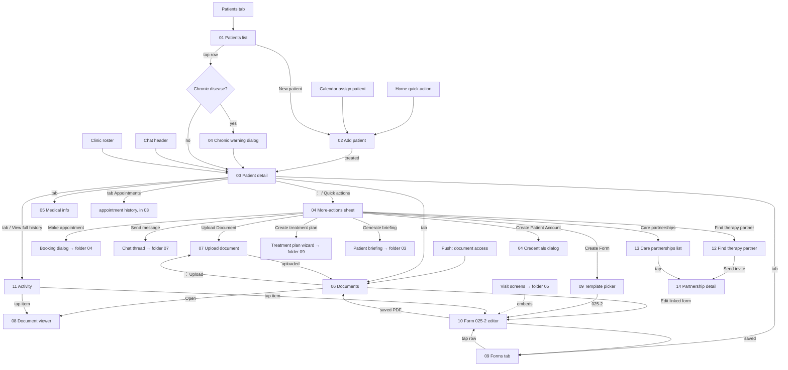

# 06 · Patients, documents & forms — flow map and rules

Designer-facing behaviour files for the Patients area of the Shifa Doctor app (KMP rewrite, phone first). One file per screen or major sheet, in the order a doctor meets them. Conventions: [`../00-README.md`](../00-README.md); template: [`../_TEMPLATE.md`](../_TEMPLATE.md); engineering spec: [`../../kmp-spec/06-patients-forms-documents-care.md`](../../kmp-spec/06-patients-forms-documents-care.md).

## 1. Flow map

## 2. Files

| File | Screen | Role | Tier | Purpose |
|---|---|---|---|---|
| [01-patients-list.md](01-patients-list.md) | Patients tab root (directory) | Doctor | all | Find a patient: search, segment tabs, status filter, sort, 10-per-page list, New patient |
| [02-add-patient.md](02-add-patient.md) | Add patient sheet | Doctor (staff via clinic) | all | Create a patient with name + optional phones, email, address, language, gender, blood group, allergies, DOB |
| [03-patient-detail.md](03-patient-detail.md) | Patient detail / profile | Doctor, staff (embedded) | all; AI summary PRO | Hero header, stats, 6 tabs (Overview, Medical info, Appointments, Documents, Forms, Activity) |
| [04-patient-quick-actions.md](04-patient-quick-actions.md) | Quick actions, ⋮ sheet, chronic warning, credentials dialog, SMS card | Doctor, staff | briefing PRO | Every action on a patient and the two blocking dialogs |
| [05-edit-patient-medical-info.md](05-edit-patient-medical-info.md) | Medical info tab (+ target Edit details) | Doctor, staff | all | Inline edits: phones, chronic disease, gender, blood group, allergies; clinic prophylaxis |
| [06-patient-documents.md](06-patient-documents.md) | Documents tab | Doctor, staff | all | Document list with 27 categories, locked docs + request access, open/edit |
| [07-upload-document.md](07-upload-document.md) | Upload options → camera/scan loop → title & type sheet | Doctor, staff | all | PDF / photo / multi-page scan upload with required category |
| [08-document-viewer.md](08-document-viewer.md) | Document viewer | Doctor, staff | all | In-app image / PDF viewer; target share/save/print and 403/404 states |
| [09-forms-tab-and-template-picker.md](09-forms-tab-and-template-picker.md) | Forms tab ("Prescriptions") + template sheet | Doctor, staff | all | List of 025-2 forms, signed/PDF badges, start a new form |
| [10-medical-form-025-2.md](10-medical-form-025-2.md) | Form 025-2 editor | Doctor | all; engine/speech PRO | Full dental outpatient card: ICD-10, dental chart, treatment, return visits, signature, save → PDF |
| [11-patient-activity-timeline.md](11-patient-activity-timeline.md) | Recent activity card, Activity tab, Clinical timeline card | Doctor, staff | timeline PRO | Dated event feed of the record; clinical facts from Intelligence |
| [12-find-therapy-partner.md](12-find-therapy-partner.md) | Find therapy partner | Doctor | all | Search doctors, pick one, send a co-treatment invite for a patient |
| [13-care-partnerships-list.md](13-care-partnerships-list.md) | Care partnerships list | Doctor | all | All partnerships with status/role, pending first |
| [14-care-partnership-detail.md](14-care-partnership-detail.md) | Partnership detail | Doctor (both sides) | all | Accept / decline / cancel / complete, progress updates |

## 3. Not designed (and why)

| Item | Reason |
|---|---|
| **Delete / archive patient** | No endpoint call and no UI anywhere in the doctor app; only the admin web panel has "deleted patients". Not in scope for M4; needs a product decision and a backend soft-delete. |
| **Delete / rename / re-categorise document** | No endpoints used by the app; the list is append-only. Listed as an open question in file 06. |
| **Link patient to clinic / clinic patient variant** | The directory is never clinic-scoped; clinic patients are the clinic roster in folder 09 (which embeds the Patient detail panel with a clinic id). Differences caused by the clinic id are noted inside files 03–07 instead of a separate screen. |
| **Edit patient full form** | Does not exist today (name, email, address, DOB, language, photo cannot be edited). Described as a NEW target variant inside file 05 rather than a separate file, since it reuses the Add patient layout. |
| **Make appointment dialog** | Launched from the patient but owned by the Calendar (folder 04); summarised in file 04 only. |
| **AI copilot card, AI summary / briefing, clinical engine panel, speech fields** | Shifa Intelligence components (folder 03); files here mark their slots. |
| **Create task from the Documents ⋮** | Task creation lives in folder 07. |
| **Treatment plan wizard** | Folder 09. |
| **Other medical form templates** | Only `025-2` exists in code; the template picker is designed to take more. |
| **Offline upload queue / drafts** | Decided against for uploads (large patient files must not sit unencrypted); a local encrypted draft is proposed only for the 025-2 editor (file 10 §6). |
| **Firebase phone OTP, admin screens, web split panes** | Out of the mobile rewrite (doc 00). |

## 4. Area rules

### Document category vocabulary (wire codes, 27)
- **Medical results** — visible to **every doctor who has access to the patient**: `BLOOD_TEST` Blood test · `URINE_TEST` Urine test · `STOOL_TEST` Stool test · `LAB_RESULT` Lab result · `MRI` · `CT_SCAN` CT scan · `XRAY` X-ray · `ULTRASOUND` · `MAMMOGRAPHY` · `ECG` · `EEG` · `ENDOSCOPY` · `BIOPSY` · `PATHOLOGY` · `IMAGING_OTHER` Other imaging · `PRESCRIPTION` · `VACCINATION_RECORD` Vaccination record · `DISCHARGE_SUMMARY` Discharge summary · `REFERRAL` · `HOSPITAL_REPORT` Hospital report · `ALLERGY_REPORT` Allergy report · `OTHER_MEDICAL` Other medical result. Teal chip.
- **Private** — visible to the **creator only**, others may request access: `APPOINTMENT_NOTE` Appointment note · `REMOTE_TASK_DOCUMENT` Remote task document · `INTERNAL_NOTE` Internal note · `OTHER_PRIVATE` Other private document. Grey chip.
- **Form** — `FORM_025_2` "025-2 form": generated by the 025-2 editor; private like the doctor's notes. Must get its own chip (missing today).
- Unknown codes from the backend render as a humanised label and never crash. Category is **required** on upload; the type picker always shows the two group headers with their visibility sentence.

### Privacy rules
- Patient names, phones, diagnoses, documents and credentials never appear in logs, analytics events, crash reports, push notification previews or screenshots used in onboarding. Debug output uses patient ids only.
- Nothing patient-related is shown outside an authenticated session: the app-lock screen (folder 01) covers the Patients tab; the task switcher snapshot must be blurred on these screens.
- Documents live in memory while viewed; no unencrypted disk cache. Share/Save (file 08) is an explicit, confirmed action.
- The one-time patient password (file 04) is shown once, copied on demand, never logged, never re-fetched.
- Chat/partnership free text may contain clinical detail by design, but notification previews on the other doctor's device show "New message" / "New invite" without patient names (folder 07 rule).

### Who can see which patient
| Scope | How it arises | What the doctor sees |
|---|---|---|
| **Own patients** | Created by this doctor, or shared with them by the backend (patient-app sharing, UNVERIFIED mechanics) | Appear in the Patients directory; full detail; all their own documents + every medical-result document from others; private documents of others appear **locked** with "Request access". |
| **Clinic patients** | On the roster of a clinic the doctor belongs to | Not in the personal directory; opened through the Clinic workspace (folder 09) with a clinic id; the server applies roster permissions to documents, uploads and prophylaxis; staff members (CLINIC_STAFF) only ever see patients this way. |
| **Care-partner patients** | Another doctor invited this doctor and they accepted (file 14) | The patient becomes accessible to the partner (appears in their directory — UNVERIFIED whether automatically or via the partnership link); medical results shared, private notes locked as above; partnership progress visible to both doctors. |
| **Appointment history** | always | Only appointments **with the logged-in doctor**; other doctors' visits are not listed. |
| **Forms (025-2)** | always | The latest 025-2 of the patient from **any** doctor seeds the dental-chart history rows; editing is per form. Whether other doctors' forms are listed is server-decided. |

The server is authoritative for all of the above; the UI only hides what the server does not return and shows locked states for what it marks as not viewable.

### Other area conventions
- Patient id is shown as `P-00042` (zero-padded to 5) everywhere; the raw numeric id never appears.
- Names are one stored string; fall back to "Patient" when empty; initials = first letters of the first and last word.
- Every date in this area is a practice-timezone date (`dd.MM.yyyy` short, `d MMM yyyy` in prose); appointment history times are `HH:mm–HH:mm` in practice TZ.
- Chronic disease warning: once per patient per session + a persistent red strip in the header; never on every tap.
- Tabs renamed: "Prescriptions" → **Forms**, "History" → **Activity**.
- Feedback = top banners; loading = skeletons matching the layout; destructive = confirm dialog with the red button on the right (decline/cancel partnership, discard pages/forms).
