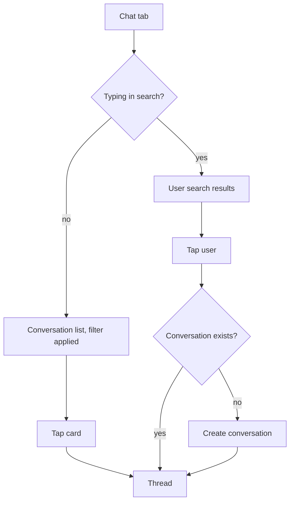

# Conversations list (Chat tab root)

| | |
|---|---|
| Area | Chat, notifications, tasks |
| Who sees it | Doctor and Clinic staff (chat is a BASIC feature, no tier gate) |
| Reached from | Chat tab in the bottom bar; "Send message" on a patient; "Message" on the Home hero card; a chat push notification; conversation back arrow |
| Screen type | Tab root |
| Current Flutter source | `lib/features/chat/presentation/chat_screen.dart` (`_buildConversationsPane`, `_ConversationTile`, `_UserSearchTile`) |
| Spec | `docs/kmp-spec/07-chat-notifications-tasks.md` §1.1, §1.6, tickets CHAT-02, CHAT-07 |

## 1. Purpose
The doctor opens this several times a day to see who wrote, how many messages are waiting, and to jump into a thread. It also doubles as the place to start a brand-new conversation with a patient or another doctor by searching their name.

## 2. Entry points
- **Chat tab** (4th slot in the doctor bottom bar, 1st slot for clinic staff). Opens as the tab root; the tab bar stays visible. The list refreshes the moment the tab becomes visible.
- **"Send message" on the patient profile** and **"Message" on the Home hero card**: the app switches to the Chat tab, then looks up (or creates) the conversation with that patient and opens the thread directly on top of this list (see file 07). On a phone the user does not see the list first.
- **Chat push notification tap**: same as above but with a conversation id; the thread opens directly.
- **Back from a thread** (phone): the thread is dismissed and the list is shown with the same scroll position and filter.

## 3. Layout, top to bottom (phone portrait)
1. **Page title** "Chat" (static).
2. **Search row**: a pill-shaped search field (hint "Search doctors and patients", magnifier icon) and, to its right, a **filter/sort menu** button (down-arrow icon). While the search field contains text the list below is replaced by search results.
3. **Filter/sort menu** (popup from the arrow): four radio-style items in two groups separated by a divider: Newest first (default), Oldest first — divider — Unread only (newest first), Unread only (oldest first). The selected item shows a check mark in brand colour.
4. **Conversation list** (scrolls; 12 px gap between cards). Each card:
   - Avatar 40 px: photo, or initials (first letter of first and last word) on light grey.
   - Name (one line, bold, ellipsis).
   - Last message preview (one line, 12 px grey, ellipsis) or "No messages".
   - Right column: time of last activity `HH:mm`, and below it an unread pill (brand background, white count) when unread > 0.
   - Selected state (tablet only): 2 px brand border.
5. **Search results** (replaces region 4 while typing): cards with avatar, name, role label ("Doctor" / "Patient") and a chat-bubble icon on the right. Tapping starts or opens the conversation.
6. No FAB, no app bar actions. The bottom tab bar is sticky.

## 4. Data and formats
| Field | Source | Format rule |
|---|---|---|
| Name | conversation participant name | As sent by backend; one line, ellipsis. |
| Avatar | participant photo URL, normalised to absolute | Photo or initials; initials are upper-case, one or two characters. |
| Last message | `lastMessage` text | One line; empty → "No messages". Attachments arrive as whatever text the backend puts there (UNVERIFIED whether it sends e.g. "[image]"). |
| Time | `lastMessageAt` | `HH:mm` 24 h. **Target: practice timezone**; today only `HH:mm`, yesterday "Yesterday", older `d MMM` (NEW rule — current app always shows `HH:mm` even for week-old chats). |
| Unread | `unreadCount` | Integer pill; cap display at "99+" (NEW; current app shows any number). |
| Role label (search) | `isDoctor` | "Doctor" or "Patient". |
| Sort key | `lastMessageAt` | Missing timestamp sorts as oldest. |

## 5. Primary flow (happy path)
1. Tap the Chat tab → list skeleton (6 card placeholders: circle + two lines + short right column) → cards appear.
2. Unread conversations show a brand pill; the tab badge shows the same total.
3. Tap a card → thread opens (file 02); the conversation is marked read on the server; the pill disappears on the next list refresh and the tab badge drops.
4. Come back → list is current (it refreshed in the background).

## 6. Screen states
- **First load**: skeleton list (target). Current app: centred spinner.
- **Empty**: centred copy "No conversations yet". Target adds an illustration and a hint "Search for a patient or doctor above to start one." (NEW). With an unread filter active: "No unread conversations".
- **Error on load**: current app prints "Error: <raw exception>" in red. Target: top banner "Couldn't load conversations" with Retry; keep stale cards if any.
- **Offline**: show last fetched list (cached) with a top banner "You're offline"; opening a thread shows cached messages; sending is disabled.
- **Refreshing**: today the list is re-fetched every 5 s and on app resume; cards do not jump because the list is rebuilt in place. Target: push-driven refresh plus pull-to-refresh (NEW); no visible spinner on background refresh.
- **Partial data**: n/a (single call). Unread badge (separate call) may lag the list by up to 10 s today.
- **Permission needed**: n/a.
- **Locked by tier**: n/a (BASIC).
- **Role difference**: identical for clinic staff. Staff may chat with patients and doctors exactly like a doctor (no server-side rule found in the client).

## 7. Interactions and secondary flows
- **Tap card** → conversation selected, mark-read request fired (failures ignored), list and thread refetched → thread screen.
- **Type in search** → every keystroke queries the server (no debounce today; target 300 ms debounce, NEW) → results replace the list. Clearing the text restores the list. Tapping the field again with text restores results.
- **Tap search result** → search cleared, results hidden; the app re-fetches the conversation list, looks for one whose participant id matches; if found, opens it; otherwise creates a conversation (no automatic message) and opens it. Failure → banner "Failed to start conversation".
- **Open filter menu → pick option** → list re-sorted/filtered immediately; the choice is not persisted across app restarts.
- **Pull-to-refresh**: not implemented today; target adds it.
- **Long-press card**: nothing today. Target: no action (no mute/delete/archive in scope).
- **Swipe card**: nothing.
- **System back** on the tab root: leaves the Chat tab (platform default behaviour of the shell, see folder 01).
- **Keyboard "Search"**: no effect beyond dismissing the keyboard; results already update live.

## 8. Edge cases
- 0 conversations → empty state; 1 → single card; 1 000 conversations → the whole list is fetched in one response with no paging; keep the list virtualised; the 5 s refetch of 1 000 rows is why polling must go (§12).
- Very long names (Uzbek three-part names, Russian patronymics) → single-line ellipsis; the time column keeps its width.
- Last message is an emoji-only or very long text → one line, ellipsis.
- Conversation whose participant was deleted/blocked on the server → name may be blank; show "Patient" / "Doctor" fallback (NEW rule, current app would crash on a missing name because the parser requires it).
- Same patient reachable both as "Patient" and via search → search tap re-uses the existing conversation; two cards for one person must never appear.
- Opened from a push for a conversation not in the list (new patient wrote while the list was stale) → the thread opens by id regardless; the list shows the card after refresh.
- Unread badge consistency: tab badge comes from a separate unread-count call (every 10 s); card pills come from the list (every 5 s). They can disagree for up to 10 s today. Target: one shared unread source updated on push and on mark-read.
- Search while offline → error text; target shows an inline "No connection" row under the field.
- Session expired (401) during a refresh → global logout (API client rule); the list must not flash an error first (today it throws "Not authenticated" and the error text flashes during logout).
- Device/practice timezone differ → times are in practice TZ (target); no notice on this screen.
- Font scale 200 % → cards grow in height; name and preview may wrap to two lines each; the time/pill column stays top-right aligned.
- Rotation / tablet width ≥ 720 dp → two-pane layout (list 2/5, thread 3/5) as today.
- Screen reader: card reads "Name, last message, time, N unread"; filter button reads "Filter conversations".

## 9. Validation and messages
| Field/action | Rule | When checked | Message (English) | Where shown |
|---|---|---|---|---|
| Search | Blank query shows the list, not results | On change | — | — |
| Start conversation | Server must return a conversation | On tap | "Failed to start conversation" | Top banner (today: SnackBar with raw exception appended) |
| Load list | Non-2xx or network error | On load/refresh | "Error" + Retry | Top banner / inline (today: red "Error: …" text) |

## 10. Navigation out
- To **Thread** (tap card / search result / push / patient entry) — nothing to save; on return the list refreshes.
- To **Patient profile** only via the thread header (see file 02).
- Leaving the tab keeps the filter choice and search text in memory for the session.

## 11. Copy
- `chat` "Chat" (title; note: missing from the exported en.json, present in the embedded fallback map), `searchDoctorsAndPatients` "Search doctors and patients", `filterConversations` "Filter conversations", `newestFirst` "Newest First", `oldestFirst` "Oldest First", `unreadOnlyNewest` "Unread Only (Newest First)", `unreadOnlyOldest` "Unread Only (Oldest First)", `noConversations` "No conversations yet", `noUnreadConversations` "No unread conversations", `noMessages` "No messages", `noUsersFound` "No users found", `doctor` "Doctor", `patient` "Patient", `failedToStartConversation` "Failed to start conversation", `error` "Error".
- **NEW**: "Search for a patient or doctor above to start one." (empty hint), "Couldn't load conversations" (error banner), "You're offline", "99+".

## 12. Known problems in the current app (do not carry over)
- Full list refetched every 5 s while the tab is visible, plus a separate 10 s unread poll; replace with push-driven refresh + pull-to-refresh (spec §8 #3).
- Times use the phone's timezone and always `HH:mm`, even for old chats (spec §8 #4).
- Loading is a centred spinner; errors print the raw exception; logout flashes "Not authenticated" (spec §8 #21).
- Avatars are not cached (reloaded every rebuild) (spec §8 #8).
- Starting a conversation re-downloads the whole list to detect duplicates instead of trusting the server (spec §8 #20).
- Search fires a request per keystroke.
- Filter button is an unlabeled down-arrow; the user cannot tell a filter is active. Target: show the active filter as a chip under the search field.
- Menu copy uses Title Case ("Newest First") unlike the rest of the app; normalise to sentence case.

## 13. Open questions for design
- Should the unread filter be a chip row (All / Unread) instead of a hidden menu, with sort kept in an overflow menu?
- Do we want a "New message" FAB that opens a dedicated people-search sheet, instead of overloading the search field?
- Should doctor-to-doctor conversations be visually distinguished (e.g. a small stethoscope badge on the avatar)?
- Show the last message type for attachments ("Photo", "Voice message 0:12", "Document.pdf") — needs backend confirmation of what `lastMessage` contains.
