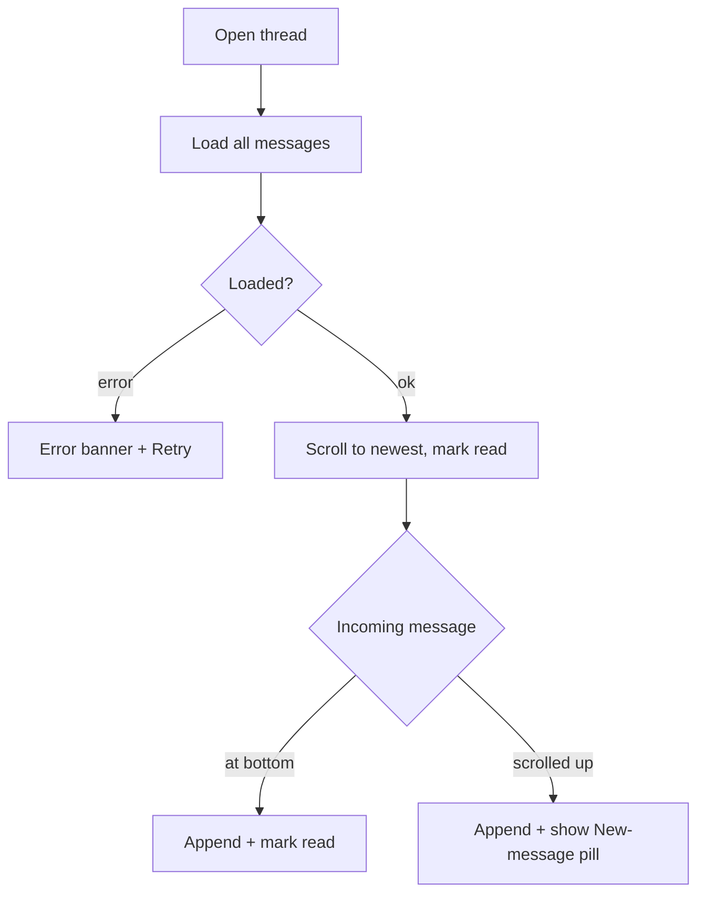

# Chat thread (conversation screen)

| | |
|---|---|
| Area | Chat, notifications, tasks |
| Who sees it | Doctor and Clinic staff (BASIC) |
| Reached from | Conversations list card; search result; "Send message" on a patient; Home hero "Message"; chat push notification |
| Screen type | Full screen (phone) / right pane of a two-pane layout (≥ 720 dp) |
| Current Flutter source | `lib/features/chat/presentation/chat_screen.dart` (`_buildChatPane`, `_ChatHeader`, `_MessageListView`), `widgets/text_message_bubble.dart`, `widgets/image_message_bubble.dart`, `widgets/voice_message_bubble.dart`, `widgets/document_message_bubble.dart` |
| Spec | `docs/kmp-spec/07-chat-notifications-tasks.md` §1.2, §1.3, tickets CHAT-03…06 |

## 1. Purpose
Read and answer one patient (or colleague). Daily, many times. The thread must make it obvious who said what, when (in the doctor's practice time), whether the patient has read it, and let the doctor jump to the patient's record in one tap.

## 2. Entry points
- **From the list** (tap card): pushed on top of the list; on a phone it covers the list and hides the tab bar (target; today the tab bar stays and a "← Chat" row is drawn inside the page).
- **From patient profile / Home hero**: arrives with a patient id; the app resolves the conversation (file 07) and opens the thread directly.
- **From a chat push** (foreground tap, background, cold start): arrives with a conversation id; opens directly after the shell is ready.
- **Tablet two-pane**: the pane shows "Select a conversation" until a card is tapped; selecting swaps the pane without navigation.

## 3. Layout, top to bottom (phone portrait)
1. **App bar** (64 px today, custom): back arrow; avatar 40 px; participant name in bold. When the participant is a **patient** the name is brand-coloured and underlined and the whole header is tappable → patient profile. For a doctor it is plain text, not tappable. No call button, no overflow menu.
2. **Message list** (scrolls, 12 px vertical padding, 12 px side padding). Oldest at the top, newest at the bottom. No date separators today (target: sticky day dividers "Today", "Yesterday", "12 Mar", NEW). Bubble types:
   - **Text**: max width 520 px (target: 80 % of screen); mine = right-aligned brand background, white 15 px text; theirs = left, light grey background, dark text; 16 px radius with a 4 px "tail" corner at the bottom on the sender side; URLs underlined and tappable; time `HH:mm` 11 px inside the bubble, bottom-left; mine also shows a status tick.
   - **Image**: 280 × 280 cover thumbnail inside the bubble; time + status in a dark translucent pill bottom-right; tap → full-screen viewer (file 05).
   - **Voice**: play/pause button, 3 px progress line, position / total `mm:ss`, time + status column at the right (file 04).
   - **Document**: file-type icon tile, file name (2 lines max), size "1.2 MB", time + status (file 06).
   - **System**: centred italic grey 12 px line, no bubble.
   - **Sender role label**: above every bubble that is not mine, "Doctor" or "Patient" in 11 px grey (because a clinic colleague or the patient can both appear on the left).
   - **Status ticks** (mine only): sending = 12 px spinner; sent = single tick; delivered = double tick white 70 %; read = double tick light blue.
3. **Composer** (sticky bottom, file 03): paperclip, text field, Send button; swapped for the voice recorder bar while recording.
4. Typing indicator: **not designed** (no transport exists; see README "Not designed").

## 4. Data and formats
| Field | Source | Format rule |
|---|---|---|
| Participant name | conversation | As is; ellipsis; fallback "Patient"/"Doctor" if blank (NEW). |
| Message time | `createdAt` (UTC) | `HH:mm` 24 h in **practice timezone** (target; today phone TZ). Day dividers in practice TZ. |
| Mine / theirs | `isMine` | Decides alignment and colour. |
| Role label | `senderRole` | "Doctor" / "Patient"; shown only on non-mine bubbles. |
| Status | `status` (`sending`, `sent`, `delivered`, `read`) | Tick icons as in §3; unknown → sent. |
| Read state | `isRead` | Not rendered separately from status. |
| Text | `content.text` | Preserve line breaks; links from `http(s)://` or `www.`; selectable. |
| Image URL | `fileUrl` ?? `thumbnailUrl` | Relative URLs resolved against the API base. |
| Voice | `fileUrl`, `duration` seconds | `mm:ss`; total from payload when present. |
| Document | `fileUrl`, `fileName`, `fileSize` bytes | "B / KB / MB" with one decimal. |

## 5. Primary flow (happy path)
1. Open thread → skeleton: header with avatar + name placeholder, 5 alternating bubble placeholders, composer visible but disabled.
2. Messages render; the list is scrolled to the **newest message** (target; today it opens at the oldest).
3. Conversation is marked read on open; unread pill and badge update.
4. Doctor types and taps Send → the message appears immediately at the bottom with a sending spinner (target: optimistic); on success it gets a single tick; the field clears; the list scrolls to bottom.
5. New incoming message while open → appended at the bottom; if the user is scrolled up, a "↓ New message" pill appears instead of jumping (NEW); the conversation is marked read again (target; today it is not).

## 6. Screen states
- **First load**: skeleton as above. Today: centred spinner in the pane.
- **Empty**: a just-created conversation has no messages → centred hint "Say hello to {name}" (NEW) above the composer. Today: blank white pane.
- **Error on load**: today red "Error: <raw>" text and no retry. Target: inline error with Retry; the composer stays usable only if a cached copy exists.
- **Offline**: show cached messages; composer disabled with a top banner "You're offline"; images show cached thumbnails or a placeholder.
- **Refreshing**: today the whole message list is refetched every 5 s and rebuilt (scroll position is preserved by stable keys). Target: push-driven append; no visible refresh.
- **Partial data**: an attachment URL missing → broken-image / "Image not available" tile inside the bubble; the rest of the thread renders.
- **Permission needed**: mic (file 04), camera/photos (file 05) — requested lazily from the composer.
- **Locked by tier**: n/a.
- **Role difference**: none; clinic staff see the same screen.

## 7. Interactions and secondary flows
- **Tap header (patient)** → Patients tab with that patient selected (patient profile). The thread stays in the back stack.
- **Tap header (doctor)** → nothing.
- **Tap link in text** → opens in external browser; failure banner "Cannot open link".
- **Long-press text** → native text selection (whole list is a selection area today). Target: selection stays; no message context menu (reply/forward/delete are out of scope).
- **Tap image** → full-screen viewer. **Tap document** → external app. **Tap play** → playback (file 04).
- **Scroll up** → older messages are already loaded (no paging today). Target: load older on reaching the top if the backend adds a cursor (UNVERIFIED backend support).
- **Back arrow / system back / swipe back** → returns to the list; draft text in the composer is kept in memory for the session (today it is kept too because the controller lives on the screen).
- **Pull down at top**: nothing today; target: nothing (refresh is automatic).
- **Keyboard**: opening the keyboard pushes the composer up and keeps the newest message visible.

## 8. Edge cases
- 0 messages (new conversation) → empty hint; 1 message → single bubble at the bottom, not the top; 1 000 messages → all delivered in one response today; the list must stay virtualised and open at the bottom without visibly scrolling through 1 000 items.
- Message send fails (network, 5xx) → the optimistic bubble shows a red "!" with "Tap to retry"; the text is not lost. Today: SnackBar with raw exception and the field keeps the text.
- Duplicate send on retry → the client must send the same local id / not fire twice while a send is in flight; today the Send button is never disabled, so double-tap sends twice.
- Send tapped with an empty field → today still fires a request with no text (server error banner). Target: Send disabled when the trimmed text is empty and nothing is attached.
- Very long text (5 000 chars) → bubble grows; text wraps; no "read more" today. Target: cap at ~12 lines with "Show more" (open question).
- Emoji-only message → render at normal size (no jumbo emoji); okay.
- Text containing only a URL → whole bubble is a link.
- Attachment of 50 MB → no client limit today; upload may time out at 30 s and fail with "Error uploading file". Target: cap 20 MB with a pre-upload banner (spec CHAT-04 fix #10).
- Playback of one voice note while another plays → both play today; target: single active player.
- Patient blocked or deleted → sending returns 4xx; show banner "This conversation is no longer available" (NEW) and disable the composer; the header name falls back to "Patient".
- Conversation opened from push for a patient not in the doctor's list → still opens (it is addressed by conversation id); header tap to the patient profile may land on "not found" — acceptable, show the Patients error state.
- Session expired mid-send → 401 → global logout; the draft is lost (acceptable, rare).
- Message arrives for *this* conversation while open → today a system tray banner is still shown (the push is not suppressed). Target: suppress the banner for the open conversation.
- Same-day grouping across midnight in practice TZ → day dividers switch at practice midnight, not phone midnight.
- Device and practice timezone differ → times in practice TZ; no notice here.
- Deep link to another conversation while this one is open → replace the thread (do not stack two threads).
- Rotation → list keeps the newest-visible message anchored; the composer draft survives.
- Font scale 200 % → bubbles wrap; time moves under the text; status tick stays beside the time; the 280 px image stays 280 px (does not scale).
- Screen reader: bubbles read "Patient, 14:32, <text>"; images read "Photo from patient, 14:32, double-tap to open"; voice reads "Voice message 0:12, play".
- Slow network > 3 s on open → keep the skeleton; do not show a blank pane.

## 9. Validation and messages
| Field/action | Rule | When checked | Message (English) | Where shown |
|---|---|---|---|---|
| Send text | Trimmed text non-empty | On tap (button disabled otherwise, target) | — | — |
| Send | Server 2xx | After request | "Failed to send message" + Tap to retry | On the bubble (target); today SnackBar with raw error |
| Open link | OS can open URL | On tap | "Cannot open link" | Top banner |
| Open document | OS can open URL | On tap | "Cannot open document URL" / "Something went wrong" | Top banner |
| Load thread | Server 2xx | On open/refresh | "Error" + Retry | Inline |

## 10. Navigation out
- **Back** → Conversations list; list refreshes unread state.
- **Header tap** → Patient profile (Patients tab); on return the thread is still open.
- **Image tap** → Viewer (modal, black); back returns to the same scroll position.
- **Document tap** → leaves the app (external viewer).
- **Link tap** → external browser.
- Draft text is kept in memory on all exits; nothing is asked.

## 11. Copy
- `selectConversation` "Select a conversation" (tablet empty pane), `doctor` "Doctor", `patient` "Patient", `send` "Send", `typeMessage` "Type a message...", `cannotOpenLink` "Cannot open link", `cannotOpenDocumentUrl` "Cannot open document URL", `somethingWentWrong` "Something went wrong", `imageNotAvailable` "Image not available", `failedToLoadImage` "Failed to load image", `failedToSendMessage` "Failed to send message", `document` "Document", `error` "Error", `retry` "Retry", `today` "Today", `yesterday` "Yesterday".
- **NEW**: "Say hello to {name}", "New message" (scroll pill), "Tap to retry", "This conversation is no longer available", "Show more".

## 12. Known problems in the current app (do not carry over)
- Thread opens scrolled to the **oldest** message and never auto-scrolls on incoming messages (only after the doctor's own text send).
- No optimistic send and no "sending" state; the spinner tick can never appear (spec §8 #2).
- Mark-read fires only when the conversation is selected, not when new messages arrive while open (spec §8 #6).
- Timestamps in phone timezone; no day dividers (spec §8 #4).
- Whole message list refetched every 5 s, no paging (spec §8 #3).
- Dead typing indicator wired into the list (spec §8 #1).
- Voice and document URLs are not normalised while image URLs are (spec §8 #7).
- Image bubble logs the full message object on every build (HIPAA) (spec §8 #5).
- Send fires with an empty field; Send button is never disabled; double-tap sends twice.
- Header is a hand-made 64 px row inside the page, not an app bar; the "← Chat" back row sits under the real app bar area.

## 13. Open questions for design
- Should the header show a presence/last-seen line? (No data today — needs backend.)
- Day dividers: sticky or inline?
- Should consecutive messages from the same sender be grouped (tail only on the last bubble, single time stamp)?
- Max bubble width on phones: 80 % or 85 %?
- Do we keep "Doctor"/"Patient" role labels, or replace them with the sender's name/avatar for group-like clinic threads?
