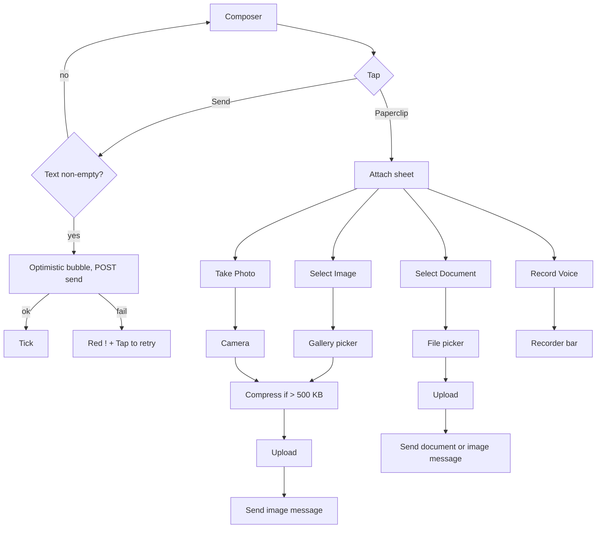

# Composer and attach menu

| | |
|---|---|
| Area | Chat, notifications, tasks |
| Who sees it | Doctor and Clinic staff (BASIC) |
| Reached from | Bottom of the chat thread (file 02) |
| Screen type | Sticky bottom bar + bottom sheet (attach menu) |
| Current Flutter source | `lib/features/chat/presentation/chat_screen.dart` (`_buildChatView` composer row, `_attachFile`, `_sendMessage`), `lib/core/widgets/shifa_button.dart` |
| Spec | `docs/kmp-spec/07-chat-notifications-tasks.md` §1.2 composer, §1.4, ticket CHAT-03/04/05/06 |

## 1. Purpose
Write and send a text message, or pick one of four attachment types. Used in every thread, many times a day; it must work one-handed with the keyboard open.

## 2. Entry points
- Always present at the bottom of an open thread. Not shown on the tablet pane while "Select a conversation" is displayed.
- The attach menu opens from the paperclip; the voice recorder (file 04) replaces the composer row in place.

## 3. Layout, top to bottom (phone portrait)
1. **Composer row** (8 px padding, safe-area aware, divider above):
   - **Paperclip icon button** (brand colour, tooltip "Attach file").
   - **Text field**: pill (24 px radius), light grey fill, hint "Type a message...", grows from 1 to 4 lines then scrolls; keyboard action = Send.
   - **Send button**: today a full `ShifaPrimaryButton` with a send icon **and** the label "Send" (wide). Target: 40 px round icon button, brand fill, disabled (grey) while the field is empty and no upload is in flight.
2. **Attach menu** (modal bottom sheet, dismissible by scrim or drag): four list rows with leading icons: image → "Select Image"; camera → "Take Photo"; file → "Select Document"; mic → "Record Voice Message". No title, no cancel row today (target: drag handle + "Cancel" row, NEW).
3. **Voice recorder bar** (file 04) replaces region 1 entirely while recording.
4. **Progress feedback** today: SnackBars "Compressing image...", "Uploading file..." at the bottom. Target: a thin inline progress strip above the composer with the same copy plus an optimistic bubble with a spinner.

## 4. Data and formats
| Field | Source | Format rule |
|---|---|---|
| Text | field value, trimmed | Sent as `text`; empty after trim = nothing to send. |
| Attachment | picker result | Uploaded first (multipart, part name `file`), then a message of type `image` / `document` / `voice` is sent with the returned URL, original file name and byte size (and `duration` for voice). |
| Message type for "Select Document" | file extension | pdf/doc/docx → document; jpg/jpeg/png → **image** (a PNG picked as a document is sent as an image bubble). |
| Size cap | none today | Target 20 MB (NEW, spec CHAT-04 fix #10). |

## 5. Primary flow (happy path)
1. Tap the field → keyboard opens; the thread list stays anchored to the newest message.
2. Type → Send becomes active.
3. Tap Send (or keyboard Send) → bubble appears at the bottom with a sending spinner → field clears instantly → bubble gets a single tick on success.
4. Tap paperclip → sheet → pick a row → the OS picker opens (or the recorder bar appears) → after selection the upload strip shows "Uploading file..." → attachment bubble appears.

## 6. Screen states
- **First load**: composer visible but disabled while the thread skeleton shows (target). Today it is only built after messages load.
- **Empty**: field empty → Send disabled (target; today always enabled).
- **Error on load**: n/a (belongs to the thread).
- **Offline**: field editable, Send disabled with tooltip/banner "You're offline"; attach menu rows disabled.
- **Refreshing**: n/a.
- **Partial data**: upload succeeded but the send call failed → today the file is orphaned on the server and the user sees "Error uploading file"; target: retry only the send step.
- **Permission needed**: camera / photos / microphone prompts come from the OS at the moment of the tap; permanently denied → banner "Allow access in Settings" with an "Open Settings" action (NEW; today the image picker simply returns nothing and the mic shows "Microphone permission denied").
- **Locked by tier**: n/a.
- **Role difference**: none.

## 7. Interactions and secondary flows
- **Tap Send / keyboard Send** → send text; keyboard stays open.
- **Tap paperclip** → bottom sheet; **tap scrim / drag down** → closed, nothing happens.
- **Select Image** → gallery picker (single image, full quality) → compress on device if the file is ≥ 500 KB (JPEG quality 85, longest side 1 920 px) → upload → send. Cancelling the picker does nothing.
- **Take Photo** → camera → same pipeline. No preview/confirm step today (the OS camera's own confirm is the only one).
- **Select Document** → file picker filtered to pdf, doc, docx, jpg, jpeg, png; single file → upload → send as document or image by extension.
- **Record Voice Message** → composer row is replaced by the recorder bar (file 04); the text draft is kept and returns when the bar closes.
- **Long-press field** → native paste menu.
- **Back / swipe back with a draft** → leaves the thread; the draft is kept in memory for the session.
- **Tap a failed bubble** → retry send (target).

## 8. Edge cases
- Double-tap Send → today two identical messages; target: Send disabled while a send is in flight.
- Send with only spaces → nothing happens (trimmed empty).
- Text of 5 000+ characters → field scrolls after 4 lines; sent as one message (no client cap; open question).
- Emoji-only / RTL text → native field behaviour; bubble aligns by sender, text direction by content.
- Pasting a URL → sent as text; rendered as a link.
- Attachment > 20 MB → banner "File is too large (max 20 MB)" (NEW); today a 50 MB file is attempted and usually fails after the 30 s timeout with "Error uploading file".
- Picker returns a file with no extension → sent as image (falls through the extension rule); target: treat unknown as document.
- HEIC photo from iOS → compression converts to JPEG only when ≥ 500 KB; a small HEIC is uploaded as HEIC (UNVERIFIED backend support). Target: always re-encode to JPEG.
- Upload fails (network) → "Error uploading file" banner; nothing is sent; the user must pick again (target: keep a failed attachment bubble with retry).
- 401 mid-upload → global logout; the draft/attachment is lost.
- Recorder open and the user taps the thread's back arrow → recording is cancelled and the temp file deleted.
- Keyboard open + attach sheet → the sheet appears above the keyboard; dismissing the sheet should not close the keyboard.
- Font scale 200 % → the field grows to 4 lines of large text; the Send and paperclip buttons stay 48 px touch targets, bottom-aligned.
- Rotation while the sheet is open → sheet persists.
- Screen reader: "Attach file, button", "Message, text field", "Send, button, dimmed" when disabled.

## 9. Validation and messages
| Field/action | Rule | When checked | Message (English) | Where shown |
|---|---|---|---|---|
| Message text | Trimmed length > 0 | Live (button state) | — | Send disabled |
| Image/doc size | ≤ 20 MB (NEW) | Before upload | "File is too large (max 20 MB)" | Top banner |
| Upload | 2xx with a `url` | After upload | "Error uploading file" | Top banner (today SnackBar, red) |
| Send after upload | 2xx | After send | "Failed to send message" | Bubble retry state |
| Camera/photo permission | Granted | On tap | "Allow access in Settings" + Open Settings | Top banner |
| Progress | — | During | "Compressing image...", "Uploading file..." | Inline strip (today SnackBar) |

## 10. Navigation out
- Attach rows hand off to OS pickers / camera and come back to the same thread.
- Nothing on the composer navigates elsewhere.

## 11. Copy
- `typeMessage` "Type a message...", `send` "Send", `attachFile` "Attach file", `selectImage` "Select Image", `takePhoto` "Take Photo", `selectDocument` "Select Document", `recordVoice` "Record Voice Message", `compressingImage` "Compressing image...", `uploadingFile` "Uploading file...", `errorUploadingFile` "Error uploading file", `failedToSendMessage` "Failed to send message", `cancel` "Cancel".
- **NEW**: "File is too large (max 20 MB)", "Allow access in Settings", "Open Settings", "You're offline", "Tap to retry".

## 12. Known problems in the current app (do not carry over)
- Send is a wide labelled button, always enabled; empty sends fire a request; double-tap duplicates.
- No optimistic bubble; progress is a bottom SnackBar (spec rule: banners, not snackbars).
- No attachment size or type cap (spec §8 #10).
- No photo preview or caption before sending; the image goes out the instant the picker returns.
- Attach sheet rows use Title Case and have no cancel affordance.
- Permission denial for camera/photos is silent.
- On web no compression happens (irrelevant for the mobile rewrite).

## 13. Open questions for design
- Mic icon directly in the composer (hold-to-record like WhatsApp) versus the current "Record Voice Message" row inside the attach sheet? The spec keeps the inline recorder bar; a tap-to-start is safer than hold-to-record for a clinical app.
- Should "Take Photo" and "Select Image" be one row with a system photo picker that offers the camera?
- Caption support on images/documents (backend `text` + attachment in one message is already allowed by the API)?
- Should the Send button morph into a mic when the field is empty?
