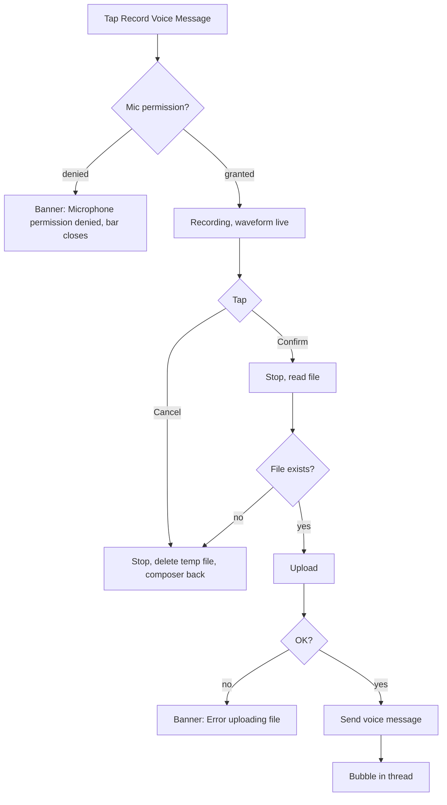

# Voice message: recording bar and playback bubble

| | |
|---|---|
| Area | Chat, notifications, tasks |
| Who sees it | Doctor and Clinic staff (BASIC) |
| Reached from | Attach menu → "Record Voice Message" (recording); any voice bubble in a thread (playback) |
| Screen type | Inline bar replacing the composer (recording); bubble inside the thread (playback) |
| Current Flutter source | `lib/core/widgets/inline_voice_recorder_bar.dart`, `lib/core/widgets/doctor_voice_recorder_session.dart`, `lib/features/chat/presentation/widgets/voice_message_bubble.dart`, `chat_screen.dart` (`_sendVoiceMessage`) |
| Spec | `docs/kmp-spec/07-chat-notifications-tasks.md` §1.3 voice, §1.4 voice, §7, ticket CHAT-06 |

## 1. Purpose
Let the doctor answer a patient by voice when typing is impractical (between visits, gloves on), and listen to voice notes patients send. Occasional use; must be forgiving (cancel is cheap) and must never lose a recording silently.

## 2. Entry points
- **Recording**: Attach menu → "Record Voice Message". Recording **starts immediately** when the bar appears (there is no separate "start" tap). The composer row is hidden while the bar is visible; the text draft is preserved.
- **Playback**: any voice bubble in the thread; no separate screen.

## 3. Layout, top to bottom (phone portrait)
### Recorder bar (replaces the composer)
1. Optional title line (not used in chat; used by AI scribe).
2. **Dark pill** (near-black, 94 % opacity, fully rounded): a live **waveform of 40 bars** filling the left/centre (bars 3–27 px tall, lighter when louder, updated every 60 ms, scrolling left as new levels arrive); on the right two 32 px icon buttons: **✕ Cancel** (white 70 %) and **✓ Confirm** (white 70 %; becomes a 20 px spinner while finishing). No elapsed-time counter today (target: `0:14` counter at the left of the pill, NEW).
3. **Hint** under the pill, 11 px grey: "Stop when you are done — pauses and filler words are fine."
4. After ✓: the bar disappears, the composer returns, and an upload strip "Uploading file..." shows until the voice bubble appears.

### Voice bubble (in the thread)
- Max width 280 px; same colours/radius/tail as text bubbles; role label above when not mine.
- Row: **play/pause icon button** (white on mine, dark on theirs) · column with a 3 px **progress line** and under it `mm:ss` position (left) and `mm:ss` total (right) · column with time `HH:mm` and status tick (mine).
- No scrubbing (the line is display-only), no speed button, no waveform.

## 4. Data and formats
| Field | Source | Format rule |
|---|---|---|
| Recording format | device recorder | AAC-LC in `.m4a`, 16 kHz, mono, 32 kbps, auto-gain, echo cancel, noise suppression (mobile). File name `voice_{epochMs}.m4a`. |
| Duration | stopwatch, whole seconds | Sent as `duration` (int seconds). |
| Max length | **none** today | Target: 5 min cap with auto-stop + banner (NEW, open question). |
| Level → bar height | dBFS, floor −55 / ceiling −8 (mobile) | Bars 0.08–1.0 of 24 px. |
| Playback total | `content.duration` if present, else the player's reported duration | `mm:ss`, zero-padded. |
| Playback position | player stream | `mm:ss`; resets to `00:00` on completion. |
| Audio URL | `fileUrl` | Today used as is (not normalised); target normalise like images. |

## 5. Primary flow (happy path)
1. Attach → Record Voice Message → OS mic permission prompt on first use → bar appears, waveform moving, counter running.
2. Doctor speaks; taps ✓ → ✓ turns into a spinner (≤ 1 s) → bar closes → "Uploading file..." strip → voice bubble appears at the bottom with the total duration.
3. Patient's voice note arrives → tap play → the line fills, position counts up → pause toggles → completion resets to start.

## 6. Screen states
- **First load**: n/a (bar appears already recording; the waveform shows flat minimal bars until sound arrives).
- **Empty**: a zero-length recording (✓ tapped instantly) is still uploaded today (duration 0). Target: ignore recordings < 1 s with a soft banner "Recording too short" (NEW).
- **Error on load**: n/a.
- **Offline**: recording works; upload fails → "Error recording voice: …" banner; target keeps the file and offers retry.
- **Refreshing**: n/a. (The 5 s thread refresh today rebuilds bubbles; playback state survives because bubbles are keyed by message id.)
- **Partial data**: message has no `duration` → total shows `00:00` until the player reports it after the first play.
- **Permission needed**: system prompt on first tap. **Denied permanently**: banner "Microphone permission denied" and the bar closes; target adds "Open Settings" action.
- **Locked by tier**: n/a.
- **Role difference**: none.

## 7. Interactions and secondary flows
- **✕ Cancel** → recorder stopped, temp file deleted, composer returns (draft text intact). Disabled while finishing.
- **✓ Confirm** → stop → upload → send. Disabled while finishing or if recording never started.
- **Tap play** on a bubble → starts from 0 (first time) or resumes; **tap pause** → pauses, position kept.
- **Playback completes** → icon back to play, position `00:00`.
- **Tap another bubble's play** → today both play simultaneously; target: the first pauses (single active player).
- **Leave the thread while playing** → playback stops (bubble disposed).
- **Leave the thread while recording** → recording is cancelled and the file deleted.
- **Lock screen / background while recording** → the OS may suspend the mic; on resume the recording continues or the stop fails (UNVERIFIED). Target: on background, auto-stop and keep what was recorded.

## 8. Edge cases
- Recording interrupted by an incoming phone call → recorder stops with an error on stop → today the bar just closes and nothing is sent, no message. Target: keep the partial file and show "Recording interrupted — send or discard?" (NEW).
- Mic denied permanently → banner and bar closes every time; target banner with "Open Settings".
- Mic in use by another app (video call in progress) → start fails → "Error recording voice" banner.
- Very long recording (20 min) → no cap today; file ≈ 4.8 MB at 32 kbps; fine for upload but awkward to listen to; target 5 min cap (open question).
- Silence only → waveform flat; upload proceeds; target minimum 1 s but no silence detection.
- Two voice bubbles playing at once → target single player.
- Playback while a video call is active → audio focus conflict; the OS handles it; nothing to design.
- Playback URL relative → fails silently today (no error UI). Target: normalise and show "Couldn't play" banner on error (NEW).
- Slow network → upload strip stays; no timeout UI until the 30 s client timeout → error banner.
- 401 mid-upload → global logout; the recording is lost.
- Device/practice timezone differ → the bubble time stamp follows the thread rule (practice TZ).
- Rotation while recording → bar persists; the waveform continues.
- Font scale 200 % → `mm:ss` labels grow; the bubble row wraps the time/status column under the progress line.
- Screen reader: bar reads "Recording, 14 seconds, Cancel button, Send recording button"; bubble reads "Voice message, 12 seconds, Play".
- Bluetooth headset connected → recorder uses the active input (OS default); nothing to design.

## 9. Validation and messages
| Field/action | Rule | When checked | Message (English) | Where shown |
|---|---|---|---|---|
| Mic permission | Granted | On bar open | "Microphone permission denied" | Top banner (today red SnackBar); bar closes |
| Recorder start | Started successfully | On bar open | "Error recording voice" | Top banner; bar closes |
| Minimum length | ≥ 1 s (NEW) | On confirm | "Recording too short" | Top banner |
| Max length | ≤ 5 min (NEW, proposal) | Live | auto-stop + "Maximum length reached" | Inline on the bar |
| Upload | 2xx | After confirm | "Error uploading file" | Top banner |
| Send | 2xx | After upload | "Error recording voice" today; target "Failed to send message" + retry | Bubble |
| Playback | Media loads | On play | "Couldn't play voice message" (NEW) | Top banner |

## 10. Navigation out
- The bar never navigates; Cancel/Confirm return to the composer in the same thread.
- Leaving the thread cancels an in-progress recording (no "discard?" prompt today; target: prompt only if the recording is ≥ 3 s, open question).

## 11. Copy
- `recordVoice` "Record Voice Message", `voiceRecordingFinishHint` "Stop when you are done — pauses and filler words are fine.", `processRecording` "Process" (confirm tooltip), `cancel` "Cancel", `microphonePermissionDenied` "Microphone permission denied", `errorRecordingVoice` "Error recording voice", `uploadingFile` "Uploading file...", `errorUploadingFile` "Error uploading file", `voiceMessage` "Voice Message" (available for accessibility labels).
- **NEW**: "Recording too short", "Maximum length reached", "Recording interrupted — send or discard?", "Couldn't play voice message", "Open Settings", "Send recording" (confirm label instead of "Process").

## 12. Known problems in the current app (do not carry over)
- No elapsed-time counter on the bar; the doctor cannot tell how long they have been recording.
- Confirm tooltip says "Process" (copied from the AI-scribe use of the same bar); the chat action is "Send".
- Recording starts the instant the row is tapped, with no visual "recording" affordance other than moving bars (no red dot, no haptic).
- No maximum length, no minimum length, no interruption handling.
- Each bubble owns its own player → several can play at once; playback stops when the bubble scrolls out and is disposed.
- Voice URL not normalised (spec §8 #7); playback errors are silent.
- Progress line is not seekable.
- Hard-coded dark hex colour on the pill (spec §8 #14).
- Web path records Opus/WebM, not WAV as the spec table states (code was updated after the spec); irrelevant for mobile but the spec row should be corrected.

## 13. Open questions for design
- Hold-to-record with slide-to-cancel, or the current tap-to-start / tap-to-send bar? (Recommend tap: fewer accidental sends.)
- Should a recorded note be previewable (play back before sending) — adds a third state to the bar.
- Playback speed (1×/1.5×/2×) for long patient notes?
- Waveform on the bubble instead of a flat progress line (requires storing levels; backend not ready — probably no).
- 5-minute cap acceptable for clinical use?
