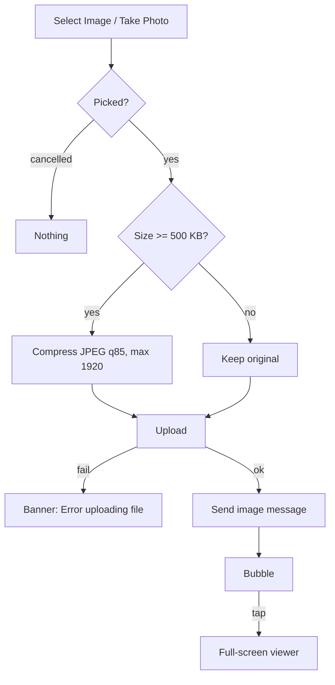

# Image message: pick, send, bubble, full-screen viewer

| | |
|---|---|
| Area | Chat, notifications, tasks |
| Who sees it | Doctor and Clinic staff (BASIC) |
| Reached from | Attach menu → "Select Image" / "Take Photo" (send); tap on any image bubble (viewer) |
| Screen type | OS picker/camera → inline bubble; full-screen modal (viewer) |
| Current Flutter source | `chat_screen.dart` (`_pickAndSendImage`, `_uploadChatAttachmentBytes`), `lib/features/chat/services/image_compression_service.dart`, `lib/features/chat/presentation/widgets/image_message_bubble.dart` (`_FullScreenImageViewer`) |
| Spec | `docs/kmp-spec/07-chat-notifications-tasks.md` §1.3 image, §1.4 image, §1.5, ticket CHAT-04 |

## 1. Purpose
Patients send photos of rashes, wounds, lab sheets; doctors send instructions or pictures back. Several times a week. The doctor must be able to look at a photo at full size and zoom in on detail.

## 2. Entry points
- **Send**: Attach menu (file 03) → "Select Image" (gallery, single) or "Take Photo" (camera). There is **no preview/caption step**: when the picker returns, compression + upload + send run automatically.
- **Document picker** (file 06) also produces an image message when the chosen file is jpg/jpeg/png.
- **Viewer**: tap on an image bubble. Opens as a modal over the thread (today pushed as a plain page on the root navigator).

## 3. Layout, top to bottom (phone portrait)
### Bubble
1. Role label above (theirs only).
2. **Image tile 280 × 280**, cropped to fill (centre crop), clipped by the bubble radius (16 px, 4 px tail). While loading: grey tile with a centred spinner (target: shimmer). On failure: grey tile with a broken-image icon and "Failed to load image" (2 lines max). When no URL at all: a small grey chip "Image not available".
3. **Overlay pill** bottom-right inside the tile: black 54 % background, time `HH:mm` white 11 px, and for my messages the status tick.

### Full-screen viewer
1. Black background; **app bar** black with a white back arrow only (no title, no share/save).
2. Image centred, fit-to-screen, **pinch-zoom 0.5×–4×** and pan. Loading: white spinner; error: white broken-image icon 64 px.
3. No swipe between images, no caption, no double-tap-to-zoom today (target: double-tap zoom, NEW).

## 4. Data and formats
| Field | Source | Format rule |
|---|---|---|
| Picked image | OS picker at full quality | If ≥ 500 KB: re-encoded JPEG quality 85, longest side ≤ 1 920 px (file name suffix `_compressed.jpg`); otherwise sent untouched. |
| Upload | multipart `file` → `{url}` | Then message `type: image`, `attachmentName` = original name, `fileSize` = bytes after compression. |
| Display URL | `fileUrl` ?? `thumbnailUrl` | Absolute kept; relative prefixed with the API base. |
| Thumbnail | `thumbnailUrl` | Backend may send one; today used only as a fallback, not as a progressive preview. |
| Size cap | none | Target 20 MB before compression (NEW). |

## 5. Primary flow (happy path)
1. Attach → Select Image → OS photo picker → pick one.
2. Inline strip "Compressing image..." (≈ 0.5–2 s for a 4 MB photo) → "Uploading file..." → the bubble appears with the local thumbnail and a sending spinner (target: optimistic; today nothing shows until the server responds and the 5 s refresh re-pulls the thread).
3. Tap the bubble → viewer opens with a fade; pinch to zoom; back closes it and returns to the same scroll position.

## 6. Screen states
- **First load (bubble)**: grey placeholder with spinner (target shimmer) at the final 280 × 280 size so the list does not jump.
- **Empty**: n/a.
- **Error on load**: broken-image tile with "Failed to load image"; tap does nothing useful today (opens the viewer which also fails). Target: tap retries the load.
- **Offline**: cached images still render (image cache); uncached show the error tile; sending disabled.
- **Refreshing**: thread refresh must not re-download images (keyed by message id + URL today — fine).
- **Partial data**: no URL → "Image not available" chip.
- **Permission needed**: camera / photo library prompts from the OS on first use. **Denied permanently**: today the picker returns nothing silently. Target: banner "Allow access in Settings" + "Open Settings" (NEW).
- **Locked by tier**: n/a.
- **Role difference**: none.

## 7. Interactions and secondary flows
- **Tap bubble** → viewer. **Back / swipe down** (target) → close.
- **Pinch** → zoom 0.5–4×; **drag** → pan; **double-tap** → toggle 1×/2× (target).
- **Long-press bubble** → nothing today; target: no action (saving to the camera roll is a HIPAA question — see §13).
- **Cancel the picker** → nothing happens, no message.
- **Take Photo** uses the OS camera's own retake/confirm; no in-app preview.
- **Rotation in viewer** → the image re-fits; zoom resets to 1× (acceptable).

## 8. Edge cases
- Very large photo (48 MP, 15 MB) → compressed to ≤ 1 920 px JPEG (≈ 0.5–1 MB); compression can take 2–4 s on old phones → the strip must stay visible; no double-send if the user taps the paperclip again (target: block a second pick while one is in flight).
- 50 MB file picked via the document picker as a PNG → not compressed (document path skips compression) → upload may hit the 30 s timeout → "Error uploading file". Target: run images from the document picker through the same compression and the 20 MB cap.
- Animated GIF → picked as an image, compressed to a static JPEG if ≥ 500 KB.
- Portrait vs landscape vs panorama → always centre-cropped to a square tile; the viewer shows the full image.
- Image fails to load (expired URL, 404) → error tile; after thread refresh it retries automatically.
- Relative URL from the backend → resolved against the API base (today correct for images).
- Thread with 100+ images → virtualised list; cached thumbnails; memory stays bounded by the image cache.
- Tap the image while the upload is still in progress (optimistic bubble) → open the local file in the viewer (target).
- Send fails after upload succeeded → file orphaned on the server; the user sees "Error uploading file" today; target: bubble with retry of the send step.
- 401 mid-upload → global logout.
- Deep link opens while the viewer is open → the viewer is dismissed first (root navigator reset), then routing proceeds.
- Font scale 200 % → the tile stays 280 px; the overlay pill text grows; "Failed to load image" wraps inside the tile.
- Screen reader: "Photo from Patient, 14:32, double-tap to open"; viewer: "Image, pinch to zoom; Back".
- Device/practice timezone differ → overlay time uses practice TZ (target).

## 9. Validation and messages
| Field/action | Rule | When checked | Message (English) | Where shown |
|---|---|---|---|---|
| Photo permission | Granted | On tap | "Allow access in Settings" + Open Settings (NEW) | Top banner |
| Size | ≤ 20 MB (NEW) | Before compression | "File is too large (max 20 MB)" | Top banner |
| Progress | — | During | "Compressing image...", "Uploading file..." | Inline strip (today SnackBar) |
| Upload | 2xx + url | After upload | "Error uploading file" | Top banner (today red SnackBar) |
| Bubble load | Image decodes | On render | "Failed to load image" / "Image not available" | Inside the tile |

## 10. Navigation out
- Bubble → Viewer (modal). Back returns to the thread at the same position; nothing to save.
- Picker/camera → OS surfaces; returning lands in the same thread.

## 11. Copy
- `selectImage` "Select Image", `takePhoto` "Take Photo", `compressingImage` "Compressing image...", `uploadingFile` "Uploading file...", `errorUploadingFile` "Error uploading file", `imageNotAvailable` "Image not available", `failedToLoadImage` "Failed to load image", `back` "Back".
- **NEW**: "Allow access in Settings", "Open Settings", "File is too large (max 20 MB)".

## 12. Known problems in the current app (do not carry over)
- No preview/caption step; the photo is sent the moment the picker closes (accidental sends of the wrong photo cannot be stopped).
- Progress via bottom SnackBars; nothing optimistic; the bubble appears only after the next refresh.
- The image bubble logs the entire message object and sender id on every rebuild (HIPAA) (spec §8 #5).
- Viewer is pushed on the root navigator with a plain page route (no fade, no swipe-to-dismiss), no double-tap zoom, no swipe between images.
- A PNG picked from the document picker bypasses compression (spec §8 #9).
- Picker permission denial is silent.
- No size cap (spec §8 #10).

## 13. Open questions for design
- Add a preview sheet (image + optional caption + Send) before upload? Strongly recommended for a clinical app.
- Allow "Save to photos"/"Share" from the viewer? Patient photos on the doctor's camera roll are a data-protection concern — default **no**, confirm with product.
- Multi-select (send several photos at once)? API supports one attachment per message; the client could loop.
- Should the bubble keep the photo's aspect ratio (max 280 wide / 360 tall) instead of a square crop?
