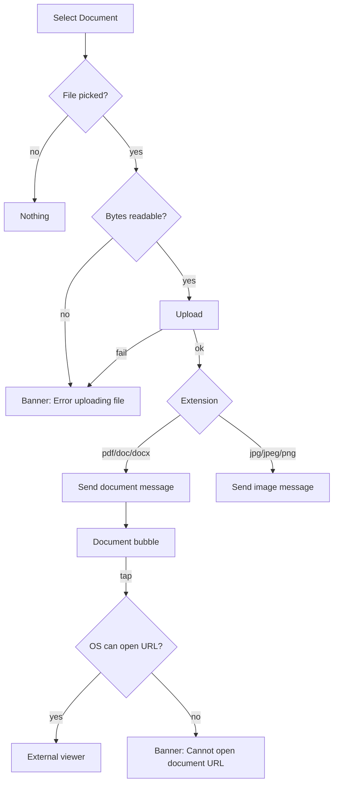

# Document message: pick, send, bubble, open

| | |
|---|---|
| Area | Chat, notifications, tasks |
| Who sees it | Doctor and Clinic staff (BASIC) |
| Reached from | Attach menu → "Select Document" (send); tap on any document bubble (open) |
| Screen type | OS file picker → inline bubble; opens in an external app |
| Current Flutter source | `chat_screen.dart` (`_pickAndSendDocument`), `lib/features/chat/presentation/widgets/document_message_bubble.dart` |
| Spec | `docs/kmp-spec/07-chat-notifications-tasks.md` §1.3 document, §1.4 document, ticket CHAT-05 |

## 1. Purpose
Share a PDF (referral, lab report, prescription scan) with a patient or receive one. Weekly. The doctor must see what the file is (name, type, size) before deciding to open it, and opening must not be a dead end.

## 2. Entry points
- **Send**: Attach menu (file 03) → "Select Document" → OS file picker filtered to pdf, doc, docx, jpg, jpeg, png (single file). No preview step; upload and send run immediately.
- **Open**: tap a document bubble → the file URL is handed to the OS (browser or a PDF app). There is no in-app viewer and no download-to-device.

## 3. Layout, top to bottom (phone portrait)
### Bubble (max width 320 px)
1. Role label above (theirs only).
2. Card with the usual bubble colours/radius; padding 12 px; a row:
   - **Icon tile** 40 px (8 px radius, white 24 % on mine / grey on theirs) with an icon by extension: pdf → PDF icon; doc/docx → document icon; jpg/jpeg/png/gif → image icon; anything else → generic file icon.
   - **File name** 14 px semibold, max 2 lines, ellipsis; under it the **size** 12 px ("812.0 KB", "2.4 MB"). If the name is missing: "Document".
   - Right column: time `HH:mm` 11 px and the status tick (mine).
3. Target additions: a small download/open chevron and a per-bubble progress ring while uploading (NEW).

### Open behaviour
- Tap → leaves the app to the system handler (browser for a bare URL, PDF viewer if the OS maps it). No in-app preview (target: in-app PDF preview with share, open question).

## 4. Data and formats
| Field | Source | Format rule |
|---|---|---|
| Allowed extensions | picker filter | pdf, doc, docx, jpg, jpeg, png. |
| Message type | extension | pdf/doc/docx → `document`; jpg/jpeg/png → `image` (renders as an image bubble, file 05). |
| File name | picker display name | Sent as `attachmentName`; shown verbatim. |
| Size | byte length | < 1 024 → "N B"; < 1 MB → "x.y KB"; else "x.y MB" (one decimal). |
| URL | `fileUrl` | Today used as is (not normalised); target normalise. |
| Cap | none | Target 20 MB (NEW). |

## 5. Primary flow (happy path)
1. Attach → Select Document → OS picker → choose "Referral.pdf".
2. Strip "Uploading file..." → bubble with PDF icon, name, size, and a sending spinner (target optimistic; today appears after the server round-trip and refresh).
3. Patient taps the bubble on their side; doctor taps a received PDF → OS asks which app (or opens the browser) → file shows.

## 6. Screen states
- **First load**: bubble renders instantly (no remote fetch needed for the card itself).
- **Empty**: n/a.
- **Error on load**: n/a for the card; opening errors are banners.
- **Offline**: card renders; tap → external open fails → "Cannot open document URL" (today) — target: "You're offline" banner; sending disabled.
- **Refreshing**: n/a.
- **Partial data**: no `fileUrl` → card not tappable (no visual hint today; target: greyed card with "File unavailable", NEW). No size → size line hidden. No name → "Document".
- **Permission needed**: the system file picker needs no permission on Android 13+/iOS; older Android may ask for storage; denial → picker returns nothing (silent today; target banner).
- **Locked by tier**: n/a.
- **Role difference**: none.

## 7. Interactions and secondary flows
- **Tap bubble** → external open; on failure banner; exceptions → "Something went wrong".
- **Long-press** → nothing today; target: "Copy link"? (No — links are unauthenticated public URLs; see §13.)
- **Cancel picker** → nothing.
- **Pick a PNG** → it becomes an image message (file 05) — intentional; document it in the design so the designer does not expect a document card for images.
- **Back / leave thread during upload** → the upload continues in the background today (no cancel); the result shows on return.

## 8. Edge cases
- 50 MB PDF → no cap today; upload runs until the 30 s client timeout → "Error uploading file"; target: pre-check 20 MB cap with banner.
- Password-protected PDF → uploads fine; the external viewer asks for the password; nothing to design.
- File with a 120-character name → 2-line ellipsis in the card; full name available to the screen reader.
- File without an extension → generic icon; sent as **image** today (falls through the rule); target: treat as document.
- Uppercase extension (`REPORT.PDF`) → lower-cased before matching: works.
- `.docx` on a phone without Office → OS offers Google Docs/Pages or fails → "Cannot open document URL". Target in-app preview avoids this for PDFs only.
- URL expired / 404 → the browser shows a server error page; the app cannot detect it. Target in-app fetch would show "File unavailable".
- Relative URL from the backend → today fails to open (not normalised; spec §8 #7).
- Upload ok, send fails → orphan file; user sees "Error uploading file"; target retry-send bubble.
- Same file sent twice → two messages; fine.
- 401 during upload → global logout.
- Font scale 200 % → the name wraps to 2 lines, the size and time wrap under; the card may reach the 320 px limit and the time column drops below (design a stacked variant).
- Screen reader: "Document, Referral.pdf, 2.4 megabytes, 14:32, double-tap to open".
- Rotation → no effect.
- Deep link while the external viewer is in front → the app routes when it returns to the foreground.

## 9. Validation and messages
| Field/action | Rule | When checked | Message (English) | Where shown |
|---|---|---|---|---|
| File type | In the allowed list | Picker filter | — (picker hides others) | — |
| Size | ≤ 20 MB (NEW) | Before upload | "File is too large (max 20 MB)" | Top banner |
| Readable bytes | Picker returned data | Before upload | "Error uploading file" | Top banner |
| Upload | 2xx + url | After upload | "Error uploading file" | Top banner |
| Open | OS can handle URL | On tap | "Cannot open document URL" | Top banner |
| Open (exception) | — | On tap | "Something went wrong" | Top banner |

## 10. Navigation out
- Tap → external app/browser; returning lands in the same thread, same position.
- Nothing else navigates.

## 11. Copy
- `selectDocument` "Select Document", `uploadingFile` "Uploading file...", `errorUploadingFile` "Error uploading file", `document` "Document", `cannotOpenDocumentUrl` "Cannot open document URL", `somethingWentWrong` "Something went wrong".
- **NEW**: "File unavailable", "File is too large (max 20 MB)", "You're offline".

## 12. Known problems in the current app (do not carry over)
- Opens in an external app only; no in-app preview, no download progress, no share sheet (spec §7 suggests download + share on iOS).
- Document URL not normalised (spec §8 #7).
- No size cap, no MIME check — only an extension filter in the picker (spec §8 #10).
- Unknown extensions silently become image messages.
- Missing URL leaves a card that looks tappable but does nothing.
- Progress via SnackBar; no optimistic bubble.

## 13. Open questions for design
- In-app PDF preview (with "Open in…" share) versus pure external open? Recommended: in-app for PDF, external for doc/docx.
- Should document cards show a first-page thumbnail for PDFs (needs backend `thumbnailUrl`)?
- Attachment URLs appear to be public, unauthenticated links (UNVERIFIED). If so, "Copy link" must not be offered.
