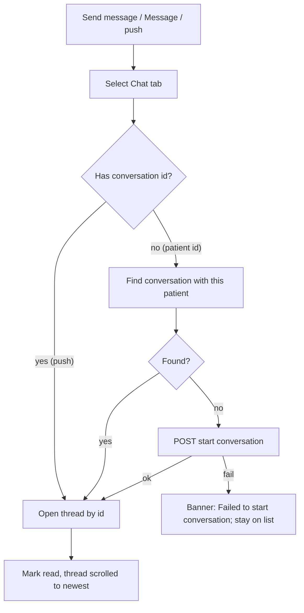

# Start a chat from a patient, the Home hero card, or a push

| | |
|---|---|
| Area | Chat, notifications, tasks |
| Who sees it | Doctor (patient profile, Home); Clinic staff only via push/search (no Home, no patient profile) |
| Reached from | Patient profile quick action "Send message"; Home hero card "Message"; chat push notification; conversations search |
| Screen type | Navigation intent (no screen of its own) ending in the chat thread |
| Current Flutter source | `lib/features/chat/application/open_chat_with_patient.dart`, `chat_screen.dart` (`_openConversationWithPatient`, `_startConversation`, the two `ref.listen` blocks), `lib/features/patients/presentation/patient_detail_panel.dart:292`, `lib/features/home/presentation/widgets/home_timeline_section.dart:102`, `lib/state/shell/shell_controller.dart` |
| Spec | `docs/kmp-spec/07-chat-notifications-tasks.md` §1.1 start, §1.6, ticket CHAT-07 |

## 1. Purpose
Get from "I am looking at this patient" to "I am writing to this patient" in one tap, without hunting for them in the chat list, and land in the exact conversation a push notification is about. Daily.

## 2. Entry points
- **Patient profile → Quick actions → "Send message"** (doctor only). Arrives with the patient id. Switches to the Chat tab and opens the thread on top of the list.
- **Home → hero (next patient) card → "Message"** (doctor only). Same, with the appointment's patient id. If the appointment has no patient id, the button only switches to the Chat tab (list, nothing selected).
- **Chat push notification** (`CHAT_MESSAGE` / `NEW_MESSAGE`): arrives with a conversation id; the shell is reset to its root, the Chat tab is selected and the thread opened. Works from foreground tap, background and cold start (the id waits until the chat screen exists).
- **Conversations search** (file 01): tapping a person starts/opens the conversation — same resolution logic for doctors and patients.
- **No entry from the appointment detail screen today** (none found in code). Target: add "Message patient" to the appointment detail actions (NEW, see folder 05).

## 3. Layout, top to bottom (phone portrait)
There is no dedicated screen. What the user sees, in order:
1. The originating button (patient quick action / hero action), with a pressed state.
2. The Chat tab becomes selected; for ≤ 1 s the conversation list may be visible while the app resolves the conversation (today it fetches the full list first). Target: show the thread skeleton immediately with the patient's name in the header (NEW) so there is no visible list flash.
3. The thread (file 02), scrolled to the newest message, or the empty-conversation hint if it was just created.

## 4. Data and formats
| Field | Source | Format rule |
|---|---|---|
| Patient id | caller (profile / hero) | Matched against `participantId` of non-doctor conversations. |
| Conversation id | push payload `chatId` / `conversationId` / `entityId` | Positive integer; otherwise the push falls back to other routing (file 10). |
| Recipient type | search result `isDoctor` | Start payload uses `recipientDoctorId` or `recipientPatientId`. |
| Header name | resolved conversation | Patient name; brand-coloured underline (tap → profile). |

### Entry point → what arrives → how the thread is found
| Entry | Arrives with | Resolution | Lands |
|---|---|---|---|
| Patient profile "Send message" | patient id | find conversation whose participant is this patient, else create | Thread (Chat tab) |
| Home hero "Message" | appointment's patient id (may be absent) | same; absent id → Chat tab list only | Thread or list |
| Conversations search tap | user id + isDoctor | find by participant id, else create with doctor/patient recipient | Thread |
| Chat push (fg / bg / cold) | conversation id | open by id (no lookup) | Thread |
| Appointment detail (target, NEW) | patient id | same as patient profile | Thread |

## 5. Primary flow (happy path)
1. Tap "Send message" on a patient.
2. Chat tab selected; thread skeleton with the patient name (target).
3. App looks for an existing conversation with that patient; if none, creates one (no automatic message is sent).
4. Thread shows; the composer is focused with the keyboard open (target; today no focus).

## 6. Screen states
- **First load**: thread skeleton with the known name (target). Today: the list is shown while resolving, then the thread pops in.
- **Empty**: new conversation → "Say hello to {name}" hint (file 02).
- **Error on load**: lookup or creation fails → banner "Failed to start conversation" (today "Error: <raw>"); the user remains on the conversation list.
- **Offline**: banner "You're offline"; stay on the list.
- **Refreshing**: n/a.
- **Partial data**: the push carries no usable conversation id → routing falls through to the patient id or the inbox (file 10).
- **Permission needed**: n/a.
- **Locked by tier**: n/a (chat is BASIC).
- **Role difference**: clinic staff have no Home or patient profile, so only search and push lead here.

## 7. Interactions and secondary flows
- **Tap "Send message"** → as §5. The patient screen stays in the Patients tab back stack; switching back to Patients shows it unchanged.
- **Tap "Message" on the hero without a patient id** → Chat tab, list only.
- **Push tap while a different thread is open** → the current thread is replaced by the target one (shell reset to root, Chat tab, thread pushed).
- **Push tap while the attach sheet / viewer / recorder is open** → sheets are dismissed by the root reset; a recording in progress is cancelled and its file deleted.
- **Second tap on "Send message" while the first is still resolving** → today a second lookup runs; both resolve to the same conversation; harmless but wasteful. Target: ignore while in flight.
- **Search tap on a doctor** → same flow with the doctor as recipient.

## 8. Edge cases
- Patient has no account / was never invited → the server rejects conversation creation (4xx) → "Failed to start conversation". Target copy: "This patient can't receive messages yet" (NEW) if the backend distinguishes the case (UNVERIFIED).
- Patient deleted/blocked after the button was rendered → same as above.
- Push for a conversation not in the doctor's list (new patient) → opens by id; the list shows it after refresh.
- Push with an id that no longer exists (conversation removed) → thread load fails → inline error with Retry; back returns to the list.
- Two conversations exist with the same patient (data inconsistency) → the first match wins; never create a third.
- Cold start from a push before login → the pending id survives login (held in state); if the user logs in as a different doctor the id is still consumed (should be cleared on logout — target rule).
- Cold start with app lock enabled → unlock first, then route.
- Clinic staff receive a `TASK_COMPLETED` push → ignored for staff (file 10); a chat push is handled normally.
- 401 during the lookup → global logout; the intent is dropped.
- Slow network > 3 s → skeleton persists; no spinner over the list.
- Language switch while resolving → header/name unaffected; banners use the new language.
- Font scale / rotation → no specific behaviour.
- Screen reader: focus should land on the thread header ("Conversation with {name}") after the switch.

## 9. Validation and messages
| Field/action | Rule | When checked | Message (English) | Where shown |
|---|---|---|---|---|
| Start conversation | Server 2xx | After tap | "Failed to start conversation" | Top banner (today SnackBar with raw error) |
| Lookup | Server 2xx | After tap | "Error" | Top banner (today "Error: <raw>") |
| Push id | Positive integer | On tap | — (falls back silently) | — |

## 10. Navigation out
- Ends in the chat thread; back from the thread goes to the conversations list (not back to the patient profile — the tab changed). Target: keep this behaviour but make the thread header's patient link the way back to the profile.
- Nothing to save.

## 11. Copy
- `sendMessage` "Send message" (patient quick action), `messagePatient` "Message" (hero action), `failedToStartConversation` "Failed to start conversation", `error` "Error".
- **NEW**: "This patient can't receive messages yet", "You're offline", "Message patient" (appointment detail action).

## 12. Known problems in the current app (do not carry over)
- The app downloads the entire conversation list to find one patient instead of asking the server to start-or-return the conversation (spec §8 #20; backend idempotency UNVERIFIED).
- Visible list flash before the thread opens; no header placeholder.
- Raw exception text in the error SnackBar.
- Pending patient / conversation ids are not cleared on logout.
- No "Message patient" action on the appointment detail screen even though the hero card has one.
- Composer is not focused after opening a fresh conversation.

## 13. Open questions for design
- Should opening a chat from a patient use a modal thread (push over the Patients tab, back returns to the profile) instead of switching tabs? The spec keeps the tab switch; a modal would feel more direct.
- When the conversation is new, should the header show "New conversation" until the first message?
- Add a confirmation when a clinic staff member starts a chat with a doctor's patient? (No rule exists today.)
