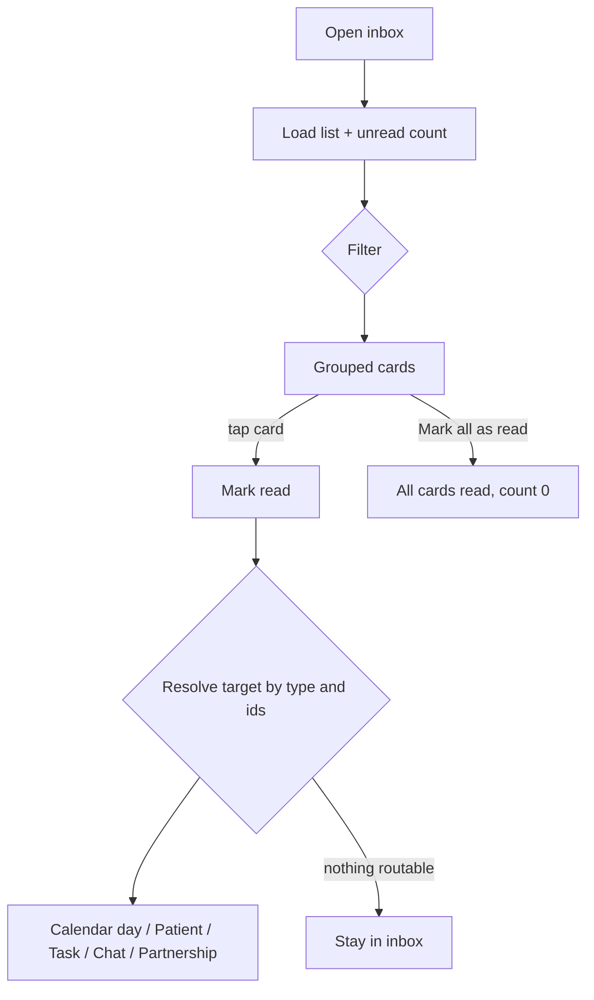

# Notification centre (inbox)

| | |
|---|---|
| Area | Chat, notifications, tasks |
| Who sees it | Doctor and Clinic staff (no tier gate) |
| Reached from | More sheet → Notifications (doctor); Notifications tab (clinic staff, 3rd slot); bell/badge on Home header; default landing of a push with no routable target |
| Screen type | Tab root (inside the shell) and pushable full screen (`/app/notifications`) |
| Current Flutter source | `lib/features/notifications/presentation/notifications_screen.dart`, `notification_ui_helpers.dart`, `lib/state/notifications/doctor_notifications_provider.dart`, `doctor_notification_actions.dart`, `lib/features/notifications/domain/notification_model.dart` |
| Spec | `docs/kmp-spec/07-chat-notifications-tasks.md` §2.1–2.4, tickets NOTIF-01…04 |

## 1. Purpose
A chronological record of everything that happened to the doctor's practice while they were not looking: bookings, cancellations, payments, new messages, completed tasks, document-access decisions, AI scribe results, partnership updates. Checked once or several times a day; each row must be understandable without opening it and must lead to the right place in one tap.

## 2. Entry points
- **Doctor**: bottom bar "More" → "Notifications" tile (with unread count). Also the bell on the Home header. Opens as a tab root.
- **Clinic staff**: 3rd bottom tab "Notifications" (badge).
- **Pushed route**: a push notification whose payload has no appointment / patient / task / chat id lands here as a pushed screen with a back button ("Back").
- The unread count is refreshed on: opening, pull-to-refresh, marking read, app resume, any foreground push, Home refresh. It is **not polled**.

## 3. Layout, top to bottom (phone portrait)
1. **Header** (compact layout): optional "Back" (pushed mode only); title "Notifications" or "Notifications (3)" when unread > 0; under it a row with a text button "Mark all as read" (double-tick icon) on the left and a **settings gear** on the right. The gear does nothing useful today (see §12) — target: remove or link to a real notification-settings screen (folder 08).
2. **Filter chips** (horizontal scroll, 8 px gap): All · Appointments · Tasks · Messages. Selected chip = primary container colour, semibold. Filtering is client-side by type prefix: `APPOINTMENT_*` → Appointments; `TASK_*` → Tasks; chat, document-access and care-partnership types → Messages. AI scribe and unknown types appear only under All.
3. **List** grouped by day: section label ("Today", "Yesterday", "Mar 5") 12 px grey semibold, then cards 12 px apart, 24 px between sections. Newest first.
4. **Card** (8 px radius, 1 px light border, soft shadow, 16 px padding):
   - Unread: background tinted with the type colour at 6 % and an 8 px **blue dot** at the top-left; read: plain card.
   - Row 1: type **icon** 20 px + **type label** (e.g. "Appointment booked") in the type colour; relative **time** on the right ("Just now", "5 min ago", "14:32", "Yesterday 09:10", "Mar 5 - 09:10").
   - Row 2: **body** up to 3 lines (localised template or server text).
   - Row 3 (optional) **inline actions** as secondary pill buttons: "View Result" (task completed with a task id); "View Appointment" + "Open Calendar" (has appointment id and is not a cancellation); "Reschedule" (cancellation with appointment id — today it just navigates like a tap).
5. Bottom padding clears the tab bar. No FAB.

### Type catalogue (icon · colour · label · tap target)
| Type | Icon | Colour | Label | Tap lands on |
|---|---|---|---|---|
| APPOINTMENT_BOOKED_BY_PATIENT, APPOINTMENT_REMINDER | calendar | blue | Appointment booked | Calendar, day of the appointment, appointment highlighted |
| APPOINTMENT_RESCHEDULED_BY_PATIENT, APPOINTMENT_CHANGED | repeat-event | dark blue | Appointment rescheduled | same |
| APPOINTMENT_PAID_BY_PATIENT | payments | green | Payment received | same |
| APPOINTMENT_CANCELLED_BY_PATIENT, APPOINTMENT_CANCELLED | busy-event | red | Appointment cancelled | same (card shows "Reschedule") |
| APPOINTMENT_ASSIGNED | bell (generic) | grey | Notification | same (by appointment id) |
| AI_SCRIBE_READY | sparkle | teal | AI Scribe summary ready | Calendar → appointment (notes refreshed first) |
| TASK_COMPLETED | check-circle | green | Task completed | Task details (file 12); clinic staff: ignored |
| TASK_ASSIGNED | assignment | amber | Task assigned | Patient profile if a patient id is present, else inbox |
| DOCUMENT_ACCESS_REQUEST / _APPROVED / _REJECTED | document | purple | Document access request / approved / rejected | Patient profile with the document selected; APPROVED opens the viewer |
| CARE_PARTNERSHIP_INVITE / _ACCEPTED / _PROGRESS | handshake | dark cyan | Therapy partner invite / Partner accepted / Partnership update | Partnership detail (or partnerships list) |
| CHAT_MESSAGE, NEW_MESSAGE | chat bubble | dark blue (NEW_MESSAGE grey) | New message / Notification | Chat thread by conversation id |
| anything else / GENERAL | bell | grey | Notification | By available ids (appointment → calendar, patient → profile), else stays in the inbox |

Colours are hard-coded hex today; map them to semantic tokens (info, success, danger, warning, accent).

## 4. Data and formats
| Field | Source | Format rule |
|---|---|---|
| Type label | `type` | From the catalogue; unknown → "Notification"; raw English titles are mapped when the type is unknown. |
| Body | `type` + structured fields (`patientName`, `appointmentStartAt`, `documentTitle`, `requestingDoctorName`) | Localised templates; appointment time formatted in **practice timezone** `d MMM yyyy` + `HH:mm`. Fallback: server message (English). |
| Relative time | `createdAt` | < 1 min "Just now"; < 60 min "{n} min ago"; today `HH:mm`; yesterday "Yesterday {time}"; else "{Mon} {d} - {time}". **Target: practice timezone** (today phone). |
| Day section | `createdAt` | "Today" / "Yesterday" / "{Mon} {d}" in practice TZ (target). |
| Unread | `readAt == null` | Tint + dot. |
| Count in title | unread-count endpoint | "(n)" only when n > 0; cap "99+" (NEW). |
| Patient name fallback | — | "Patient" when missing. |

## 5. Primary flow (happy path)
1. Open → skeleton (chip row + 6 card placeholders) → grouped list.
2. Unread cards stand out; title shows "(3)".
3. Tap a card → it is marked read (optimistic tint removal) → the app navigates to the target (table above).
4. Return → card is read; title count decremented; tab badge updated.

## 6. Screen states
- **First load**: skeleton (target). Today: centred spinner.
- **Empty**: large bell outline 80 px, "No notifications", body "You'll see appointment updates, messages and patient activity here." With a filter active: "No notifications in this category" / "Try another filter or check back later."
- **Error on load**: error icon, "Error", technical text hidden for auth-type errors, "Retry" secondary button. Target: banner + Retry, keep stale cards.
- **Offline**: show the last fetched list; actions disabled; banner "You're offline".
- **Refreshing**: pull-to-refresh spinner at the top; content does not jump (new items are prepended under "Today").
- **Partial data**: unread count failed → title without "(n)", list still shown; list failed but count ok → error state.
- **Permission needed**: n/a here (see file 09 for the disabled-notifications banner that should appear at the top of this screen).
- **Locked by tier**: n/a.
- **Role difference**: clinic staff see the same inbox; task notifications never route for staff (tap does nothing beyond mark read — target: hide the Tasks chip for staff, NEW).

## 7. Interactions and secondary flows
- **Tap card** → mark read + navigate (file 10 for the exact landing).
- **"View Result" / "View Appointment" / "Reschedule"** → mark read + same navigation as the card tap. **"Open Calendar"** → mark read + Calendar tab on today (not the appointment day).
- **"Mark all as read"** → server call → list and count refresh; no confirmation.
- **Filter chip tap** → instant client-side filter; the choice is not persisted.
- **Pull-to-refresh** → list + count reload.
- **Gear** → today switches to the Notifications tab (no-op). Target: opens Notification settings or is removed.
- **Back** (pushed mode) → previous screen.
- **Long-press / swipe card** → nothing today; target: no swipe-to-delete (no delete endpoint).

## 8. Edge cases
- 0 notifications → empty state; 1 → one section; 100+ → the whole list arrives in one response (no paging); keep it virtualised; sections must not re-measure on refresh. Target: ask backend for paging before the list grows further (open).
- Notification for a **deleted appointment** → tap shows "Opening appointment..." loading, the day lookup fails and nothing happens (user stays in the inbox, no message). Target: banner "This appointment no longer exists" (NEW) and the card stays read.
- Notification for a deleted patient / task → Patients or Task details shows its own not-found state.
- Appointment time across midnight: the booking body shows the appointment time in practice TZ; the card's relative time and section use practice TZ too (target) so "Today" is the practice day.
- Device/practice timezone differ → grouping must follow practice TZ (today phone TZ: a 23:30 practice-time booking can appear under "Tomorrow"'s logic as "Today" on a phone 3 h ahead).
- Server-English body with no structured fields → shown in English regardless of app language (today the client tries to parse English sentences; target: backend sends structured fields — NOTIF-01 fix #13). Language switch while open → labels and templates switch; raw server text does not.
- Very long document titles or patient names in the body → 3-line clamp.
- Unread count disagrees with visible unread cards (count endpoint vs list) → both refresh on the same triggers; accept a brief mismatch.
- Mark all as read while offline → error banner; cards unchanged.
- Tap a card twice quickly → one mark-read, one navigation (guard in flight).
- Deep link (push) arrives while the inbox is open → the list refreshes; the push routes away from the inbox.
- 401 on load → global logout (error text for "Unauthorized" is hidden today to avoid a flash).
- Font scale 200 % → chips scroll horizontally; card rows wrap; action buttons stack vertically.
- Rotation → no change.
- Screen reader: card reads "Unread, Appointment booked, 5 minutes ago, Patient Aziza booked an appointment for 12 Mar 2026 at 14:30"; actions are separate buttons.

## 9. Validation and messages
| Field/action | Rule | When checked | Message (English) | Where shown |
|---|---|---|---|---|
| Load list | 2xx | On open/refresh | "Error" + Retry | Inline (target banner) |
| Mark read / all | 2xx | On tap | silent on success; "Error" on failure | Top banner |
| Appointment target | Appointment still exists | On tap | "This appointment no longer exists" (NEW) | Top banner |
| Loading target | — | On tap from a push (cold) | "Opening appointment..." (today unlocalised; target localised, NEW key) | Blocking progress dialog → target: inline progress on the card |

## 10. Navigation out
- Card / actions → Calendar (appointment day), Patients (profile, optionally with the document viewer open), Task details, Chat thread, Partnership detail. The inbox stays in its tab; the targets open in their own tabs/stacks.
- "Open Calendar" → Calendar tab, today.
- Back (pushed mode) → previous screen.
- Nothing to save; on return the list refreshes (mark-read already applied).

## 11. Copy
- `notifications` "Notifications", `markAllAsRead` "Mark all as read", `notificationSettings` "Settings", `back` "Back", `notificationFilterAll` "All", `notificationFilterAppointments` "Appointments", `notificationFilterTasks` "Tasks", `notificationFilterMessages` "Messages", `today` "Today", `yesterday` "Yesterday", `timeJustNow` "Just now", `timeMinAgo` "{n} min ago", `timeYesterday` "Yesterday {time}", `noNotifications` "No notifications", `notificationEmptyBody` "You'll see appointment updates, messages and patient activity here.", `notificationEmptyFilter` "No notifications in this category", `notificationEmptyFilterHint` "Try another filter or check back later.", `notificationViewResult` "View Result", `notificationViewAppointment` "View Appointment", `notificationOpenCalendar` "Open Calendar", `notificationReschedule` "Reschedule", `error` "Error", `retry` "Retry".
- Type labels: `notificationGeneric` "Notification", `notificationTypeAppointmentBooked` "Appointment booked", `notificationTypeAppointmentRescheduled` "Appointment rescheduled", `notificationTypeAppointmentPaid` "Payment received", `notificationTypeAppointmentCancelled` "Appointment cancelled", `notificationTypeTaskCompleted` "Task completed", `notificationTypeTaskAssigned` "Task assigned", `notificationTypeDocumentAccessRequest` "Document access request", `notificationTypeDocumentAccessApproved` "Document access approved", `notificationTypeDocumentAccessRejected` "Document access rejected", `notificationTypeAiScribeReady` "AI Scribe summary ready", `notificationTypePartnershipInvite` "Therapy partner invite", `notificationTypePartnershipAccepted` "Partner accepted", `notificationTypePartnershipProgress` "Partnership update", `notificationTypeChatMessage` "New message".
- Bodies: `notificationMessagePatientBookedAppointment` "Patient {name} booked an appointment for {date} at {time}.", `notificationMessagePatientBookedAppointmentNoTime` "Patient {name} booked an appointment.", `notificationMessageAppointmentReminder` "Your appointment is in about 1 hour. Please be ready.", `notificationMessagePatientCancelled` "Patient {name} cancelled their appointment.", `notificationMessagePatientPaid` "Patient {name} paid for their appointment.", `notificationMessagePatientRescheduled` "Patient {name} rescheduled their appointment.", `notificationMessageChat` "You have a new patient message.", `notificationMessagePartnershipInvite` "A doctor invited you to co-treat a patient.", `notificationMessagePartnershipAccepted` "Your therapy partnership invite was accepted.", `notificationMessagePartnershipProgress` "There is a new partnership progress update.", `documentAccessRequestDetail` "{doctorName} requested access to \"{documentTitle}\" for {patientName}.", `documentAccessApprovedDetail` "Your request for access to \"{documentTitle}\" for {patientName} was approved.", `documentAccessRejectedDetail` "Your request for access to \"{documentTitle}\" for {patientName} was rejected."
- **NEW**: "This appointment no longer exists", "Opening appointment…" (localised), "You're offline", "99+".

## 12. Known problems in the current app (do not carry over)
- Grouping and relative time use the phone's clock and timezone (spec §8 #4).
- The gear button switches to the very tab the user is on — a dead control (spec §8 #12).
- Client reverse-parses English server sentences to localise them (spec §8 #13); the reminder body is a fixed English sentence from the server.
- "Reschedule" on a cancelled appointment only opens the calendar day; it does not start a reschedule flow.
- "Open Calendar" goes to today, not the appointment's day.
- Document-access approve/reject endpoints exist but have no buttons; tapping sends the doctor to the patient's documents instead (spec §2.1; NOTIF-04 optional).
- No paging; the full history is downloaded every time (spec §2.1).
- Hard-coded hex colours and a hard-coded blue unread dot (spec §8 #14).
- Loading is a spinner; errors expose raw text except for auth errors.
- Deleted-appointment taps fail silently after an unlocalised "Opening appointment..." dialog (spec §8 #22).
- Debug logging of notification ids/types on every fetch (spec §8 #5).

## 13. Open questions for design
- Should unread be a dot only (no tinted background), with a bolder title, to reduce visual noise with many unread cards?
- Do inline action buttons earn their space, or is the card tap enough? ("Open Calendar" to today seems redundant.)
- Approve/Reject on document-access requests inline — build or not (NOTIF-04)?
- A "Clear"/"Delete" affordance — no endpoint exists; confirm it is out of scope.
- Should the Tasks chip be hidden for BASIC/PRO doctors who cannot open task details?
