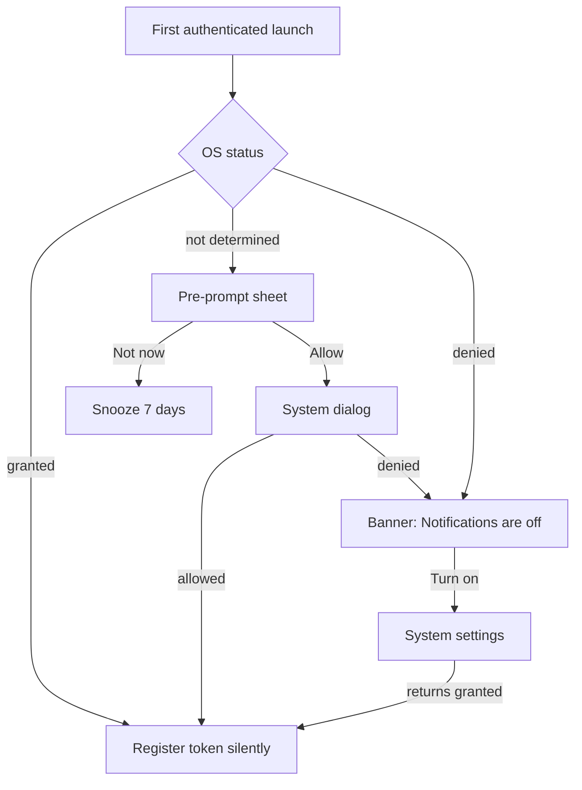

# Notification permission prompt, settings redirect, "notifications off" banner

| | |
|---|---|
| Area | Chat, notifications, tasks |
| Who sees it | Doctor and Clinic staff |
| Reached from | First authenticated launch (prompt); Notification centre and Home when permission is denied (banner); Settings (re-enable) |
| Screen type | System dialog + in-app pre-prompt sheet (NEW) + persistent top banner (NEW) |
| Current Flutter source | `lib/core/services/push_notification_service.dart` (`initialize`), `lib/main.dart` (init order), `lib/app/app.dart` (token upload) |
| Spec | `docs/kmp-spec/07-chat-notifications-tasks.md` §2.5, ticket PUSH-01 ("permission request on first authenticated launch") |

## 1. Purpose
Get the doctor to allow notifications at a moment when they understand why (bookings, cancellations, patient messages), and make it obvious — and fixable — when notifications are off. Once per install, then rarely.

## 2. Entry points
- **Today**: the OS permission dialog is requested inside app start-up (`main()`), **before the splash finishes and before login**, with no explanation. On Flutter mobile builds this code never ran because Firebase only initialises on web; so no mobile user has ever seen this prompt from Shifa Doctor.
- **Target**:
  1. **Pre-prompt sheet** shown once after the first successful login, when the shell is on screen (not during splash, not during app-lock).
  2. **System dialog** right after the sheet's "Allow" button.
  3. **"Notifications are off" banner** at the top of the Notification centre (and the Home attention centre, folder 02) whenever permission is denied or the token could not be registered.
  4. **Settings → Notifications** row (folder 08) that shows the status and a "Open system settings" action.

## 3. Layout, top to bottom (phone portrait)
### Pre-prompt sheet (NEW, bottom sheet, non-blocking)
1. Illustration (bell with calendar/chat glyphs).
2. Title "Stay on top of your practice".
3. Body "Get notified when patients book, cancel or message you, and when AI summaries are ready."
4. Primary button "Allow notifications" → triggers the system dialog.
5. Text button "Not now" → dismisses; the sheet is not shown again for 7 days, then at most once more (open question).

### System dialog
- Android 13+: runtime POST_NOTIFICATIONS prompt; iOS: alerts/badge/sound prompt (no provisional delivery). Nothing to design.

### "Notifications are off" banner (NEW)
- Full-width warning banner under the app bar of the Notification centre: warning icon, text "Notifications are off. You won't hear about new bookings or messages.", action "Turn on" (→ system settings deep link), close "×" (hides for the session).
- Same banner, compact variant, as a card in the Home attention centre.

## 4. Data and formats
| Field | Source | Format rule |
|---|---|---|
| Permission status | OS (granted / denied / not determined / provisional) | Drives sheet and banner visibility. |
| Token registered | `PUT /api/doctors/me/fcm-token` success | If the OS granted but registration failed, show the banner variant "Couldn't register this device for notifications." with "Retry". |
| Snooze | local preference `notif_prompt_snoozed_until` (NEW) | 7 days. |
| Android channel | `shifa_doctor_channel`, "Shifa Doctor Notifications", importance high | Shown in system settings; name should be localised (today English only). |

## 5. Primary flow (happy path)
1. First login completes → shell visible → pre-prompt sheet slides up.
2. Tap "Allow notifications" → system dialog → Allow.
3. Sheet closes; token is obtained and registered with the backend in the background; nothing else is shown.
4. Later, a push arrives (file 10).

## 6. Screen states
- **First load**: n/a (sheet appears after the shell renders; never over the splash).
- **Empty**: n/a.
- **Error on load**: token registration fails → banner variant with "Retry"; retry silently on next launch anyway.
- **Offline**: permission can be granted offline; registration retries when online; no banner for a transient failure (only after two consecutive failures — open question).
- **Refreshing**: status re-checked on every app resume (the user may have changed system settings).
- **Partial data**: granted but no token (Firebase unavailable) → banner "Couldn't register this device…".
- **Permission needed / denied permanently**: this file. Denied permanently → the system dialog cannot be shown again; "Turn on" must open system settings.
- **Locked by tier**: n/a.
- **Role difference**: identical for clinic staff; body copy still fits (bookings, messages).

## 7. Interactions and secondary flows
- **Allow notifications** → system dialog. **Not now** → snooze. **Scrim tap / drag** → same as Not now.
- **Banner "Turn on"** → app notification settings page of the OS; on return, status re-checked; banner disappears if granted.
- **Banner ×** → hidden until the next cold start.
- **Settings → Notifications row** → shows "On" / "Off"; tap → system settings.
- **Logout** → token cleared on the backend (empty token); permission state untouched; the sheet is not shown again for the same device unless status is "not determined".

## 8. Edge cases
- Status "not determined" but the doctor dismissed the sheet 3 times → stop asking; rely on the banner.
- iOS "provisional" (quiet) delivery is not requested today; if product wants it, the banner must not show for provisional status.
- Android < 13 → no runtime prompt; skip the sheet; banner only if the user disabled notifications in settings.
- Permission granted but the channel is muted (Android) → pushes are silent; the app cannot detect it; nothing to design.
- App lock enabled → never show the sheet over the lock screen; show after unlock.
- Deep link cold start → route first, show the sheet afterwards (or skip for that session).
- Multiple doctors share a device → token re-registered on each login; the sheet logic is per device, not per account.
- Language switch → sheet/banner text follows the app language; the Android channel name updates only on next channel creation (OS caveat).
- Font scale 200 % → sheet scrolls; buttons remain full width at the bottom.
- Rotation → sheet persists.
- Screen reader: sheet title is the first focus; banner is announced as "Warning".
- Session expired while the sheet is open → logout dismisses the sheet.

## 9. Validation and messages
| Field/action | Rule | When checked | Message (English) | Where shown |
|---|---|---|---|---|
| OS permission | granted | On launch / resume | "Notifications are off. You won't hear about new bookings or messages." + "Turn on" | Top banner (inbox, Home) |
| Token registration | 2xx | After grant / on refresh | "Couldn't register this device for notifications." + "Retry" | Top banner |
| Snooze | 7 days | On "Not now" | — | — |

## 10. Navigation out
- "Turn on" → OS settings (external); return re-checks status.
- Sheet buttons → stay on the current screen.

## 11. Copy
All copy in this file is **NEW** (nothing exists in `en.json`): "Stay on top of your practice", "Get notified when patients book, cancel or message you, and when AI summaries are ready.", "Allow notifications", "Not now", "Notifications are off. You won't hear about new bookings or messages.", "Turn on", "Couldn't register this device for notifications.", "Retry" (`retry` exists). Android channel name "Shifa Doctor Notifications" and description "Notifications for documents, tasks, chat, and appointments" exist only as hard-coded English in code.

## 12. Known problems in the current app (do not carry over)
- Permission requested during app start-up, before login and without context; on a cold start this dialog would cover the splash.
- No pre-prompt, no "denied" state anywhere in the UI, no way back to system settings, no banner.
- Token upload happens only when Firebase initialised; on the Flutter mobile builds it never did, so the whole push stack was web-only (doc 00 "Where the code differs").
- Channel name/description are hard-coded English.
- Permission result is only logged in debug mode; the app never reacts to "denied".

## 13. Open questions for design
- Show the pre-prompt immediately after first login, or after the first meaningful event (first booking seen)? Recommend immediately: doctors expect it.
- Snooze length and maximum number of re-asks.
- Should the banner also appear on the Calendar (bookings are the most time-critical)?
- iOS provisional (quiet) notifications as a middle ground for "Not now"?
