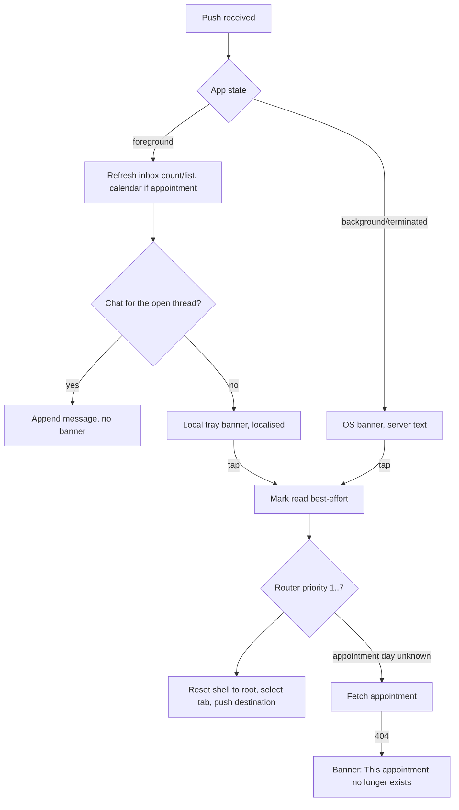

# Push notification arrival (foreground / background / cold start) and deep-link landing

| | |
|---|---|
| Area | Chat, notifications, tasks |
| Who sees it | Doctor and Clinic staff |
| Reached from | Any push from the backend (18 types); in-app notification taps reuse the same router |
| Screen type | System tray banner (foreground and background) + navigation; in-app banner for the open chat (NEW) |
| Current Flutter source | `lib/core/services/push_notification_service.dart`, `lib/app/app.dart` (`setOnNotificationTap`, `setOnForegroundDataRefresh`, `_openCalendarToAppointment`, `_fetchAppointmentDay`), `lib/features/shell/presentation/main_shell.dart` (pending task id), `lib/state/shell/shell_controller.dart`, `lib/state/appointments/appointment_invalidation.dart` |
| Spec | `docs/kmp-spec/07-chat-notifications-tasks.md` §2.3 tap column, §2.5, tickets PUSH-02, PUSH-03 |

## 1. Purpose
Interrupt the doctor only as much as the event deserves, and when they tap, land them exactly where the event lives — the right calendar day, the right thread, the right task — from any app state. Continuous.

## 2. Entry points
- **Foreground** (app open): the data payload is turned into a **local notification** (system banner) with a localised title/body; the app also refreshes the inbox count, the inbox list and — for appointment types — the calendar/home providers. No in-app banner is drawn today.
- **Background**: the OS shows the server's `notification` block (server English title/body, not localised). Tap → the app resumes and routes.
- **Terminated (cold start)**: tap → the app launches; the payload is held until the shell is built, then routed. The pending id survives splash → app-lock → shell.
- **In-app**: tapping a card or action in the Notification centre feeds the same router with the same payload keys.

## 3. Layout, top to bottom (phone portrait)
1. **System banner** (OS-owned): app icon, title = type label ("Appointment booked"), body = localised template ("Patient Aziza booked an appointment for 12 Mar 2026 at 14:30."). Android channel: high importance (heads-up). Nothing to design beyond copy.
2. **In-app banner (NEW, target)** for the **open chat thread only**: when a `CHAT_MESSAGE` arrives for the conversation currently on screen, suppress the tray banner and append the message. For a *different* conversation while in the app, show a slim top banner "New message from {name}" with the first words, tappable, auto-hides after 4 s. All other types keep the tray banner (even in foreground) so the doctor can act later.
3. **Loading while resolving an appointment deep link** (cold start only): a centred card with a spinner and "Opening appointment..." (today unlocalised). Target: route to the Calendar immediately with a skeleton and resolve the day there (NEW rule, no blocking dialog).

### Landing table (priority order the router uses; first match wins)
| # | Condition | Icon in tray | Lands on | Notes |
|---|---|---|---|---|
| 1 | type is DOCUMENT_ACCESS_* and patientId + documentId present | document (purple) | Patients tab → patient profile with that document highlighted; APPROVED also opens the document viewer | Shell reset to root first |
| 2 | type CHAT_MESSAGE / NEW_MESSAGE with chatId / conversationId / entityId | chat (blue) | Chat tab → that thread | Without an id: falls through |
| 3 | type starts with CARE_PARTNERSHIP | handshake (cyan) | Partnership detail (partnershipId) or partnerships list | |
| 4 | appointmentId present (BOOKED, REMINDER, RESCHEDULED, CHANGED, PAID, CANCELLED, ASSIGNED, AI_SCRIBE_READY) | calendar / sparkle | Calendar tab on the appointment's day with the appointment highlighted; AI_SCRIBE_READY first refreshes that appointment's notes | Day from `appointmentStartAt` in practice TZ, else fetched (`GET /api/appointments/{id}`); if the fetch fails → nothing happens today |
| 5 | type TASK_COMPLETED with taskId | check (green) | Task details (file 12) pushed inside the Tasks tab | Clinic staff: ignored (cleared) |
| 6 | patientId present (TASK_ASSIGNED, GENERAL…) | assignment / bell | Patients tab → patient profile | |
| 7 | nothing routable | bell (grey) | Notification centre (pushed, with Back) | |

A best-effort "mark as read" (`PUT /api/notifications/{id}/read`) fires on every tap before routing.

## 4. Data and formats
| Field | Source | Format rule |
|---|---|---|
| Payload keys | `notificationId`/`id`, `type`, `appointmentId`, `appointmentStartAt`, `patientId`, `documentId`, `documentTitle`, `documentAccessRequestId`, `taskId`, `chatId`/`conversationId`/`entityId`, `partnershipId`, `patientName`, `requestingDoctorName`, `createdAt` | All strings in FCM data; parsed as ints where needed. |
| Title/body (foreground) | localised from `type` + fields in the **app language** (cached at start, refreshed on language change) | Falls back to the server's `notification.title/body`, then "Notification". |
| Title/body (background) | server `notification` block | English today; target: backend sends localised text per the doctor's language, or data-only pushes rendered by the app (PUSH-02). |
| Local notification id | `notificationId` or epoch-based | Same id replaces an earlier banner for the same notification. |
| Dedupe | ids already tapped in this session | A foreground push for an already-handled id is dropped. |

## 5. Primary flow (happy path)
1. Patient books → push arrives while the doctor is on Home → tray banner "Appointment booked — Patient Aziza booked an appointment for 12 Mar 2026 at 14:30."; the Home "today" list and inbox badge refresh silently.
2. Doctor taps the banner → Calendar tab opens on 12 March with the new appointment highlighted; the inbox card is marked read.
3. Patient writes while the doctor is in that very thread → no tray banner; the bubble appears and is marked read (target).

## 6. Screen states
- **First load**: cold-start route shows the destination's own skeleton (Calendar/Chat/Task) rather than a blocking dialog (target).
- **Empty**: n/a.
- **Error on load**: target not found (deleted appointment/task/patient) → destination shows its own not-found state or a banner; today the appointment case fails silently.
- **Offline**: tap routes to the destination; its own offline state applies; mark-read is skipped silently.
- **Refreshing**: foreground pushes refresh inbox + calendar providers; the UI must not jump (lists update in place).
- **Partial data**: payload missing ids → falls down the priority list; worst case the inbox.
- **Permission needed**: file 09.
- **Locked by tier**: TASK_COMPLETED for a BASIC/PRO doctor → today the router still sets the Tasks tab (which is then bounced to Home) and pushes task details; target: open task details read-only or show the tier gate (file 16).
- **Role difference**: clinic staff: task deep links are dropped; appointment links go to the staff shell's Clinic workspace calendar (folder 09) — UNVERIFIED landing today (the router sets tab index 2, which for staff is the Notifications tab).

## 7. Interactions and secondary flows
- **Tap tray banner** → route as table. **Swipe banner away** → nothing; the inbox still shows the item.
- **Tap in-app chat banner (NEW)** → that thread replaces the current one.
- **Tap while a sheet/dialog/viewer is open** → root reset dismisses them; a voice recording in progress is discarded.
- **Tap while on the app-lock screen** → unlock first, then route (pending id kept).
- **Tap before login (cold start, logged out)** → login first; the pending id is routed after the shell appears (only if the same doctor logs in — target: clear pending ids on logout/login switch).
- **Language change** → tray copy cache refreshed; already-shown banners keep their old language.

## 8. Edge cases
- Notification for a **deleted appointment (404)** → today: spinner dialog, then nothing. Target: land on Calendar today + banner "This appointment no longer exists".
- Notification for a **cancelled** appointment → Calendar day with the cancelled item visible (status badge); "Reschedule" label in the inbox is misleading (file 08 §12).
- Chat push for a conversation **not in the list** (brand-new patient) → opens by id; fine.
- Chat push with no conversation id → falls to patientId → patient profile (not the thread). Ask backend to always send `conversationId`.
- TASK_ASSIGNED is a patient-facing event that reaches the doctor inbox: lands on the patient profile, not the task. Target: if `taskId` is present, open task details (NEW rule).
- Two pushes tapped in quick succession → the second wins; no stacked destinations.
- Push arrives while the **same screen** is open (e.g. Calendar day) → silent refresh, banner still shown today; acceptable except for the open chat thread.
- 100 pushes overnight → 100 tray entries (Android groups by app; iOS stacks). No summary notification today (open question).
- Foreground push for an id already tapped → dropped (dedupe), so a re-sent notification is invisible until the inbox refreshes.
- Practice vs phone timezone → body time and calendar day both computed in practice TZ (today correct for the booked-body; the "today" of the calendar uses the device clock — folder 04 §12).
- 401 on mark-read → ignored (best effort); 401 on the destination → logout.
- Font scale / rotation → OS-owned banner; in-app banner wraps to 2 lines.
- Screen reader: tray banner read by the OS; in-app banner announced politely.
- Android channel muted by the user → no banner; the inbox still updates on resume.

## 9. Validation and messages
| Field/action | Rule | When checked | Message (English) | Where shown |
|---|---|---|---|---|
| Appointment lookup | 200 with `startAt` | On tap | "This appointment no longer exists" (NEW) | Top banner on Calendar |
| Resolving (cold start) | — | On tap | "Opening appointment…" (localise; today hard-coded English) | Inline skeleton (target) |
| New chat message in-app | — | On arrival | "New message from {name}" (NEW) | In-app top banner |
| Fallback title | type unknown | On arrival | "Notification" | Tray |

## 10. Navigation out
- Every tap resets the shell to its root (clears nested stacks), selects the tab and pushes the destination. Unsaved input on whatever screen was open is **lost without asking** today. Target: if a form with unsaved changes is open (create task, SOAP notes), ask "Discard changes and open notification?" (NEW, open question).
- Destinations: Calendar (day + highlighted appointment), Patients (profile, document selected / viewer open), Chat thread, Task details, Partnership detail/list, Notification centre.

## 11. Copy
- Tray title/body keys: see file 08 §11 (type labels and bodies are shared).
- `notificationGeneric` "Notification" (fallback title).
- **NEW**: "Opening appointment…" (today an unlocalised literal), "This appointment no longer exists", "New message from {name}", "Discard changes and open notification?", Android channel name/description (today hard-coded English).

## 12. Known problems in the current app (do not carry over)
- Background pushes show server English regardless of the app language (spec §2.5); foreground ones are localised by reverse-parsing English (spec §8 #13).
- Tap handler logs the whole payload including patient/document ids (HIPAA) (spec §8 #5).
- A chat push for the open thread still pops a tray banner; the thread is not marked read.
- Deleted-appointment taps fail silently behind an unlocalised blocking dialog (spec §8 #22).
- Root reset discards any unsaved form.
- Task deep links are routed by tab index 5 even when the Tasks tab is hidden by tier; staff appointment links set a tab index that means "Notifications" in the staff shell.
- Pending ids are not cleared on logout.
- Web service worker had no click handler (irrelevant for mobile).
- On the Flutter mobile builds none of this ever ran (Firebase initialised only on web).

## 13. Open questions for design
- In-app banner for all types while in the foreground (like Slack) versus tray banners? Spec keeps tray; this file proposes in-app only for chat.
- Summary/grouped notification after N unread (Android group summary, iOS thread id per patient)?
- Should AI_SCRIBE_READY open the appointment's notes tab directly instead of the calendar day?
- Sound/vibration differentiation per type (bookings vs messages)?
