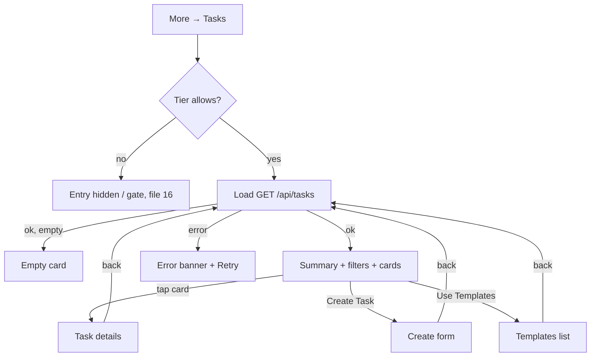

# Remote care tasks — list (Tasks root)

| | |
|---|---|
| Area | Chat, notifications, tasks |
| Who sees it | Doctor only, **PREMIUM** tier (entry hidden otherwise, file 16). Never clinic staff. |
| Reached from | More sheet → Tasks; task push (TASK_COMPLETED) lands on details with this list underneath; back from details / create / templates |
| Screen type | Tab root (pushed into the tab stack from the More sheet; shows a back arrow when it can pop) |
| Current Flutter source | `lib/features/tasks/presentation/tasks_screen.dart`, `lib/state/tasks/tasks_provider.dart`, `lib/state/tasks/task_actions.dart`, `lib/features/tasks/domain/task_models.dart` |
| Spec | `docs/kmp-spec/07-chat-notifications-tasks.md` §3.1, §3.5, ticket TASK-02 |

## 1. Purpose
See every remote-care programme the doctor has assigned (blood-pressure logs, medication adherence, exercises), who is behind, and start a new one. A premium doctor checks this a few times a week.

## 2. Entry points
- **More sheet → "Tasks"** (doctor, premium). Opens inside the shell; the tab bar stays; an app-bar back arrow shows because the screen can pop.
- **Task push / inbox "View Result"** → details screen on top of this list (the list is built underneath so back lands here).
- **Return** from Create task, Use templates, Task details → the list reloads.
- Tasks are also prefetched when the shell starts (today for every doctor regardless of tier — a 403 is swallowed).

## 3. Layout, top to bottom (phone portrait)
1. **App bar** (brand background, white text): back arrow, title "Remote Care Tasks". Target: standard app bar from the kit; no second in-page title.
2. **Page header** (duplicated today): title "Remote Care Tasks" + subtitle "Monitor and manage patient follow-ups"; **"Create Task"** primary button full width (plus icon); **"Use Templates"** secondary button full width.
3. **Summary cards** (stacked full width on phones, 12 px gap): "Active tasks" (count, blue), "Completed tasks" (green), "Overdue tasks" (red; counts tasks whose status is *expired*).
4. **Search & filters panel** (white card): search field "Search tasks or patients"; **Status** dropdown (All, Active, Completed, Expired, Cancelled, Draft); **Category** dropdown (All + four categories — on phones the raw codes "vital / exercise / medication / other" are shown, see §12); refresh icon button right-aligned.
5. **Task cards** (12 px gap), each:
   - 40 px rounded icon tile (brand 8 %) with the category icon: vital → heart monitor; exercise → running figure; medication → pill; other → clipboard.
   - Task name 16 px semibold; under it a 20 px initials avatar (teal) + patient name (ellipsis).
   - Status pill top-right: Active (green), Completed (blue), Expired (orange), Cancelled (red), Draft (grey) — tinted background 12 %, 11 px text.
   - Meta row: category icon + "Vital" · clock icon + "3× per day".
   - Date row: calendar icon + "2026-03-01 – 2026-03-31" | "2026-03-01 · 30 days" | "2026-03-01".
   - Progress: label "Task progress", 6 px brand bar, "12/90" at the right (green when > 0).
6. **Empty card** (when the filtered list is empty): clipboard-check icon 48 px, "No tasks found", "Create your first remote care task", "Create Task" primary button.
7. Pull-to-refresh on the whole page. No FAB. Bottom padding clears the tab bar.

## 4. Data and formats
| Field | Source | Format rule |
|---|---|---|
| Task name | `taskName` | As is; wraps (no clamp today; target 2 lines). |
| Patient | `patientName` | Initials = first letters of first and last word, upper-case. |
| Status | `status` (DRAFT, ACTIVE, COMPLETED, EXPIRED, CANCELLED; unknown → Active) | Localised label + colour. |
| Category | `category` (VITAL, EXERCISE, MEDICATION, OTHER; unknown → Other) | Localised label + icon. |
| Frequency | `timesPerDay` | "{n}× per day". |
| Dates | `startDate`, `endDate`, `durationDays` | Today ISO `yyyy-MM-dd`; target locale date "1 Mar – 31 Mar 2026" (practice calendar day; dates are date-only). |
| Progress | `progress.completedCheckIns / totalCheckIns` | "12/90" and a bar; "0/0" when missing. |
| Summary counts | derived client-side from the full list | Active = status active; Completed = completed; Overdue = **expired** (not "missed check-ins"). |
| Search | task name or patient name contains query (case-insensitive) | Live. |

## 5. Primary flow (happy path)
1. More → Tasks → skeleton (header buttons visible, 3 summary placeholders, 4 card placeholders) → list.
2. Scan summary cards; tap a card → Task details (file 12).
3. Tap "Create Task" → form (file 13); on return the list reloads and shows the new task.

## 6. Screen states
- **First load**: skeleton (target). Today there is **no loading state**: the list starts empty, so the "No tasks found" empty card flashes until the response arrives.
- **Empty**: empty card as §3.6 (summary cards show 0/0/0; filters still shown — target: hide the filter panel when the doctor has no tasks at all, keep it when a filter produced the empty result with copy "No tasks match your filters", NEW).
- **Error on load**: today errors are swallowed (printed) and the stale list stays. Target: top banner "Couldn't load tasks" + Retry; keep stale cards.
- **Offline**: cached list shown; Create/Templates disabled with banner.
- **Refreshing**: pull-to-refresh or refresh icon; cards update in place.
- **Partial data**: a task without `progress` shows "0/0"; without `patientName` the parser fails today (required field) — target fallback "Patient".
- **Permission needed**: n/a.
- **Locked by tier**: this screen is never reached when locked (entry hidden); if the tier drops while open, the shell bounces to Home. See file 16 for the gate design.
- **Role difference**: clinic staff never see it.

## 7. Interactions and secondary flows
- **Tap task card** → details.
- **Create Task** → create form (no patient preselected). **Use Templates** → templates list (file 14).
- **Search typing** → live client filter. **Status / Category dropdown** → client filter; both combine with search.
- **Refresh icon / pull-to-refresh** → reload from server.
- **Back arrow / system back** → previous screen (Home or wherever the More sheet was opened).
- **Long-press card** → nothing; target: nothing (cancel lives in details).
- **Summary card tap** → nothing today; target: tapping "Active" sets the status filter to Active (NEW, open question).

## 8. Edge cases
- 0 tasks → empty card; 1 → single card; 100+ tasks → one response, no paging; the summary counts are computed over all of them; the list must stay virtualised (today it is a plain column inside a scroll view — every card is built).
- Very long task names ("Measure blood pressure morning and evening after medication") → wraps to 2–3 lines today; target clamp 2 lines.
- Patient with a single-word name → one-letter initials; empty name → "?" — target "Patient".
- Task overdue across timezones: "Expired" comes from the server; the list never computes it locally, so phone timezone cannot affect it. Check-in "missed" (details) does (file 12).
- Task assigned to a patient who has not installed the patient app → appears as Active with 0/N progress for ever; nothing distinguishes it (UNVERIFIED whether the backend exposes a "patient never checked in" flag). Target copy on the card after 3 days without check-ins: "No check-ins yet" (open question).
- Filter combination yields nothing → empty card with the *create* CTA (misleading) — target: "No tasks match your filters" + "Clear filters".
- Status filter "Draft" — drafts are never created by this app (no draft save); the option exists for backend parity.
- Task deleted/cancelled by another device → shows on the next refresh.
- 401 → logout; 403 (tier revoked server-side) → today swallowed; target: show the tier gate.
- Slow network > 3 s → skeleton stays; the buttons remain tappable.
- Language switch while open → labels switch; category dropdown on phones still shows raw codes today.
- Font scale 200 % → summary cards stack (already full width); task card rows wrap; the status pill moves under the title.
- Rotation / tablet → summary cards in a row, filter panel in a row, max content width 1 200.
- Screen reader: card reads "Blood pressure, Aziza Karimova, Active, Vital, 3 times per day, 1 March to 31 March, progress 12 of 90".
- Double-tap "Create Task" → two pushes today; target: guard.

## 9. Validation and messages
| Field/action | Rule | When checked | Message (English) | Where shown |
|---|---|---|---|---|
| Load | 2xx | On open/refresh | "Couldn't load tasks" + Retry (NEW; today silent) | Top banner |
| Tier | PREMIUM | Before fetch | — (fetch skipped) | — |
| Search | — | Live | — | — |

## 10. Navigation out
- Card → Task details (push); Create Task → form (push); Use Templates → templates (push). Each returns here and triggers a reload; filters and search text are kept.
- Back → previous screen; nothing to save.

## 11. Copy
- `remoteCareTasks` "Remote Care Tasks", `remoteCareTasksSubtitle` "Monitor and manage patient follow-ups", `createTask` "Create Task", `useTemplate` "Use Templates", `activeTasks` "Active tasks", `completedTasks` "Completed tasks", `overdueTasks` "Overdue tasks", `searchTasksOrPatients` "Search tasks or patients", `status` "Status", `category` "Category", `all` "All", `active` "Active", `taskCompleted` "Completed", `expired` "Expired", `taskStatusCancelled` "Cancelled", `draft` "Draft", `vital` "Vital", `medication` "Medication", `exercise` "Exercise", `taskOther` "Other", `perDay` "per day", `days` "days", `taskProgress` "Task progress", `noTasksFound` "No tasks found", `createFirstRemoteTask` "Create your first remote care task", `refresh` (missing in en.json; embedded "Refresh").
- **NEW**: "Couldn't load tasks", "No tasks match your filters", "Clear filters", "No check-ins yet", "You're offline".

## 12. Known problems in the current app (do not carry over)
- No loading state — the empty state flashes on every open; load errors are swallowed and leave stale data (spec §8 #16).
- Title appears twice (app bar + page header).
- Phone category dropdown shows raw enum codes (spec §8 #15).
- "Overdue tasks" counts *expired* tasks, not tasks with missed check-ins — label and meaning disagree.
- Dates in ISO format regardless of locale.
- Cards are built eagerly in a column (no virtualisation).
- A hidden patient filter variable exists without UI (dead code).
- Tasks are prefetched at shell start for non-premium doctors (403 swallowed).
- Buttons stacked full width push the content far down on phones; the summary cards occupy a full screen before any task is visible.

## 13. Open questions for design
- Replace the summary cards with a compact segmented count strip ("Active 4 · Completed 12 · Expired 1") that doubles as the status filter?
- Should "Use Templates" be a secondary action inside the Create flow rather than a sibling button?
- Sort order: server order today (UNVERIFIED); propose active first, then by start date desc.
- Show missed check-ins on the card (red count) instead of only completed/total?
