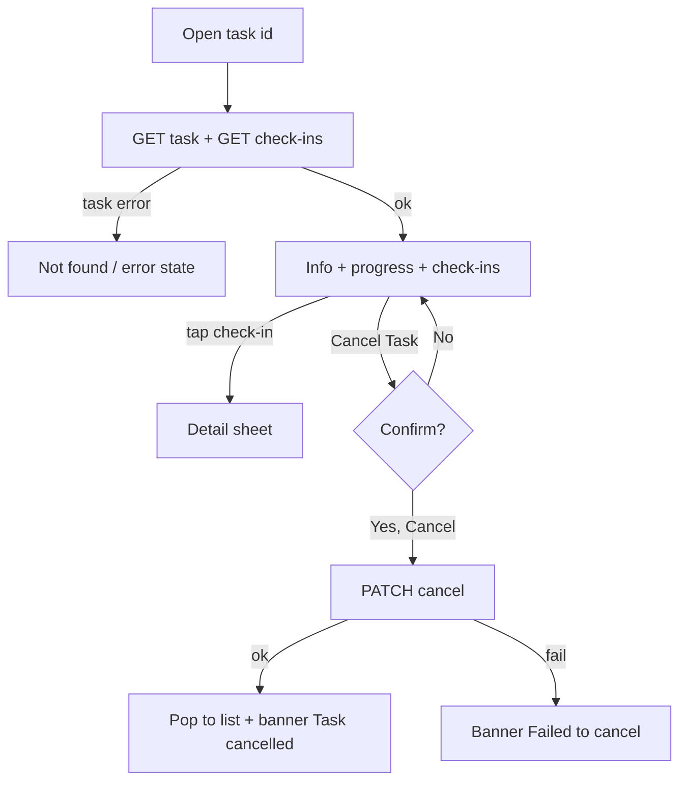

# Task details (check-ins, progress, cancel)

| | |
|---|---|
| Area | Chat, notifications, tasks |
| Who sees it | Doctor only, PREMIUM (reached by push even when the tab is hidden, see §6) |
| Reached from | Tasks list card; TASK_COMPLETED push / inbox card or "View Result" |
| Screen type | Full screen (pushed inside the shell) + check-in detail bottom sheet |
| Current Flutter source | `lib/features/tasks/presentation/task_details_screen.dart`, `lib/state/tasks/tasks_provider.dart` (`taskByIdProvider`, `taskCheckInsProvider`), `lib/state/tasks/task_actions.dart` (`cancelTaskWithClient`), `lib/core/widgets/scrollable_sheet_dialog.dart` |
| Spec | `docs/kmp-spec/07-chat-notifications-tasks.md` §3.2, ticket TASK-03 |

## 1. Purpose
Review how a patient is doing on one remote-care task: what was asked, what they submitted (values, notes), what they missed, and stop the task if needed. Opened on every "Task completed" notification and when a patient calls about it.

## 2. Entry points
- **Tasks list** → card tap, with the task id. Pushed on top of the list.
- **TASK_COMPLETED push** (foreground tap / background / cold start) and the inbox card or "View Result": the shell resets, the Tasks tab is selected and this screen is pushed. The list underneath may still be empty/loading.
- There is no edit screen; the only mutation is **Cancel**.

## 3. Layout, top to bottom (phone portrait)
1. **App bar** (brand): back arrow, title "Task Details".
2. **Info card**:
   - Task name 24 px bold (wraps) + **status pill** (Active green / Completed blue / Expired orange / Cancelled red / Draft grey, 20 % tint).
   - Label/value rows (label column 100 px, grey): Patient; Category; Input Type ("Numeric" / "Text" / "Yes/No"); Input Label (if set); Description (if set); Start Date `yyyy-MM-dd`; End Date (if set); Duration "{n} days" (if set).
   - **Progress** block (if the server sent progress): "Progress" heading, brand linear bar + "12/90"; under it three stats centred: Completed (green), Pending (orange), Missed (red) with counts.
3. **Check-ins** heading 18 px, then a non-scrolling list of **check-in cards** (8 px gap): date `yyyy-MM-dd` bold, scheduled time `HH:mm` grey, status pill (Completed green / Pending orange / Missed red); completed ones add "{Input label}: {value}" and "Notes: …". Tap → detail sheet.
4. **Cancel Task** button (destructive secondary, full width) — only while status is Active.
5. **Check-in detail sheet** (bottom sheet, scrollable, 24 px padding): title "Check-in Details"; rows Scheduled, Status; completed → Submitted at (converted to the **patient's timezone**), {Input label or "Value"}: value, Notes (if any); missed → "No submission received"; pending → "Awaiting submission"; primary "Close" full width.
6. Whole page scrolls; app bar fixed. No FAB. Content refreshes every 15 s while open.

## 4. Data and formats
| Field | Source | Format rule |
|---|---|---|
| Status | `status` | Pill + colour as list. |
| Input type | `inputType` (NUMERIC, TEXT, BOOLEAN; unknown → Text) | "Numeric" / "Text" / "Yes/No". |
| Dates | `startDate`, `endDate` (date-only) | ISO today; target locale "1 Mar 2026". |
| Check-in scheduled | `scheduledDate` + `scheduledTime` (HH:mm, patient-local wall time) | "2026-03-12 08:00"; target "12 Mar · 08:00". |
| Effective check-in status | server `status`; a **pending** check-in whose scheduled moment is in the past is shown as **Missed** | Today computed with the phone clock; **target: patient's timezone** (`patientTimeZone`). |
| Submitted at | `completedAt` (UTC) | Converted to `patientTimeZone`, "yyyy-MM-dd HH:mm" (target locale format + "(patient time)" suffix, NEW). |
| Value | `numericValue` → number as is (e.g. "120.0" today; target trim trailing ".0"), `textValue`, `booleanValue` → "Yes"/"No", none → "—" | |
| Progress | `progress.*CheckIns` | Counts; bar = completed/total. |

## 5. Primary flow (happy path)
1. Tap "Task completed" notification → skeleton (title line, 6 rows, 3 check-in placeholders) → content.
2. The newest completed check-in is near the end of the list (server order, UNVERIFIED) — target: newest first, or auto-scroll to the check-in referenced by the notification (open question).
3. Tap a check-in → sheet with value and notes → Close.
4. Optional: Cancel Task → confirm dialog → task cancelled → back to the list with a confirmation banner.

## 6. Screen states
- **First load**: skeleton (target). Today: centred spinner for the task; a second spinner inside the check-ins section.
- **Empty**: no check-ins → "No check-ins found" centred in the section (e.g. a task starting tomorrow). Target copy "No check-ins scheduled yet".
- **Error on load**: today any error (network included) shows "Task not found" because failures are swallowed into "null". Target: distinguish 404 "Task not found" (with Back) from "Couldn't load task" + Retry. Check-ins error → "Error: …" text today; target inline Retry.
- **Offline**: cached task shown; Cancel disabled; banner.
- **Refreshing**: 15 s silent poll today; target: refresh on resume + on TASK_COMPLETED push for this task, optional 15 s while visible. No jump.
- **Partial data**: task ok, check-ins failed → info card + inline error; progress missing → progress block hidden.
- **Permission needed**: n/a.
- **Locked by tier**: a BASIC/PRO doctor can still arrive here from a push; the server may 403 → today "Task not found". Target: show the tier gate card (file 16) instead.
- **Role difference**: clinic staff never reach it (task deep links are dropped for staff).

## 7. Interactions and secondary flows
- **Tap check-in card** → detail sheet; scrim/drag/Close dismisses.
- **Cancel Task** → dialog title "Cancel Task", body "Are you sure you want to cancel this task?", buttons "No" (text) and "Yes, Cancel" (red primary, right). Yes → request → list reloaded → screen pops → banner "Task cancelled successfully". Failure → banner "Failed to cancel".
- **Back / system back** → list (reloads).
- **Tap patient name** → nothing today; target: opens the patient profile (NEW).
- **Pull-to-refresh** → not implemented; target: add.

## 8. Edge cases
- 0 check-ins / 1 / 100+ (a 3×/day task over 90 days = 270 cards) → today all cards are built in one column; target: virtualised list, grouped by day, collapsed past days (open question).
- Task overdue across timezones: a check-in scheduled 22:00 patient time shows "Missed" at 22:01 on the doctor's phone clock today, even if the patient (in another zone) still has hours left. Target rule: compute with `patientTimeZone`; if it is missing, fall back to the practice timezone and mark the status as approximate.
- Patient without the app / never checked in → all check-ins Pending then Missed; progress 0/N. Target: a hint line under progress "The patient hasn't submitted anything yet" when completed = 0 and at least one slot has passed (NEW).
- Task cancelled on another device meanwhile → the 15 s poll flips the status; the Cancel button disappears; if the user confirms cancel at the same moment → server 409/4xx → "Failed to cancel".
- Task not found (deleted) → "Task not found" + Back.
- Double-tap "Yes, Cancel" → one request (dialog closes on first tap).
- Leaving during the cancel request → the request completes; the list reloads; no banner (acceptable).
- 401 mid-cancel → logout.
- Numeric value with decimals (36.6) → shown as "36.6"; integer 120 → "120.0" today (format fix).
- Boolean task with "No" answers → "Yes/No: No".
- Very long notes (1 000 chars) → the sheet scrolls.
- Phone timezone ≠ practice ≠ patient → scheduled times are patient wall-clock (no conversion needed); submitted-at is converted to patient time; nothing uses the phone zone (target).
- Font scale 200 % → label column (100 px) too narrow; target: stack label over value.
- Rotation → no change; the sheet persists.
- Screen reader: check-in card "12 March, 08:00, Completed, Blood pressure 120 over 80, notes …".
- Deep link to another task while open → replaces this screen.

## 9. Validation and messages
| Field/action | Rule | When checked | Message (English) | Where shown |
|---|---|---|---|---|
| Load task | 200 | On open | "Task not found" (404) / "Couldn't load task" + Retry (NEW) | Inline |
| Load check-ins | 200 | On open | "Error" + Retry | Inline under heading |
| Cancel | Confirm | On tap | "Cancel Task" / "Are you sure you want to cancel this task?" / "No" / "Yes, Cancel" | Dialog |
| Cancel result | 2xx | After request | "Task cancelled successfully" / "Failed to cancel" | Top banner (today SnackBar) |

## 10. Navigation out
- Back → Tasks list (reloads). After a successful cancel the screen pops automatically.
- Patient name → patient profile (target).
- Nothing to save.

## 11. Copy
- `taskDetails` "Task Details", `patient` "Patient", `category` "Category", `inputType` "Input Type", `inputLabel` "Input Label", `description` "Description", `startDate` "Start Date", `endDate` "End Date", `duration` "Duration", `days` "days", `progress` "Progress", `checkInCompleted` "Completed", `pending` "Pending", `missed` "Missed", `checkIns` "Check-ins", `noCheckInsFound` "No check-ins found", `numeric` "Numeric", `text` "Text", `boolean` "Yes/No", `value` "Value", `notes` "Notes", `yes` "Yes", `no` "No", `cancelTask` "Cancel Task", `cancelTaskConfirm` "Are you sure you want to cancel this task?", `yesCancel` "Yes, Cancel", `taskCancelled` "Task cancelled successfully", `failedToCancel` "Failed to cancel", `taskNotFound` "Task not found", `checkInDetails` "Check-in Details", `scheduled` "Scheduled", `status` "Status", `submittedAt` "Submitted at", `noSubmissionReceived` "No submission received", `awaitingSubmission` "Awaiting submission", `close` "Close", `error` "Error".
- **NEW**: "Couldn't load task", "No check-ins scheduled yet", "The patient hasn't submitted anything yet", "(patient time)".

## 12. Known problems in the current app (do not carry over)
- "Missed" is computed with the phone clock, not the patient's timezone (spec §8 #4).
- Any load error becomes "Task not found" (spec §8 #16).
- 15 s polling while open regardless of activity (spec §8 #3).
- All check-ins rendered eagerly; no grouping; ISO dates.
- Two spinners (task + check-ins) instead of one skeleton.
- Numeric values printed as Dart doubles ("120.0").
- Patient name is plain text, not a link to the record.
- Cancel success feedback is a SnackBar; the spec requires a banner.

## 13. Open questions for design
- Group check-ins by day with a compact 3-dot (one per slot) timeline instead of one card per slot?
- Show a small chart for numeric tasks (e.g. blood pressure trend) — likely the most valuable addition; needs no backend change.
- Should "Completed" tasks still offer any action (duplicate as a new task)?
- Newest check-ins first or chronological?
