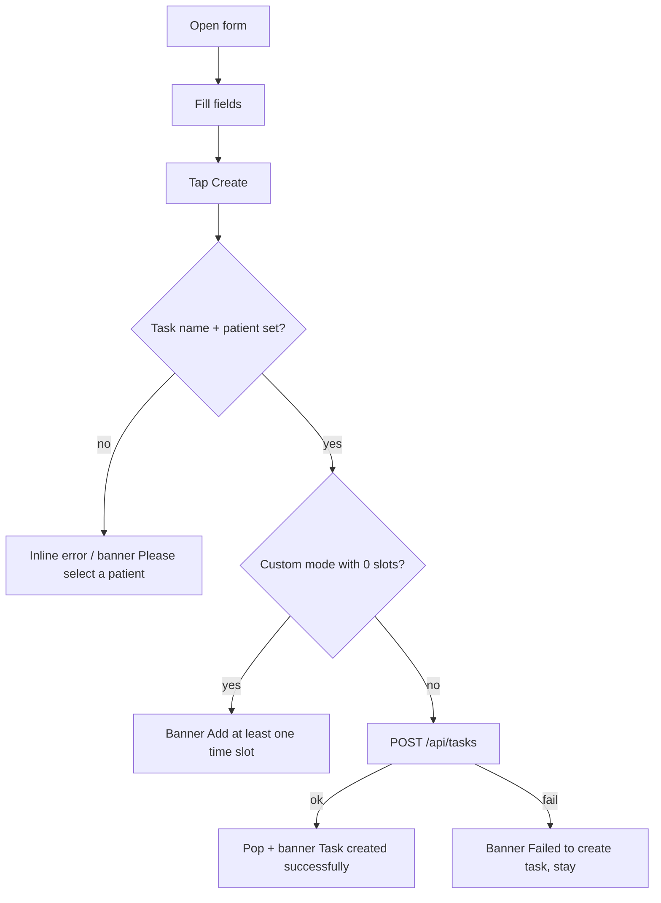

# Create / assign a remote-care task

| | |
|---|---|
| Area | Chat, notifications, tasks |
| Who sees it | Doctor only, PREMIUM |
| Reached from | Tasks list "Create Task" / empty-state button; Templates list (pre-filled); Patient profile overflow → task (patient pre-selected) |
| Screen type | Full screen form (pushed inside the shell) + patient search dialog |
| Current Flutter source | `lib/features/tasks/presentation/create_task_screen.dart` (`_SearchablePatientDropdown`, `_PatientSearchDialog`, `_SlotPreview`, `_CustomTimesEditor`), `lib/state/tasks/task_actions.dart` (`createTaskWithClient`), `lib/app/router.dart` (`createTask` args) |
| Spec | `docs/kmp-spec/07-chat-notifications-tasks.md` §3.3, ticket TASK-04 |

## 1. Purpose
Define what the patient must do, how often, for how long, and what they must report. Done once per programme (weekly at most); the schedule part is the hard bit and must prevent impossible timetables.

## 2. Entry points
- **Tasks list → "Create Task"** (nothing pre-filled).
- **Templates list → tap template** (all fields pre-filled from the template; patient empty).
- **Patient profile → overflow menu → task** (patient pre-selected and shown; still changeable).
- Always pushed; back returns to the caller, which reloads the list.

## 3. Layout, top to bottom (phone portrait)
1. **App bar** (brand): back, title "Create Remote Care Task".
2. **Patient *** — read-only field that opens a **search dialog** (hint "Tap to search and select patient"); shows "Name (ID: 123)" once chosen. Dialog: search field "Search by name or ID" (autofocus), list of patients (name, "ID: 123"), selected row highlighted with a check, "No patients found" when empty. Only patients already in the doctor's list are offered.
3. **Task Name *** (text).
4. **Description** (3 lines, hint "Task description shown to patient").
5. **Category *** dropdown: Vital (default), Exercise, Medication, Other.
6. **Input Type *** dropdown: Numeric (default), Text, Yes/No.
7. **Input Label** (hint "e.g., Blood Pressure, Weight (kg)").
8. **Schedule** heading + segmented control: **Even spacing** | **Custom times**.
   - *Even spacing*: "Times per day:" dropdown 1–15 (default 1); "Start Time" row (default 08:00, time picker); when ≥ 2 per day: "Interval between tasks:" dropdown (Every 1 hour, 2, 3, 4, 6, 8, 12, 24 hours; default 1) and a **slot preview** box "Daily slots: 08:00 · 12:00 · 16:00" (brand tint) which turns orange with "{n} slot(s) won't fit before midnight. Pick a smaller interval or earlier start time." when slots overflow the day.
   - *Custom times*: bordered editor "Daily slot times" with hint "Define each slot explicitly to support non-uniform schedules."; numbered rows each with the time (tap to edit), edit icon, delete icon (disabled when only one row); footer "{n} slot(s) per day" and "+ Add time slot".
9. **Start Date *** row (default today; picker today … +365 days).
10. **Checkbox "Use end date (otherwise use duration)"** (default on) → **End Date** row ("Not set" until picked; picker from start date, default start + 30 days); when off → **Duration (days)** numeric field.
11. **Notes Required** checkbox.
12. **Notes Label** (hint "e.g., Additional notes"; keyboard Done submits).
13. **"Create Remote Care Task"** primary button, full width, spinner while saving. No sticky footer today (button scrolls with the form). Target: sticky bottom action bar.

## 4. Data and formats
| Field | Rule / wire format |
|---|---|
| Patient | required; `patientId` int. |
| Task name | required, trimmed. |
| Category / Input type | upper-case codes. |
| Times per day | even mode: 1–15; custom mode: number of slots (clamped 1–15). |
| Start time | `HH:mm` 24 h; custom mode sends the first slot. |
| Interval | sent only in even mode with ≥ 2 per day; hours from the option list. |
| Custom times | sorted, de-duplicated `["08:00","10:00",…]`; only in custom mode. |
| Start date | `yyyy-MM-dd`, today … +365 d (phone calendar day; target practice day). |
| End date / duration | one of the two; end ≥ start; duration integer days (unvalidated today; target ≥ 1). |
| Notes required / label | boolean + optional text. |
| Slot preview | slots = start + k·interval while < 24:00. |
| Template prefill | all fields; times/day clamped 1–15; interval snapped up to the nearest option; custom times present → custom mode. |

## 5. Primary flow (happy path)
1. Open → form with defaults (or template/patient prefilled).
2. Pick patient → fill name → choose category/input → set schedule (preview confirms the slots) → dates → Create.
3. Button shows a spinner → success → screen pops → banner "Task created successfully" → list shows the task.

## 6. Screen states
- **First load**: instant (no fetch) except the patient list, which comes from the Patients cache; if empty the dialog shows "No patients found" — target: skeleton rows in the dialog while loading.
- **Empty**: no patients at all → dialog empty state with "Add a patient first" link to Patients (NEW).
- **Error on load**: n/a (patients failing to load → empty dialog; target banner).
- **Offline**: form editable; Create disabled with banner.
- **Refreshing**: n/a.
- **Partial data**: template with an interval not in the option list → snapped up (e.g. 5 h → 6 h) silently; target: show a one-line note "Interval adjusted to 6 h" (NEW).
- **Permission needed**: n/a.
- **Locked by tier**: not reachable when locked; a 403 on save → "Failed to create task" today; target tier gate banner.
- **Role difference**: doctor only.

## 7. Interactions and secondary flows
- **Patient field tap** → dialog; **row tap** → selects and closes; **scrim** → closes without change.
- **Segmented control** → switches mode; switching to Custom seeds one slot from the current start time if the list is empty; the other mode's values are kept in memory.
- **Times per day / interval change** → preview recomputes live.
- **Start Time / End Date / Start Date rows** → native pickers (date pickers follow the app locale).
- **+ Add time slot** → time picker (initial = last slot) → added if not a duplicate, list re-sorted. **Row tap / edit icon** → picker → replaced, re-sorted. **Delete** → removed (never below one).
- **"Use end date" toggle** → swaps End Date row ↔ Duration field; values of the hidden one are dropped on save.
- **Keyboard Done on Notes Label** → submits.
- **Create** → validates (§9) → saves; the button is disabled while saving.
- **Back / system back with edits** → today leaves silently and loses input. Target: "Discard this task?" dialog when any field changed (NEW).

## 8. Edge cases
- Double-tap Create → guarded by the saving flag (ok).
- Even mode: 15 × every 2 h from 08:00 → only 8 fit → orange warning; the server receives timesPerDay 15 and generates 8 (UNVERIFIED) — target: block save while the preview is clipped (open question) or send the fitted count.
- Custom mode: 15 slots max; the 16th "Add" is still allowed today (clamped to 15 on the wire) — target: disable Add at 15 with a hint.
- Duplicate custom time → silently ignored; target: brief banner "That time is already in the list".
- Start date today with start time already past → the first check-in is immediately "pending → missed"; target: hint "First check-in will be tomorrow" or let the backend skip (UNVERIFIED).
- Duration "0" or "-3" or "abc" → sent as 0 / −3 / null today; target: require integer ≥ 1 when the end-date toggle is off.
- End date before start → impossible via picker (min = start). Changing start after end was set → end can end up before start (no re-validation) — target: clear end date with a hint.
- Patient without the app → task is created anyway; nothing warns. Target: if the backend exposes `hasApp`/`lastSeen`, show "This patient hasn't installed the Shifa app yet" under the patient field (NEW, UNVERIFIED).
- Very long task name (200 chars) → accepted; target max 100 with counter.
- Template with `customTimes` → custom mode preselected; template without → even mode.
- Patient pre-selected from the profile but not in the cached patient list (new patient) → the field shows empty today (lookup by id fails). Target: show the name passed by the caller.
- Date picker range: today … +365 in the **phone** calendar; a doctor whose practice day has already rolled over sees yesterday's date as "today" edge (practice TZ rule).
- 401 on save → logout; input lost (acceptable).
- Language switch → labels switch; the date picker locale follows.
- Font scale 200 % → segmented control labels wrap; use icon-only segments with text below (design variant).
- Rotation → form persists (state in memory).
- Screen reader: required fields announced with "required"; the preview announces "Daily slots: 08:00, 12:00, 16:00".
- Leaving mid-save → the request completes; the list reloads on return.

## 9. Validation and messages
| Field/action | Rule | When checked | Message (English) | Where shown |
|---|---|---|---|---|
| Patient | selected | On submit | "Please select a patient" | Inline under field + banner (today both) |
| Task Name | non-empty | On submit | "Task name is required" | Inline under field |
| Custom times | ≥ 1 slot | On submit | "Add at least one time slot" | Top banner |
| Slot overflow | slots fit before midnight | Live | "{n} slot(s) won't fit before midnight. Pick a smaller interval or earlier start time." | Preview box (orange) |
| Duration (days) | integer ≥ 1 (NEW) | On blur/submit | "Enter a number of days (at least 1)" (NEW) | Inline |
| End date | ≥ start date | Picker min; re-check on start change (NEW) | "End date must be after the start date" (NEW) | Inline |
| Save | 2xx | After request | "Task created successfully" / "Failed to create task" | Top banner (today SnackBar) |
| Discard | any change + back | On back | "Discard this task?" (NEW) | Dialog |

## 10. Navigation out
- Success → pops to the caller (list, templates → which pops itself to the list, or patient profile); the list reloads.
- Back → caller; target asks to discard when dirty.
- Patient dialog is modal; nothing else navigates.

## 11. Copy
- `createRemoteCareTask` "Create Remote Care Task", `patient` "Patient", `tapToSearch` "Tap to search and select patient", `searchByNameOrId` "Search by name or ID", `noPatientsFound` "No patients found", `id` "ID", `taskName` "Task Name", `pleaseEnterTaskName` "Task name is required", `description` "Description", `taskDescription` "Task description shown to patient", `category` "Category", `vital` "Vital", `exercise` "Exercise", `medication` "Medication", `taskOther` "Other", `inputType` "Input Type", `numeric` "Numeric", `text` "Text", `boolean` "Yes/No", `inputLabel` "Input Label", `enterInputLabel` "e.g., Blood Pressure, Weight (kg)", `scheduleMode` "Schedule", `scheduleModeEvenSpacing` "Even spacing", `scheduleModeCustomTimes` "Custom times", `timesPerDay` "Times per day", `startTime` "Start Time", `intervalBetweenTasks` "Interval between tasks", `every1Hour` "Every 1 hour", `everyNHours` "Every %d hours", `slotsPreviewLabel` "Daily slots", `slotsPreviewClipped` "%d slot(s) won't fit before midnight. Pick a smaller interval or earlier start time.", `customTimesLabel` "Daily slot times", `customTimesHint` "Define each slot explicitly to support non-uniform schedules.", `customTimesEmpty` "No slots yet — add one below.", `customTimesCount` "%d slot(s) per day", `customTimesAddSlot` "Add time slot", `customTimesAddAtLeastOne` "Add at least one time slot", `edit` "Edit", `remove` "Remove", `startDate` "Start Date", `useEndDate` "Use end date (otherwise use duration)", `endDate` "End Date", `notSet` "Not set", `durationDays` "Duration (days)", `notesRequired` "Notes Required", `notesLabel` "Notes Label", `enterNotesLabel` "e.g., Additional notes", `pleaseSelectPatient` "Please select a patient", `taskCreated` "Task created successfully", `failedToCreateTask` "Failed to create task".
- **NEW**: "Discard this task?", "Enter a number of days (at least 1)", "End date must be after the start date", "That time is already in the list", "Interval adjusted to {n} h", "This patient hasn't installed the Shifa app yet", "Add a patient first".

## 12. Known problems in the current app (do not carry over)
- Duration (days) is not validated (spec §8 #15); end date is not re-checked after the start date changes.
- Back discards a half-filled form silently.
- Patient field creates a text controller on every rebuild (engineering) and cannot display a patient missing from the cached list.
- Interval snapping from templates is silent.
- Clipped slot schedules can still be saved.
- The Create button scrolls away with the form; no sticky action bar.
- Form is one long page with 13 regions; no grouping into steps.

## 13. Open questions for design
- Split into a 3-step flow (What → When → Report) with a summary step? Recommended on phones.
- Replace "Times per day + interval" with a visual day strip where slots are placed directly (and custom mode becomes the only mode)?
- Should "Input Label" be mandatory for numeric tasks (it is the unit shown to the patient)?
- Offer "Save as template" on success (there is no create-template endpoint; see file 14)?
