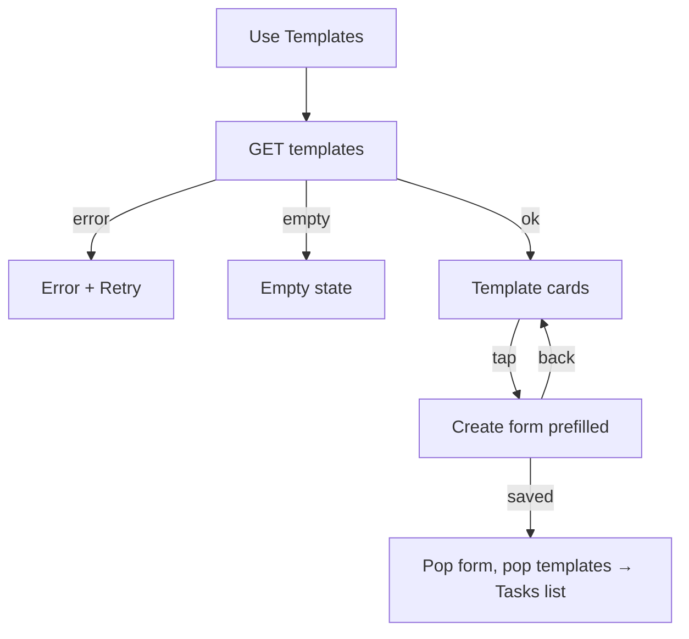

# Task templates (pick a template)

| | |
|---|---|
| Area | Chat, notifications, tasks |
| Who sees it | Doctor only, PREMIUM |
| Reached from | Tasks list → "Use Templates" |
| Screen type | Full screen list (pushed inside the shell) |
| Current Flutter source | `lib/features/tasks/presentation/select_template_screen.dart`, `lib/state/tasks/task_actions.dart` (`fetchTemplatesWithClient`), `lib/features/tasks/domain/task_models.dart` (`TaskTemplate`) |
| Spec | `docs/kmp-spec/07-chat-notifications-tasks.md` §3.4, §3.5, ticket TASK-05 |

## 1. Purpose
Start a new task from a ready-made configuration (name, category, schedule, input type) instead of typing everything again. Used when the same programme is assigned to many patients.

**Important scoping fact:** the app only *reads* templates (`GET /api/tasks/templates`). There is **no create, edit or delete template screen** and no endpoint for it in the client. The empty-state copy ("No templates yet. Create a task first, then it will appear here.") implies the backend derives templates from previously created tasks — UNVERIFIED. "Task templates list + create/edit" from the brief therefore reduces to this picker; create/edit is listed under "Not designed" in the README until the backend confirms an API.

## 2. Entry points
- **Tasks list → "Use Templates"** (secondary button in the header). Pushed on top of the list.
- Nothing else opens it (not reachable from the create form or the patient profile today).

## 3. Layout, top to bottom (phone portrait)
1. **App bar** (brand): back arrow, title "Use Templates" (same key as the button).
2. **List** (16 px padding, pull-to-refresh) of **template cards** (12 px gap): title = template name (semibold); subtitle = "Category: Vital · Times per day: 3" (12 px grey); trailing chevron. Tap → Create task form pre-filled (file 13).
3. **Target additions**: category icon tile at the left; a second subtitle line with the schedule ("08:00 · 14:00 · 20:00" or "Every 8 h from 08:00") and the input type; a search field when there are more than ~8 templates (NEW).
4. No FAB, no create action (see §1).

## 4. Data and formats
| Field | Source | Format rule |
|---|---|---|
| Name | `taskName` | One line, ellipsis (target 2 lines). |
| Category | `category` | Localised label; unknown → "Other". |
| Times per day | `timesPerDay` | Integer. |
| Schedule (target) | `customTimes` if present, else `startTime` + `intervalHours` | "08:00 · 14:00 · 20:00" / "Every 8 h from 08:00" / "08:00". |
| Input type (target) | `inputType` | "Numeric" / "Text" / "Yes/No". |
| Legacy fields | `morningTime`, `afternoonTime`, `eveningTime` | Parsed but never shown or sent — ignore in design. |

### Template field → create-form prefill
| Template field | Prefills | Adjustment |
|---|---|---|
| taskName, description, inputLabel, notesLabel | the text fields | verbatim |
| category, inputType | the two dropdowns | unknown codes → Other / Text |
| timesPerDay | "Times per day" | clamped to 1–15 |
| startTime | "Start Time" | missing → 08:00 |
| intervalHours | "Interval between tasks" | clamped 1–24, then snapped **up** to the nearest option (1, 2, 3, 4, 6, 8, 12, 24) |
| customTimes (non-empty) | switches the form to **Custom times** and fills the slot list | sorted; empty → stays in Even spacing |
| notesRequired | checkbox | verbatim |
| patient, dates, duration | **not** part of a template | always entered by the doctor |

## 5. Primary flow (happy path)
1. Tasks → Use Templates → skeleton (5 rows) → list.
2. Tap "Blood pressure, twice daily" → Create form opens pre-filled; the doctor picks the patient and saves.
3. On success the Create form pops **and this screen pops itself**, landing on the Tasks list with the new task and the success banner.

## 6. Screen states
- **First load**: skeleton rows (target). Today: centred spinner.
- **Empty**: centred grey text "No templates yet. Create a task first, then it will appear here." Target: icon + title "No templates yet" + body + button "Create a task" (NEW copy split).
- **Error on load**: today the raw error text centred + "Retry" text button. Target: banner "Couldn't load templates" + Retry.
- **Offline**: cached list if any; otherwise error state with the offline banner.
- **Refreshing**: pull-to-refresh; list rebuilt; no jump.
- **Partial data**: a template missing optional fields still renders (name/category/times are required; a malformed one crashes the parser today — target skip it).
- **Permission needed**: n/a.
- **Locked by tier**: unreachable when locked; 403 → error state today; target tier gate.
- **Role difference**: doctor only.

## 7. Interactions and secondary flows
- **Tap card** → Create form with template; **back from the form** → this list stays; **success in the form** → this list pops too.
- **Pull-to-refresh** → reload.
- **Back / system back** → Tasks list.
- **Long-press** → nothing (no edit/delete).

## 8. Edge cases
- 0 templates → empty state; 1 → single card; 100+ → one response, no paging; target search field.
- Template with 15 custom slots → subtitle too long → truncate with "+12 more" (target rule).
- Template interval not in the form's option list (e.g. 5 h) → form snaps up to 6 h silently (file 13 §6).
- Template whose category/input type is unknown → "Other" / "Text".
- Duplicate template names → shown twice; nothing distinguishes them (backend concern).
- Tap two cards quickly → two forms pushed today; target guard.
- Returning from the form after the user **cancels** → stays here (correct); after **success** → pops automatically; if the pop happens while the screen is not mounted (rare) nothing breaks.
- Language switch while open → labels switch; template names are user content and stay.
- 401 → logout.
- Font scale 200 % → subtitle wraps to 2 lines; chevron stays vertically centred.
- Rotation / tablet → max width 720, centred.
- Screen reader: "Blood pressure, Category Vital, 3 times per day, button".
- Deep link while open → this screen is popped by the root reset.

## 9. Validation and messages
| Field/action | Rule | When checked | Message (English) | Where shown |
|---|---|---|---|---|
| Load | 2xx | On open/refresh | "Couldn't load templates" (NEW) + "Retry" | Top banner / inline |
| Empty | list empty | After load | "No templates yet. Create a task first, then it will appear here." | Centred empty state |

## 10. Navigation out
- Card → Create form (push). Success there pops both screens to the Tasks list; cancel returns here.
- Back → Tasks list. Nothing to save.

## 11. Copy
- `useTemplate` "Use Templates" (title and button), `category` "Category", `timesPerDay` "Times per day", `vital` "Vital", `exercise` "Exercise", `medication` "Medication", `taskOther` "Other", `retry` "Retry", `noTemplatesYet` — **missing from en.json** (falls back to the English literal "No templates yet. Create a task first, then it will appear here."), `taskTemplates` "Task Templates" (exists, unused — could be the title).
- **NEW**: "Couldn't load templates", "No templates yet" (title), "Create a task".

## 12. Known problems in the current app (do not carry over)
- Screen fetches with its own ad-hoc state instead of the shared task store (spec TASK-05 fix) — engineering, but it means the list is never cached and reloads on every open.
- Raw error text shown to the user.
- Subtitle shows only category and count; the schedule — the thing a template is for — is invisible until the form opens.
- `noTemplatesYet` has no translation entry; Uzbek/Russian users see the English literal.
- Title reuses the button label "Use Templates" instead of "Task Templates".
- Three legacy time fields are parsed and ignored (spec §8 #11).

## 13. Open questions for design
- Should templates be offered *inside* the Create form (a "Start from template" chip row at the top) and this screen dropped?
- If the backend adds template CRUD: a "Save as template" toggle on task creation and swipe-to-delete here. Confirm with backend before designing.
- Show how many times a template was used / last used (needs backend)?
