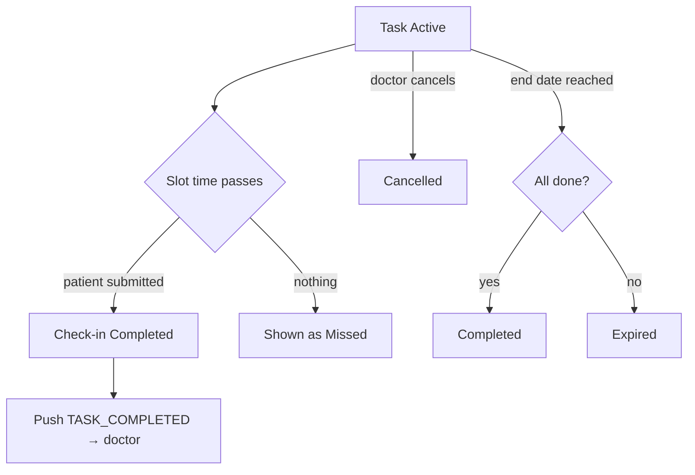

# Task completion: check-in detail sheet, status lifecycle and what the patient sees

| | |
|---|---|
| Area | Chat, notifications, tasks |
| Who sees it | Doctor only, PREMIUM |
| Reached from | Task details → tap a check-in (sheet); TASK_COMPLETED notification (push / inbox) |
| Screen type | Bottom sheet + lifecycle rules (no separate screen) |
| Current Flutter source | `lib/features/tasks/presentation/task_details_screen.dart` (`effectiveCheckInStatus`, `_showCheckInDetailModal`, `_CheckInCard`), `lib/features/tasks/domain/task_models.dart` (`TaskStatus`, `CheckInStatus`, `TaskCheckIn`), `lib/features/notifications/presentation/notification_ui_helpers.dart` (TASK_COMPLETED / TASK_ASSIGNED) |
| Spec | `docs/kmp-spec/07-chat-notifications-tasks.md` §3.2, §3.5, §2.3 (TASK_* rows), tickets TASK-03, NOTIF-01 |

## 1. Purpose
Explain, in one place, how a task moves from created to finished, how each check-in is judged, how the doctor learns that the patient did something, and what the patient side sees — so the designer can make the states consistent across the list, the details, the inbox and the push.

## 2. Entry points
- **Check-in detail sheet**: Task details → tap any check-in card.
- **Completion signal**: the backend sends `TASK_COMPLETED` (push + inbox) — today this fires per check-in submission (UNVERIFIED whether it also fires when the whole task reaches COMPLETED). Tap → Task details.
- **`TASK_ASSIGNED`** is the patient-side event; when it reaches the doctor inbox it has no task id branch and lands on the patient profile.

## 3. Layout, top to bottom (phone portrait)
### Status lifecycle (what each surface shows)
| Task status | Set by | List pill | Details | Doctor action |
|---|---|---|---|---|
| Draft | backend only (the app never saves drafts) | grey "Draft" | no Cancel | none |
| Active | on create | green "Active" | "Cancel Task" visible | cancel |
| Completed | backend when the end date/duration passes with the programme done (UNVERIFIED rule) | blue "Completed" | read-only | none |
| Expired | backend when the period ends (counted as "Overdue" in the list summary) | orange "Expired" | read-only | none |
| Cancelled | doctor "Cancel Task" | red "Cancelled" | read-only | none |

### Check-in lifecycle
| Check-in status | Meaning | Card | Sheet |
|---|---|---|---|
| Pending (future slot) | not yet due | orange "Pending" | "Awaiting submission" |
| Pending (slot passed) | due, nothing submitted — shown as **Missed** client-side | red "Missed" | "No submission received" |
| Missed (server) | backend closed the slot | red "Missed" | "No submission received" |
| Completed | patient submitted | green "Completed" + value + notes | Submitted at (patient time), value, notes |

### Check-in detail sheet
1. Title "Check-in Details".
2. Rows (label 12 px grey over value 16 px): "Scheduled" `yyyy-MM-dd HH:mm`; "Status".
3. Completed: "Submitted at" (patient timezone); "{Input label}" or "Value" → number / text / "Yes" / "No" / "—"; "Notes" (if any).
4. Missed: grey line "No submission received". Pending: "Awaiting submission".
5. Primary "Close" full width. Sheet scrolls when long.

### Patient-side visibility (for consistency, from the patient app `shifa2.0` — UNVERIFIED details)
- The patient sees the task name, description, input label, the day's slots and submits a value (+ notes if required) per slot. Doctor-side "Cancelled" removes it from the patient's list. The doctor app shows nothing about whether the patient has *seen* the task.

## 4. Data and formats
| Field | Source | Format rule |
|---|---|---|
| Scheduled | `scheduledDate` + `scheduledTime` | Patient wall-clock; no conversion. |
| Missed computation | pending + scheduled moment < now | **Target: now in `patientTimeZone`** (fallback practice TZ); today phone clock. A slot with no time counts as due at 23:59. |
| Submitted at | `completedAt` UTC → `patientTimeZone` | "2026-03-12 08:14"; target "12 Mar, 08:14 (patient time)". |
| Value | numeric / text / boolean | Numeric trimmed of ".0"; boolean "Yes"/"No"; none "—". |
| Notes | `notes` | Full text, wraps. |
| Progress stats | `progress.completed / pending / missed / total` | Server numbers (they may use the server's own "missed" rule, which can disagree with the client's by a few minutes). |

## 5. Primary flow (happy path)
1. Patient submits 08:00 blood pressure → backend creates `TASK_COMPLETED` → doctor's phone shows "Task completed — <server message>" (body is server English today).
2. Doctor taps → Task details; the 08:00 check-in is green with "Blood pressure: 128/82" (text input) → tap → sheet with submitted time and notes.
3. Days pass; the progress bar fills; at the end date the task flips to Completed (or Expired if not finished).

## 6. Screen states
- **First load**: sheet opens with data already loaded (no fetch).
- **Empty**: pending/missed sheets have only two rows and a hint line — deliberately short.
- **Error on load**: n/a.
- **Offline**: sheet works from loaded data.
- **Refreshing**: the 15 s poll can change a card's status under the open sheet; the sheet keeps the snapshot (acceptable).
- **Partial data**: `completedAt` missing → "Submitted at" row hidden; no value fields → "—".
- **Permission needed**: n/a.
- **Locked by tier**: see file 16.
- **Role difference**: doctor only.

## 7. Interactions and secondary flows
- **Tap check-in** → sheet; **Close / scrim / drag** → dismiss.
- **Long-press value** → copy (target: selectable text).
- **TASK_COMPLETED tap from the inbox "View Result"** → Task details (not scrolled to the check-in; target: scroll + highlight the referenced check-in if the payload carries a check-in id — it does not today, backend request).
- No doctor-side actions on a check-in (no "mark as reviewed", no reply). Target open question: "Message patient" shortcut from the sheet.

## 8. Edge cases
- Task overdue across timezones: patient in Tashkent (UTC+5), doctor travelling in London; a 22:00 slot is "Missed" from 17:00 London time on the doctor's phone today — wrong until the fix (patient TZ).
- Patient timezone missing → fallback practice TZ and show "(approx.)" next to "Missed" (NEW rule, open question).
- Daylight-saving change in the patient zone → `TimeZone.of(iana)` handles it; wall-clock slots stay at 08:00.
- Patient submits late (after the slot) → server decides whether it is Completed; the client shows whatever status arrives.
- Patient submits twice → one check-in; the latest value (backend).
- Numeric value out of any sane range (e.g. 999 for weight) → shown as is; no validation on the doctor side; target: none (the patient app validates).
- Text value 2 000 characters → sheet scrolls.
- Boolean "No" answers on a "Took medication?" task → "Yes/No: No" today; target "Took medication? No".
- Task assigned to a patient who never opened the app → every slot Missed; the task ends Expired; the doctor gets no TASK_COMPLETED pushes at all. Target: a "No check-ins yet" hint (file 11/12) — the only signal available without backend changes.
- TASK_COMPLETED for a task that was cancelled meanwhile → details show Cancelled; fine.
- TASK_COMPLETED for a deleted task → "Task not found".
- 100+ completed check-ins → list grows; sheet unaffected.
- Font scale 200 % → sheet rows stack already; Close stays full width.
- Rotation → sheet persists.
- Screen reader: sheet title first; rows read "Scheduled, 12 March 08:00".
- Language switch → labels switch; values stay.

## 9. Validation and messages
| Field/action | Rule | When checked | Message (English) | Where shown |
|---|---|---|---|---|
| Missed hint | pending past slot | On render | "No submission received" | Sheet |
| Pending hint | future slot | On render | "Awaiting submission" | Sheet |
| Push body | — | On arrival | "Task completed" title; body = server text (English) today | Tray / inbox |

## 10. Navigation out
- Sheet → Close returns to Task details.
- Push / inbox → Task details (file 12).

## 11. Copy
- `checkInDetails` "Check-in Details", `scheduled` "Scheduled", `status` "Status", `submittedAt` "Submitted at", `value` "Value", `notes` "Notes", `yes` "Yes", `no` "No", `noSubmissionReceived` "No submission received", `awaitingSubmission` "Awaiting submission", `close` "Close", `checkInCompleted` "Completed", `pending` "Pending", `missed` "Missed", `notificationTypeTaskCompleted` "Task completed", `notificationTypeTaskAssigned` "Task assigned", `notificationViewResult` "View Result".
- **NEW**: "(patient time)", "(approx.)", "Patient {name} completed {task}: {value}" (localised push body — needs structured payload from backend).

## 12. Known problems in the current app (do not carry over)
- "Missed" judged by the phone clock (spec §8 #4) — the one place where the patient timezone matters most.
- TASK_COMPLETED push/inbox body is raw server English; no patient name, task name or value in structured fields (spec §8 #13).
- TASK_ASSIGNED in the doctor inbox routes to the patient, not the task.
- Numeric values formatted as "120.0".
- The sheet shows ISO dates/times; no "patient time" hint even though the conversion is to the patient's zone.
- No link from a completed check-in to message the patient.

## 13. Open questions for design
- Should the doctor be able to acknowledge/flag a check-in (e.g. abnormal value) — needs backend.
- Show threshold alerts for numeric tasks (e.g. BP > 140) — needs backend fields for min/max.
- "Message patient" button in the sheet (pre-filled "About your check-in on 12 Mar…")?
- Distinguish "patient never installed the app" if the backend can tell us.
